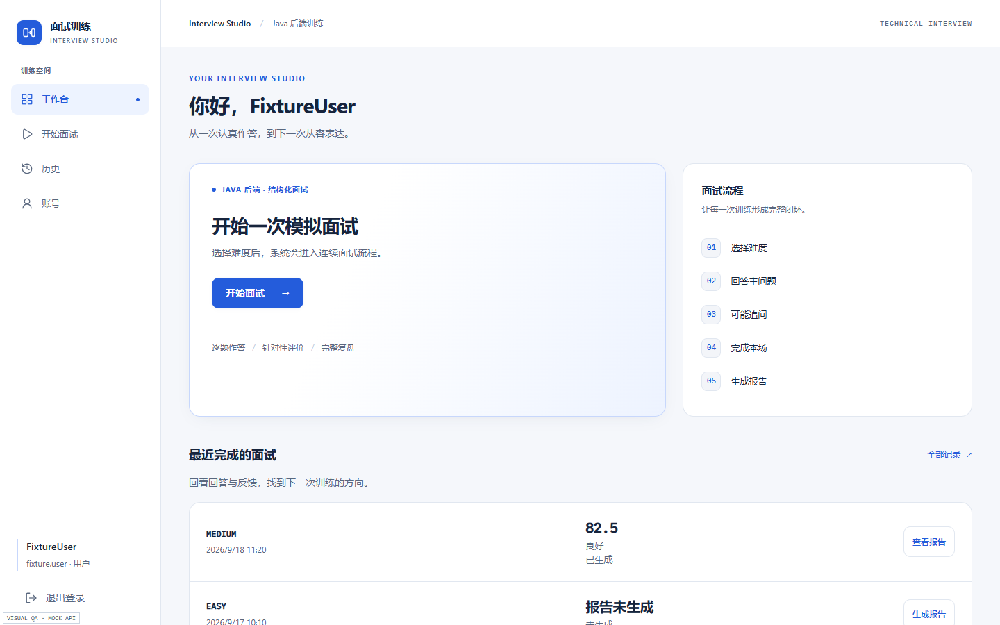
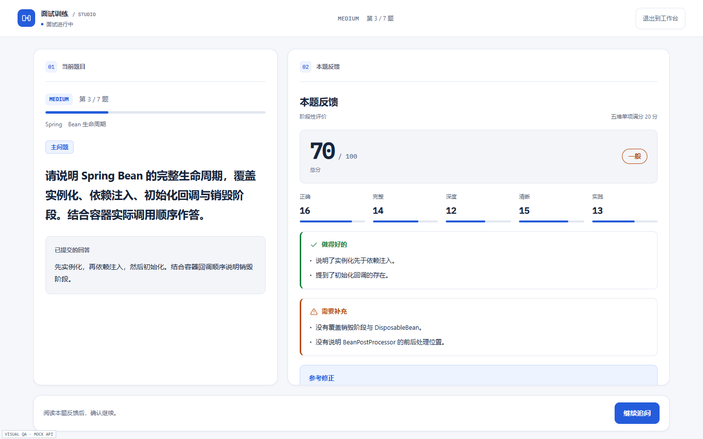
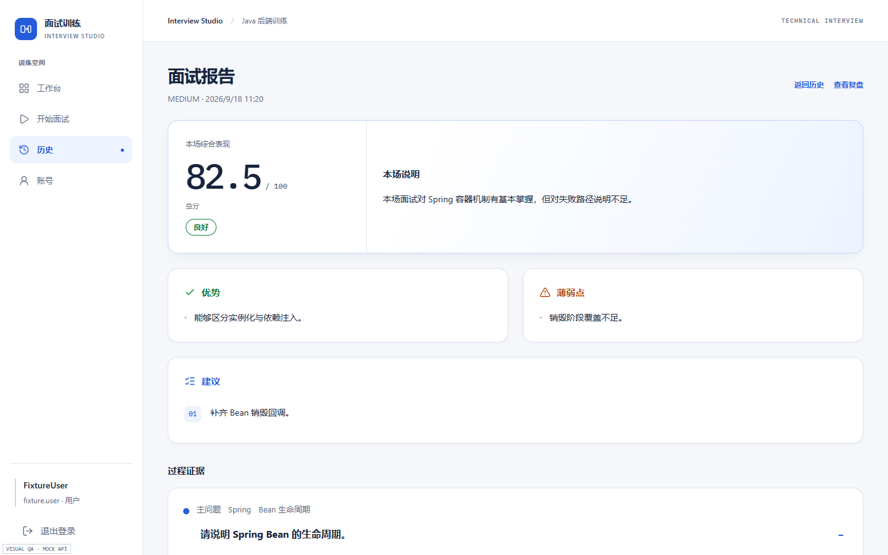
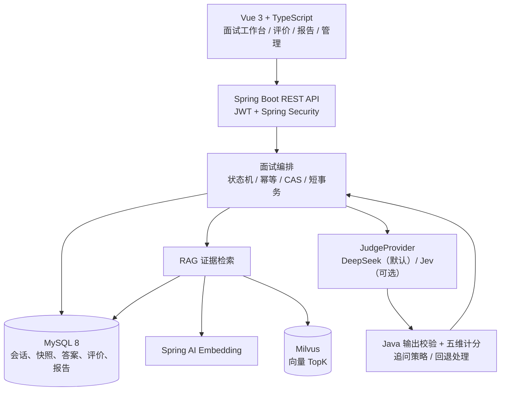

# AI 模拟面试系统 · AI Interview Studio

**面向 Java 后端学习与求职场景的全栈模拟面试项目。** 从题库出题、作答、RAG 知识检索、AI 评分与追问，到报告与薄弱点沉淀，形成可恢复的完整训练流程。

**项目重点不是“接入一个大模型 API”，而是让 LLM 参与真实业务流程时，仍能保证幂等提交、状态一致性、异常隔离和结果可追溯。**

**Java 21 · Spring Boot 3.5 · Spring Security · MyBatis · MySQL 8 · Milvus · Spring AI（Embedding）· Vue 3 · TypeScript**

[查看前端页面](#界面预览) · [了解系统架构](#系统架构) · [查看工程亮点](#核心工程设计) · [本地运行](docs/GETTING_STARTED.md) · [验证记录](#测试与验证)

> **展示边界**：当前公开 Java 后端与 Vue 前端源码，**尚无线上演示地址**。下方 V3 截图使用本地 Mock 数据，分数不代表真实模型质量。业务浏览器验收使用真实 Spring Boot + 隔离 MySQL、模型与向量替身；另有**独立的真实 MySQL/Milvus 并发专项测试**。不将本地测试等同于线上部署或 AI 评分质量验证。

## 界面预览

**工作台：开始或继续当前训练（Mock 数据）**



<table>
  <tr>
    <td width="50%">
      <strong>面试作答与五维反馈（Mock 数据）</strong><br/>
      
    </td>
    <td width="50%">
      <strong>面试报告与改进建议（Mock 数据）</strong><br/>
      
    </td>
  </tr>
</table>

[查看更多桌面及移动端截图](docs/frontend/v3/COMPARISON.html) · [V3 设计规范](docs/frontend/V3_DESIGN_SYSTEM.md)

## 项目能做什么

| 功能 | 实际实现 |
| --- | --- |
| 账号与角色 | 注册、登录、密码修改；JWT + Spring Security；管理员权限、用户状态与资源归属校验 |
| 面试与题目 | EASY / MEDIUM / HARD 分别规划 5 / 7 / 9 道主问题；创建时固化题目与评分点快照 |
| 作答与评分 | 按当前问题顺序作答；五维各 0–20 分，由 Java 校验模型输出并计算总分 |
| 追问与结果 | 每道主问题最多一次追问；区分阶段性评价和最终评价，明确确认后推进 |
| RAG 证据 | 题目与评分点构建检索 Query；Milvus 检索、MySQL 资格过滤，保存进入 Prompt 的检索证据 |
| 报告与复盘 | 历史记录、问答时间线、面试报告与用户薄弱知识点沉淀 |
| 运营管理 | 题库与评分点管理；知识文档上传、切片、Embedding、向量入库及失败补偿 |

## 系统架构



**主问题来自固定题库，而不是临时由 LLM 编造。** RAG 用于回答后的知识证据补充；评分合法性、会话推进和持久化由 Java 后端负责。

## 核心工程设计

以下是更值得从后端工程角度阅读的四个设计点：

**1. requestId 幂等与并发状态控制**

- `request_id` 与 `interview_question_id` 唯一约束防重复写入；同一请求身份只有在问题及答案内容一致时才能重放。
- 用数据库状态 CAS 抢占评价资格，使用 `interview_session.version` 乐观锁保护会话推进；避免重复评价、重复追问和越序推进。
- **Attempt Fencing（任务身份隔离）**：评价与知识文档处理在每次领取、重试或超时接管时更换 `attemptId`；旧任务即使晚于新任务返回，也无法通过锁定读和带身份条件的 SQL 提交成功/失败状态。报告生成使用本次抢占获得的固定 Version。
- RAG 轨迹、评价、答案状态和 Session 推进在一个短事务中提交；外部模型与向量请求不持有长数据库事务。详见[并发超时接管设计](docs/design/timeout-task-fencing.md)。

**2. 题目快照与评分一致性**

- 创建会话时保存题干、参考答案、评分点、顺序等快照；之后管理员修改题库，不会追溯改变已创建会话的评分依据。
- 模型提出分数和追问建议，Java 检查五维分数 `0–20`、评分点归属和回答证据，再计算总分及后续动作。
- 非法模型结果归类为外部服务错误，返回脱敏 HTTP `502`，不将失败评价误写入数据库。

**3. RAG 数据资格过滤与跨存储补偿**

- 根据主问题与评分点生成 Query，**检索 Query 不包含用户答案**；Milvus 返回候选后，再由 MySQL 检查文档状态、版本与 Embedding 配置。
- `rag_retrieval_batch` / `rag_hit_log` 保留检索轨迹，可定位哪些证据真正进入评价。
- 知识入库涉及 MySQL 与 Milvus 两套存储：每批向量 ID 带独立 Attempt 前缀，失败时仅补偿本批明确 ID，避免旧线程删除接管线程的数据；MySQL 在锁内确认任务身份后才提交 Chunk/READY。
- 超时后的旧 Milvus RPC 仍可能迟到写入，孤立向量通过 MySQL 资格过滤排除；项目提供[独立维护窗口使用的手动对账工具](tools/orphan-vectors/README.md)（默认 dry-run），**不是自动定期清理，也不保证跨存储原子事务**。

**4. 外部模型失败后的恢复**

- 使用 `EVALUATING` / `GENERATING` / `PROCESSING` 超时状态回收、幂等重放和持久化结果复用处理失败；**超时接管由后续请求触发，并非后台定时任务**。
- DeepSeek 为默认 Judge；可选 Jev 负责原生判分与建议，再由 DeepSeek 生成反馈，校验失败时按受限预算重试或回退。
- 外部调用可能重试，不承诺恰好执行一次；异常与状态恢复必须以数据库事实为准。

[更完整的实现说明与接口清单](docs/PROJECT_TECHNICAL_DETAILS_20261015.md) · [后端源码学习手册](docs/study/AI模拟面试系统-后端源码与面试学习手册.md)

## 技术选型

| 模块 | 技术 |
| --- | --- |
| 后端 | Java 21、Spring Boot 3.5、Spring MVC、Spring Security、JWT、MyBatis |
| 数据存储 | MySQL 8.0（事务、唯一约束、状态和快照） |
| AI / 检索 | DeepSeek、可选 Jev、Spring AI Embedding、Milvus SDK、RAG 轨迹 |
| 前端 | Vue 3、TypeScript、Vite、Pinia、Vue Router |
| 验证 | JUnit / Spring 测试、Vitest、浏览器自动化、隔离 MySQL 与本地 AI 替身 |

Spring AI **仅用于 Embedding 适配**，向量存储由原生 Milvus SDK 封装实现。本项目不是微服务架构，也未接入消息队列或 Redis 缓存。

## 本地运行

环境：**JDK 21、MySQL 8、Node.js（满足当前前端依赖的版本要求）**。完整 AI 流程还需 Milvus、Embedding API 与 DeepSeek API 凭据。

```powershell
git clone https://github.com/kun520c/ai-interview-system.git
cd ai-interview-system
# 按 docs/GETTING_STARTED.md 初始化数据库并配置后端环境变量
.\mvnw.cmd -B -ntp spring-boot:run

# 新开一个终端
cd frontend
npm ci
npm run dev
```

前端开发地址通常为 `http://localhost:5173`，通过 Vite 将 `/api` 代理到 `http://localhost:8080`。

**重要：** 空数据库不会自动生成题库；仅配置基础后端可以运行登录、题库等 API，**不能直接进行真实 AI 评分**。从初始化数据库、创建管理员与演示题目到启用 AI 的完整步骤见 [本地运行指南](docs/GETTING_STARTED.md)。

## 测试与验证

以下为 **2026-10-19 并发最终集成与本地同步的验收记录**，均为本地隔离环境结果，**不等同于 GitHub CI、线上可用性或真实模型评分质量**。不同运行有重复用例，不能相加作为独立测试总数。

| 验证范围 | 已记录结果 |
| --- | --- |
| 后端 Maven 全量 | **1,790 项**：1,771 通过、0 失败、0 错误、19 跳过 |
| 并发与数据库迁移聚焦回归 | 本地同步阶段 **124 项通过**，0 失败、0 跳过 |
| 真实 MySQL 知识持久化 | 独立启用 **10 项通过** |
| 真实 Milvus 现有 Smoke Tests | 独立启用 **7 项通过** |
| 真实 MySQL + Milvus A/B 任务交错和维护验收 | 独立运行 **10 项通过**；包括超时接管、迟到插入、定向补偿和安全对账 |
| Vue Typecheck / ESLint / Build | 均通过 |
| Vue Vitest | **293 项通过**，0 失败 |
| 完整浏览器 `full` | **49 项检查通过**；真实后端 + 本地 Mock AI（真实 Spring Boot + 隔离 MySQL，模型/向量为本地 Mock/替身） |

默认 Maven 的 19 项跳过为需要显式启用的外部服务 / AI Baseline 测试；真实 MySQL/Milvus 测试是在隔离环境中**另行启用**，并非默认 Maven 全量自动执行。真实交错专项中的部分临时测试源码、日志保存在开发者本地忽略的验收目录；公开仓库包含设计、核心回归及结果报告，不将临时证据描述为云端 CI。

测试使用本地 Fake Embedding / Judge，**收费模型调用为 0**；未验证付费模型的评分准确性、所有真实网络故障或正式环境部署。GitHub Actions 的 [Frontend checks](https://github.com/kun520c/ai-interview-system/actions/workflows/frontend-checks.yml) 仅检查前端，不代表后端 Maven/真实 Milvus 已在云端运行。

[并发最终验收](docs/verification/CONCURRENCY_FINAL_ACCEPTANCE_20261019.md) · [最终集成与迁移说明](docs/verification/CONCURRENCY_FINAL_INTEGRATION_20261019.md) · [V3 原始验收（2026-10-18）](docs/frontend/V3_BLOCKER_FIX_20261018.md) · [隔离浏览器验收工具](tools/browser-e2e/README.md)

## 仓库导航

- [`frontend/` — Vue 前端](frontend/)：工作台、面试、评价、报告、管理员界面
- [`src/main/java/` — Java 后端](src/main/java/com/kun/aiinterview/)：认证、题库、面试编排、评价、RAG 与知识入库
- [`src/test/` — 自动化测试](src/test/)：状态、幂等、检索、异常与真实数据库合同
- [`sql/` — MySQL Schema](sql/ai_interview.sql)
- [`docs/` — 设计和验证文档](docs/README.md)：包含 [Attempt Fencing 设计](docs/design/timeout-task-fencing.md)与[2026-10-19 真实服务验收](docs/verification/CONCURRENCY_FINAL_ACCEPTANCE_20261019.md)
- [`sql/migrations/` — 旧库增量迁移](sql/migrations/20261015_timeout_attempt_fencing.sql)：新增两个任务身份字段，不用于空库初始化
- [`tools/` — 独立测试与历史实验](tools/README.md)：含[孤立向量手动对账工具](tools/orphan-vectors/README.md)

**项目状态：** 学习与作品展示用途，核心源代码与测试公开；当前不提供公开测试账号、在线部署或真实模型质量保证。

