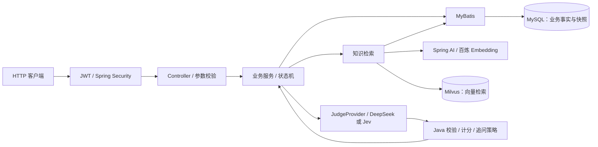

# AI 模拟面试系统

面向 Java 后端实习、校招和初级岗位的模拟面试系统。围绕固定题库完成「创建面试 → 回答 → 知识检索 → 评分与追问 → 面试报告」，重点解决 AI 调用参与业务流程时的数据一致性、重复请求和失败恢复问题。

**当前发布范围：后端 MVP、REST API 与 Vue 前端源码及测试；尚无线上演示。** RAG 检索质量与模型评分质量仍需独立验证，不能由单元测试通过推导出准确率。

## 核心功能

| 模块 | 已实现的行为 |
| --- | --- |
| 账号与权限 | 注册、登录、查看当前用户、修改密码；BCrypt、JWT、Spring Security；管理员接口鉴权与面试归属校验 |
| 题库管理 | 题目及评分点创建、整体替换、分页、详情、启停；启用评分点权重之和必须为 100 |
| 面试会话 | EASY / MEDIUM / HARD 分别规划 5 / 7 / 9 道主问题；创建时固定题目与评分点快照；恢复当前会话 |
| 回答与追问 | 幂等提交；正确性、完整性、深度、表达、实践五维评分；每道主问题最多一次追问 |
| 结果复盘 | 已完成面试分页、主问题与追问时间线、报告生成与查询；报告生成时维护用户知识点弱项 |
| 知识入库 | 上传 UTF-8 Markdown / TXT，最大 5 MiB；显式触发切片、Embedding、Milvus 写入与 MySQL 持久化；失败重试与补偿 |

## 技术栈与架构

| 层次 | 技术与职责 |
| --- | --- |
| 应用 | Java 21、Spring Boot 3.5.16、Spring Web、Jakarta Bean Validation |
| 身份认证 | Spring Security、BCrypt、JJWT 0.13.0；受保护请求重新查询数据库中的用户状态与角色 |
| 数据存储 | MySQL 8.0、MyBatis 3.0.5；13 张核心表，保存业务状态、快照、评分与检索轨迹 |
| 向量检索 | Milvus Java SDK 2.6.20；COSINE TopK；MySQL 回查正文并检查数据资格 |
| Embedding | Spring AI 1.1.8 的 OpenAI 兼容适配，连接百炼 / DashScope；默认 `qwen3.7-text-embedding`、1024 维 |
| 评分与报告 | Spring RestClient 调用 DeepSeek；可选 Jev Judge 组合策略；Java 校验结构化输出并计算总分 |

按业务模块组织代码，模块内部采用 Controller / Service / Mapper 分层。Spring AI 用于 Embedding；Milvus 使用项目自有 `VectorStoreClient` 与原生 SDK 适配。



## 主要业务流程

1. **创建面试**：根据难度和分类规则从启用题库选题，在一致的数据库视图中读取题目与评分点；一次性保存全部主问题快照，激活第一题。已有进行中的会话则恢复该会话。
2. **提交回答**：校验登录用户、会话归属和当前问题，使用客户端 `requestId` 保存答案，通过 CAS 抢占评价资格。
3. **评价回答**：从题目快照构建检索 Query → Embedding → Milvus Top5 → MySQL 资格过滤 → 保存 RAG 轨迹 → 调用评分策略 → Java 校验与计分。
4. **推进面试**：Java 根据模型的追问建议、总分和核心评分点覆盖情况决定 `FOLLOW_UP`、`NEXT_MAIN` 或 `FINISH`。无追问直接形成 `FINAL`；有追问时主回答为 `INITIAL`，主回答与追问回答合并评价后形成 `FINAL`。
5. **生成报告**：面试完成后显式请求报告生成。只汇总每道主问题的有效 `FINAL` 评价，Java 计算平均总分，模型生成复盘文字；报告、弱项更新和 `READY` 状态一起提交。

主要入口：

| 接口 | 用途 |
| --- | --- |
| `POST /api/auth/register`、`POST /api/auth/login` | 注册与登录 |
| `POST /api/interviews`、`GET /api/interviews/current` | 创建或恢复面试 |
| `POST /api/interviews/{sessionId}/answers` | 提交回答、执行评分与推进流程 |
| `GET /api/interviews/history`、`GET /api/interviews/{sessionId}` | 历史与详情 |
| `POST /api/interviews/{sessionId}/report`、`GET /api/interviews/{sessionId}/report` | 生成与查询报告 |
| `/api/admin/questions` | 管理员题库管理 |
| `POST /api/admin/knowledge/documents`、`POST /api/admin/knowledge/documents/{documentId}/process` | 上传与处理知识文档 |

## 核心后端设计

| 设计 | 实现与解决的问题 |
| --- | --- |
| **题目快照** | 独立的只读 `REPEATABLE_READ` 事务读取题目和评分点，保存题干、参考答案、评分点及顺序；题库后续修改不会改变已有面试的评分依据 |
| **提交幂等** | `request_id` 与 `interview_question_id` 分别有唯一约束；重放必须使用相同问题和完全相同的答案内容，改变载荷返回冲突；已评价答案复用持久化结果 |
| **并发控制** | 创建会话时锁定用户行并再次检查活动会话；评价资格用状态 CAS；推进会话同时检查 `version`、状态和当前问题；评价与报告各有唯一约束兜底 |
| **短事务** | 回答落库、状态推进、报告完成各有独立事务；Embedding、Milvus、LLM 网络调用在 MySQL 事务之外执行，避免持有数据库锁等待外部服务 |
| **跨存储补偿** | 知识入库先写 Milvus，再在事务中写切片并标记 `READY`；后续失败按本次 `vector_id` 删除向量并尝试标记 `FAILED`；重试前按文档清理残留向量和切片 |
| **停滞恢复** | 请求触发回收过期 `EVALUATING` / `GENERATING` / `PROCESSING`，默认阈值为 10 / 10 / 15 分钟；CAS 只允许一个请求接管，已有评价或报告优先复用 |

恢复机制依赖数据库状态、唯一约束和后续请求。没有后台自动扫描，也不承诺外部调用恰好执行一次；真实网络超时后的最终状态恢复仍需专门验证。

## RAG 与 LLM 的实际边界

- **主问题来自固定题库**。RAG 在用户回答后为评价提供知识证据，LLM 可建议追问，不自由生成主问题。
- **检索 Query 不包含用户回答**：由主问题、评分点及追问目标构成；用户回答进入评价 Prompt。Milvus 按 Embedding 配置版本检索，MySQL 只放行 `ACTIVE` 切片、`READY` 文档、当前文档版本及匹配的模型 / 配置版本。
- **检索轨迹可追溯**：`rag_retrieval_batch` 保存 Query、过滤条件、原始命中数与证据数；`rag_hit_log` 保存进入评价 Prompt 的证据。原始 Milvus 命中不逐条落库，也不直接全部交给模型。
- **Java 掌握业务决策**：校验模型五维分数均为 0～20、评分点 ID 与覆盖证据等，再将五维分数相加得到 0～100 总分；会话状态、追问和报告聚合由后端控制。
- **默认使用 DeepSeek**。可选 `AI_JUDGE_PROVIDER=jev`：Jev 提供分数、覆盖判断和追问建议，DeepSeek 生成文字反馈；组合结果不合法或外部服务失败时回退完整 DeepSeek Judge。Jev 分支仍依赖 DeepSeek。
- **质量验证尚有缺口**：当前公开检索实现没有相似度准入阈值、分类过滤或 rerank；没有已验证的 RAG 准确率。Jev 已完成代码接入及离线契约验证，尚未完成完整真实评分链路验证，其 confidence 不能当作准确率。

## 项目目录

```text
src/main/java/com/kun/aiinterview/
├── auth/           注册与登录
├── security/       JWT、认证过滤器、权限配置
├── user/           用户、改密、弱项维护
├── question/       题目与评分点管理
├── interview/      会话、快照、评价、追问、报告
│   ├── evaluation/ RAG Query、Judge、输出校验、计分与策略
│   └── service/    业务编排与短事务服务
├── knowledge/      上传、切片、Embedding、Milvus、检索与轨迹
└── common/         统一响应、异常、校验与停滞恢复配置
src/main/resources/mapper/  MyBatis SQL
src/test/                   单元、Mock HTTP、真实 MySQL 与受保护的外部服务测试
sql/ai_interview.sql        完整建表脚本，不含初始题库或账号
pom.xml                    依赖与构建配置
AGENTS.md                  工程约束与历史验证记录
```

## 本地运行

以下以 Windows PowerShell 为例；需准备 **JDK 21、MySQL 8.0**，确保 `JAVA_HOME` 指向 JDK 21，并让 `java` 和 `mysql` 命令可用。Maven Wrapper 会下载所需 Maven，首次构建需要网络。

### 1. 获取源码并初始化空数据库

```powershell
git clone https://github.com/kun520c/ai-interview-system.git
cd ai-interview-system
java -version
.\mvnw.cmd -v
mysql -u root -p
```

在 MySQL 客户端执行：

```sql
SOURCE sql/ai_interview.sql;
EXIT;
```

脚本创建 `ai_interview` 及 13 张表，应在全新的本地数据库执行。应用不会自动建表或填充数据。

### 2. 启动基础后端

在仓库根目录的 PowerShell 窗口设置**当前进程**环境变量，填写自己的数据库凭据：

```powershell
$env:DB_URL = 'jdbc:mysql://localhost:3306/ai_interview?useUnicode=true&characterEncoding=UTF-8&serverTimezone=Asia/Shanghai'
$env:DB_USERNAME = Read-Host '本地数据库用户名'
$dbPassword = Read-Host '本地数据库密码' -AsSecureString
$env:DB_PASSWORD = [System.Net.NetworkCredential]::new('', $dbPassword).Password

$jwtBytes = [byte[]]::new(32)
$rng = [System.Security.Cryptography.RandomNumberGenerator]::Create()
$rng.GetBytes($jwtBytes)
$rng.Dispose()
$env:JWT_SECRET = [Convert]::ToBase64String($jwtBytes)

$env:MILVUS_ENABLED = 'false'
$env:DEEPSEEK_ENABLED = 'false'
$env:AI_JUDGE_PROVIDER = 'deepseek'
$env:EMBEDDING_BASE_URL = 'http://localhost:18080/v1'
$env:EMBEDDING_API_KEY = 'local-disabled-placeholder'

.\mvnw.cmd -B -ntp spring-boot:run
```

默认地址为 `http://localhost:8080`。此模式可使用账号、题库、知识上传和查询接口，**不能执行真实知识处理或面试评分**。即使关闭 Milvus，Embedding 配置仍会绑定，所以需提供上述占位配置；该模式不会主动调用占位地址。

也可以使用被 `.gitignore` 忽略的 `src/main/resources/application-local.yaml`，并用 `.\mvnw.cmd -B -ntp "-Dspring-boot.run.profiles=local" spring-boot:run` 启动；真实密钥和密码只保存在本机。

### 3. 准备演示数据

数据库初始为空。通过 `POST /api/auth/register` 注册自己的本地演示账号，字段为 `account`、`username`、`password`、`email`；密码长度 8～72。在本地数据库将该账号的 `user.role` 设置为 `ADMIN`，再通过 `POST /api/auth/login` 登录。后续请求携带返回的 `data.accessToken`：`Authorization: Bearer <token>`。

创建 EASY 面试前，需通过 `POST /api/admin/questions` 为 `JAVA_BASIC`、`JAVA_COLLECTION`、`SPRING`、`MYSQL`、`NETWORK` **各准备至少一题 EASY 启用题目**。例如：

```json
{
  "category": "JAVA_BASIC",
  "knowledgePoint": "接口与抽象类",
  "difficulty": "EASY",
  "questionContent": "Java 接口与抽象类有什么区别？",
  "referenceAnswer": "接口可以定义默认方法，支持多实现；抽象类可以保存实例状态并提供构造器，类只能单继承抽象类。",
  "scoringPoints": [
    { "pointType": "CORE", "content": "说明多实现与单继承，以及实例状态和构造器的区别", "weight": 100 }
  ]
}
```

新题默认启用。其余分类按相同接口准备对应题目；MEDIUM / HARD 的分类规则见 [InterviewPlanConfig](src/main/java/com/kun/aiinterview/interview/config/InterviewPlanConfig.java)。上传知识文档不会自动开始处理，也不会自动创建面试题。

### 4. 启用完整 AI 链路

先停止后端，准备可连接的 Milvus Standalone、百炼 Embedding Key 和 DeepSeek Key，再在同一窗口设置：

```powershell
$env:EMBEDDING_BASE_URL = 'https://dashscope.aliyuncs.com/compatible-mode/v1'
$embeddingKey = Read-Host '百炼 API Key' -AsSecureString
$env:EMBEDDING_API_KEY = [System.Net.NetworkCredential]::new('', $embeddingKey).Password
$env:MILVUS_ENABLED = 'true'
$env:MILVUS_URI = 'http://localhost:19530'
$env:MILVUS_COLLECTION_NAME = 'knowledge_chunk_vectors_local'
$env:DEEPSEEK_ENABLED = 'true'
$deepseekKey = Read-Host 'DeepSeek API Key' -AsSecureString
$env:DEEPSEEK_API_KEY = [System.Net.NetworkCredential]::new('', $deepseekKey).Password

.\mvnw.cmd -B -ntp spring-boot:run
```

仓库未提供 Milvus 的 Compose 部署文件。启用后，程序会创建不存在的 Collection，或检查已有 Collection 的 Schema 与索引；Embedding 与 Milvus 维度必须一致，默认均为 1024。默认模型及其他环境变量见 [application.yaml](src/main/resources/application.yaml)，需确保账号实际拥有模型调用权限。

管理员以 `multipart/form-data` 上传知识文档，字段为 `file`、`title`、`category`、可选 `source`，再调用 `POST /api/admin/knowledge/documents/{documentId}/process`。有 `READY` 知识文档和合格题库后，可创建面试 `{"difficulty":"EASY"}`，按返回的当前问题 ID 提交答案：

```json
{
  "interviewQuestionId": 1,
  "answerContent": "在这里填写本地演示回答",
  "requestId": "demo-answer-001"
}
```

将 `1` 替换为实际返回的 ID。同一次提交重试保留相同 `requestId`、问题和内容；下一题使用新的 `requestId`。最后一次评价结束后，再请求报告生成接口。

## 验证与当前限制

| 验证层次 | 已有证据与范围 |
| --- | --- |
| 单元 / Mock HTTP | 2026-10-14 基于公开源码复跑 29 个测试类、457 项聚焦测试，失败 0、错误 0、跳过 0；覆盖快照、幂等载荷校验、状态机、评分校验、追问、检索过滤、入库补偿和 Jev fallback |
| 真实 MySQL | 历史 Mapper / 事务测试验证唯一约束、CAS、并发创建、一致性快照及报告 / 弱项回滚；[历史验证记录](docs/evaluation/Jev-Java结构与无效代码审计.md)记录完整回归为 1411 项，失败 0、错误 0、跳过 18 项受保护的外部服务测试 |
| 真实 Embedding / Milvus | [历史记录](AGENTS.md)包含本地真实入库、检索与指定向量删除补偿；故障注入验证不等于真实网络超时验证，也不等于检索准确率验证 |
| 真实模型评价 | DeepSeek / Jev 的接口适配有离线测试；公开证据未完成完整真实评分链路与质量基准验收 |

本次还通过 Java 21 编译与 JAR 打包，并验证 Maven Wrapper 的基础启动、未认证请求 `401` 和注册 / 登录非法参数 `400`。启动检查使用占位配置，未连接真实数据库或 AI 服务；未复跑历史真实服务验收。

普通全量回归命令为 `.\mvnw.cmd -B -ntp test`，其中包含真实 MySQL Mapper/事务测试。测试数据库必须为 **`ai_interview_test`**：从 `sql/ai_interview.sql` 建同结构表时，仅在私有工作副本中替换数据库创建与 `USE` 目标。默认测试 URL 为 `jdbc:mysql://localhost:3306/ai_interview_test`；可用 `TEST_DB_URL` 指定另一独立实例上的同名库。凭据用 `TEST_DB_USERNAME` / `TEST_DB_PASSWORD`，未设置时回退到 `DB_USERNAME` / `DB_PASSWORD`。不得使用演示或业务数据；空测试库可直接运行回归，测试自行创建所需数据。

运行前使用 `Remove-Item Env:变量名` 真正移除 `RUN_REAL_*`、`MILVUS_ENABLED`、`DEEPSEEK_ENABLED`、`AI_JUDGE_PROVIDER` 等临时开关，不能仅置为空字符串。test profile 的模型开关保持 false；受保护真实模型、Embedding、Milvus测试默认跳过。

当前提供 Vue 前端源码及测试，尚无在线演示、正式部署与运维验证；没有 Redis 缓存、消息队列或微服务。知识库尚不支持 `READY` 文档重处理、文档分页与启停管理，切片未实现 tokenizer 或 Markdown 结构感知。`tools/` 中的独立实验不属于生产默认实现，其历史证据依赖和失败结论见 [工具说明](tools/README.md)。

2026-10-15 发布准备回归：在全新临时 MySQL 8.0.45 实例的 `ai_interview_test` 上，后端 1616 项测试，0 failures、0 errors、19 项受保护测试跳过。前端类型检查、Lint、构建通过，289 项测试通过。Git 导出的干净文件集独立 RAG 回归为 Java 28、Python 9、合成候选 Gate 54，失败与错误均为 0。这些结果包含真实 SQL 和 Mock 外部端口，不是收费模型或检索质量重新验收。


## Current release additions

The Vue application is in `frontend/`; see [frontend setup](frontend/README.md). Public offline RAG tests use an authored synthetic fixture and require no historical provider evidence. [Current release scope](docs/RELEASE_SCOPE.md) describes the environment, model configuration and experimental boundaries.

Current configuration defaults to `deepseek-flash`. COSINE threshold filtering remains opt-in and disabled by default; standalone Rerank/Semantic Gate experiments are not production strategies. Historical quality failures and stopped runs remain unchanged.
