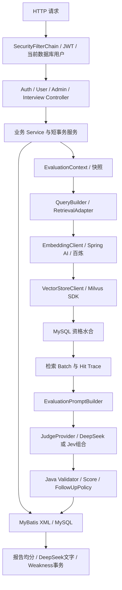
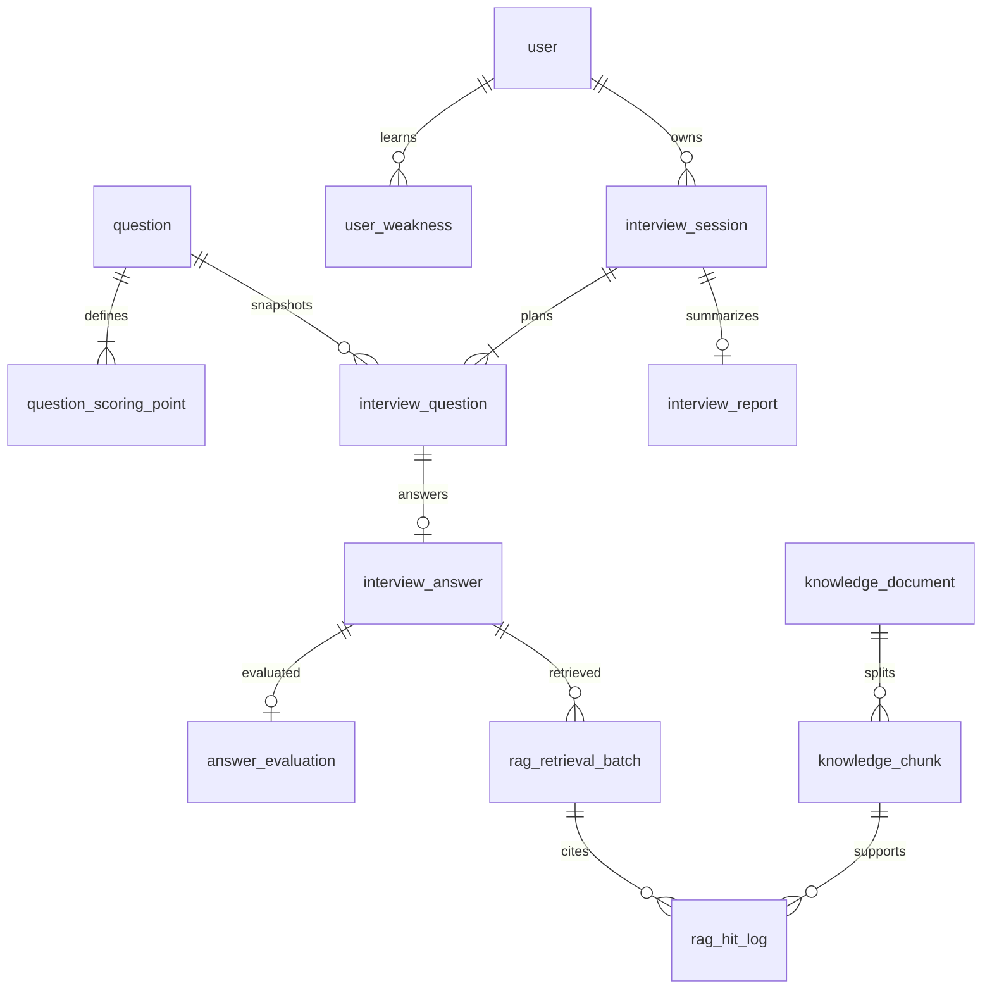
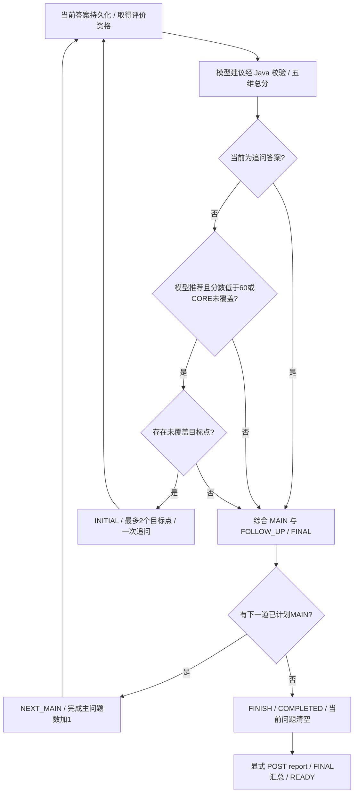

# AI 模拟面试系统：实现与验证证据交接

报告日期：2026-10-14（Asia/Shanghai）  
项目根目录：`E:\learning\IDEA_PROJECTJ\ai-interview-system`  
报告状态：`READY`；表示本次梳理完成，不表示所有实验或产品质量门禁通过。

本报告依据当前工作区源码、配置、SQL、测试及已保存证据编写。本轮只新增本文件，未启动应用、连接数据库或 Milvus、调用收费模型、重跑历史实验、修改锁或冻结文件，也未执行 Git stage/commit/push。文中真实服务结论属于历史运行的已保存证据；本轮新增验证属于文件读取、SHA 核对和轻量静态复算。

引用约定：文件路径均相对项目根目录；`路径:行号` 是本轮检查的当前行号。历史异常栈的旧行号明确标为“当时源码”，不冒称当前行号。附录以 S/E/T 编号连接实现、证据和测试，便于新对话反向检索。

## 第0章：简历对话快速交接摘要

项目名称为“AI 模拟面试系统”，面向 Java 后端实习、校招及初级岗位，提供固定题库出题、逐题作答、一次追问、结构化评价和最终复盘。它解决的是完整面试业务与 AI 评价如何协作的问题：主问题由题库确定，模型提供判断建议，Java 掌握权限、状态、总分和持久化，避免模型直接控制流程。

实际核心技术为 Java 21、Spring Boot 3.5.16、Spring Security/Validation、MyBatis/MySQL、BCrypt/JJWT、RestClient、Spring AI 1.1.8 Embedding、百炼 `qwen3.7-text-embedding`（1024维）、Milvus SDK及DeepSeek JSON接口。当前默认模型是 `deepseek-flash`，旧 `deepseek-v4-flash` 为历史配置。

后端按业务模块分层，13张表承载用户、题库、会话快照、答案评价、知识、检索Trace、报告和薄弱点。创建时固定全部主问题和评分标准，题库修改不改变该场标准；提交使用requestId、问题唯一约束、状态CAS和会话version防重复及竞争。

RAG在回答后提供事实依据。Query取主问题、评分点或追问目标，不含用户答案；Embedding→Milvus COSINE TopK5→MySQL按向量ID水合，检查状态、当前文档及模型版本，再将正文放入Prompt。检索批次和实际输入证据可追踪，raw命中不直接写入引用日志。

模型建议五维分数、覆盖和追问；Java校验每维0～20、完整评分点ID及协议，五维求和并决定下一步。追问综合主/追问答案，每题一份有效FINAL。Java算报告均分，DeepSeek写总结，报告、薄弱点及READY同短事务完成。

最值得突出的是：固定计划与评分快照保证复盘一致；数据库约束和 CAS 保证流程可恢复；MySQL 为知识真源、Milvus 为检索索引并有失败补偿；不可信模型输出先校验再进入业务；通过原始响应、Prompt、检索 Trace 与数据库快照建立验收证据链。这些是具体实现，未使用 Redis 缓存、微服务或复杂 Agent 工作流。

真实验收达到 EASY 五题后端闭环：五道主问题、两次追问、七次真实 RAG 检索、五份 FINAL、READY 报告和薄弱点均有证据。两次执行器原报告仍为 BLOCKED；日期表示比较和续跑历史保护范围错误修复后，原响应回放与 MySQL/Milvus 只读复核给出 `REAL_E2E_PASS_RECONCILED`。它证明业务完成，不证明原运行器一次成功或评分主观准确。

当前默认 RAG 仍为 Dense TopK5 加 MySQL 资格检查；COSINE 0.70 是默认关闭的候选实验。Rerank、Semantic Gate 和 P4.2 适配层没有生产接线。P3 冻结独立验证未达门槛；P4.1 仅三题真实微验证，正式语义结论仍待审；P4.2 离线实现完成，但八题真实验证因冻结文件漂移尚未执行。Jev 已有生产适配和降级，本场仅一次 Jev 请求返回区域限制 451，实际评价来自 DeepSeek。

简历可以写业务闭环、13 表建模、题库快照、状态与幂等控制、RAG 检索和结构化 LLM 集成、真实服务验收。不能写评分准确率、RAG 整体精度提升、高并发、缓存命中率、线上部署或 Jev 全场评分。面试应准备解释事务为何避开模型调用、CAS 与唯一约束如何配合、向量与正文如何对齐、追问规则如何约束模型，以及 E2E 成功为何不能替代语义质量验证。候选简历文字见第10章，供新对话继续编辑。

## 第1章：项目定位、技术栈和当前状态

### 1.1 定位与范围

这是单体 Java 后端作品，核心价值是把注册登录、题库管理、知识库处理、完整面试和复盘串成可靠业务。当前源码目录有 182 个生产 Java 文件、131 个测试 Java 文件，按 `auth/user/security/question/knowledge/interview/common/config` 组织。文件数量仅用于本次检索覆盖，不作为能力或性能指标。

仓库另有 `frontend/` Vue/TypeScript 页面和前端审查文档。本轮重点五题验收走真实后端 HTTP，没有据此证明前端 UI 全程、线上发布或 MEDIUM/HARD 完整真实面试通过。`AGENTS.md` 的阶段文字是约束和历史记录，实际状态应与当前文件及本报告证据交叉理解。

### 1.2 技术是否实际参与业务

| 技术 | 当前真实用途 | 边界 |
|---|---|---|
| Java 21 / Spring Boot 3.5.16 | Web、Bean 管理、事务、配置、业务服务 | 版本见 `pom.xml:8`、`:42` |
| Spring Security / BCrypt / JJWT | 无状态 Bearer 认证、数据库当前角色、密码散列、签名 JWT | 不是复杂 RBAC；没有 refresh-token 模块证据 |
| MyBatis 3.0.5 / MySQL | 13 表及 XML SQL、批量插入、生成键、事务、CAS | 历史真实环境 MySQL 8.0.45；本轮不探测服务版本 |
| Spring AI 1.1.8 | `EmbeddingModel`→百炼 OpenAI 兼容 Embedding | 只用于 Embedding；未使用 Spring AI Milvus VectorStore/ChatClient/Agent |
| Milvus SDK 2.6.20 | 1024 维向量写入、删除补偿、COSINE Search、Schema 验证 | 正文、业务状态仍在 MySQL |
| Spring RestClient / Jackson | DeepSeek、Jev HTTP 请求、结构化响应解析 | DeepSeek 与 Jev 不是 Spring AI ChatModel |
| DeepSeek | 答案评价、Jev 模式反馈、报告文字 | 当前默认 `deepseek-flash`；历史实验需保留其原模型名称 |
| Jev | 可选五维/覆盖/追问建议 judge | 默认 provider 为 DeepSeek；本场 Jev 451 后降级 |
| Redis | 题库领域和知识文档内容 | 未发现客户端、依赖、缓存、分布式锁业务使用；不能写“使用 Redis” |
| Docker / Compose | 文档记录的本地 Milvus 服务运行方式 | 不等于已完成线上容器部署、压测或高可用 |
| Rerank / Semantic Gate | `tools/rag-p2`～`tools/rag-p4-2` 实验 | 未进入 Maven 生产源码，未正式启用 |
| Spring Mail / Knife4j / LangChain4j | 未发现当前核心业务实现 | 不纳入简历实际栈 |

上述结论来自依赖和调用点联合检索，尤其是 `EmbeddingConfiguration`、`SpringAiEmbeddingClient`、`JudgeConfiguration` 与 `MilvusVectorStoreClient`（S06～S10），并非仅看到依赖便认定使用。

### 1.3 当前默认配置与运行条件

`src/main/resources/application.yaml` 当前设置：Milvus 默认 false（`:41`），DeepSeek 默认 false（`:56`），judge 默认 deepseek（`:66`）；Jev `min-confidence=0.0`，意味着未校准前不以此阈值触发降级。Embedding 配置 Bean 没有随这两个开关关闭，启动仍需满足 DB、JWT、Embedding 必填配置。单纯有源码不代表无凭据即可启动完整面试评价。

`InterviewWorkflowService` 与 `EvaluationOrchestrationService` 要求 Milvus、DeepSeek 两个开关都为 true。缺组件时 Controller 保持可启动，提交/处理/报告入口通过 `ObjectProvider` 给出受控“服务当前不可用”业务错误。开关 false 不是运行成功证据，也不是自动启用外部服务的理由。

| 场景 | MySQL / Milvus 目标 | 使用规则 |
|---|---|---|
| 正常 local | `ai_interview` / `default/knowledge_chunk_vectors_local` | 私有 local 配置提供凭据，文件应忽略且不复制入测试配置 |
| 普通 test | `ai_interview_test` / `knowledge_chunk_vectors_test` | 模型替身，Milvus false；普通 Mapper/事务测试仍可能访问并写测试 MySQL |
| guarded Smoke | `local,test-real`，目标仍为 test | 临时 RUN_REAL 开关和双层保护；local 只提供凭据 |
| AI baseline | 单独 `evaluation`，evaluation 库/Collection | 禁止与 local/test 组合；不能偷换到正式库 |
| 最终五题 E2E | Runner 明确覆盖后的 `test-real` | 真实模型与隔离 test 数据；并非普通 test-real 配置自行开启 DeepSeek |

`EnvironmentIsolationInitializer` 在数据源/Milvus Bean 初始化前校验最终绑定目标；测试 classpath 标记要求显式 test/test-real，evaluation 必须单独使用。它校验 MySQL 数据库名及 Collection，也拒绝危险 Hikari init SQL 等覆盖。当前 local 的目标约定来自项目环境记录，initializer 并不对所有普通 local 值施加同样的 test 校验。S11 是实际防护实现。

### 1.4 Git 和证据保存状态

本轮只读 Git：当前分支 `codex/rag-p1-cosine-candidates-20261012`，HEAD 为 `6076a70f18f3062b8faff4fc179cf21f00a95036`；本地 `origin/main` 指向 `e2cab27db7c103a52eb03417b82115e0910da2e1`，main 显示 ahead 1。没有 fetch，不能把本地远端跟踪引用当成实时服务器查询。

F1～F4 可在历史 `cf3e03a`、`a202fd0`、`60a0735`、`621efe5` 定位；其后有工作流、报告、薄弱点、Spring AI、CAS 修复和 Jev 提交。它们是已提交源码，且处于本地 origin/main 祖先历史。P1 阈值、隔离器、当前 Prompt/Jev 强化及 tools 等仍有未提交/未跟踪文件；本轮暂存 diff 为空。`docs/` 和大量 `target/` 证据受既有忽略规则影响，报告文件也被忽略；磁盘存在不等于已经提交、推送或具备异机可复现材料。

## 第2章：整体系统架构

### 2.1 模块与职责



固定题库和知识库是两条不同数据链。题库提供题目、参考答案和评分点；知识库提供评价用事实正文。外部模型既不选主问题，也不持有 Mapper；流程变化由 Java 根据合法建议产生，再用事务与 CAS 写入。

### 2.2 十三表关系和关键约束

| 表 | 核心数据、关系和作用 | DDL 起点 |
|---|---|---:|
| user | account/email 唯一，BCrypt、role/status、password_changed_at | `sql/ai_interview.sql:7` |
| question | 分类、知识点、难度、题面、参考答案、启用状态 | `:38` |
| question_scoring_point | question 外键，类型、正文、1～100 权重及顺序 | `:65` |
| interview_session | user 外键，当前问题、计划/完成数、version、报告状态 | `:112` |
| interview_question | session、题库及 parent 外键；主问题快照或追问；两种 order | `:181` |
| interview_answer | 问题唯一、request_id 全局唯一，内容与评价状态 | `:276` |
| answer_evaluation | answer 唯一，关联主问题；五维/总分/阶段/决策/raw JSON/版本 | `:315` |
| knowledge_document | 规范正文、SHA、文件名/类型、版本及处理状态 | `:419` |
| knowledge_chunk | document 外键；版本/index 唯一、vector_id 唯一，正文及模型版本 | `:473` |
| rag_retrieval_batch | batch ID 主键、answer 外键、Query/topK/filter/counts | `:534` |
| rag_hit_log | answer、batch、chunk 外键；batch/rank 唯一，实际输入证据 ID | `:583` |
| interview_report | session 唯一，均分、等级、文字、模型与 Prompt 版本 | `:652` |
| user_weakness | user/category/knowledge_point 唯一，薄弱度、发现次数与解决状态 | `:686` |



图省略了自关联 parent 和 evaluation→MAIN 等关系，DDL 表格给出实际关联。数据库 CHECK 再约束状态、0～20 维分、总分必须等于五维之和、完成数不超过计划数。评分点权重和=100 跨行约束由 Java 执行；它不是数据库 CHECK，也不是总分计算公式。active session 没有条件唯一索引，使用 user 行锁加事务内重查避免同用户并发创建。

一主问题最多一追问的正常保证来自评价资格 CAS、既有追问查询、唯一 display_order 和事务回放；当前 DDL 的 parent/type 是普通索引，不应宣称另有 parent 唯一约束。当前问题 ID 为业务指针，DDL 没有对该列单独建到 interview_question 的外键，Java 验证其归属。

### 2.3 事务与外部系统边界

模型和向量操作往往等待网络，不能塞进持锁数据库长事务。系统先用短事务抢占/提交，外部调用期间不持有整个业务事务，完成后用短事务推进。评价 INSERT 与工作流推进也分开：若评价已持久化而推进失败，后续重试先读已有 `answer_evaluation`，回放决策，不重新收费评价。若仅有 RAG Trace 而无合法评价，答案标 FAILED，重试可能产生新批次和新模型调用，不能泛称全链恰好一次。

MySQL 与 Milvus 没有跨库原子提交。知识处理选择先写向量、再事务写 Chunk+READY，失败精确删除本次 vector IDs；补偿失败附加 suppressed 异常，仍保留主异常和 FAILED。后续重试按 documentId 清理残留后重建。资格 SQL 只让 READY 当前版本进入评价，可避免 PROCESSING/FAILED 的孤立向量被采用。S07、S10、S12 支持这些实际机制。

## 第3章：完整面试业务流程与源码实现

### 3.1 API 与输入输出

| 步骤 | 触发 API / Controller | 输入与输出 | 主要访问与写入 |
|---|---|---|---|
| 注册 | POST `/api/auth/register` / AuthController | account、username、email、password → 成功 Result | 查重；写 user，USER/ENABLED |
| 登录 | POST `/api/auth/login` | account/password → accessToken、Bearer、过期秒数、用户摘要 | 查 user、BCrypt matches；签 JWT |
| 当前用户/改密 | GET `/api/users/me`；PUT `/api/users/me/password` | 当前用户摘要；旧/新密码→成功 | 改密锁 user，更新 hash 与时间 |
| 创建/恢复 | POST `/api/interviews` | difficulty → session、当前题、计划/完成数 | 查 active、题库/评分点；写 session 与全部 MAIN |
| 当前场次 | GET `/api/interviews/current` | 无业务参数→当前 session 或 null | 只查当前用户 active session |
| 作答 | POST `/api/interviews/{sessionId}/answers` | interviewQuestionId、answerContent、requestId → evaluation、nextAction、nextQuestion、sessionStatus | 答案、RAG、评价与流程表；真实模型 |
| 详情 | GET `/api/interviews/{sessionId}` | 归属场次→题目/答案/评价列表 | 批量读取题、答案、评价；不重新评价 |
| 报告状态 | GET `/api/interviews/{sessionId}/report` | →状态；READY 时带分数及总结 | 只读；不触发生成 |
| 生成报告 | POST `/api/interviews/{sessionId}/report` | 已完成场次→READY 报告 | Java 均分、一次 DeepSeek、报告/weakness/READY 事务 |
| 历史 | GET `/api/interviews/history?page=1&pageSize=10` | 完成会话分页，pageSize 1～50 | 按 ended_at/id 倒序，用户范围过滤 |

Controller 实际路径见 S01。用户身份来自 `@AuthenticationPrincipal`，客户端不传可任意指定的 userId。用户 VO 不暴露密码；InterviewQuestionResponse 不暴露参考答案或评分点快照；普通用户不能访问管理员题库答案。

### 3.2 注册、JWT 与权限

AuthService 先查 account/email，数据库唯一约束再处理并发重名；注册密码经 BCrypt encode，登录 matches 后检查 ENABLED。JWT 有 subject、issuer、issued/expiration、account/role 及凭据版本，签名验证确保完整性而非加密。每个受保护请求仍查数据库 user，以当前 status/role 建立权限，不能信任旧 token 的 role。

`JwtAuthenticationFilter.authenticate:131` 校验 `credential_version` 和 password_changed_at；凭据版本使用签名密钥对当前密码 hash 做 HMAC，防止同秒改密后仅靠 iat 精度失效的问题。改密服务通过 `getUserByIdForUpdate` 串行化更新，旧 token 因 hash 变化失效。登录、注册只对对应 POST 放行；`/api/admin/**` 需要 ADMIN，其他请求认证；无凭据 401，普通用户访问管理员资源 403。

session 不存在或不属于当前用户统一 404，减少归属信息泄漏。400 参数/业务输入，409 状态/幂等冲突，413 上传超限，502 外部服务，500 内部异常。API 响应文本经过控制，但日志会保留异常栈；不能宣称所有供应商异常 cause/日志都已做全面秘密与个人数据审计。S02、S03、S13 是依据。

### 3.3 创建时固定计划和快照

`InterviewPlanConfig:14` 的 EASY/MEDIUM/HARD 分别计划 5/7/9 题，并要求 5/7/9 个领域。EASY 为 JAVA_BASIC、JAVA_COLLECTION、SPRING、MYSQL、NETWORK；MEDIUM 加 JVM、并发及 REDIS 等；HARD 再覆盖 PROJECT_SCENARIO。

`QuestionMapper.xml` 查询同难度 ENABLED 题并按 category/id 排序；`QuestionPlanSelector.select:16` 为每个必需领域选择第一个未选题，再补足数量。当前不是随机抽题，也不是 LLM 出主问题。题库少于要求或领域缺题立即拒绝创建完整计划。

`InterviewQuestionPlanSnapshotService.prepareSnapshot:30` 在 REPEATABLE_READ 只读事务读取题目及启用评分点，避免分次读取混合题库版本。`InterviewSessionTransactionService.createAndStartSession:32` 锁 user 后再次检查 active；若存在直接恢复，否则事务插入 session、全部主问题、激活首题并 startSession。生成键、写入行数和最终状态均检查，失败整体回滚。

`InterviewQuestionSnapshotFactory.createMainQuestion:22` 固定分类、知识点、题面、参考答案和评分点 JSON。主问题 planOrder 从 1 连续增长，displayOrder=`2*planOrder-1`；追问占紧邻的偶数位置，因此无需批量移动后续题序。状态 CREATED 在事务内转换为 IN_PROGRESS，首题 WAITING_ANSWER，其余 PENDING。题库全量替换不会改旧会话快照。S04 是依据。

### 3.4 一次答案提交

`InterviewService.submitAnswer:222` 先校验身份、正 ID、答案非空及 UTF-8 字节不超过 MySQL TEXT 65535、requestId 不超过64字符，加载归属 session/question。先按 requestId 查重：同问题同正文可重放；同 ID 不同正文或其他问题为409。新 requestId 已有该问题答案也为409，数据库两项唯一约束兜底竞争。

新提交要求 IN_PROGRESS 且是当前 WAITING_ANSWER 问题。`submitAnswer` 短事务插入 SUBMITTED 答案、把题标 ANSWERED；随后 `evaluateAnswer` 抢占 SUBMITTED→EVALUATING，FAILED 可重试，fresh EVALUATING 返回409。过期 EVALUATING 通过时间条件 CAS 重新占用；竞争失败重查最新状态，已 EVALUATED 则重放，避免把正常竞争误报500。

此时才构造上下文、Query、Embedding、Milvus/MySQL 水合、Trace、Prompt、Judge，Java 校验和写评价。HTTP 返回 evaluation 与合法下一步。若模型/检索/解析或推进异常，尽力把 EVALUATING 标 FAILED，主异常保留，失败恢复异常为 suppressed。已经写入的答案和 Trace 不因一次 HTTP 失败消失；恢复要检查持久化现场。

### 3.5 追问、下一题及结束



追问不是“低于60自动追问”：必须先有模型 `followUpRecommended=true`，并满足分数<60或 CORE 未覆盖，且能找出未覆盖目标。目标按原快照顺序先 CORE，再其他类型，最多两个（S05）。候选文本来自模型，是否采用和目标 ID 来自 Java。

主答案需要追问时写 INITIAL，插入 FOLLOW_UP，父指向 MAIN，不关联题库 ID、不复制另一套 MAIN 标准，激活追问且不增加 completedQuestionCount。追问答案结合主答案重新评价完整 MAIN 标准，必须 FINAL，不允许二次追问。NEXT_MAIN/FINISH 才加完成主问题数；会话 CAS 同时检查 id、version、IN_PROGRESS、当前问题。最后结束只把会话 COMPLETED，报告还需独立生成；源码没有基于未实现定时队列自动生成报告的证据。

### 3.6 管理员准备入口

`AdminQuestionController` 支持 POST 创建、PUT 整题/评分点替换、GET 分页/详情和 PUT status。QuestionAdminService 检查评分点权重1～100且合计100、UTF-8 TEXT 大小、影响行数和生成键；题目与评分点事务提交，替换先更新题再删旧点/批插新点。启用状态相同可幂等返回。真实 Mapper/事务与 401/403 测试独立于模型 E2E，不能用本场没有管理员写入来否认其已有实现或冒称本场验证了全部管理接口。

知识管理员只支持上传和显式 process；当前 Controller 没有列出知识库分页、禁用、READY 重处理或编辑版本的完整管理 API，虽然数据库保留相关状态/版本字段。

## 第4章：RAG知识库建设及实际检索链路

### 4.1 数据结构、语料规模和身份映射

知识文档保存规范化原文、title/category/source、content_hash、document_version、processing_status；Chunk 保存 documentId/version/index、正文、vectorId、embeddingModel/version、status。评分点属于题库标准，保存类型、权重和内容；它既不是 Chunk，也没有“每个评分点必有一个向量”的规则。

Milvus Collection 恰有五个受控字段：vector_id（VarChar主键、Java UUID、非autoID、最大64）、document_id（Int64）、chunk_index（Int64）、embedding_version（VarChar最大128）和 vector（FloatVector 1024）。动态字段关闭，AUTOINDEX/COSINE。MySQL vector_id 允许128、embedding_version允许50，与 Milvus 限制不同，适配器按实际存储端校验，并非所有字段限制完全相同。

`vectorId` 是 MySQL/Milvus 连接键；还校验 documentId/chunkIndex。MySQL 是正文、标题、来源、资格和版本的真源，Milvus 不存完整正文或 Document 状态。模型/profile 版本过滤避免把不同向量空间混用；该 profile 字符串不是实际模型权重版本的独立认证。

| 语料阶段/环境 | 有证据的数据规模 | 证据解释 |
|---|---|---|
| 早期 pilot local | 5文档、14 Chunk/向量 | 是早期覆盖子集，不是当前完整规模 |
| 2026-10-06 full bank local 入库后 | 21题、97评分点、21文档、52 Chunk/向量 | 16新文档产生38新块；全52一对一，E01 |
| 2026-10-11 P0 local 只读 | 冻结四表191行、52向量 | 21+97+21+52=191；已有 Query 向量8份；E03 |
| 2026-10-14最终只读验收 test | 同样191行、52向量 | E11保存的实时复核结果，不是本轮新连数据库 |
| evaluation 环境 | 不在本轮证明当前就绪规模 | E07曾因开关阻断；不能借 local/test 数量填充 |

因此“当前已证实的真实知识库规模”为21份文档/52块/52向量，最新依据是保存于10月14日的隔离测试环境只读核验；不保证报告阅读时在线库数量仍不变。正式 local 可用的是同内容的已处理语料与生产处理能力，test 是隔离副本，合成候选回答、Mock fixture 和微验证题不是额外知识文档。21个题目覆盖5 EASY、7 MEDIUM、9 HARD主题，小规模人工/AI编写审查语料不代表广泛 Java 问题覆盖。

### 4.2 从上传到 READY

1. POST multipart `/api/admin/knowledge/documents` 输入 file/title/category/optional source。硬限制5MiB，先查大小再读全字节；只接 UTF-8 `.md/.markdown/.txt`，剥离 Windows/Unix 客户端目录，拒绝非法/空文件名。
2. 严格UTF-8解码、去BOM、CRLF和CR归一LF、拒绝空正文，对规范内容SHA-256；写 UPLOADED/version1，不自动启动模型。content_hash 当前是普通索引，不应写“自动全库内容去重”。
3. POST `/{documentId}/process` 显式抢占 UPLOADED、FAILED 或过期 PROCESSING；READY/fresh PROCESSING 拒绝。早期文档只描述首次处理，当前源码已增加失败重试和过期恢复，以 S07 为准。
4. 取得资格后先按 documentId 删除残留向量，再删对应版本残留 Chunk；切片、Embedding、组装 Java UUID；Milvus insert；MySQL短事务批写 Chunk并标READY。
5. 后段失败精确补偿本次UUID，标FAILED；补偿失败不覆盖原错误。后续重试再按documentId对账，不能把它说成跨库强一致事务。

`KnowledgeTextChunker.split:16` 最大1200 UTF-16 code units、重叠目标150、从800后寻找自然边界，优先双换行→换行→中英文句末→硬切。strip后空块不返回，索引从1连续；英文重叠起点尽量向空白移动，无法移动用原候选，防不前进循环。它没有 tokenizer、语义标题感知或引用列表专门合并规则。参考列表独立成块和代码跨块是已观察到的问题，不能把“自然边界切片”写成所有证据完美。

EmbeddingConfiguration 使用 Spring AI OpenAiEmbeddingModel，请求 model/input/dimensions/float；3s连接、20s读取；RetryTemplate最多1次。SpringAiEmbeddingClient 按 batchSize<=20分批，保留输入原文，按供应商 index复原顺序，检查模型、数量、唯一索引、1024维及有限值；只在可信usage完整时累计请求总token。不把 characterCount当token，不把批次token均分给Chunk；knowledge_chunk.token_count 当前写null。独立Jackson null primitive保护避免null误变0.0F。（S06）

Milvus启动已有Collection只描述验证 Schema/index；缺失才创建，不自动drop或迁移。真实实验只读加载器避免生产初始化器创建分支。插入计数必须等于请求；删除计数0可接受以支持补偿幂等；模板参数过滤代替字符串拼接。（S10）

### 4.3 一次生产式检索

```text
EvaluationContext（持久化题目/评分快照、回答）
  → EvaluationRagQueryBuilder
     MAIN：主问题 + 全部评分点内容
     FOLLOW_UP：主问题 + 追问题面 + 目标评分点内容
     两者都不含候选答案/参考答案
  → EmbeddingClient.embed([Query.strip()])（外部百炼）
  → Milvus.search(1024维、profile版本模板、COSINE、limit=5)
  → 可选应用COSINE门槛（缺省关闭）
  → vectorId批量MyBatis水合（MySQL资格条件）
  → Java校对documentId/chunkIndex，恢复原rank
  → RetrievalResult(rawHits, items)
  → RagTracePersistenceService保存Batch + 实际evidence Hit
  → EvaluationPromptBuilder把同一evidence正文传给Judge
```

`EvaluationOrchestrationService:43` 固定TopK=5。Milvus返回Float32 COSINE后拓宽double，零或负COSINE只要finite也是合法结果，不归一化成概率。Search没有显式Strong级别，继承Collection默认；本场test集合记录为BOUNDED，P0独立runner的Strong不能推断成生产配置。

当前门槛在 `RetrievalProperties:17` 默认false；显式 `rag-p1` profile设0.70，代码按Float32包含边界比较，Search后过滤并保留rawHit。过滤后全部空就跳过SQL，避免IN空列表；不补Rank6、不重排、不按document去重。P1独立实验工具历史曾按double `>=0.70d` 比较，0.70F边界会有差别；报告保留历史合同，不把工具表示差异改写成当前业务比较。

`KnowledgeChunkMapper.xml:44` 批量查vectorId并join document，条件为Chunk ACTIVE、Document READY、Chunk版本=当前Document版本、模型和profile匹配。缺资格候选丢弃，身份不一致抛异常。Java按Milvus原位置建vectorRank，可有rank空洞。SQL门禁保证可用状态，不证明语义相关；未通过资格的不作为模型依据。

### 4.4 Trace 和模型“引用”的准确含义

每次成功检索得到结果后先事务保存 `rag_retrieval_batch`：answer/batch、Query、topK、filter、模型/profile、raw/evidence计数。零证据也保存Batch；只有最终items保存 `rag_hit_log`，包含chunkId、原rank、相似度等。rawHit只留内存诊断及实验工具证据，不逐项写正式Hit表。模型失败后Trace仍可保留，便于还原它当时看了什么。

Prompt逐条拼 rank/similarity/title/category/source/content；不发送rawHits或向量值，不要求必须五条。这里 `rag_hit_log` 的“引用”表示被选为输入证据，**不是模型生成句子的逐句引用、不是答案真的引用了这些知识，也不是35条独立正确语义证据**。正式Trace也没有保存整段正文不可变副本，正文通过Chunk外键取得；本场另保存冻结语料SHA和完整Prompt，才能回放。

模型 `scoringPointResults.evidence` 则指候选回答的覆盖依据，语义和来源与RAG正文完全不同。DeepSeek路径的通用校验只要求covered时非空，未强制每条是候选原话；Jev反馈合并额外执行连续原文contains检查。不能把二者统一说成已有生产逐字引用验证。S08、S09、S14支撑区别。

## 第5章：AI评价、Java评分、追问和报告机制

### 5.1 三种“评分”必须区分

| 层次 | 实际责任 | 没有证明的部分 |
|---|---|---|
| 模型建议 | 每维0～20、covered、文字、followUpRecommended/候选文本 | 人类专家一致性、公平性、主观准确率 |
| Java答案总分 | 验证合法值，五维等权相加0～100，分级与规则决策 | 没有独立从答案语义计算维分，也没有按评分点权重再算总分 |
| 最终报告分 | 每个MAIN有效终评总分的算术平均，2位HALF_UP | LLM不决定overallScore；报告文字质量不由平均公式保证 |

`EvaluationStandard` 等级>=90 EXCELLENT、>=80 GOOD、>=60 FAIR、其余WEAK。评分点权重用于标准表达/Prompt，不直接参与当前 `EvaluationScoreCalculator.calculate:9` 的总分。Java控制算法和边界并不消除模型建议的主观性。

### 5.2 DeepSeek 路径

当前默认 JudgeConfiguration 选 DeepSeekJudgeProvider→DeepSeekEvaluationClient.evaluate/completeJson，POST `/chat/completions`；两条message、json_object、thinking disabled、stream=false，输出上限4096，连接3s/读取60s。应用层没有HTTP重试循环。要求一个choice、index0、assistant、finish_reason=stop和非空content，解析到 LlmEvaluationSuggestion；length截断、异常HTTP/JSON为ExternalServiceException。

EvaluationPrompt v3 明确题目、参考答案、评分点、主/追问回答和RAG为待分析数据；禁止把参考/RAG记为候选已说过内容、禁止模型返回最终totalScore或业务状态。FOLLOW_UP额外列出完整MAIN评分ID，提醒target不是输出子集。Prompt约束并非自动语义证明；实际输出仍要Java验证。（S09、S14）

通用 LlmEvaluationValidator 检查每维非null且0～20整数、非空文本元素、结果数量和MAIN ID集合恰好一致、不重复/未知ID、covered必须有依据、追问布尔/文本一致及禁止二次追问。它不能证明covered真的正确、反馈没有假遗漏、依据真的支持评分点。DeepSeek响应model只要求非空，当前通用客户端未严格要求与请求model一致；生产结果对象不保留usage，成本统计来自本场Runner的完整HTTP envelope捕获。

### 5.3 Jev 组合与合法降级

显式 `ai.judge.provider=jev` 才实例化 JevClient；请求 `/v1/systemone`，state复用当前Prompt，五维用5级rubric（0～4），每个MAIN评分点用covered/uncovered choice，MAIN另有yes/no追问建议。Jev不是主问题生成器，也不生成全部反馈文字。

JevJudgeProvider 校验问题集合、类型、legend/rubric、概率范围/分布、confidence和choice最大概率。score×5并HALF_UP映射0～20；当前 `jev-1.13.0` 专用两位展示兼容检查通过可行区间同时验证概率和score，不修改原响应。这个兼容修复不代表所有供应商模型精度已校准。

Jev判断合法后再调DeepSeek写反馈，模型不能改Jev维分/covered/followUp。合并要求所有MAIN pointEvidence恰一次，covered的证据连续出现在主答案或追问答案之一，禁止从参考答案/RAG借证据；通用validator再验证。合法组合存provider/judge typed projection/generation/suggestion；数据库投影不等于完整Jev HTTP envelope。

HTTP错误、非法数值/响应、低于配置confidence或反馈不合法都经ExternalServiceException进入一次DeepSeek judge fallback。生产fallback重新评价整题，不是伪造Jev分数；若fallback仍失败则答案FAILED。成功返回模型和Prompt版本要按实际provider记录。（S08）

最终场次第一次Jev451原文为区域不可用，后随DeepSeek200，构成真实降级证据；后续续跑显式使用已有DeepSeek provider，Jev请求0。因此不能称“全场Jev评分已验收”，也不需要为完成场次再试受限供应商。

### 5.4 报告、薄弱点与实际 FINAL 兜底边界

InterviewReportService检查归属和COMPLETED；READY直接返回；NOT_STARTED/FAILED以version CAS占GENERATING；fresh GENERATING409，超过默认10分钟可CAS恢复。有现存报告则markReady恢复并返回，不重调模型或更新weakness；无报告才重新生成。

FINAL有效结果查询用窗口ROW_NUMBER按MAIN分区，FINAL优先、同阶段ID倒序；**实际SQL仍允许没有FINAL时选INITIAL**（`AnswerEvaluationMapper.xml:277`～`:293`），Mapper测试还明确覆盖这个行为。ReportService只验证评价数量等于计划题数，不显式检查每项phase=FINAL；UserWeaknessService也不自己过滤phase。正常工作流COMPLETED通常保证五题都FINAL，本场也已逐行证明；但在异常/受损数据场景，“只有FINAL可进入报告”尚非严格代码不变量。应列为规则一致性技术债，不能用设计文字掩盖，也不能据此断言本场报告污染。

ReportService对有效总分均值保留2位HALF_UP；DeepSeekInterviewReportGenerator只返回summary/strengths/weaknesses/suggestions，summary<=2000，列表1～5项、单项<=500，等级由Java标准得出。`InterviewReportTransactionService.completeReportGeneration:27`事务插报告、applySessionEvaluations、markReportReady并把均分写session；UNIQUE(session_id)防第二报告，任何后段失败回滚整个事务。（S12）

Weakness按category/knowledgePoint分组取本场均分，weaknessScore=100-average。<80（FAIR/WEAK）upsert ACTIVE并增加discovered_count；>=80只resolve已有ACTIVE，不创建新的“强项薄弱点”。它不是用户跨所有历史成绩的平均。重复READY报告返回不再调用该服务。当前没有专门薄弱点查询Controller证据，持久化能力已经实现并在本场核验。

本场五份FINAL=96/92/91/82/10，均分74.20，NETWORK/tcp_vs_udp薄弱度90.00、发现1次。主答案初评7分在追问后被FINAL96替代；两个INITIAL不能再计入均分。这证明正常聚合契约，未证明文字建议的专家准确性。

## 第6章：P0～P4.2验证与改进历史

### 6.1 先区分两套编号

`docs/rag/PHASE_4A_GOLDEN_SET_REPORT.md` 至Phase4D5报告是早期题库知识建设/检索评价；2026-10-11起的 `target/rag-p1-20261012/`、`target/rag-p2/`、`target/rag-p3/`、`target/rag-p4/` 是后续改进实验。本报告所称P4 Semantic Gate不是早期Phase4D5。早期“当前21主题无需reranker”有其正样本题库范围，后来独立改写和库外题暴露的问题不与它逻辑冲突。

### 6.2 按时间还原目标、运行与结论

| 时间/阶段 | 实际做了什么 | 真实调用/证据等级 | 保留结论 |
|---|---|---|---|
| 10-06 full bank | 16新文档入库，验证52块映射；21题生产Query基线 | 真实Embedding/Milvus/MyBatis | 当前固定正样本银行Hit@1/3/5和MRR@5均1.0；不是通用准确率 |
| 10-11 P0 Dense | 8个冻结Query向量检索local Top5并只读水合 | 实际Milvus/SQL，复用已有向量，非新Embedding实验 | `LOCAL_READONLY_TOPK5_COMPLETE`；当时无人工Gold，不能评质量 |
| 10-12 P1应用阈值 | 生产代码加入默认关闭COSINE门槛，历史8×5回放 | 编译、Mock和离线；该轮新外部调用0 | 0.70历史留17条；不称新检索或独立质量通过 |
| 10-12单题E2E/只读复验 | 一题经真实HTTP、模型到DB；修正工具JSON表示比较 | 真实业务，原FAIL后只读复核 | 证明动态2条证据及Java决策；不是整场完成 |
| 10-13凌晨 P1独立16题 | 8改写+4边界追问+4库外，V0/V1共享真实Top5 | 16Embedding+16Search、真实只读水合 | V0=80条；0.70只留5，13题空；质量标签须另审 |
| 10-13 P2 Rerank | 原16题Top5用原题+标题/正文重排 | 16次百炼rerank；不重调Embedding/Search | 排序探索成功，标签10人工+70AI，未生产接入 |
| 10-13 P3独立12题 | 6覆盖+6Hard Negative，冻结Top2/0.50规则 | 各12Embedding、Search、Rerank；读库，零模型重试 | 执行PASS；质量`FAIL_UNDER_PRELOCKED_RULE` |
| 10-13 P4 Gate | 对P3已有Rerank Top2做语义支持/引文验证 | 已发5DeepSeek，后7未尝试 | g05本地校验错误停批，原FAIL保留；还有误拒质量问题 |
| 10-13 P4修复 | 重复同点多引文误拒修复，回放原5响应 | 新模型0；离线41项最终通过 | 格式/引用复验PASS；不是P4全12题质量PASS |
| 10-13 P4.1 | Prompt允许最小机制的部分核心支持，3题微验证 | C01/N02/N06各1DeepSeek | C01留2，N02/N06各0；结构匹配，正式语义仍PENDING |
| 10-13 P4.2适配准备 | 预先固定主要机制/辅助背景角色，独立组合层、8题冻结 | 37离线检查0失败/错误/跳过 | PREP READY指这一层；没有新协议真实调用 |
| 后续 P4.2执行准备 | 单次8题runner、Analyze、预算/锁/资源门禁 | 45检查中44通过、1错误；真实调用0 | EXECUTION_PREP BLOCKED，未封存READY，未启动run-once |
| 10-13～14最终E2E | EASY五题生产默认路径，恢复原场次 | 7Embedding、8DeepSeek、1失败Jev请求；后只读复核 | 真实业务`REAL_E2E_PASS_RECONCILED`；不验证P4.2 |

P1真实时间在原JSON为 `2026-10-12T16:14...Z`，转换上海为10月13日凌晨；目录20261012是任务命名，不能把UTC日历和本地执行日期混为一谈。单题E2E为10月12日晚，发生在P1独立执行之前。各准备、执行和复核任务存在时间交叠，具体时间以原时间戳为准。E03～E11提供原件。

### 6.3 初始正样本与 P0 的证据边界

早期 full bank Golden 为21Query×52Chunk=1092判断，旧294保留+新798，在新检索前冻结。DIRECT定义为至少一个评分点机制得到正文支持，不要求整题充分；全21题均正样本。真实检索返回105条：DIRECT56、RELATED_ONLY24、IRRELEVANT25；Top1均DIRECT。这能说明当前固定银行易获得首条相关知识，也同时说明Top5尾部有25条无关，不能写“所有引用100%相关”。Golden文档没有本轮可独立确认的“全量人类盲审”证据，本报告不把1092判断包装成人工Gold。（E01、E02）

P0 v2修复过PerfMark classpath和授权/依赖封存，`TEST_RESULTS.json.live=NOT_RUN` 是准备阶段字段；后续 `target/local-rag-live-runs/LOCAL_20261011T103308698Z/local-rag-result.json` 才是真实完成记录，列MySQL/Milvus版本、8Query、40候选、Strong/COSINE/TopK5、43条RPC观察和前后191行/52向量指纹。该阶段复用已有E02 Query向量，新模型调用0；不能写“P0新调用8次Embedding”。后续原人工40标签为2=16、1=11、0=13，P1历史回放使用它们，争议AI建议另存未改人工原标。

### 6.4 P1：为什么 0.70 不能直接推广

历史8Query的原问题/评分点与银行高度贴近，COSINE0.70留下17条；这一离线数据没有空结果，空路径由明确合成Mock测试。独立16题采用冻结builderInput与真实QueryBuilder组成生产式Query，而非只取题面，包含合成评分点和边界追问上下文；工具直接HTTP调用Embedding，没有启动Spring AI业务应用。

独立真实原始80命中经资格水合，V0全保留，V1仅5、13Query零。原JSON执行成功不能自动推导质量。实际人工原标只有Q01/Q02共10条，另外70为AI全文审查建议；用户确认用于探索仍是COMBINED_PROVISIONAL，不等于80人工Gold。其暂定分布2=15、1=12、0=53。

| 策略（同80候选暂定标签） | 选择 | 直接2/部分1/无关0 | 有用误删 | 有覆盖题保留有用 | 库外有候选 |
|---|---:|---|---:|---|---|
| Dense Top5 | 80 | 15/12/53 | 0 | 12/12 | 4/4 |
| Dense Top3 | 48 | 15/10/23 | 2 | 12/12 | 4/4 |
| COSINE>=0.70 | 5 | 3/2/0 | 22 | 3/12 | 0/4 |
| COSINE>=0.60历史对照 | 20 | 12/7/1 | 8 | 12/12 | 0/4 |

接口/抽象类直接支持0.6486、G1 RSet0.6863都在0.70下被拒；不是简单浮点边界问题。0.60观察也在同批上探索，不能再用同批证明独立泛化。纯Top3减少数量但库外仍会有相似结果，无法充当语义拒绝器。故当前0.70保留为可选实验，默认关闭。（E04、E05）

### 6.5 P2：Rerank 的确切效果

P2重用P1真实候选，不再访问DB/Milvus/Embedding；每题原始questionText+5个标题与完整Chunk一次 `qwen3.7-text-rerank`，北京Workspace原生接口，不是 `/embeddings` 或OpenAI Chat。返回完整index排序及score，与原vector/chunk ID映射；0重试、不换Key/模型。

16HTTP完成。暂定标签下Rerank Top2选32=15直接+8部分+9无关，候选池有用保留23/27=85.19%，库外仍4/4有候选。Top3选48=15+11+22。合并NDCG@3在12个有正标签Query由0.922021到0.975023，4胜/0败/8平；其余4个全无关Query不进入NDCG分母。**纯人工2Query的NDCG不变**（0.910657），所以不能把混合标签的提高写成人工独立验证结论。保留率分母是原Top5候选池，不是全52Chunk召回率。（E06）

本次42966输入token、公开原价估算¥0.021483；Rerank均值291.34ms、median279.58ms、nearest-rank p95 372.546ms。仅为16题服务请求观测，不是并发性能或生产整题延迟保证。P2 PASS是实验执行/探索完成，不是正式生产质量验收。

### 6.6 P3：冻结的独立验证真实失败

在看新结果前固定12道新题、6覆盖/6相同术语但机制缺失负例、策略和验收。Embedding/Rerank都只用原题文本（`tools/rag-p3/p3.py:43`），与P1生产式Query及最终E2E的“题面+评分点”不同，不能跨批直接比较分数或当作同输入因果实验。

主策略 C 为只看Rerank前2且score>=0.50，通过者0～2，不从Rank3补位；A Milvus Top2、B Rerank Top2、D低信息检查为对照。0.50来自P2探索，事先冻结，不扫描新题最佳阈值。实际各12Embedding/Search/Rerank、0重试，冻结191行/52向量和历史文件保持。执行PASS后质量最初UNLABELED，后才生成标签评价。

P3标签文件字段humanLabels有60条，不因此认定当前60条全为人工。用户授权AI修订后来源为51原人工-as-supplied+9 USER_AUTHORIZED_AI_CORRECTION；覆盖分类及充分性也有6项、8项授权修订。原件及9修改理由/SHA保留在correction audit，最终质量仍PROVISIONAL。正式报告的“HUMAN_ONLY”历史名称不能覆盖来源审计。（E07）

| 策略 | 留存 | 直接/部分/无关 | 相对Rerank Top2有用保留 | 覆盖完全误拒 | 库外正确空 |
|---|---:|---|---|---|---|
| A Milvus Top2 | 24 | 9/6/9 | 15/17=88.24% | 0/6 | 0/6 |
| B Rerank Top2 | 24 | 11/6/7 | 17/17 | 0/6 | 0/6 |
| C Top2+0.50 | 15 | 11/4/0 | 15/17=88.24% | 0/6 | 4/6 |
| D Top2低信息 | 24 | 11/6/7 | 17/17 | 0/6 | 0/6 |

冻结要求库外6/6空、有用保留>=90%，C同时未达到；结果`FAIL_UNDER_PRELOCKED_RULE`。高分的InnoDB MVCC背景无法解释N02范围锁/不存在记录插入等待，TCP TIME-WAIT正文不能解释N06未收到FIN且数据无ACK时socket选项。旧“部分相关1”允许背景，不等于支持主要机制；“选中没有label0”仍可语义误准入。纯参考列表过滤也不能排除有正文但目的不符的候选。

### 6.7 P4：语义门禁、中断和离线修复

P4对P3已保存的Top2做一次DeepSeek Semantic Evidence Gate，不重调检索。模型分解corePoints，每候选给CORE_SUPPORT/BACKGROUND_ONLY/NO_SUPPORT/UNCERTAIN、版本、supports的pointId和逐字正文quote；Java检查ID、正文连续出现、信息性、数量/协议，不把SAFE_EMPTY故障算正确拒绝。

冻结12题，真实发g01～g05五次，全部HTTP200；g05支持同一p1的两段合法正文，被旧表达式 `points.containsKey(pointId) && supported.add(pointId)` 把第二段当错误SUPPORTED_POINT。原结果`FAIL_STOPPED_NO_RETRY`、g05 SAFE_EMPTY_FAILED、g06～g12 NOT_STARTED；没有证据可写P4全12通过或负例全拒绝。

修复将声明验证与集合去重分离：多段同点逐段验证，distinct point只计一次覆盖；加强纯URL、Markdown参考列表低信息识别。旧源码复现原5结果，修复回放前4完全不变，g05从0变c1；最终13专项+28旧Mock=41，0失败/错误/跳过，新增模型/资源调用0。首轮6项中5通过/1error是URL负例夹具选错，原失败保存，不被最终结果抹除。（E08）

还有语义误拒：g01链表iterator/反复get定位摘要，g05快照简短结论明明对最小机制有用，却因不足整题展开被当背景。这是AI工程师离线诊断，不是人工Gold。修复后前5题只留7，按修订暂定标签即使余下最优，覆盖有用保留上限9/12=75%，直接上限9/11=81.82%，低于原90%门槛。继续补旧7题不能把旧规则变成PASS，原锁与失败必须保留。

### 6.8 P4.1：误拒修复的三题真实微验证

新版Prompt明确：单块不必覆盖全题，直接支持至少一个最小核心机制即有价值；短结论和带参考列表的机制正文不因篇幅被否定，同时拒绝仅同域背景、题设外配置分支。保留旧Gate协议与已修复校验器，创建新版本/新目录，未续跑P4剩余7题。

18项离线检查通过；真实仅C01/N02/N06三题各一次DeepSeek。t1正常保留c1/c2，t2/t3正常判无核心返回0；不是超时/格式异常导致的空。原响应/引文/偏移已保存，结构状态 `MATCH_PENDING_SEMANTIC_REVIEW`，quality字段仍`PENDING_SEMANTIC_REVIEW`。保存报告没有独立人工语义PASS，本报告不替它补写。

这支持“局部误拒修复方向有真实响应”，不证明C02～C05新版效果、完整90%目标或新题泛化。费用usage估算¥0.02871544、模型均值5109.18ms仅属于该3题；不能预测P4.2组合延迟。（E09）

### 6.9 P4.2：固定主辅要求与当前阻断

P4.1仍让模型自行列核心点，可能把背景或版本描述当核心。P4.2在检索前由调用方固定QuestionContract，要求ID、题面连续anchor、PRIMARY_MECHANISM/SUPPORTING_CONTEXT、版本约束；模型不得重新创造corePoints。Java只允许真实正文支持已锁定主要ID且DIRECT_MECHANISM、版本符合声明协议的候选准入；辅助点不能自行升级。部分主机制可保留，缺失主点显式输出，wholeAnswerSufficiency始终NOT_INDEPENDENTLY_VERIFIED。

实际独立组合：原题Embedding→Milvus Top5→现有MySQL资格水合→一次Rerank选准确Top2→一次Gate→0～2，不补Rank3。缺合同、检索/Rerank/Gate异常安全返回空，UNCERTAIN单列，不退回未经确认的Dense。Java检查quote出现/角色/ID，不会自动证明DIRECT或MATCH语义；真实背景quote错误关联主要ID仍须独立审查。

`tools/rag-p4-2/java/com/kun/aiinterview/knowledge/admission/P42Configuration.java` 显式导入且enabled=true才实例化实验组件；P42Properties缺省false，所有文件在src/main之外，Maven不会编译入生产。关闭策略原样delegate旧query/topK/result。题库合同提供器、EvaluationRetrievalAdapter接线、Trace/空元数据兼容尚未完成，无法靠设置环境开关让现有业务自动使用P4.2。（S15）

前期适配层37项离线通过（25Java+10数据+2PS），新8题4覆盖/4Hard Negative检索前冻结。八题涉及桥接方法、FutureTask异常、二级索引回表、semi-consistent UPDATE、Bean生命周期、三级缓存代理、核心线程超时、TLAB；覆盖假设来自AI离线语料审计，正式结果须独立人工确认。旧8个P4/P4.1响应回放只是旧协议回归，不是新协议真实验证。

后续专用ExecuteOnce/Analyze已编码编译、45项检查44通过，1error是原protected-history中InterviewControllerTest的SHA与后来新增 `@ActiveProfiles("test")` 后文件不符。准备状态BLOCKED、manifest未创建、realRun未预约。本轮对1679项SHA重新只读核对，恰1漂移且同一文件，证实阻断仍在；未修改冻结或回退他人代码。新八题真实HTTP、组合语义、usage/延迟、独立人工指标与生产接线全部尚未验证。（E10）

若将来解除冻结一致性并取得独立授权，计划最多8Embedding+8Search+8Rerank+8Gate，即24次收费模型请求、无答案评价/Jev/业务写入。¥1及费率代理只是冻结计划预算，非账单硬上限。本次不执行、不发起授权或改锁。

## 第7章：最终真实五题E2E证据链

### 7.1 验收设计与原场次

`tools/final-e2e` 使用真实Spring后端、正常HTTP注册登录、生产计划/快照、真实Embedding/Milvus/MySQL、真实Judge、Java验证评分决策和报告/薄弱点。运行环境固定test schema/Collection，P4.2关闭、COSINE门槛关闭，TopK5；不靠直接INSERT伪造评价，也不手写模型评分/追问/报告。

EASY五题知识点为接口/抽象类、ArrayList/LinkedList、IoC/DI、事务ACID、TCP/UDP。受控合成输入首/末主答案不完整，中间三题及首题追问用冻结参考回答，末追问仍不完整，以观察真实规则追问和薄弱点。这是工程验收案例，不代表真实用户能力分布；脚本没有强制追问分数。

前置401、普通USER访问admin403、参数400、非归属404、未完成报告409、重复创建恢复同session、同request答案幂等和冲突分别留下HTTP记录。全场始终使用原会话150；后续恢复没有重建场次、重选题或重评已成功首答案。

### 7.2 第一次 BLOCKED：首题成功后日期比较误报

attempt `final-e2e-20261013-001` 创建五题会话并完成首主答案：INITIAL、Java7分、WEAK、FOLLOW_UP，追问等待；RAG Batch1/Hit5持久化。发生3次真实模型请求：Embedding200、Jev451、DeepSeek200。Jev原响应为 `Typesafe is not available in your region.`，生产catch ExternalServiceException使用DeepSeek合法降级。

随后GET详情与独立DTO投影比较出错：执行器默认Jackson把LocalDateTime表示为数组，Spring HTTP是ISO字符串，差异只有startedAt/createdAt/submittedAt。原抛出点为当时 `FinalE2eRunner.java:324`，guard `HTTP_DETAIL_DB_PROJECTION_MISMATCH`，不是Milvus检索失败。原report.failure.operation最后停在Milvus操作名，属于旧诊断位置记录不准确，需结合栈和保存HTTP定位。

日期修复采用实际Spring ObjectMapper并在收费前验证合同，14专项离线检查通过；生产业务不改，首题响应/评分/追问/持久化只读复算通过。原首场新增17行只是新增行数量，不是SQL写语句总数；原报告和两锁保留。完整控制台stdout/stderr没有单独保存，不补造。E11的repair目录与原attempt提供证据。

### 7.3 第二次执行：从追问恢复到报告

原随机密码/JWT仅存在已结束进程内存，历史授权后仅为合成测试用户轮换密码，再正常登录；没有改角色/status或业务成果。明确因Jev区域不可用使用已有DeepSeek provider。对已成功首答案相同requestId重放，不重新调模型；继续首追问及余下四主问题和最后一次追问。

attempt002新请求13=6Embedding+6DeepSeek答案评价+1DeepSeek报告，Jev0，全部HTTP200、完整请求/响应及usage保存；新增6答案、6评价、6Batch、30Hit、1追问、1报告、1Weakness=51行，并合法更新原会话/问题状态。不能称“只写51次SQL”或“没有修改历史会话”。

### 7.4 第二次 BLOCKED：收尾保护范围错误

完成报告、报告重放及历史GET后，执行器 `verifyHistory` 把续跑会话及其原问题整行当不可变历史，合法PENDING→ANSWERED也触发HISTORICAL_BUSINESS_ROW_CHANGED。按当时TreeMap表顺序和ORDER BY id，首个不一致是原问题174的status/updated_at。

栈是当时 `FinalE2eRunner.java:161 lambda$verifyHistory$4`→`check:43`→`RagE2ePolicy.require:38`，`FinalE2eResume.java:85`收尾捕获并把先前成功状态改BLOCKED；`:92`只是包装。它既不是预检失败，也不是权限或生产状态转换失败。修复只给明确续跑会话允许工作流字段变化，归属、题面/评分快照、旧答案/评价/RAG和无关行继续严格保护；收费前先回放实际合同。

33第二次修复离线检查和14日期回归均0失败/错误/跳过。随后历史任务实际MySQL/Milvus只读核验PASS、结果为REAL_E2E_PASS_RECONCILED，新模型0、业务/向量写入0。第一次只读连接曾被沙箱getsockopt权限阻断，本机连接获准后通过；这是执行环境故障，不能写成生产回归。

### 7.5 逐项核对最终结果

| 待核对项目 | 本轮从保存原件复核的事实 | 直接证据 |
|---|---|---|
| 原会话150 | COMPLETED、计划/完成5、currentQuestion=null、report READY | second-repair/current.database.json及002终态快照 |
| 5 MAIN | 原主题173～177，全ANSWERED，快照保留 | questions行、00/99快照及合同回放 |
| 2追问 | 178、190各一、全部ANSWERED | questions parent/type与对应答案 |
| 7答案/评价 | 全EVALUATED；2INITIAL+5FINAL | answers/evaluations逐行计数 |
| 5 FINAL | 96/92/91/82/10，各MAIN一份 | evaluations、Java维分/决策回放 |
| 7真实RAG | 001一次、002六次；各Query与1024维实际请求对应 | providers、Batch、answer-N.evidence |
| 35引用 | 7Batch各raw5/evidence5/topK5；7×5个Hit输入证据 | ragBatches/ragHits，不是35语义正确率 |
| READY报告 | 一份报告14，overallScore74.20、等级FAIR | report行、模型report响应及HTTP GET |
| 薄弱点 | 一条NETWORK/tcp_vs_udp，90.00、ACTIVE、discovered_count1 | weaknesses与FINAL10分关系 |
| 幂等重放 | 20-report-ready和21-report-replayed保存文件字节完全相同 | 本轮SHA/字节比较；模型计数不增加 |
| MySQL/Milvus只读 | 191冻结语料行、52向量、ID/schema/映射保持；终态与保存一致 | second-failure-diagnosis.liveReadOnlyVerification |
| Jev451降级 | 原451响应区域限制，后同operation DeepSeek200 | 001 provider-index、Jev/DeepSeek原响应 |
| 独立结论 | REAL_E2E_PASS_RECONCILED，NEXT_REAL_RUN_READY=NO原因是无需再跑 | second-failure-diagnosis、verification-status |
| 原执行状态 | 001与002仍BLOCKED，文件原样 | 两份report.json，本轮SHA核对 |

本轮检查 `preserved-attempts.sha256.json` 全76文件：缺失0、SHA不符0；16次模型请求的32份request/response与原providerRecords SHA全相符。second-repair/current快照与002终态JSON语义完全相同；7评价的总分都等于五维之和，5FINAL的均值独立计算74.2。

002六份逐题evidence静态断言另验证30个水合正文/ID对、6 Query/Embedding输入及1024维长度、6个实际system/user Prompt、返回content与DB raw_result完整JSON关系，全部通过。这是本轮文件级核验，不伪称本轮再次真实连接或执行Java/JUnit。首题由原repair wire复核、保存快照和源码 `FinalE2eRepair.verifyFirstEvaluation`交叉支持；本轮没有另调用首题模型。

### 7.6 成本、耗时和审计局限

整场跨两attempt共16转发请求=7Embedding+8DeepSeek（7答案、1报告）+1Jev451；成功响应15、区域拒绝1。不是“16成功收费调用”，451是否计费无账单。原价格假设下001已知usage估算¥0.0152948（Jev缺usage），002¥0.1046562；合计已知约¥0.119951，不是完整账户账单或成本优化指标。

原sent/received时间戳本轮复算：Embedding约0.296～0.441s，答案DeepSeek约3.106～4.167s，报告约5.742s，Jev拒绝约0.923s。只代表这个串行本机样本的供应商往返，未计完整请求负载、排队/并发、人工等待，不能当稳定SLA、QPS或生产p95。

attempt002无关全表历史hash基线只在旧进程内存，未落盘。保存会话快照、76文件、当前冻结语料/向量证明本场成果及语料保持，但不能事后认证所有无关历史行当次完全没变。只读快照也不提供MySQL/Milvus跨服务原子性或全时段瞬态无漂移证明。这些限制保留，不改变已完成本场业务的结论。

当前无需attempt003或新的收费续跑；原锁、BLOCKED报告和后续复核结论应共同交接，不覆盖失败历史。

## 第8章：测试设计、验证方法与工程思路

### 8.1 分层验证各证明什么

| 层 | 本项目实际验证对象 | 能证明 / 不能证明 |
|---|---|---|
| 普通单元/Mock | QueryBuilder、切片、外部响应校验、五维/追问、Prompt、服务调用 | 算法/边界/错误分支；不能证明外部模型实际效果 |
| WebMvc/MockMvc | 401/403、DTO/参数、业务VO与HTTP错误 | API合同；Service或DB为Mock时不证明持久化 |
| 真实MyBatis/MySQL | 生成键、评分点batch、唯一/check、事务rollback、version/CAS、并发抢占 | 真SQL与隔离库事务；不是收费模型集成 |
| guarded real Smoke | Embedding、Milvus写搜删、schema不兼容、知识pipeline/失败补偿 | 真实外部连接/返回/清理；普通回归skip不能作真实通过证据 |
| 离线历史回放 | 原模型content/quote、SHA、完整JSON、Java决策与Prompt | 检查已付费结果如何被程序解释；不是新模型调用 |
| 只读真实复核 | 身份、冻结行/向量、同场成果、当前资格及内容 | 持久化可读且与原件一致；不能证明语义准确 |
| 真实收费E2E | 正常HTTP→模型→Java→数据库→报告/Weakness | 工程闭环；不能证明准确率、代表性/压测 |
| 独立语义质量评价 | 预注册题/标签、核心支持/充分性、误拒/误准入 | 在该数据范围的质量；不自动推广全用户场景 |

新概念需用实际失败理解：单题真实E2E先发现writer缺少FOR UPDATE权限、HTTP异常细节不足、MySQL JSON键序及IntNode/LongNode表示问题。前者是环境权限，后者是执行器比较；它们都可能让HTTP/脚本状态误导工程判断。单题稳定后再验证五题，才能覆盖INITIAL→追问FINAL→下一题→结束→报告→Weakness，而不把调试成本乘整场调用数量。

### 8.2 单题真实 E2E 如何证明链路

`tools/rag-e2e` 使用正常注册登录、真实业务Controller创建EASY计划，只提交第一主问题的合成答案。最终第三attempt原report仍FAIL/RAW_MODEL_TO_DB_MISMATCH：MySQL将JSON对象格式/键序规范化，直接比较raw字符串误报。修复保留完整字段、数组顺序、数值，表示无关比较再核对原content SHA，不用DTO子集冒充全JSON。

原运行答案EVALUATED、评价FINAL90/EXCELLENT/NEXT_MAIN；模型建议followUp=true但CORE全覆盖且分数不低，Java不追问，具体证明“推荐不能决定状态”。raw5→水合/Prompt2，chunk525/526，证明证据数量可变；阈值候选2是该次冻结全向量资格和唯一SQL返回2行推导，不补造未保存3条raw明细。后只读复核`PASS_EXISTING_RUN_BUSINESS_CONTRACT`，重建生产Context/Prompt/Validator/Score/Policy、HTTP投影及原content SHA。

单题完整DeepSeek HTTP envelope仅存历史SHA，原body未保留，不能重新核算envelope字节SHA；content则可确定格式恢复并匹配原SHA。这促成最终五题Runner保存完整providers请求响应、逐次DB快照和逐题evidence。原最初run-once报告曾被旧入口覆盖，首次诊断及历史SHA仍在；该遗留缺口不能补造为完美保存。（E12）

### 8.3 为什么执行成功与语义成功分开

P3全部HTTP/检索/Rerank完成，但4/6库外拒绝和15/17保留率未过门槛；P4.1三次正常结构化判断，也仍须审查引用是否蕴含点。相反最终E2E原BLOCKED却有完整业务成果。把这些分别记为执行状态、结构/程序验证、语义质量、持久化状态，才能正确归因和决定下一步。

评分模型输出JSON合法、covered集合完整，仅表示合同符合；“反馈把已正确说过的机制称缺失”仍可能存在。Phase5 E06保存过114次真实推理、Jev组合33/38合法、独立DeepSeek38/38结构合法，但baseline确认假遗漏1/38，另外存在UNCERTAIN；严格质量FAIL保留。五份组合失败为两份非法反馈JSON及三份非连续/缺失候选原话证据；该比较harness以sentinel拦截五次fallback，实际fallback联网0，38份独立baseline不能称那五次fallback。后续v3 Prompt强化和E07 Canary预检阻断不能作为这批语义缺陷已修好的证明。（E13）

### 8.4 为什么正样本、负样本和冻结不可缺

固定21题都在库内，Hit@1高容易掩盖“任意题也返回五条”。P1库外Kafka/ES/PKCE/PostgreSQL题揭示术语碰撞；P3使用同领域但具体机制不在库的Hard Negative更难，检验系统是否把相关背景错误当答案依据。

标签2/1/0/U和整题SUFFICIENT/PARTIAL/NONE/U作用不同。部分1可能只是背景，不保证主要机制；原RAG返回“MySQL一致性读”无法推出“范围锁”，TCP关闭不能推出socket计时选项。P4.2主辅要求就是针对这个已经观察到的问题，而非泛泛加第二模型。

先冻结题、候选范围、阈值、角色和指标，避免看新答案后改规则再宣布同集PASS。P2探索选0.50，P3锁定后失败就保留FAIL；P4错误修复只复验已付款响应，P4.1是开发微验证，P4.2换8新题且必须独立标签。数据独立也不能替代标签独立：AI修订要保留来源，不能自动升级为人类盲审。

指标应明确分母：Hit@K/first DIRECT只是是否找到至少一条，MRR是首相关倒数排名；NDCG@3用`2^label-1`且排除零正标签题；候选池保留/precision只计本次Top5，有用=1或2；库外正确拒绝要求正常无支持，故障SAFE_EMPTY不算成功。主要机制证据保留与整题充分必须另评。没有完备全库标签时不能声称全库召回率。

### 8.5 为什么检查引文、持久化和 Java 规则

Gate用连续quote和UTF-16 offset验证引文存在于本候选正文，拒绝标题/URL/参考列表，可排除伪造、跨块拼接和只给来源的输出；仍需语义审查“这段原话是否证明这个机制/条件”。真实存在只是必要条件，P4.2也无法独立证明模型的语义标签。

生产引用须贯通Milvus ID→合资格MySQL正文→Prompt→rag_hit_log→evaluation batch，防止只保存漂亮摘要却无实际输入依据。final report还要核验五维sum、终评数/phase、状态、均分和Weakness，HTTP200并不能证明这些约束全部正确。最终报告重放前后快照一致且无新模型，才有已观察的幂等证据。

Java独立算总分/平均、验证ID/状态、选择追问，原因是外部模型不可信且可能建议不一致；并不把它变成确定性语义评分器。本文区分模型提议、Java决策、SQL写入，就是为面试解释这条边界。

### 8.6 隔离、费用、锁和历史证据保护

普通测试可能rollback或清理，但真正收费E2E会保留业务现场；若写正式local，测试用户、报告、重处理清理会污染应用数据。故专用test库/Collection和evaluation库分离，初始化前目标校验，不把test profile模型Key复制成真实Key。

RUN_REAL六个Smoke开关（另有AI baseline自己的RUN_REAL_AI_BASELINE）由环境条件注解+Assumptions双层保护，普通全量必须关闭；真实test-real仍留环境隔离。普通Mapper不受六开关控制，不能把普通mvn test称“绝对不连接/写MySQL”。本轮只读交接因此不运行完整Maven。

实验在请求前持久化intent并CREATE_NEW消费锁，失败/超时不回退次数、不删锁；原始response、usage、ID、Query及内容SHA保存，未知收费/失去响应单列。没有重新调用模型“验证历史”，没有覆盖原报告为PASS。冻结SHA还绑定源码/字节、jar/class/方案，防运行器实际代码漂移；P4.2当前test文件漂移被挡住就是实际门禁作用。

本机资源保护使用身份/UUID/Collection ID、191行和52向量指纹；只读SQL固定白名单、服务READ ONLY、最终rollback，Milvus只Describe/Query/Search，不load/drop或清共享Collection。只读事务限制来自服务器状态而非“账号名字像只读”；部分工具账号本来有写权限，不得冒称数据库账号本身只读。不存在跨服务快照原子性保证。

Mock故障注入便于覆盖超时、无usage、坏index、重复ID、低信息引文、错误版本、重复锁等；真实模型效果需单独费用授权和独立数据。两者都需要，不能互相替代。

## 第9章：当前问题、技术债和验证边界

### 9.1 按证据成熟度分类

| 类别 | 可归入能力/问题 | 准确表述 |
|---|---|---|
| A 已实现且真实E2E | 注册登录、安全边界、创建固定五题、作答、实际检索/评价、两追问、终评/报告/Weakness、幂等重放 | EASY五题后端工程闭环已复核通过，E11 |
| A 其他真实服务验证 | full bank知识处理、52块/向量一致性、单题动态证据、真实SQL/事务与基础Smoke历史 | 是独立运行证据，不都由最终场次重新覆盖 |
| B 仅Mock/离线 | P4.2新协议/组合层、当前新增runner控制、部分异常与边界修复 | 代码/编译/Mock通过，不冒称八题真实组合通过 |
| C 真实实验未达质量 | P1独立0.70严重误删；P3冻结规则FAIL；P4已执行部分有语义误拒；Phase5 E06严格质量FAIL | 不为简历改写历史失败，保留条件和分母 |
| D 未接业务 | Rerank、Semantic Gate、QuestionContract提供器、P4.2接线；Redis缓存、邮件/Knife4j、微服务等 | 不写当前核心能力 |
| E 当前缺口/风险 | 语义准入、供应商地域、反馈主观性、FINAL兜底、冻结漂移、线上性能/部署证据 | 有源码证据的列缺口；无运行证据的写尚未验证 |
| F 可后续优化 | 文档/Chunk质量、契约维护、独立质量集、观测与部署演示 | 不妨碍基于现有工程事实投实习简历 |

### 9.2 当前值得交接的具体问题

| 事项 | 证据及影响 | 已解决 / 尚未解决 |
|---|---|---|
| Dense尾部无关或背景 | 独立Top5有大量无关；SQL只查资格 | 生产语义过滤尚未启用，不能保证每块支持核心机制 |
| 阈值与语义Gate误拒 | 0.70独立只保5；P4拒简短核心 | 部分开发修复有响应，整体门槛/泛化未通过 |
| Rerank高分背景误准入 | P3 N02/N06；0.50留下背景 | P4.2主辅设计已实现，但新8题未真实验证 |
| P4.2冻结漂移 | 1679清单1差异；45检查1error | 仍阻断执行准备，不是生产接口故障；不能删除锁绕过 |
| Jev区域不可用 | 最终一次451 | DeepSeek降级已真实成功，Jev当前地区可用性未恢复/验证 |
| 评分/文字主观质量 | E06硬假遗漏、UNCERTAIN；当前E2E仅工程契约 | v3当前专家准确率、公平性、一致性尚未验证 |
| FINAL不变量不足 | SQL可INITIAL兜底且Service未过滤 | 正常本场全FINAL无污染；异常数据防线需小增量审查 |
| DeepSeek校验/观测差异 | model只非空；通用evidence不做逐字contains；usage不入结果 | 不能宣称等同Jev严格出处或生产全量成本审计 |
| 长模型调用与恢复 | 同步请求+过期时间CAS，无分布式fencing/队列 | 持久化回放已实现；超慢旧worker与重占并发边界没有完整真实压力证据 |
| 单次小样本 | 21文档/52块、最终EASY合成回答、局部语义标签 | 不能推广全Java领域/真实用户答案分布 |
| 延迟/费用 | 本场数秒，Gate微验证约5.1s且将来串行增加 | 未证明P4.2生产总延迟/费用收益；账单未核对 |
| 运维/部署/安全容量 | 无本轮确认线上、长稳、多实例、QPS/SLA、攻击面全审 | 尚未验证；不能虚构高并发或性能提升 |
| 材料可复现 | docs/target忽略、当前代码/tools未提交 | 磁盘证据足够本次交接；远端完整材料/部署复现未证明 |

“两次最终执行器错误”“单题JSON比较错误”“P4同点多引文校验错误”都有已保存修复和复验，应作为历史工程经验，不能把它们列成当前生产业务未能完成的缺陷。P4误拒质量与P4.2冻结阻断则仍在，应继续列出。

### 9.3 明确未验证项

当前RAG改进整体独立质量、P4.2八题真实API与组合语义、正式独立人工审查、Jev地区可用性、当前默认版本的专家评分准确率、MEDIUM/HARD完整真实闭环、真实用户代表性、并发/性能/长稳、线上部署、前端UI本场全程、供应商账单和所有无关历史行的追溯不变性，均不能由本场证据推出。本轮不改变这些状态，也不重复实验来填满结论。

## 第10章：可用于简历的技术亮点与候选项目描述

### 10.1 五项最重要的真实技术亮点

1. **完整Java后端业务**：注册登录→固定题库会话→主/追问作答→评价→终场报告与薄弱点；真实EASY五题含两追问已复核，能讲完整状态流转。
2. **MySQL建模与并发/幂等**：13表、题目/评分快照、requestId/问题/报告唯一约束、用户行锁、答案状态CAS、会话version和短事务，支持合法重放和失败恢复。
3. **可追踪的RAG事实链**：Spring AI只封装Embedding，Milvus原生SDK搜向量，MySQL当前版本资格水合；Query不含用户回答，实际Prompt证据与Trace关联。
4. **模型建议与业务决策分离**：结构化LLM输出先校验，再Java算五维总分、等级、一次追问和报告均分；Jev组合异常有已验证DeepSeek降级。
5. **工程验收与证据保全**：真SQL、Mock、真实模型和只读核验分层，保存原始请求响应/usage/SHA/快照，能识别并复核“执行器失败而业务已完成”。

### 10.2 四条候选简历项目经历描述

以下文字供下一对话结合简历篇幅和本人实际投入继续编辑，不自动认定为最终简历；不附测试账号、内部ID或夸大指标。

- 基于 Java 21、Spring Boot 和 MyBatis 开发 Java 后端模拟面试系统，设计13张MySQL业务表，实现注册登录、题库管理、面试创建、逐题作答、追问及报告复盘的完整流程。
- 在面试创建时持久化全部主问题及评分标准快照，结合请求幂等标识、数据库唯一约束、状态CAS和版本校验，控制重复提交、并发评价与会话推进，并支持失败后的结果回放。
- 构建知识文档上传、切片和向量化链路，通过 Spring AI 调用百炼 Embedding，使用 Milvus 检索并由 MySQL 水合当前有效知识，为LLM评价提供可追踪依据；实现向量写入失败补偿和检索Trace持久化。
- 集成 DeepSeek 结构化评价，使用Java校验五维评分、评分点覆盖及追问协议，计算总分和报告均分；完成包含两次追问、报告及薄弱点的五题真实后端E2E验收与只读持久化复核。

若版面仅三条，可合并第一和第四；无需把所有技术名词写入一条。Jev可在面试作为可选provider和真实降级案例讲解，简历核心更宜突出已经完整观察的DeepSeek链路。

### 10.3 不应采用的表述

| 不应写 | 可替代的准确文字 |
|---|---|
| “RAG准确率100% / 提升X%” | “固定知识库检索基线与独立正负样本验证；改进实验尚有未达门槛项” |
| “Semantic Gate已上线，整体评分更准” | “设计并离线验证语义准入实验；生产接线与独立质量仍待完成” |
| “Jev完成整场真实评分” | “可选Jev judge，区域限制时合法降级到DeepSeek” |
| “Redis缓存/分布式锁提升吞吐” | “MySQL唯一约束、行锁、CAS与version控制并发” |
| “全场一次E2E运行成功” | “原执行器中断后，经原证据回放和真实只读核验确认完整业务成功” |
| “评分权重由Java保证准确” | “Java校验维分并求和；语义维分由模型建议，权重不直接参与总分” |
| “容器化高可用/线上部署、千级QPS” | “本地真实服务工程验证”，不提供不存在的性能指标 |

### 10.4 面试官容易追问的技术点

| 追问 | 应基于本项目说明的要点 |
|---|---|
| JWT已经验签为何每次查用户？ | 签名不保证当前启用/角色；查当前DB，凭据HMAC版本应对同秒改密 |
| 为什么创建时选完全部题？ | 标准和进度固定、历史复盘一致；RR读取题库，短事务持久化，不让模型出主题 |
| 重复请求和并发如何处理？ | requestId同内容重放、问题唯一；CAS赢家调用模型，version防旧状态推进 |
| 为什么要单独事务服务？ | Spring代理事务边界、短事务避开网络等待；结果保存后推进失败可回放 |
| MySQL/Milvus怎么一致？ | UUID映射、模型/版本资格、先向量后DB/READY、精确补偿+documentId重试对账 |
| 向量相关不等于证据充分？ | MVCC与范围锁、TIME-WAIT与socket选项；部分背景和核心支持不同 |
| 分数由谁算？ | 模型给五维，Java范围/ID校验和求和、等级、均值；没有专家准确率证明 |
| 追问为什么不是模型决定？ | 推荐只是前提，<60或未覆盖CORE、存在未覆盖目标、最多一次；追问评价完整MAIN |
| 如何知道调用真的生效？ | 实际request/response、usage、Prompt/Trace、DB、只读复核，而非只看HTTP200 |
| 当前最大的不足是什么？ | 默认Dense语义边界、实验未接线与质量门禁、样本/主观评分/性能部署缺口 |

## 第11章：下一阶段RAG修复建议

本章只交接建议，不增加本轮执行范围。

### 11.1 先处理真实阻断，保留历史

先核对P4.2原保护清单与当前InterviewControllerTest差异的归属；应采用有审查记录的新冻结/新版本方案处理已批准外部改动，或由原开发者确认如何恢复一致性。不得直接改SHA清单、删除旧锁、为满足门禁回退别人正确测试。源代码变动与执行方案应一起绑定，形成新的可审查READY封存，真实调用仍需单独授权。

原P3 FAIL、P4中断、P4.1 PENDING、最终两个BLOCKED和RECONCILED并行保留；本场业务已完成，下一RAG质量实验不得重评原七答案或创建第三收费续跑。

### 11.2 用独立八题先验证组合，不直接生产开启

复用已冻结8题与主辅QuestionContract，保持原题输入、不看标签在线准入、不补Rank3、不回调阈值。需要验证请求模型/接口/index/usage、合资格候选身份和正文、Gate引用、状态/错误、before/after资源指纹；故障空结果和正常无支持必须区分。

正式独立人工应先看40原始候选而非预测标签，确认coverage/主要机制/条件/版本，冻结标签后再评Gate。AI建议另外保存；审查声明可机器检查字段，不能机器证明人确实独立。预注册目标4/4覆盖留真实主机制、4/4库外正常空、背景误准入0、相对固定Rerank Top2核心证据保留>=90%；分母0或不确定则INCONCLUSIVE，不强行PASS。即使通过也只称该8-case holdout通过。

优先观察错误：短核心误拒、背景映射主ID、复合点支持过度声明、题设默认与改变全局配置混淆、版本MATCH无依据、Top2漏证据无法补救。新版本失败需新验证集，不在同8题调参后再以它为独立证据。

### 11.3 质量通过后再做业务接线的小增量

首先设计题库QuestionContract来源及MAIN/FOLLOW_UP共用/目标范围，避免把“全部评分点”和“辅助背景”简单一一映射；合同必须在检索前确定。明确0证据/异常时业务Trace如何记录失败原因，处理实验RetrievalResult可能缺Embedding元信息，不伪造batch模型字段。

保持EmbeddingClient/VectorStoreClient、MySQL资格、既有rawHit及原rank诊断边界；给新策略/合同/Prompt可追踪版本，实验开关默认关闭。不需要改数据库Schema才能做大部分此项接线；若遇到具体表约束问题，按AGENTS先解释Java为什么不能解决、迁移影响并等显式批准。

针对接线增量做聚焦Mock、真MyBatis Trace/空证据/事务、受保护HTTP和既有幂等回归，特别检验Semantic Gate失败不产生假引用、报告只取FINAL规则如何严格保证。完整真实面试是否再做应视接线影响和单独费用授权判断，不能继承旧授权自动重跑。

### 11.4 语料和观测可优化，但不虚构收益

下一版本语料可以将纯参考链接并入机制正文、复核跨段代码和边界摘要、补真实需求缺口，避免为让负例PASS就把其官方资料悄悄入当前冻结库。每次变化要明确文档/模型profile/向量重建及新基线，保留旧语料比较，不把全库扩充误当Gate算法提升。

新增分阶段真实延迟、attempt/usage和费用观测后，才能判断Rerank+Gate的收益是否足够抵消串行额外调用。主观评分质量另设真实用户或独立专家案例；不把相关性指标、业务READY、covered合法集合合成一个“准确率”。性能压测、演示/部署、材料版本整理可以后续做，不影响当前以已证实Java工程事实投递实习简历。

## 附录：关键源码、证据文件及验证结果索引

### A. 源码索引

下表行号是当前文件定位起点，不是历史日志行号；方法名优先用于后续检索。

| 编号 | 项目根相对路径 / 当前定位 | 对应结论 |
|---|---|---|
| S01 | `src/main/java/com/kun/aiinterview/interview/controller/InterviewController.java:28` | 创建、current/history/detail、answers、GET/POST report实际API |
| S01 | `src/main/java/com/kun/aiinterview/auth/controller/AuthController.java:22`；`src/main/java/com/kun/aiinterview/user/controller/UserController.java:23` | 注册登录、当前用户/改密 |
| S02 | `src/main/java/com/kun/aiinterview/auth/service/AuthService.java:34`；`src/main/java/com/kun/aiinterview/user/service/UserService.java:46` | BCrypt、账号查重、用户行锁改密 |
| S03 | `src/main/java/com/kun/aiinterview/security/config/SecurityConfiguration.java:29` | STATELESS、POST登录/注册放行、ADMIN权限 |
| S03 | `src/main/java/com/kun/aiinterview/security/filter/JwtAuthenticationFilter.java:131`；`src/main/java/com/kun/aiinterview/security/jwt/JwtTokenService.java:45` | 验签后查当前DB、凭据版本与改密失效 |
| S04 | `src/main/java/com/kun/aiinterview/interview/config/InterviewPlanConfig.java:14`；`src/main/java/com/kun/aiinterview/interview/service/QuestionPlanSelector.java:16` | 5/7/9固定领域及确定性选题 |
| S04 | `src/main/java/com/kun/aiinterview/interview/service/InterviewQuestionPlanSnapshotService.java:30`；`src/main/java/com/kun/aiinterview/interview/service/InterviewSessionTransactionService.java:32` | RR快照读取、锁用户、事务内重查active和固定整场计划 |
| S04 | `src/main/java/com/kun/aiinterview/interview/service/InterviewQuestionSnapshotFactory.java:22`；`src/main/resources/mapper/QuestionMapper.xml:108` | 题面/参考/评分点快照、奇数displayOrder、按category/id选择 |
| S05 | `src/main/java/com/kun/aiinterview/interview/evaluation/decision/FollowUpPolicy.java:32`；`src/main/java/com/kun/aiinterview/interview/evaluation/decision/FollowUpTargetResolver.java:19` | 推荐只是前提、<60/CORE缺口、最多2目标、一次追问 |
| S05 | `src/main/java/com/kun/aiinterview/interview/evaluation/score/EvaluationScoreCalculator.java:9`；`src/main/java/com/kun/aiinterview/interview/evaluation/standard/EvaluationStandard.java:13` | 五维求和、90/80/60分级 |
| S06 | `src/main/java/com/kun/aiinterview/knowledge/embedding/EmbeddingConfiguration.java:32`；`src/main/java/com/kun/aiinterview/knowledge/embedding/springai/SpringAiEmbeddingClient.java:34` | Spring AI实际范围、Bailian请求、batch/index/维度/有限值/usage |
| S07 | `src/main/java/com/kun/aiinterview/knowledge/controller/AdminKnowledgeDocumentController.java:23`；`src/main/java/com/kun/aiinterview/knowledge/service/KnowledgeDocumentAdminService.java:39` | 5MiB上传、UTF-8规范化、UPLOADED与显式处理 |
| S07 | `src/main/java/com/kun/aiinterview/knowledge/chunk/KnowledgeTextChunker.java:16` | 1200/150/800切片算法，字符非token |
| S07 | `src/main/java/com/kun/aiinterview/knowledge/service/KnowledgeDocumentProcessingService.java:47`；`:209`、`:334` | 抢占、documentId对账、Milvus写入与精确补偿 |
| S07 | `src/main/java/com/kun/aiinterview/knowledge/service/KnowledgeDocumentProcessingTransactionService.java:20` | Chunk批写和READY同事务 |
| S08 | `src/main/java/com/kun/aiinterview/interview/evaluation/judge/JudgeConfiguration.java:25`；`src/main/java/com/kun/aiinterview/interview/evaluation/judge/jev/JevClient.java:26` | provider选择、Jev HTTP与响应集合 |
| S08 | `src/main/java/com/kun/aiinterview/interview/evaluation/judge/jev/JevJudgeProvider.java:95`；`:210`、`:264`、`:284` | Jev组合/fallback、展示精度、维分映射与连续回答证据 |
| S09 | `src/main/java/com/kun/aiinterview/interview/evaluation/llm/deepseek/DeepSeekEvaluationClient.java:73`；`:172`、`:257` | JSON/非thinking、完成原因、模型名校验边界与解析 |
| S09 | `src/main/java/com/kun/aiinterview/interview/evaluation/prompt/EvaluationPromptBuilder.java:18`；`:246` | Prompt行为约束、0～5证据输入 |
| S10 | `src/main/java/com/kun/aiinterview/knowledge/vector/milvus/MilvusCollectionInitializer.java:50`；`:295` | 现存Schema验证、缺失创建、dynamic/autoID控制 |
| S10 | `src/main/java/com/kun/aiinterview/knowledge/vector/milvus/MilvusVectorStoreClient.java:56`；`:395` | 插入、删除模板、单FloatVec COSINE/filter/TopK；不显式Strong |
| S11 | `src/main/java/com/kun/aiinterview/config/EnvironmentIsolationInitializer.java:19`；`src/main/resources/META-INF/spring.factories` | 初始化前隔离目标检查、测试runtime标记 |
| S11 | `src/main/resources/application.yaml`；`src/main/resources/application-evaluation.yaml`；`src/test/resources/application-test.yaml`；`src/test/resources/application-test-real.yaml` | 默认开关、模型、隔离Profile；不引用私有local凭据 |
| S11 | `src/main/java/com/kun/aiinterview/knowledge/retrieval/RetrievalProperties.java:17`；`src/main/resources/application-rag-p1.yaml` | 阈值缺省false、Float32门槛；显式rag-p1才开 |
| S12 | `src/main/java/com/kun/aiinterview/interview/service/InterviewReportService.java:90`；`:383` | COMPLETED/READY/CAS恢复、Java均分 |
| S12 | `src/main/java/com/kun/aiinterview/interview/service/InterviewReportTransactionService.java:27`；`src/main/java/com/kun/aiinterview/user/service/UserWeaknessService.java:25` | 报告/Weakness/READY原子、>=80解决而非新增 |
| S12 | `src/main/java/com/kun/aiinterview/interview/report/deepseek/DeepSeekInterviewReportGenerator.java:57`；`src/main/resources/mapper/AnswerEvaluationMapper.xml:216` | 报告文字与Java等级；FINAL优先但INITIAL可兜底 |
| S13 | `src/main/java/com/kun/aiinterview/interview/service/InterviewService.java:222`；`:410`；`src/main/java/com/kun/aiinterview/common/exception/GlobalExceptionHandler.java:24` | 归属/幂等/重复键、受控HTTP错误 |
| S13 | `src/main/java/com/kun/aiinterview/interview/service/InterviewWorkflowService.java:47`；`src/main/java/com/kun/aiinterview/interview/service/InterviewWorkflowTransactionService.java:28` | 资格/CAS/失败与旧评价回放、推进短事务 |
| S13 | `src/main/resources/mapper/InterviewAnswerMapper.xml:100`；`src/main/resources/mapper/InterviewSessionMapper.xml:28` | 答案状态条件、version+当前问题CAS |
| S14 | `src/main/java/com/kun/aiinterview/interview/service/EvaluationContextService.java:45`；`src/main/java/com/kun/aiinterview/interview/evaluation/EvaluationRagQueryBuilder.java:10` | 主/追问上下文和无用户答案Query |
| S14 | `src/main/java/com/kun/aiinterview/interview/evaluation/EvaluationRetrievalAdapter.java:27`；`src/main/java/com/kun/aiinterview/knowledge/service/KnowledgeRetrievalService.java:48` | 调Embedding/Search、资格水合、保留raw rank |
| S14 | `src/main/resources/mapper/KnowledgeChunkMapper.xml:44`；`src/main/java/com/kun/aiinterview/knowledge/service/RagTracePersistenceService.java:74` | 状态/版本/model资格；Batch+实际证据Hit，零也可追踪 |
| S14 | `src/main/java/com/kun/aiinterview/interview/orchestration/EvaluationOrchestrationService.java:104`；`src/main/java/com/kun/aiinterview/interview/evaluation/validation/LlmEvaluationValidator.java:17` | 已有评价先返回，检索/Trace/Prompt/Judge/校验/评分/决策/INSERT |
| S15 | `tools/rag-p4-2/java/com/kun/aiinterview/knowledge/admission/QuestionContract.java`；`tools/rag-p4-2/java/com/kun/aiinterview/knowledge/admission/PrimarySemanticGate.java:24` | 调用方固定主辅/anchor、ID/逐字引文/角色检查与语义边界 |
| S15 | `tools/rag-p4-2/java/com/kun/aiinterview/knowledge/admission/ExperimentalEvidenceStrategy.java:22`；`tools/rag-p4-2/java/com/kun/aiinterview/knowledge/admission/P42Configuration.java:26` | 独立组合、default委派、显式导入/开启，src/main未接线 |

Entity/DTO/VO分别在业务模块的对应目录：实体13表匹配，SubmitInterviewAnswerRequest的UTF-8/ID/requestId约束、UploadKnowledgeDocumentRequest的multipart约束、Auth请求密码约束以及独立用户/问题/评价/报告VO均纳入静态检索。Mapper XML在 `src/main/resources/mapper/`；完整13表当前DDL为 `sql/ai_interview.sql`，未修改Schema。没有声称逐行形式化审计全部131测试类。

### B. 历史证据索引（优先入口，不清理重复文件）

| 编号 | 首读报告/原件路径 | 可定位结果、用途与边界 |
|---|---|---|
| E01 | `docs/rag/PHASE_4D4_FULL_BANK_INGESTION_REPORT.md`；`docs/rag/full-bank/PHASE_4D4_REAL_INGESTION_MANIFEST.json`；`docs/rag/full-bank/PHASE_4D4_CROSS_STORE_INTEGRITY.json` | local真实21文档/52块；16入库/38新向量，老14保持；不是收费E2E |
| E02 | `docs/rag/PHASE_4D5_FULL_BANK_GOLDEN_FREEZE_REPORT.md`；`docs/rag/PHASE_4D5_FULL_BANK_RETRIEVAL_REPORT.md`；`docs/rag/evaluation/PHASE_4D5_FULL_BANK_BASELINE_RESULTS.json` | 1092判断、21正样本/105命中、Hit/MRR；标签来源非全人工独立证明 |
| E03 | `target/local-rag-p0-codex-20261011-v2-perfmark/ACCEPTANCE.md`、`TEST_RESULTS.json`；`target/local-rag-live-runs/LOCAL_20261011T103308698Z/local-rag-result.json` | 准备与真实LOCAL8Query分开；旧向量、Strong、191/52前后、43RPC |
| E04 | `docs/rag/p1-20261012/REPORT.md`、`threshold-replay.json`、`closeout-evidence.json` | 8×5离线、0.70留17、生产默认false、1412回归与未提交状态 |
| E05 | `target/rag-p1-independent/run-once/results.json`、`results.sha256`、`annotation.html` | 16真实Query/80候选、V1=5/13空；请求响应在同目录；原件quality等待标签 |
| E05 | `target/rag-p2/inputs/rag_p1_quality_review.md`；`target/rag-p2/prepared/labels.json` | 10人工+70AI的暂定评估、来源和探索用途，不能改原人工标注 |
| E06 | `target/rag-p2/run-once/report.md`、`results.json`、`analysis.json`、`review.html`；`tools/rag-p2/VERIFICATION.md` | 16真实Rerank/费用/延迟、策略及三种标签视图；执行PASS非泛化 |
| E07 | `tools/rag-p3/admission-v1.json`、`protocol-v1.json`、`coverage-review-v1.json`；`target/rag-p3/prepared/freeze.json` | 新12题、0.50/Top2固定规则与检索前覆盖假设 |
| E07 | `target/rag-p3/run-once/results.json`、`retrieval.json`；`target/rag-p3/quality-reviews/fb5812fd2eddd987/report.md`、`quality.json`、`labels-input.json` | 执行PASS后标签评价FAIL；实际模型、候选、质量分母 |
| E07 | `target/rag-p3/p3-authorized-correction-audit.json`；`target/rag-p3/p3-labels-corrected-user-authorized.json` | 原件SHA、9授权AI改标、覆盖/充分性修改，51+9来源 |
| E08 | `target/rag-p4/run-once/results.json`、g01～g05子目录；`target/rag-p4-repair/support-point-v1/final-report-v2/report.md`、`summary.json`、`encoding-and-citation-audit.json` | 五真实响应、后7未跑、同point多quote修复、UTF-8完好、语义误拒仍在 |
| E09 | `target/rag-p4-1/prepared/report.md`、`freeze.json`；`target/rag-p4-1/run-once/results.json`、`analysis.json`、t1/t2/t3 | 3题真实微验证与PENDING语义；不把prepared旧“尚未执行”覆盖run-once |
| E10 | `target/rag-p4-2/prepared/report.md`、`freeze.json`、`holdout-questions-v1.json`、`validation-plan-v1.json`、`protected-history.json` | 37离线准备READY、8新题/主辅合同，不是执行器READY |
| E10 | `tools/rag-p4-2/EXECUTION.md`；`target/rag-p4-2/execution-prep/preparation-status.json`、`tests.json` | 后续45检查44通过/1error、冻结漂移、manifest/run-once未创建 |
| E11 | `tools/final-e2e/README.md`；`target/final-e2e/attempts/final-e2e-20261013-001/report.json`及providers | 首题真实成功、Jev451/DeepSeek降级、原BLOCKED |
| E11 | `target/final-e2e/repair-20261013/diagnosis.json`、`pure-replay.json`、`repair-offline-tests.json`、`resume-ready.json` | 日期表示误报、14检查、原场次恢复准备 |
| E11 | `target/final-e2e/attempts/final-e2e-20261013-002/report.json`、`answer-2.evidence.json`～`answer-7.evidence.json`、`providers/provider-index.json` | 6+7新真实调用、六组正文/Prompt/评价、原收尾BLOCKED |
| E11 | 同002目录 `20-report-ready.database.json`、`21-report-replayed.database.json`、`99-final-or-failure.database.json` | COMPLETED/READY、5FINAL、35Hit、报告/Weakness幂等 |
| E11 | `target/final-e2e/second-repair-20261014/DELIVERY.md`、`second-failure-diagnosis.json`、`current.database.json`、`preserved-attempts.sha256.json`、`verification-status.json` | 真实只读复核和RECONCILED、33检查、76历史文件；全表基线未落盘局限 |
| E11 | `tools/final-e2e/FinalE2eRepair.java`、`FinalE2eSecondRepair.java:134`、`FinalE2eSecondRepair.java:233` | 首题及逐题Java/wire/Prompt/均分回放；只读inspect源码可核查 |
| E12 | `tools/rag-e2e/README.md`；`target/rag-e2e/attempts/rag-e2e-attempt-003-20261012/report.json` | 单题FINAL90、原JSON表示比较FAIL、早期权限与恢复历史 |
| E12 | `target/rag-e2e/reverification/rag-e2e-attempt-003-20261012/20261012-220913-5737974d/reverification.json` | PASS_EXISTING_RUN_BUSINESS_CONTRACT、2证据、content SHA、envelope缺body局限 |
| E13 | `docs/evaluation/PHASE_5_EPOCH_06_JUDGE_VALIDATION_REPORT.md`；`docs/evaluation/judge/PHASE_5B_EPOCH_06_RELIABILITY_AND_COMPARISON.md` | 114真实推理、33/38组合、38/38baseline结构合法、语义假遗漏/UNCERTAIN/严格FAIL |
| E13 | `docs/evaluation/PHASE_5_EPOCH_07_CANARY_01_REPORT.md`；`docs/evaluation/judge/PHASE_5B_EPOCH_07_CANARY_01_RUN_EVIDENCE.json` | v3离线394检查后因evaluation Milvus false停，真实推理0，不写修复质量通过 |
| E14 | `docs/environment/Phase0.5-环境清理与隔离验证.md`；`docs/environment/数据环境审计-闭环验证.md`；`docs/README.md` | 正式/test/evaluation环境约定、旧路径映射和忽略/归档规则 |

证据是本机历史文件，目录中的prepared报告可能保留执行前状态，必须与run-once/后续复核联合读取；本报告没有覆盖它们。历史JSON旧路径按docs/README映射定位。此索引优先总结→原件→定向源码，不需机械重读所有重复日志。

### C. 聚焦测试索引与历史计数

| 编号 | 测试源码 / 代表验证 | 保存结果或边界 |
|---|---|---|
| T01 | `src/test/java/com/kun/aiinterview/question/mapper/QuestionMapperTest.java:33`；`QuestionScoringPointMapperTest.java:36`（同目录） | 真MySQL生成键、评分点batch顺序；不是只Mock |
| T01 | `src/test/java/com/kun/aiinterview/question/service/QuestionAdminServiceTransactionTest.java:73`、`:107` | 插点数量不符rollback，整替换失败恢复旧题/旧评分点 |
| T01 | `src/test/java/com/kun/aiinterview/question/controller/AdminQuestionControllerIntegrationTest.java`；`AdminQuestionControllerTest.java`（同目录） | 401/403/admin合法/参数、服务与持久化边界分层 |
| T02 | `src/test/java/com/kun/aiinterview/security/filter/JwtAuthenticationFilterTest.java`；`src/test/java/com/kun/aiinterview/user/service/ConcurrentPasswordChangeIntegrationTest.java` | token/角色状态、同秒凭据失效、真实改密竞争 |
| T03 | `src/test/java/com/kun/aiinterview/interview/service/InterviewEvaluationClaimConcurrencyIntegrationTest.java:130`、`:139`；`src/test/java/com/kun/aiinterview/common/recovery/StaleRecoveryCasIntegrationTest.java:90` | SUBMITTED/FAILED竞争及过期CAS单赢家；不是吞吐压测 |
| T04 | `src/test/java/com/kun/aiinterview/interview/service/InterviewWorkflowTransactionServiceIntegrationTest.java`；`InterviewReportTransactionServiceIntegrationTest.java`（同目录） | 真MySQL工作流/报告Weakness事务与rollback |
| T05 | `src/test/java/com/kun/aiinterview/interview/mapper/AnswerEvaluationMapperTest.java:286` | 明确验证无FINAL时INITIAL兜底；佐证第5/9章规则技术债 |
| T06 | `src/test/java/com/kun/aiinterview/knowledge/service/KnowledgeRetrievalThresholdTest.java`；`RagP1OfflineBusinessReplayTest.java`（同目录） | Float32包含边界、rank空洞、关闭委派、动态/零evidence完整业务Mock链 |
| T07 | `src/test/java/com/kun/aiinterview/knowledge/service/RagTracePersistenceServiceIntegrationTest.java`；`src/test/java/com/kun/aiinterview/interview/service/FullInterviewBusinessOfflineTest.java` | 真SQL Batch/Hit；五题/追问模型替身离线流程，二者不是同层验证 |
| T08 | `src/test/java/com/kun/aiinterview/knowledge/embedding/RealEmbeddingSmokeTest.java`；`src/test/java/com/kun/aiinterview/knowledge/vector/milvus/RealMilvusVectorStoreSmokeTest.java`、`RealMilvusSchemaValidationSmokeTest.java` | guarded真实Embedding/SDK，双层保护；正常skip不作通过证明 |
| T08 | `src/test/java/com/kun/aiinterview/knowledge/service/KnowledgePersistenceIntegrationTest.java`、`RealKnowledgeDocumentProcessingSmokeTest.java`、`RealKnowledgeDocumentProcessingFailureIntegrationTest.java` | guarded真实知识持久化/流水线/补偿；只清自己数据 |
| T09 | `tools/rag-p4-repair/P4GateRepairOfflineTest.java`；`tools/rag-p4-1/P41OfflineTest.java`；`tools/rag-p4-2/P42OfflineTest.java` | quote/重复点/主辅、坏JSON/版本/故障/开关；新规则语义仍未真验 |
| T10 | `tools/final-e2e/FinalE2eRepairOfflineTest.java`；`FinalE2eSecondRepairOfflineTest.java`（同目录） | 日期合同、历史scope、篡改/删除/报告/Weakness；保留旧失败 |

| 历史运行（不得理解为本轮重跑） | Tests | Failures | Errors | Skipped | 直接结果来源 |
|---|---:|---:|---:|---:|---|
| P1最终聚焦12类 | 237 | 0 | 0 | 0 | `target/rag-p1-20261012/focused-tests-with-agent.log` |
| P1离线选择第一次环境失败 | 1411 | 7 | 115 | 19 | `target/rag-p1-20261012/offline-regression.log`；隔离profile/loopback，不泛称代码坏 |
| P1同选择隔离后 | 1411 | 0 | 0 | 19 | `target/rag-p1-20261012/offline-regression-isolated.log` |
| P1收口离线选择 | 1412 | 0 | 0 | 19 | `target/rag-p1-closeout-20261012/offline-regression.log:1320` |
| P1独立题集聚焦 | 4 | 0 | 0 | 0 | `target/rag-p1-closeout-20261012/independent-query-tests-final.log` |
| P1独立工具准备 | 71 Java +14 JS | 0 | 0 | 0 | `target/rag-p1-independent/offline/offline-tests.json`、`annotation-tests.json` |
| P2最终离线 | 53 Python +5 PS | 0 | 0 | 0 | `target/rag-p2/offline/test-results.json`、`powershell-tests.json` |
| P3最终离线 | 25 Java +36 Python +5 PS | 0 | 0 | 0 | `target/rag-p3/offline/`三组tests JSON |
| P4准备 | 44 | 0 | 0 | 0 | `target/rag-p4/offline/test-summary.json` |
| P4修复首轮夹具错误 | 6 | 0 | 1 | 0 | E08报告，5通过/1error，后7未执行 |
| P4修复最终 | 13专项+28回归 | 0 | 0 | 0 | E08 `repair-tests.json`和`regression-tests/java-tests.json` |
| P4.1准备 | 18 | 0 | 0 | 0 | `target/rag-p4-1/offline/test-summary.json` |
| P4.2组合准备 | 25 Java +10数据 +2 PS | 0 | 0 | 0 | `target/rag-p4-2/offline/`三组tests JSON |
| P4.2后续执行准备 | 45（44通过） | 0 | 1 | 0 | `target/rag-p4-2/execution-prep/tests.json`；冻结漂移error |
| 最终E2E准备聚焦 | 307 | 0 | 0 | 0 | `target/final-e2e/preparation/offline-status.json`，包括真实MySQL事务测试与Mock |
| 最终E2E入口离线 | 10 | 0 | 0 | 0 | 同preparation的gate-offline-tests.json |
| 日期修复聚焦业务Mock | 2 | 0 | 0 | 0 | `target/final-e2e/repair-20261013/maven-focused.log` |
| 日期修复专项 | 14 | 0 | 0 | 0 | E11 repair-offline-tests.json |
| 第二次scope修复专项 | 33 | 0 | 0 | 0 | E11 second-repair-offline-tests.json |

这些不同时间/选择的计数不相加冒充当前全量。`target/surefire-reports/`是多次运行遗留混合输出，本轮读取130份XML合计1596/0/0/19，但时间混合，**不将其作为一个新回归结果**。源代码有131测试文件也不等于某次全部测试的套件数。当前本轮没有mvn test、编译或JUnit运行；报告不把历史编译/Mock等同实时完整集成成功。

### D. 本轮新增静态核对与剩余交接状态

| 只读检查 | 本轮实际结果 |
|---|---|
| 模块/源码/配置/SQL/API与调用链检索 | 核心模块全覆盖，生产182 Java/测试131 Java inventory，关键实现与代表测试定向阅读 |
| 最终原attempt保全清单 | 76文件全部存在且SHA相符，0不符 |
| 模型wire与providerRecords | 16请求/32请求响应文件SHA相符；15成功200、1 Jev451 |
| 最终保存DB计数/五维/均分 | 7答案、7评价（2+5）、7Batch/35Hit；五维求和全部一致、FINAL平均74.20 |
| READY和重放/当前保存快照 | READY与重放字节相同；second-repair当前与002终态JSON相同 |
| 六份逐题evidence | 30水合正文/身份、6Query/1024维、6实际Prompt/返回content/DB JSON关系断言全部通过 |
| P4/P4.1原结果 | P4五已发/七未跑；P4.1三正常结构结果2/0/0，quality仍PENDING |
| P4.2保护清单 | 1679项中1漂移，匹配保存阻断；不改原件 |
| 报告文本与索引 | UTF-8、章节、路径/行号、关键数字及夸大表述检查；只保留唯一交付文件 |

新增文件：`docs/PROJECT_IMPLEMENTATION_AND_VERIFICATION_HANDOFF_20261014.md`，用途为简历/项目学习/面试/RAG后续对话的唯一事实和证据交接。生产/测试/配置/数据库/向量/历史证据修改：0；新收费调用：0；新真实服务连接：0；Git提交/推送：0。

交接结论：当前工程业务已具备可用于实习简历的真实后端闭环；RAG改进与主观评价质量必须继续按独立证据推进。建议下个RAG对话从E10冻结漂移及独立8题计划开始，简历对话先读第0章和第10章，不重复收费验收已完成场次。


