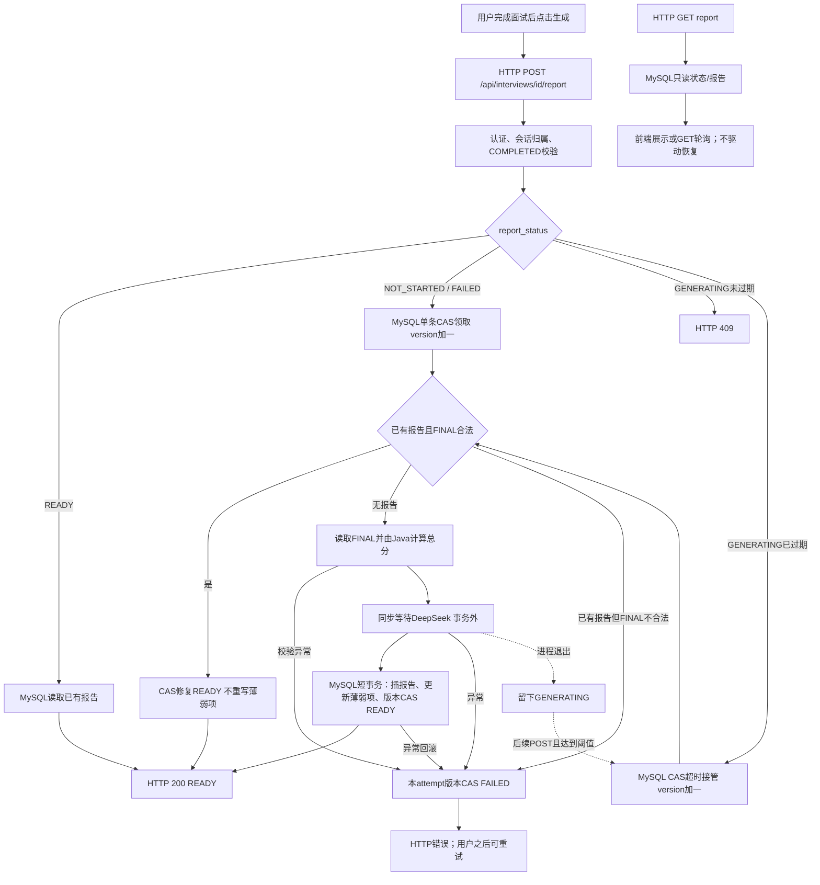
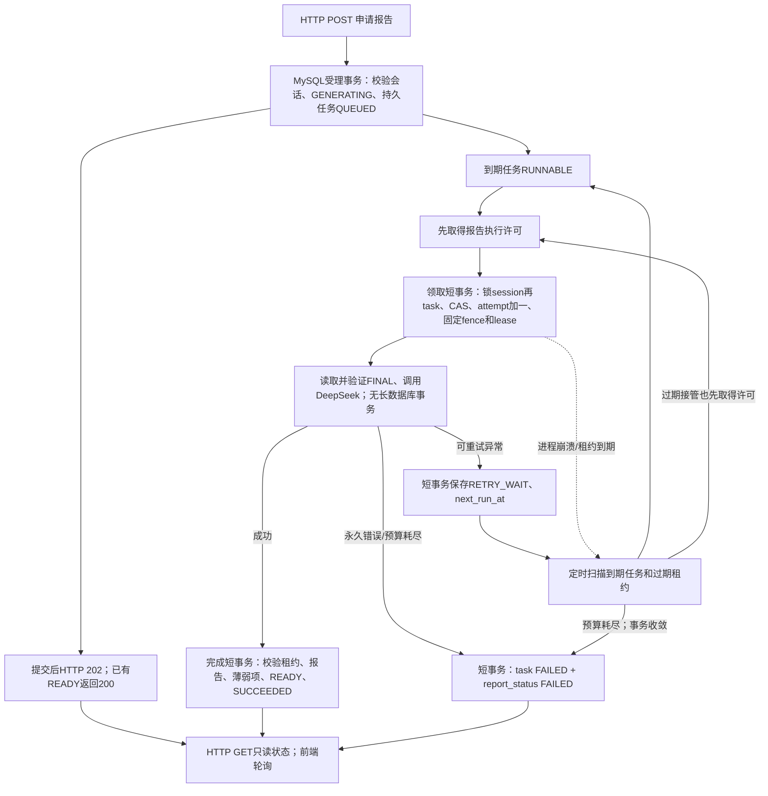
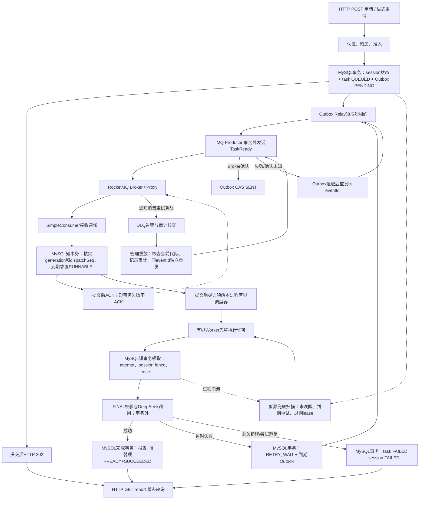

# Java 后端项目 MQ 架构可行性专项审查

- 审查日期：2026-11-13（Asia/Shanghai）。
- 范围：AI 模拟面试系统、飞机大战 Android 后端；Venue Booking 仅作已有实现参考。
- 性质：源码审查、架构评估与方案设计。本文所有“新增、修改、迁移、测试计划”均为后续建议，未实施。
- 唯一交付文件：/Users/kun/Developer/projects/ai-interview-system/docs/design/MQ_ARCHITECTURE_FEASIBILITY_REVIEW_20261113.md。
- 证据优先级：当前工作区源码与测试源码 > 可复核的历史测试产物 > 项目文档 > 架构推演。代码位置以本次工作区为准，未来修改后行号可能变化。

## 1. 执行摘要与明确结论

**最值得改造的是 AI 模拟面试系统的“用户主动申请生成面试报告”链路；最值得现在优先考虑的是持久化异步任务，不是立即部署 RocketMQ。**

1. 当前报告已与提交答案分离，有状态查询、前端轮询、CAS、版本隔离和超时接管，但生成 POST 仍同步等待 DeepSeek 与最终数据库事务。“有 GENERATING 状态”不等于“已有后台异步执行器”。
2. 当前恢复由后续 POST 触发，没有自动扫描报告任务；GET 轮询不会接管。正常前端在 GENERATING 时也不开放再次生成，因此进程崩溃后的用户体验存在明确改进空间。
3. 首选路线为 MySQL 持久任务 + 有界 Worker + 自动恢复。单体或少量实例中，这足以解决请求等待、应用重启后继续执行、限制模型并发等主要问题。
4. RocketMQ 的当前必要性证据不足：未获得真实报告到达率、持续积压、数据库扫描成本或独立消费方需求。只有未来需要独立 Worker、跨实例低延迟通知，且对照测试证明收益时，才进入本文的 MQ 增量方案。
5. 飞机大战现在不引入 MQ。生产 WebSocket 只接通 WAITING 大厅；内部状态机、输入队列和循环骨架已有测试，但生产双人战斗、权威结束结果、成绩持久化和在线排行榜尚未接通。先完成这些业务，再决定结算是否需要异步。
6. Venue Booking 已有真实 RocketMQ、Outbox、任务租约、消费去重和故障实验。它更适合立即拿来学习既有 MQ 工程，不应算成“需要新引入 MQ”的候选。

本报告评分为 **AI 报告 80/100，飞机大战结算 38/100**，代表两个候选的相对改造适配度，不代表 MQ 已被证明必需。若现有同步报告体验与人工恢复都能满足当前使用，也可以暂不改造，先补基线测量。**目前不推荐给两个核心项目强行新增 MQ。**

### 1.1 现在与以后分别做什么

- 现在：确认报告受理与结果展示契约，测量等待和恢复问题，验证数据库任务方案。
- 条件成立后：只给 AI 报告任务增加 RocketMQ 唤醒通道，保留数据库为事实源与恢复依据。
- 游戏：优先完成开局、联机世界、战斗输出、权威结束和短事务结算；实时输入、移动、自动开火、碰撞、固定步进与快照不进入 MQ。
- 学习：先读 Venue 的真实发送/消费故障用例，再用 AI 报告做受控对照，避免重复搭建一套仅增加技术名词的系统。

## 2. 审查边界、仓库与验证状态

### 2.1 仓库基线

| 项目 | 本地绝对路径 | 分支与 HEAD | 审查前已有工作区内容 |
|---|---|---|---|
| AI | /Users/kun/Developer/projects/ai-interview-system | main；01ac774caff491b978dd2268e8b427355a64b97a | mvnw 已修改；compose.mac.local.yaml 未跟踪 |
| 游戏 | /Users/kun/Documents/University/实验课/软件构造实验/aircraft-war-android | feature/server-room-loop；e3d899ad0671412462a3537880f01f2c82ae0a6e | BattleWebSocketHandler.java 已修改，差异为四个空白行；另有学习文档、旧实验 ZIP、未命名目录三个未跟踪条目 |
| Venue | /Users/kun/Developer/projects/venue-booking | codex/backend-v1-readiness；a6ecd9237ab018ba705106e1c7a72b705e8349c7 | 15 项已跟踪修改，235 个未跟踪状态条目，未逐项展开到报告 |

已读取三个仓库的 AGENTS.md、相关项目文档及实际源码。AI 的 AGENTS.md 在审查开始时为1056行，包含不同阶段的历史描述；涉及 FINAL、知识处理重试和补偿时以当前实现为准。报告放入已有 docs/design/，符合 [AI 文档导航](/Users/kun/Developer/projects/ai-interview-system/docs/README.md:17)。不修改导航、不生成第二份报告。

未 fetch、提交、推送或创建 PR；本地远程跟踪分支不等于远端实时状态。不推断 Android 队友分支的完成情况。未读取密钥文件、连接业务数据库、启动服务、调用付费模型或新增中间件。

最终核对时，AI仓库另出现AGENTS.md新增工程记录规则，以及docs/engineering/中的IMPROVEMENT_LEDGER.md、SOURCE_LEARNING_BACKLOG.md。它们属于审查期间并发出现的工作区变化，并非本次工具写入，原样保留；第2.1节记录的是起始基线。新增规则涉及工程优化批次记录，本次只做审查且用户限定唯一文档，因此未更新这些记录。游戏与Venue的Git状态条目及三个仓库HEAD未变化。

本机只读确认：ARM64、Temurin Java 21.0.13；PATH 未发现 mvn，存在 Docker CLI。未验证 Docker daemon、Broker、数据库或模型服务当前可用性，后续实施须重新检查。没有必要为了文档审查启动这些服务。

### 2.2 本次验证与历史验证严格分开

**本次未运行 Maven、Gradle、前端测试或负载测试。** 用户限定只新增本报告，测试通常会生成构建文件并可能写入测试数据库；本次采用只读源码核对、现存 XML 重算及文档一致性检查。未执行不等于失败，也不等于通过。

| 证据 | 只读核对结果 | 可以证明什么 | 不能证明什么 |
|---|---|---|---|
| AI 现存 /private/tmp/ai-c3-20261112/full-reports/ | 134 份 XML；tests=1698，failures=0，errors=0，skipped=19，即 1679 项非跳过 | 2026-11-12 历史隔离 MySQL、Mock HTTP、Loopback 回归结果与归档吻合 | 本次 HEAD 重新运行、真实 DeepSeek/Embedding/Milvus、生产容量 |
| 游戏 game-server/build/test-results/test/ | 25 套件，327 项，失败/错误/跳过均 0；XML 为 2026-11-12 UTC | 账号、认证、真实 MySQL/Java WS 大厅、房间规则和内部循环的历史验证 | 生产双人战斗、Android 真机、完整结算、真实慢网络压力 |
| 游戏 game-core/build/test-results/test/ | 38 套件，403 项，失败/错误/跳过均 0；XML 为 2026-11-12 UTC | 单机共享核心历史验证 | 已具备双人权威世界或双人 Boss 闭环 |
| Venue 历史 M2 原始 results.json 与验收文档 | 固定旧基线 5c1940d，93 项：双进程15、消息29、候补30、DLQ12、观测7 | 真实 Broker、双 API/Worker、模拟支付和注入故障历史结果 | 当前工作树新回归、真实支付、生产 HA 与长期容量 |

AI 归档入口：[C3 收口报告](/Users/kun/Developer/projects/ai-interview-system/docs/verification/C3_B4A_B4C_CLOSEOUT_20261112.md:102)。focused 136、business 336 与 full 1698 是重叠测试，不能相加宣传。19 个跳过包含受保护真实服务测试及 AI baseline。更早的真实 DeepSeek E2E 曾完成报告，但首次成功门禁 FAIL、报告出现过字段校验 502 后重试恢复；见 [历史 E2E 评测](/Users/kun/Developer/projects/ai-interview-system/docs/evaluation/E2E_EVALUATION_REPORT.md:43)。不能推导“从未验证真实模型”，也不能将该历史说成当前模型已通过。

本文使用三种标签：

- **已实现并有测试证据**：有相应测试源码，必要时有上述历史执行记录；不代表本次执行。
- **已实现但缺少验证**：源码存在，但目标场景的真实集成、负载或故障证据不足。
- **尚未实现/规划**：只在文档契约中出现，或仅有未接生产入口的局部骨架。

## 3. AI 模拟面试系统：源码事实

### 3.1 从作答完成到报告生成

1. 答案评估仍是同步业务链：作答 → RAG → DeepSeek 建议 → Java 校验和计分 → 确定性追问/下一题/完成。
2. 最后一次有效 FINAL 与答案状态、会话 COMPLETED 在短事务内提交；不自动生成报告。
3. 用户另行 POST /api/interviews/{sessionId}/report；入口做认证身份与归属校验，再调用报告服务。
4. READY 直接返回既有报告。NOT_STARTED/FAILED 使用条件更新领取；GENERATING 未过期返回冲突，过期才允许版本 CAS 接管。
5. 成功领取后使用“原 version + 1”作为本次固定令牌，不能重读新版本再冒充当前执行者。
6. 查询每个 MAIN 的有效 FINAL，验证题目/答卷关联与完整性，由 Java 计算 overallScore；模型生成摘要、优势、弱点与建议。
7. DeepSeek 在数据库事务外同步调用。随后短事务插入报告、更新用户薄弱项、CAS 将会话改 READY 并写 total_score；任何一步失败全部回滚。
8. RuntimeException 触发本次版本的 FAILED 更新；进程直接消失则来不及执行该 catch，留下 GENERATING，等后续 POST 接管。

| 源码证据 | 关键位置、类/方法与结论 | 状态 |
|---|---|---|
| A1 | [InterviewController](/Users/kun/Developer/projects/ai-interview-system/src/main/java/com/kun/aiinterview/interview/controller/InterviewController.java:105)，105/119 行：GET/POST；POST 直接调用 generateReportForApi | 已实现并有测试证据 |
| A2 | [InterviewReportService](/Users/kun/Developer/projects/ai-interview-system/src/main/java/com/kun/aiinterview/interview/service/InterviewReportService.java:96)，96–187 行：generateReportForApi → generateReport → generateClaimedReport，同步返回 READY | 已实现并有测试证据 |
| A3 | [InterviewSessionMapper.xml](/Users/kun/Developer/projects/ai-interview-system/src/main/resources/mapper/InterviewSessionMapper.xml:136)，136/148/160/172 行：claimReportGeneration、reclaimStaleGenerating、markReportReady、markReportFailed 的状态/version 条件 | 已实现并有测试证据 |
| A4 | [InterviewReportTransactionService](/Users/kun/Developer/projects/ai-interview-system/src/main/java/com/kun/aiinterview/interview/service/InterviewReportTransactionService.java:26)，completeReportGeneration，26–67 行：报告+薄弱项+READY 同一事务 | 已实现并有测试证据 |
| A5 | [DeepSeekInterviewReportGenerator](/Users/kun/Developer/projects/ai-interview-system/src/main/java/com/kun/aiinterview/interview/report/deepseek/DeepSeekInterviewReportGenerator.java:57)，57–97 行：一次 completeJson、结构化字段校验、等级由 Java 判定 | 已实现并有测试证据 |
| A6 | [DeepSeekEvaluationClient](/Users/kun/Developer/projects/ai-interview-system/src/main/java/com/kun/aiinterview/interview/evaluation/llm/deepseek/DeepSeekEvaluationClient.java:85)，85/156/193/209 行：同步 HTTP，失败诊断与脱敏；诊断分类不等于自动重试策略 | 已实现并有测试证据 |
| A7 | [InterviewWorkflowTransactionService](/Users/kun/Developer/projects/ai-interview-system/src/main/java/com/kun/aiinterview/interview/service/InterviewWorkflowTransactionService.java:351)，351–388 行：最后 FINAL 与 COMPLETED 事务；报告另行申请 | 已实现并有测试证据 |
| A8 | [AnswerEvaluationMapper.xml](/Users/kun/Developer/projects/ai-interview-system/src/main/resources/mapper/AnswerEvaluationMapper.xml:215)，215–253 行只取 FINAL；A2 的248–366行验证完整性并计算分数 | 已实现并有测试证据 |
| A9 | [ai_interview.sql](/Users/kun/Developer/projects/ai-interview-system/sql/ai_interview.sql:654)，654/677 行：报告表及 session_id 唯一约束；112–157行会话初始 NOT_STARTED | 已实现并有测试证据 |

**事务边界已经合理，不需要为了引入 MQ 推倒重来。** 模型调用不持有最终写入事务；现有最大可复用价值在 FINAL 规则、计分、唯一键、CAS 和原子提交，不在改成几个 Producer/Consumer 类。

### 3.2 当前“异步程度”与恢复缺口

报告与作答链路解耦的是**业务触发时机**，不是执行线程。后台没有找到报告 @Async、调度扫描、持久任务领取器或 MQ 消费者。

- [前端 useInterviewReport](/Users/kun/Developer/projects/ai-interview-system/frontend/src/features/interview/composables/useInterviewReport.ts:310) 的 generate 在329行 await POST；31/106/117/249行等实现状态观察和约3秒 GET 轮询。
- [httpClient](/Users/kun/Developer/projects/ai-interview-system/frontend/src/api/httpClient.ts:63) 配置120秒客户端超时；这不改变后端同步语义。
- [application.yaml](/Users/kun/Developer/projects/ai-interview-system/src/main/resources/application.yaml:55) 的 DeepSeek 默认连接/读取超时为3秒/60秒；是配置默认值，未读取本地秘密配置核对运行值，也不能简单相加当作整个报告的硬耗时上限。
- [StaleRecoveryProperties](/Users/kun/Developer/projects/ai-interview-system/src/main/java/com/kun/aiinterview/common/recovery/StaleRecoveryProperties.java:19) 的 GENERATING 默认10分钟、PROCESSING默认15分钟，最低阈值1分钟；它只提供过期判断，不是后台恢复器。
- GET 无副作用。前端 generate 仅允许 NOT_STARTED/FAILED（313–317行），因此一直轮询 GENERATING 不会自动触发已有 POST 接管逻辑。
- 当前无报告模型调用的显式全局并发预算。即使 Servlet 容器有线程限制，也不等于符合供应商配额的业务背压。

上述请求阻塞和恢复路径由源码可证；真实等待分布、超时频率、供应商限额、峰值积压尚未测量。

### 3.3 当前状态机与幂等边界

| 起点 | 当前动作 | 终点/保证 |
|---|---|---|
| NOT_STARTED 或 FAILED | CAS 校验 COMPLETED、version、原报告状态 | GENERATING，version+1，唯一领取者 |
| GENERATING 未过期 | POST 再次进入 | 409；不重复模型调用 |
| GENERATING 已过期 | 更新 version 与 updated_at | 仍 GENERATING；旧版本不能完成/标失败 |
| GENERATING | 报告、薄弱项、READY 一次提交 | READY；报告 UNIQUE(session_id) 兜底 |
| GENERATING | 可捕获运行异常 | 本次版本条件更新 FAILED |
| READY | 再次 POST/GET | 返回原报告，不重新生成 |
| 非 READY 但已存在报告 | 校验 FINAL、CAS 修复 READY | 不再次调用模型，不再次更新薄弱项 |

已有报告恢复见 A2 的208–234行。唯一键冲突不是无条件成功信号；还要判断真实事务状态与数据一致性。

版本隔离保证旧结果不能覆盖新结果，不保证模型只被调用一次。超时接管时，旧 HTTP 请求可能仍在供应商执行，重复计费、重复文本生成都可能发生。这个边界引入 MQ 后仍存在。

### 3.4 薄弱项的跨会话顺序必须保留说明

[UserWeaknessService](/Users/kun/Developer/projects/ai-interview-system/src/main/java/com/kun/aiinterview/user/service/UserWeaknessService.java:26) 按同场 FINAL 的知识点聚合；[UserWeaknessMapper.xml](/Users/kun/Developer/projects/ai-interview-system/src/main/resources/mapper/UserWeaknessMapper.xml:26) 的 upsert 会覆盖分数、discovered_count+1、设 ACTIVE，较好结果只 resolve 已有 ACTIVE。

同一用户先结束的低分场 A 生成较慢，后结束的高分场 B 先写入时可能没有 ACTIVE 可解决；A 后写又变 ACTIVE。反序写入则可能 RESOLVED。**当前语义是报告应用事务的实际顺序，不是按面试 ended_at 的顺序。**

本次最小方案沿用当前语义，并要求针对反序完成写测试。若产品要求按面试结束时间更新，必须另行设计带时序水位的投影或不可变贡献记录；GOOD 也要留下水位，计数还要防重复。简单 FIFO、每用户串行或给记录加一个 version，并不能自动处理晚到的旧场次与累计次数。不同用户由 user_id 隔离，不应混称为跨用户顺序问题。

### 3.5 测试证据与缺口

| 测试源码 | 已覆盖内容（均为现有测试，不是本次新运行） |
|---|---|
| [InterviewReportTransactionServiceIntegrationTest](/Users/kun/Developer/projects/ai-interview-system/src/test/java/com/kun/aiinterview/interview/service/InterviewReportTransactionServiceIntegrationTest.java:145) | 145行原子完成；200行旧版本回滚；265行薄弱项失败回滚；307行新旧任务交错；388行并发唯一效果；447行模拟崩溃后 POST 恢复。历史9项 |
| [InterviewReportFinalConsistencyIntegrationTest](/Users/kun/Developer/projects/ai-interview-system/src/test/java/com/kun/aiinterview/interview/service/InterviewReportFinalConsistencyIntegrationTest.java:116) | 116/140/200/214/228/245行：FINAL 完整性、历史 READY、异常旧行、回滚重试。历史24项 |
| [InterviewReportApiServiceTest](/Users/kun/Developer/projects/ai-interview-system/src/test/java/com/kun/aiinterview/interview/service/InterviewReportApiServiceTest.java:114) | 94行归属拒绝，114行状态查询无副作用；历史9项 |
| [InterviewControllerTest](/Users/kun/Developer/projects/ai-interview-system/src/test/java/com/kun/aiinterview/interview/controller/InterviewControllerTest.java:121) | 未登录、JWT身份传递、伪造userId与响应字段，121/326/365行；历史16项。归属拒绝证据见上一行 |
| [DeepSeekInterviewReportGeneratorTest](/Users/kun/Developer/projects/ai-interview-system/src/test/java/com/kun/aiinterview/interview/report/deepseek/DeepSeekInterviewReportGeneratorTest.java:80) | Mock HTTP 成功与字段校验，80/141/173行；历史13项 |
| [FullInterviewBusinessOfflineTest](/Users/kun/Developer/projects/ai-interview-system/src/test/java/com/kun/aiinterview/interview/service/FullInterviewBusinessOfflineTest.java:188) | 公开业务链与报告故障传播，188/373行；历史112项，外部服务替身 |
| [InterviewReportView.spec.ts](/Users/kun/Developer/projects/ai-interview-system/frontend/tests/InterviewReportView.spec.ts:147) | GENERATING/409 仅 GET 轮询，147/508行；未在本次重跑 |

尚缺：202 受理契约、持久队列、Worker 重启、主动扫描、多实例任务领取、MQ 双写窗口、ACK 丢失、积压准入、真实模型负载和跨场次反序规则的专项验收。现有测试可靠性基础较强，但不能等同已测试 MQ。

### 3.6 不只报告：其他候选比较

| 场景 | 当前实现与证据 | MQ 判断 |
|---|---|---|
| 知识文档处理 | [AdminKnowledgeDocumentController](/Users/kun/Developer/projects/ai-interview-system/src/main/java/com/kun/aiinterview/knowledge/controller/AdminKnowledgeDocumentController.java:34) 同步 process；[KnowledgeDocumentProcessingService](/Users/kun/Developer/projects/ai-interview-system/src/main/java/com/kun/aiinterview/knowledge/service/KnowledgeDocumentProcessingService.java:60) 的60–225行：领取、切片、Embedding、Milvus、MySQL；261行 attemptId-chunkIndex 隔离向量 | 是第二候选。批量导入、独立资源池时有价值；当前仅管理员显式触发，频率未知、未见批量负载证据，优先级低于面向用户的报告 |
| 知识处理恢复 | [KnowledgeDocumentProcessingTransactionService](/Users/kun/Developer/projects/ai-interview-system/src/main/java/com/kun/aiinterview/knowledge/service/KnowledgeDocumentProcessingTransactionService.java:21) 21–67行锁文档、验证 attempt、替换 chunks/READY；上层105–153行核实未知提交、仅清理本批确切向量 ID | 已有复杂一致性边界；MQ 无法原子提交 MySQL+Milvus，也无法消除迟到向量 |
| 作答评分、RAG 与追问 | [InterviewService](/Users/kun/Developer/projects/ai-interview-system/src/main/java/com/kun/aiinterview/interview/service/InterviewService.java:274) 与 [EvaluationOrchestrationService](/Users/kun/Developer/projects/ai-interview-system/src/main/java/com/kun/aiinterview/interview/orchestration/EvaluationOrchestrationService.java:129)：结果决定下一题和追问 | 保留当前交互；改 MQ 会扩大 API/前端状态机范围，收益尚未证明 |
| 薄弱项更新 | 已处于报告最终短事务内，有计数与解决状态 | 不拆成第二个消费者；会把已有强一致性改成需要去重和时序投影的新问题 |
| 历史、报告查询 | MySQL 查询 | 保持同步读；MQ 不解决查询索引问题 |
| 邮件通知、分析事件 | 未确认有实际产品闭环 | 不为了 MQ 创造场景 |

知识处理的 [KnowledgeAttemptFencingIntegrationTest](/Users/kun/Developer/projects/ai-interview-system/src/test/java/com/kun/aiinterview/knowledge/service/KnowledgeAttemptFencingIntegrationTest.java:98) 覆盖98/190/202行的旧任务、迟到插入和检索资格，历史16项；[2026-10-19并发验收](/Users/kun/Developer/projects/ai-interview-system/docs/verification/CONCURRENCY_FINAL_ACCEPTANCE_20261019.md:43) 另有隔离真实 MySQL/Milvus + Fake Embedding 的10项历史交错测试。真实向量补偿经验可借鉴，但不作为报告链路首期新增任务。

## 4. 飞机大战：已实现与规划的边界

### 4.1 实际技术栈和生产入口

[game-server/build.gradle](/Users/kun/Documents/University/实验课/软件构造实验/aircraft-war-android/game-server/build.gradle:1) 使用 Java21、Spring Boot3.5.16、Security、WebSocket、MyBatis3.0.5、MySQL、Flyway、Testcontainers；[game-core/build.gradle](/Users/kun/Documents/University/实验课/软件构造实验/aircraft-war-android/game-core/build.gradle:14) 保持 Java11兼容。

| 能力 | 当前事实与源码 | 判断 |
|---|---|---|
| 账号、登录、刷新、退出 | [AuthController](/Users/kun/Documents/University/实验课/软件构造实验/aircraft-war-android/game-server/src/main/java/edu/hitsz/aircraftwar/server/auth/AuthController.java:31)，31–67行；[AuthTransactions](/Users/kun/Documents/University/实验课/软件构造实验/aircraft-war-android/game-server/src/main/java/edu/hitsz/aircraftwar/server/auth/AuthTransactions.java:43)，43–159行短事务、行锁、token轮换 | 已实现并有测试证据 |
| Security 与 WS 身份 | [SecurityConfiguration](/Users/kun/Documents/University/实验课/软件构造实验/aircraft-war-android/game-server/src/main/java/edu/hitsz/aircraftwar/server/auth/SecurityConfiguration.java:59)，59–79行无状态、WS需认证；账号哈希 Argon2id | 已实现并有测试证据 |
| WS 生产消息 | [BattleWebSocketHandler](/Users/kun/Documents/University/实验课/软件构造实验/aircraft-war-android/game-server/src/main/java/edu/hitsz/aircraftwar/server/battle/BattleWebSocketHandler.java:150)，150–184行只处理 PING 与大厅；START_GAME/MOVE_INPUT/ACTION_INPUT 当前拒绝 INVALID_INPUT | 已实现并有测试证据；不能称生产战斗已通 |
| 房间生命周期 | [RoomManager](/Users/kun/Documents/University/实验课/软件构造实验/aircraft-war-android/game-server/src/main/java/edu/hitsz/aircraftwar/server/battle/RoomManager.java:29)，29–68/131–209行：进程内双索引、两人房、WAITING断线保留与约30秒清理；READY不自动开局 | 已实现并有测试证据 |
| 状态规则 | [GameRoom](/Users/kun/Documents/University/实验课/软件构造实验/aircraft-war-android/game-server/src/main/java/edu/hitsz/aircraftwar/server/battle/GameRoom.java:35)，35–104行验证房主/准备/连接/matchId；RoomManager70–128行 commitStart/finishMatch/openLoop 包内方法 | 规则与测试已实现，生产开局/结束未接 |
| Game Loop 骨架 | [RoomGameLoop](/Users/kun/Documents/University/实验课/软件构造实验/aircraft-war-android/game-server/src/main/java/edu/hitsz/aircraftwar/server/battle/RoomGameLoop.java:13)，13–175行：每房128队列、40ms tick门控、每tick最多32条、固定窗100次尝试/秒、1秒输入TTL、CAS串行 | 已实现并有局部测试；不是已运行的生产游戏调度 |
| 单机 Core 与 Boss | [CoreWorld](/Users/kun/Documents/University/实验课/软件构造实验/aircraft-war-android/game-core/src/main/java/edu/hitsz/aircraftwar/core/world/CoreWorld.java:55)，55–64/359–371行单 Hero；786–819/884–902行死亡与 Boss 逻辑 | 单机已实现有测试；Boss击毁计分掉落，非双人结束事件 |
| 双人权威世界、快照、战斗重连 | 生产 handler 未接，loop 无世界执行和网络快照输出 | 尚未实现完整闭环 |
| 战绩、排行榜、历史统计 | 当前两份迁移创建 player_account、auth_session、auth_refresh_token 三张表，Mapper仅账号与认证；[协议草案](/Users/kun/Documents/University/实验课/软件构造实验/aircraft-war-android/docs/PROTOCOL.md:174) 174–192/298–303行写有未来 GAME_ENDED 和结算契约 | 尚未实现/规划 |
| Android 本地入口 | [MainActivity](/Users/kun/Documents/University/实验课/软件构造实验/aircraft-war-android/android-app/app/src/main/java/edu/hitsz/aircraftwar/android/MainActivity.java:12) 12–18行引导 TextView | 本工作区事实，不推断其他人分支 |

房间、连接、输入都在进程内；重启不保证保存未完成对局。MQ 也不会自动提供房间归属、连接迁移或战斗重连。

### 4.2 并发、事务、外部调用与瓶颈

认证使用 MySQL 事务；登录/刷新按固定锁序保护会话轮换。大厅采用连接/房间同步保护，当前核心没有 DeepSeek 等外部服务。等待房间清理的 @Scheduled 并非战场调度。

Handler230–355行对每连接维护256容量发送队列与单发送者 CAS，满载或 IO 失败断开；但实际 send 在调用者或定时线程锁外同步执行，慢发送可能拖住该线程及后续收件人。现有 Mock 慢连接测试不等于真实网络背压验收。应先测量并解决这类直接链路问题，MQ 不是 WebSocket 输出阻塞的替代修复。

Game Loop 的40ms配置、输入上限是代码参数，不是已经证明的实际 tick 延迟或吞吐。多人结算负载应按“每秒结束几局、每局最多两条 COOP 成绩”测量，不能拿每秒输入或 tick 次数冒充结算 QPS。

### 4.3 游戏测试能证明到哪里

- [BattleWebSocketIntegrationTest](/Users/kun/Documents/University/实验课/软件构造实验/aircraft-war-android/game-server/src/test/java/edu/hitsz/aircraftwar/server/auth/BattleWebSocketIntegrationTest.java:248)：248–270行证实双方准备仍 WAITING，START_GAME 拒绝；284/336/359行验证等待期重连/到期。
- [AuthHttpTestSupport](/Users/kun/Documents/University/实验课/软件构造实验/aircraft-war-android/game-server/src/test/java/edu/hitsz/aircraftwar/server/auth/AuthHttpTestSupport.java:22) 使用 RANDOM_PORT；AuthMySqlConfiguration19–27行使用隔离 MySQL8.4.7 Testcontainer。
- [RoomGameLoopTest](/Users/kun/Documents/University/实验课/软件构造实验/aircraft-war-android/game-server/src/test/java/edu/hitsz/aircraftwar/server/battle/RoomGameLoopTest.java:41)：FIFO、队满、限流、TTL、过期连接、两房隔离、结束竞争；335–375行明确三个战斗指令仍拒绝。RUNNING由测试夹具开启。
- [RoomManagerConcurrencyTest](/Users/kun/Documents/University/实验课/软件构造实验/aircraft-war-android/game-server/src/test/java/edu/hitsz/aircraftwar/server/battle/RoomManagerConcurrencyTest.java:63)：同锁竞争和防重复状态转换。
- [RoomBroadcastTest](/Users/kun/Documents/University/实验课/软件构造实验/aircraft-war-android/game-server/src/test/java/edu/hitsz/aircraftwar/server/battle/RoomBroadcastTest.java:41)：模拟慢连接、失败和有界队列。
- [BossLifecycleTest](/Users/kun/Documents/University/实验课/软件构造实验/aircraft-war-android/game-core/src/test/java/edu/hitsz/aircraftwar/core/world/BossLifecycleTest.java:48)：48行验证单机Boss击毁不直接结束，153行验证单次GAME_OVER。
- [开发路线](/Users/kun/Documents/University/实验课/软件构造实验/aircraft-war-android/docs/server/DEVELOPMENT_PROGRESS_AND_ROADMAP.md:128)：B06/B07/B09/B10及性能阶段仍为后续；MQ/Redis deferred。B05生产提交 f20d24f 到当前 HEAD 仅文档变化，不改变本轮未重测的事实。

### 4.4 游戏结算未来用最简单的闭环

本报告不为游戏设计第二套完整 MQ 架构，只给下一阶段决策边界：

1. 权威战场产生不可变结果，以服务端 matchId 为事实标识；客户端不能任意报分。
2. 战场锁与固定步之外执行短事务：对局记录与两名玩家成绩一起提交；UNIQUE(matchId,playerId)，同键同内容返回原结果，同键异内容拒绝并留审计。
3. 首期榜单、历史直接查询同一成绩事实表，无双写就没有缓存投影一致性问题。
4. 若先广播 GAME_ENDED，明确区分“战斗结束”和“战绩已持久化”。需要承诺不丢已确认成绩时，持久化成功后才给持久化确认；内存异步队列和 MQ 发布之前的崩溃均可能丢结果。
5. 确有热点读再加 Redis，可重建且有陈旧指标；不要把无去重的 ZINCRBY 当可靠结算。未来独立排行榜投影用已提交 MatchSettled + Outbox、投影幂等/绝对值更新或原子去重。
6. 只有真实集中结算压迫、多个独立消费方、恢复与扩展需求出现，才考虑 MQ。发送网络 IO 仍应离开 tick/房间锁，新增 Broker 不应进入实时动作关键路径。

## 5. Venue Booking：已有 MQ 的实际价值与限制

这是已有可靠消息链路的辅助样本，不参与新引入 MQ 的评分。

- [RocketMqTransport](/Users/kun/Developer/projects/venue-booking/backend/messaging/src/main/java/com/venuebooking/messaging/RocketMqTransport.java:28) 使用官方 gRPC Client，同步 send、eventId key、SimpleConsumer显式 ACK；[messaging/pom.xml](/Users/kun/Developer/projects/venue-booking/backend/messaging/pom.xml:12) 固定 rocketmq-client-java5.2.2。
- [BookingKernel](/Users/kun/Developer/projects/venue-booking/backend/persistence/src/main/java/com/venuebooking/core/BookingKernel.java:320) 的320–388行在业务事务内登记 Outbox；新增 MONEY_DISPATCH 才产生 TaskReady。支付/退款外呼是真实异步任务价值，不是“发送一条日志”。
- [MessageService](/Users/kun/Developer/projects/venue-booking/backend/persistence/src/main/java/com/venuebooking/core/MessageService.java:68) 的68–179行管理发送、按(event_id,consumer_group)去重、持久化 mq_ready；普通业务事件仅 EVENT_OBSERVED，不应宣传所有事件都有完整下游业务。
- [MessageWorker](/Users/kun/Developer/projects/venue-booking/backend/worker/src/main/java/com/venuebooking/worker/MessageWorker.java:58) 58–147行：发送后登记 ACCEPTED、消费数据库事务提交后 ACK；15秒不可见期用于短唤醒事务。
- [TaskService](/Users/kun/Developer/projects/venue-booking/backend/persistence/src/main/java/com/venuebooking/core/TaskService.java:87) 87–106/154–197/239行：独立任务租约，事务外渠道调用，完成事务 token fencing；MQ 未唤醒时 DB 约30秒后扫描接管。
- [WaitlistService](/Users/kun/Developer/projects/venue-booking/backend/persistence/src/main/java/com/venuebooking/core/WaitlistService.java:290) 290–355/422–459行：候补仲裁依赖数据库锁与按日扫描，不是消费者直接仲裁。
- [MessageMapper.xml](/Users/kun/Developer/projects/venue-booking/backend/persistence/src/main/resources/com/venuebooking/persistence/mapper/MessageMapper.xml:13) 有 SKIP LOCKED、发布租约与 token CAS；MessageService183–239行有隔离、DLQ录入与审计重放。
- [rocketmq.yml](/Users/kun/Developer/projects/venue-booking/infra/compose/rocketmq.yml:14) 固定 RocketMQ5.3.3镜像digest、单NameServer、单Broker/Proxy；broker.conf6–11行同步刷盘/72小时保留，不等于副本高可用。

[scripts/acceptance-m2-messaging.py](/Users/kun/Developer/projects/venue-booking/scripts/acceptance-m2-messaging.py:71) 有发送后未登记、消费提交未ACK、Broker暂停；[acceptance-m2-dlq.py](/Users/kun/Developer/projects/venue-booking/scripts/acceptance-m2-dlq.py:59) 有真实DLQ/受控重放。历史验收边界见 [BACKEND_V1_FRONTEND_READINESS](/Users/kun/Developer/projects/venue-booking/docs/06-review/BACKEND_V1_FRONTEND_READINESS.md:122)。

局限：单Broker无HA；发布失败持续退避无终止态；DLQ需要显式运维处理；历史无自动归档和入口背压，长期公平性/容量未证实。资金模拟渠道可用稳定商户单号去重，DeepSeek没有在本次审查中确认等价能力，不能照搬“外呼只生效一次”。

## 6. MQ 的真实价值：概念与方案比较

### 6.1 七个概念不能混为一谈

| 概念 | 在报告业务中的具体含义 | 由谁提供 |
|---|---|---|
| 异步处理 | HTTP先受理，报告稍后完成 | API契约+持久任务+Worker；不要求MQ |
| 系统解耦 | API与任务执行进程独立部署、失败隔离 | 模块边界/Worker；MQ可提供通知通道，但共用DB仍有数据耦合 |
| 消息持久化 | 已受理通知可在进程退出后保留 | Outbox/任务表与Broker存储；内存线程池没有这个承诺 |
| 削峰填谷 | 到达短期超过执行能力时先存储等待 | 有容量边界的DB队列或Broker；不会增加模型服务能力 |
| 背压与并发控制 | 避免无限受理、无限领取、无限占用模型配额 | 入口准入、执行令牌、队列上限、全局预算；不是“用了MQ”自动获得 |
| 可靠投递 | 提交后的工作能再次被发现、投递和处理 | Outbox重发、消费幂等、扫描、监控；ACK仅是某一边界的确认 |
| 最终一致性 | GENERATING最终成为READY或可解释终态，投影符合事实 | 状态机、事务、重试与人工修复；不等于永远自动成功 |

### 6.2 A/B/C/D 方案逐项评估

| 方案 | AI 报告 | 游戏结算 | 主要代价与适用边界 |
|---|---|---|---|
| A 保持当前架构 | 低频可用，已有CAS/事务；POST阻塞且崩溃恢复依赖重入 | 先完成现有开发路线，再用短事务结算最合理 | 最少组件；接受当前体验和恢复方式 |
| B1 普通 Spring @Async/线程池 | 可释放HTTP线程、限本机执行并发；单独使用无法可靠恢复已受理任务 | 可以隔离tick与落库，但内存任务可能丢失 | 有界队列、拒绝策略、异常观察；afterCommit投线程池仍有崩溃窗口 |
| B2 MySQL持久任务+有界Worker | 当前首选：接受状态、任务重试、lease、扫描，多实例可CAS领取 | 有可靠不丢结算需求时再加，先完成权威结果 | 增加任务生命周期和扫描索引；低规模通常比Broker简单 |
| C RocketMQ+Outbox+同一任务执行器 | 条件式选择：跨实例通知、独立Worker与消息可观测；主要基础能力仍来自B2 | 未来已提交结算通知多个独立投影时考虑 | 多一套组件、发送/ACK窗口、DLQ、磁盘与保留期治理 |
| D Kafka/RabbitMQ | 当前没有证明需要替换选型 | 同左 | 无持续事件流重放/流处理或特殊路由的明确需求，不展开新技术栈 |

Spring 异步执行需要受控 executor，代理调用与异常处理也有边界；线程队列应有容量。参见 [Spring Task Execution and Scheduling](https://docs.spring.io/spring-framework/reference/integration/scheduling.html)。它不是业务事务之后的持久作业存储。

### 6.3 对用户八个问题的直接回答

1. **为什么需要 MQ？** 当前需要的是缩短受理等待和自动恢复；MQ只在通知、独立消费和运营积压管理形成额外需求时有价值。
2. **规模足够吗？** 未发现两个项目足以证明MQ优势的真实业务负载。游戏高频tick不是高频结算；AI生成率和模型配额也未给出。
3. **不用 MQ 的实际问题？** 当前AI有请求线程占用、客户端不确定结果、崩溃后无自动推进；这些可用B2解决。游戏当前问题是业务链未完成。
4. **MQ 能解决什么？** 条件式异步通知、生产消费进程分离、通知缓冲与重投、独立订阅。本文方案中减少HTTP阻塞由B2提供，不能把全部收益归功MQ。
5. **不能解决什么？** 模型延迟/收费/质量、MySQL业务约束、重复外呼、全局配额、同用户薄弱项语义、战场权威归属、数据库长期写入瓶颈。
6. **新增成本？** Outbox与Broker监控、消息协议、重放权限、组件故障、存储清理、版本兼容、更多集成测试，以及开发机资源。
7. **单体是否过度设计？** 当前很可能是。已有数据库状态管理完善，首期B2性价比更高。
8. **多实例是否改变结论？** DB CAS也能支持多实例；多实例不是MQ必要条件。独立Worker、通知延迟或大量扫描确有压力时，MQ吸引力增加，但仍不替代DB fencing和全局预算。

定性容量关系：设到达率为λ，持续可完成率为μ；长期λ≥μ时，任何有限存储都会积压。以并发c和平均模型占用时间S得到的c/S只是理想上限估计，还受RPM/TPM、长尾和故障限制。没有实测数据，本报告不填写QPS或提升百分比。

### 6.4 MQ 进入条件与停止条件

至少先满足：已定义受理/完成SLO；B2故障恢复正确；有代表性负载基线；存在一个明确额外诉求（例如独立Worker通知延迟不满足目标、扫描成本有实测压力、确有独立事件消费者）；团队能维护Broker与DLQ。

比较B2与C时保持相同模型替身、数据库、执行并发、入站流量和故障条件。若C没有改善约定指标，或运维代价超过收益，停在B2。把“学习RocketMQ”记作学习收益，不伪装成生产必要性。

## 7. 100分评分矩阵

评分是基于本次源码和证据的工程判断，不是性能测量；相同权重对待两个核心候选。

| 维度 | 权重 | AI 报告得分与证据 | 游戏结算得分与证据 |
|---|---:|---|---|
| 真实业务需求与MQ契合度 | 30 | 23：真实用户等待外部模型，可异步；但DB任务即可满足主要需求 | 9：结束后有自然事件，但当前生产链未生成结算事实 |
| 明确工程收益 | 20 | 14：受理响应、自动恢复、模型并发预算可落地；MQ增量收益未证 | 5：无结算负载证据，同库读写更直接 |
| 现有代码复用 | 15 | 14：FINAL、计分、CAS、unique、报告/薄弱项事务和历史故障测试可复用 | 5：可复用认证/MyBatis/生命周期，结算领域尚待实现 |
| 风险与成本合理性 | 15 | 10：局部拆分可控，但双调度、外呼计费、迁移与顺序复杂 | 5：B06/B07/B10和双方协议仍在前，增加MQ扩大交付风险 |
| Java后端实习培养价值 | 15 | 14：可验证双写、幂等、租约、失败窗口、配额与证据；学习不等于业务必需 | 12：未来结算幂等/投影很好，但当前难与真实业务闭环结合 |
| 可测试性与可展示性 | 5 | 5：已有真实MySQL事务测试和Mock模型，可精确注入故障 | 2：局部测试扎实，尚无真实对局到排行的演示 |
| **总分** | **100** | **80** | **38** |

明确选择：AI 的按需报告生成。明确时机：先验证、再做持久化异步；不建议现在直接加Broker。另一项目：目前没有加入MQ的必要性。知识文档批处理为AI内部第二候选，未超过报告；Venue为已有样本，不因技术栈更丰富而参与竞争。

## 8. 最佳候选的目标架构：AI 报告

以下只设计 AI 报告一条业务链。B2 是当前推荐的可交付终点，C 是达到第6.4节门槛后的增量；二者共用同一个任务状态机和执行器，不实现两套模型处理逻辑。

### 8.1 改造前：当前源码流程

当前没有 Producer、Broker、Consumer。这是事实，不能把前端轮询画成后台任务。

### 8.2 当前首选：数据库任务 + 有界 Worker

自动重试期间公开报告状态仍 GENERATING；只有明确业务终止才 FAILED。任务内部 QUEUED/RUNNABLE/RUNNING/RETRY_WAIT 不必全部作为报告枚举暴露。需要时在响应中加入排队/执行提示，不谎报具体完成时间。

### 8.3 条件式 RocketMQ 增量：消息只做持久任务唤醒

**选择明确：TaskReady 是任务调度通知，不是 ReportGenerated 业务完成事件。Consumer 只完成短数据库唤醒事务；实际模型执行仍由持久任务 Worker 负责。** ACK 的含义是“通知对应的可恢复调度状态已提交”，不是“报告已完成”。

Consumer与任务调度器首期部署在同一Worker进程：短事务提交后发送best-effort本地唤醒信号给有界调度器，再按持久事实ACK；本地信号丢失由定时扫描恢复，不能只投不可恢复的线程队列。若二者拆成不同进程，必须另有可验证的调度信号，否则仅低频扫描仍可能抵消MQ的唤醒延迟收益。

优势是避免让长耗时模型调用占有 Broker 不可见期，无需同时续两种执行租约。代价是 MQ 主要增加唤醒路径，持久任务并未减少；如果扫描同样频繁且足够快，MQ 可能没有可测收益。必须诚实接受这种结果。

采用普通消息、一个报告任务 Topic、一个报告 Worker Consumer Group。多个 Worker 共享该组；不同业务订阅才另设组。Key 使用稳定事件标识便于排查，**Key 不提供业务去重**。消息不承载答卷正文、完整Prompt、模型输出、Token或用户凭据，只传小型元数据。

建议消息字段：schemaVersion、eventId、eventType=ReportTaskReady、taskId、sessionId、generationNo、dispatchSeq、createdAt、traceId。以数据库记录校验其合法性，不能相信消息传来的 userId、最终分数或任意状态。

官方说明：SimpleConsumer 暴露接收/ACK/不可见期操作；PushConsumer不能把未持久化工作扔到线程池后就返回成功。本方案的消费业务是已经提交的“唤醒”，后续模型任务由数据库恢复。[RocketMQ Consumer Types](https://rocketmq.apache.org/docs/featureBehavior/06consumertype/)

### 8.4 三类标识与两个状态机

不能把业务重试、Worker接管与Broker重投混成一个“重试次数”。

- generation：用户一次明确生成意图；首次申请创建，新一轮只允许在FAILED后的显式重试创建。READY不支持重生成。
- attempt/fence：同一generation下的执行领取/接管；每次领取计attempt、递增session.version，保存精确值。Broker重复通知不增加attempt。
- eventId/dispatchSeq：一次唤醒事件与调度轮次；发送不确定时重发相同eventId。业务退避后的新一轮唤醒使用新dispatchSeq，防旧通知提前执行。

任务状态：

| 当前状态 | 允许转换 | 前置条件 |
|---|---|---|
| 无任务 | QUEUED | 首次受理事务；会话COMPLETED，非READY；同会话唯一任务行 |
| QUEUED | RUNNABLE | 到期通知或扫描；generation/dispatchSeq匹配 |
| RUNNABLE | RUNNING | 已拿执行许可，锁session→task，CAS成功，attempt预算充足 |
| RUNNING | SUCCEEDED | 当前fence/lease有效；报告、薄弱项、READY与任务一并提交 |
| RUNNING | RETRY_WAIT | 可重试、预算允许；保存下一执行时间与安全原因 |
| RETRY_WAIT | RUNNABLE | 到期且generation/dispatchSeq匹配 |
| RUNNING过期 | 新RUNNING或FAILED | 扫描按同一锁序接管并增fence/attempt；耗尽则终止 |
| 任意待执行状态 | FAILED | 明确永久错误、总deadline或预算耗尽，经状态条件事务提交 |
| FAILED | 新generation的QUEUED | 显式重试带expectedGeneration；普通重复POST不能开启新一轮 |

公开状态仍用NOT_STARTED/GENERATING/READY/FAILED。GENERATING包括已排队、执行中和可重试等待。新路径的不变量是：

- 新受理的 COMPLETED+GENERATING 必须有对应非终态任务。
- READY/SUCCEEDED意味着唯一报告已提交，薄弱项本场效果没有因任务重放重复应用。
- 最终FAILED与task FAILED同事务。
- 历史READY可以没有任务；迁移遗留行单独对账，不强造任务。

### 8.5 数据结构建议及为什么需要

**B2必要：一张 report_generation_task。** 现有session状态是恢复依据，但缺少排队/执行区分、独立租约、退避时间、尝试预算和可操作失败原因。将这些全塞进会话表会混合业务与调度职责，因此建议独立任务表；不是声称任何异步都必须新表。

建议字段（设计，非DDL）：

| 字段组 | 建议内容与用途 |
|---|---|
| 主体 | id/taskId、session_id唯一；一行代表同会话当前任务，不允许并行活跃代际 |
| 代际 | generation_no、generation_id（对外可用不透明重试令牌）；FAILED显式重试替换代际 |
| 调度 | status、dispatch_seq、next_run_at、created_at、updated_at；执行查询索引(status,next_run_at,id) |
| 执行 | attempt_count、attempt_fence、lease_owner、lease_until、started_at、finished_at；过期索引(status,lease_until,id) |
| 策略/诊断 | max_attempts或策略版本、generation_deadline、last_error_code、安全短摘要、trace_id；不存未经脱敏的异常/Prompt |
| 限额 | 首期可由配置固定实例预算，不为未证实需求先建通用限流平台 |

租约和到期判断使用数据库时间，保存足够精度（如DATETIME(6)）；不要混用JVM本地时间和数据库时区而不测试。任务更新必须带generation+状态+fence/lease条件，检查影响行数。

**C才必要：report_task_outbox。** 建议 event_id主键；task_id/session_id、generation_no、dispatch_seq、event_type、schema_version、不可变payload；UNIQUE(task_id,generation_no,dispatch_seq,event_type)；status、available_at、send_attempts、next_send_at、lease_token、lease_until、last_error_code、sent_at。发送状态不代表业务完成。

首次受理及每次需要重试唤醒时，在同一MySQL事务内写任务和Outbox。普通通知由Relay按数据库时间到available_at才发，不为退避额外引入延迟Topic。索引覆盖待发到期与发送租约恢复。

首期无需新增通用消费Inbox：这个Consumer只做匹配generation/dispatchSeq的幂等条件状态转换，无计数累加。未来独立消费方有不可重复副作用时，再引入(eventId,consumerGroup)原子去重。C阶段若实现管理DLQ重放，需要持久化replay审计（优先复用已有审计设施，否则新增小型report_message_replay_audit，记录操作人、理由、原eventId、代际、结果与时间），不能用无记录脚本任意重放。任务历史审计表也可后续增加；当前行覆写时必须至少保留必要监控与安全日志，不能声称有完整代际审计历史。

**不修改既有报告唯一约束，不增加session当前任务外键作为首期必需项。** sessionId唯一任务关联已足够；session.version继续作为报告执行fence。但若未来其他模块也在报告生成期间更新该version，应重新审查冲突语义。

### 8.6 领取、完成与恢复的事务细节

1. HTTP受理锁session再task，校验归属、COMPLETED及任务状态，CAS到GENERATING并写QUEUED。仅提交成功后返回202。
2. Worker先获取执行许可，再尝试领取；不先把任务标RUNNING后放入长线程队列等候，避免排队消耗lease。
3. 领取事务按session→task固定顺序锁定与复核，递增session.version并把这次精确fence写入task，attempt+1，设置lease。失败全部回滚。
4. 外部模型调用在事务外；固定FINAL和计分规则，继续执行现有Java字段校验。
5. 完成事务先检查任务generation、RUNNING、fence、lease有效，再调用/复用原完成逻辑；报告、薄弱项、session READY、task SUCCEEDED必须同一事务。
6. 最后的任务条件更新仍需检查lease_until > DB NOW；零行必须抛错并回滚。检查约束的是这条SQL成功时的租约，不能保证物理COMMIT发生在墙钟到期之前；事务仍持锁，竞争接管须待锁释放后重验终态，因而不能双写。不能只在事务开头检查一次。
7. 捕获失败时同样校验fence；可重试更新RETRY_WAIT并建立下一唤醒，终止时session FAILED与task FAILED一起提交。
8. CAS落败、重复报告、提交确认未知时，先读task/session/report真值，区分已成功、已接管、可重试事务和实际失败。不能直接FAILED或再次打模型。
9. MySQL死锁/暂时提交失败优先用已取得模型结果重试短事务，并重验fence/lease；不得为一次数据库死锁重新调用模型。
10. 扫描仅无锁获取有限候选，随后按相同锁序重验CAS。不要在扫描先锁task、完成先锁session，制造倒序死锁；考虑分页/候选轮换，避免所有实例永远争同一条。

SKIP LOCKED可用于队列表降低锁竞争，但不是必须，也不代替状态条件和统一锁序。若使用它，须设计完整锁序与饥饿测试，不能把不一致扫描视图用于一般业务判断。[MySQL Locking Reads](https://dev.mysql.com/doc/refman/8.0/en/innodb-locking-reads.html)

初始可采用大于有限任务deadline的固定lease，或者有上限且带fence的心跳续租；参数先测后定。供应商请求超时不证明远端已停止，因此任何配置都不能保证外呼恰好一次。心跳不能让永久卡住的任务无限续命。

## 9. 可靠性、一致性与故障恢复矩阵

| 故障窗口 | 持久事实/判定 | 恢复动作与幂等边界 | 必须验证 |
|---|---|---|---|
| MySQL提交成功，MQ发布失败 | task与Outbox均已提交，PENDING/可恢复SENDING | Relay退避重发；DB扫描兜底，API已202不能反称业务未受理 | 断Broker后任务仍可发现并最终完成 |
| MQ发布成功，生产者没收到确认 | 发送结果未知，可能已入Broker | 同eventId重发；Consumer条件唤醒幂等 | 多次通知只产生一个有效领取 |
| Broker确认，Relay标SENT前崩溃 | Outbox租约最终到期 | 再发同eventId；SENT不是消费/报告完成证据 | 发送断点崩溃恢复 |
| Consumer收到通知后崩溃 | 唤醒事务未提交或结果未知 | 未ACK由Broker重投；扫描也能唤醒 | 消费前/事务中杀进程 |
| 唤醒事务成功，ACK失败 | RUNNABLE等事实已持久 | 重投只读/条件判定后ACK，不再重置attempt | 丢ACK、重复投递、并发消费者 |
| Worker领取后、模型调用前崩溃 | RUNNING与lease已持久 | lease到期接管；领取也计attempt，预算耗尽可收敛FAILED | 无无限RUNNING、无无限接管 |
| 模型成功但完成事务前崩溃 | 只有供应商成功，DB未保存结果 | lease到期可能重新调用；允许重复计费风险，不能承诺零重复 | 统计外呼次数与有效结果次数 |
| 完成事务成功但客户端/Worker未收到确认 | 报告/弱项/READY/SUCCEEDED已经原子提交 | 查询真值，返回既有报告；不得再更新薄弱项 | 提交未知/连接断开窗口 |
| 旧Worker在新接管后返回 | generation/fence或lease不匹配 | 整个旧完成/失败事务拒绝，不能污染新任务 | 旧成功/旧失败与新成功四种交错 |
| 外部超时/429/暂时5xx | 受控结构化错误码，远端可能已执行 | DB任务有限退避、抖动、总deadline/调用预算；遵守可安全使用的Retry-After | 慢响应、限流、计费不确定、总预算 |
| 非法模型JSON/业务不变量/鉴权配置错误 | 非瞬时或需要人工处理 | 首期直接FAILED/告警；不对所有错误盲重试 | 400/401/402/403/422、schema错不形成重试风暴 |
| 消息/任务持续积压 | 最老等待时间、到达/完成速率、quota与存储 | 暂停/限量受理、降低报告优先级、控制Worker；不以失败重投限流 | 有界内存、稳定答卷链路、无无限受理 |
| 通知消费重试耗尽 | Broker DLQ，DB任务可能仍可运行/已成功 | 告警、按generation/dispatch核查；管理路径记录审计后独立重发同eventId；终态和旧代际只审计处置 | 不让普通Relay重发SENT；不重开SUCCEEDED/FAILED |
| 模型业务尝试耗尽 | DB attempt/deadline达到预算 | task FAILED+session FAILED；向用户展示可理解原因和显式重试 | 最后一次崩溃也能终止 |
| Broker丢盘/保留期清理/停机 | MySQL仍保留任务与必要Outbox | DB扫描兜底；已完成不重做；超过期限的未完成任务告警/终止 | 消息不存在时仍可对账 |
| MySQL不可用 | 不能持久受理/领取/完成 | 新申请返回503；不202假成功，Consumer不假ACK，模型新调用暂停 | 数据库故障期间无虚假受理 |
| 非法payload/未知schema/不存在task | 不可信消息 | 隔离并审计，有限重试或DLQ；不通过payload创建报告任务 | 不暴露敏感内容、不无限毒消息循环 |

DLQ管理重放不是普通Relay扫描SENT：管理操作核对Outbox原消息和当前task，记录审计后独立调用Producer重发相同eventId/generation/dispatch；普通Relay仍只处理待发及发送租约过期的记录。重放不修改任务代际、尝试预算或终态，非法/陈旧通知保留可追踪处置。合法提前到达的通知也不能提前执行模型，Consumer按数据库时间核对，到期扫描继续兜底。

### 9.1 只有一个模型重试调度者

- Broker重试仅解决“通知未完成持久化”的故障。
- 模型执行失败、业务退避、最大attempt和最终FAILED都由任务状态机管理。
- 兜底扫描与MQConsumer调用同一唤醒/领取规则；通知无权重置attempt、lease或代际。
- 当前同步POST的updated_at超时接管路径必须退出新任务执行流；不与新扫描并行运行。
- QUEUED的正常等待与RUNNING崩溃必须分开。不能把排队超过原10分钟阈值当成执行者死亡。
- 长期扫描失败也要告警；“有定时任务”不是已具备可运维恢复。

RocketMQ官方明确，消费重试不是正常业务流程控制或限流机制；重试耗尽进入DLQ也不代表业务已自动修复。[Consumption Retry](https://rocketmq.apache.org/docs/featureBehavior/10consumerretrypolicy/)

### 9.2 Outbox与事务消息的取舍

本方案选择Transactional Outbox，因为受理任务本来就在MySQL中，任务与待发记录可在一个本地事务提交，发送失败也可检索和运维。

只在afterCommit回调发送无法覆盖“数据库已提交、回调尚未执行就退出”；在事务内先发普通MQ则可能“消息已见、数据库回滚”。Producer内建重试也不能消除最终发送失败。[Sending Retry and Throttling Policy](https://rocketmq.apache.org/docs/featureBehavior/05sendretrypolicy/)

RocketMQ事务消息也能连接本地事务与消息可见性，但需要半消息、本地执行结果和事务回查设计；它不包住模型调用，也不保证下游消费结果。这里已经有任务和数据库兜底，首期不同时引入事务消息和Outbox两套桥接机制。[Transaction Message](https://rocketmq.apache.org/docs/featureBehavior/04transactionmessage/)

### 9.3 消息顺序与业务顺序

不同会话报告无需全局消息顺序；同会话通过generation、dispatchSeq、fence拒绝迟到命令即可，普通消息足够。FIFO会带来额外队头阻塞，却不能阻止超时旧线程或HTTP/DB重复。

同用户薄弱项的跨会话顺序遵循第3.4节；如果改变领域时序语义，必须先改正确的投影规则，不能用MQ FIFO掩盖。报告文本、分数和状态的本地原子性仍由MySQL事务提供。

### 9.4 限流、背压和存储治理

- 先给报告单独并发预算，为实时答卷评价预留配额；二者共用DeepSeekClient/账号，报告Worker限流不是全系统限流。
- 固定实例数时记录“实例数×单实例许可”的上限；弹性扩容若需硬全局限额，再设计共享原子配额。MQ负载均衡不保证供应商账户限额。
- 入口设置用户活跃任务限制、系统待处理软/硬阈值和最长可接受等待；返回429表示用户额度，503表示系统容量/依赖不可用，配合合理重试提示。硬上限需原子配额，COUNT后INSERT只能是软保护。
- Worker先有许可后领取；小批量拉取通知，不无限缓存。模型请求有有限deadline，重试次数、总时间和费用预算必须可配置。
- 监控task各状态数量/最老年龄、Outbox待发年龄、发送失败、DLQ、接管次数、lease失效提交、模型超时/429、有效报告率及重复外呼。
- 区分Broker lag与DB任务lag：通知ACK很快，但模型任务可能还在排队，不能只看消费积压为0就宣称无积压。
- 定义Outbox已发送记录与终态任务的留存/归档策略，保留长于允许重放与对账窗口；绝不直接清空未完成任务/消息/卷。本期只设计，不执行清理。

## 10. 预计代码、API与部署改动范围

### 10.1 现有代码：必要改造

以下路径均位于 /Users/kun/Developer/projects/ai-interview-system；本次没有修改。

| 现有文件 | 后续改动与保留边界 |
|---|---|
| [InterviewController.java](/Users/kun/Developer/projects/ai-interview-system/src/main/java/com/kun/aiinterview/interview/controller/InterviewController.java:119) | POST改持久受理；GET仍只读；新增或明确显式重试动作与expectedGeneration校验 |
| [InterviewReportService.java](/Users/kun/Developer/projects/ai-interview-system/src/main/java/com/kun/aiinterview/interview/service/InterviewReportService.java:106) | 分开申请/读取和已领取执行；复用FINAL校验、计分、buildReport；受管任务不再走旧POST超时领取 |
| [InterviewReportTransactionService.java](/Users/kun/Developer/projects/ai-interview-system/src/main/java/com/kun/aiinterview/interview/service/InterviewReportTransactionService.java:26) | 纳入任务完成条件；可由外层短事务先校验再调用现有代理方法、以REQUIRED合并，确保task终态同一事务；保留报告+薄弱项+READY原子性 |
| [InterviewSessionMapper.java](/Users/kun/Developer/projects/ai-interview-system/src/main/java/com/kun/aiinterview/interview/mapper/InterviewSessionMapper.java:1) 与 [XML](/Users/kun/Developer/projects/ai-interview-system/src/main/resources/mapper/InterviewSessionMapper.xml:136) | 新的受理/领取条件更新与固定fence；保留终态CAS，严格检查影响行数 |
| [DeepSeekEvaluationClient.java](/Users/kun/Developer/projects/ai-interview-system/src/main/java/com/kun/aiinterview/interview/evaluation/llm/deepseek/DeepSeekEvaluationClient.java:154) 与异常模型 | 自动重试阶段提供结构化、脱敏reason/status；不能解析异常文案决定重试，也不在共用Client隐式加多次HTTP |
| [StaleRecoveryProperties.java](/Users/kun/Developer/projects/ai-interview-system/src/main/java/com/kun/aiinterview/common/recovery/StaleRecoveryProperties.java:19) | 区分旧报告恢复配置与新任务lease/deadline；知识和答卷恢复不顺带重构 |
| [InterviewReportResponse.java](/Users/kun/Developer/projects/ai-interview-system/src/main/java/com/kun/aiinterview/interview/vo/InterviewReportResponse.java:1) | 按需新增不透明generation令牌和安全状态说明；不泄露session.version、lease、模型原文或错误堆栈 |
| [useInterviewReport.ts](/Users/kun/Developer/projects/ai-interview-system/frontend/src/features/interview/composables/useInterviewReport.ts:310) 及报告API封装 | 接受202+GENERATING、轮询、显式重试，区分受理成功与生成成功；保留路由切换/epoch防旧响应覆盖 |
| 相关API、服务、MySQL事务和前端测试 | 在现有断言上扩展202/任务恢复等场景，不删减原安全与FINAL测试 |

### 10.2 新增职责：按阶段最少拆分

B2可新增在现有interview模块内，不建通用工作流平台：

- ReportTaskApplicationService：申请、显式重试和对外状态。
- ReportTaskTransactionService：受理、领取、完成、失败、接管的短事务边界；与原报告事务明确协作。
- ReportTaskExecutor：已领取任务的FINAL聚合与模型调用。
- ReportTaskScanner：到期任务、租约恢复与终态收敛；有批次/时间预算。
- ReportTaskLimiter/配置：有界执行许可及报告配额，可作为小型配置组件，不强制抽象接口。
- ReportGenerationTask实体、Mapper/XML、隔离测试迁移与正式增量迁移设计。

C才新增：

- ReportTaskReady消息结构与schema校验。
- ReportTaskOutbox实体、Mapper、OutboxRelay及Producer适配。
- ReportTaskReadyConsumer，仅短事务唤醒与ACK。
- RocketMQ连接/Topic/Group配置、健康检查、指标、受控DLQ重放流程。

不是每项职责都必须对应一个新类；本科生应先画出调用与事务边界，再按现有代码风格实现。名称为建议，不作为预先生成空文件的理由。

### 10.3 API契约必须显式变更

| 请求 | 拟定语义 |
|---|---|
| POST /api/interviews/{sessionId}/report | 首次提交成功HTTP 202 + Result.success(data)，JSON中的code仍为200，reportStatus=GENERATING；已有活跃任务返回同一受理状态；READY返回200原结果。普通重复请求不因看到FAILED自动创建新generation |
| GET /api/interviews/{sessionId}/report | 200只读；GENERATING/FAILED带安全状态与必要generation令牌，READY返回现有业务字段；原401/404归属语义不变 |
| POST /api/interviews/{sessionId}/report/retry（建议） | 只接受FAILED+expectedGeneration匹配；事务内创建新代际。重复旧令牌返回409并要求GET对账，不能再次开启任务 |
| 受理前错误 | 无权限/非COMPLETED/容量不足/DB不可用仍是立即HTTP错误；未持久化不返回202 |
| 受理后模型错误 | 不再期待原POST返回502；GET最终显示FAILED或重试中，UI和监控必须适配 |

现有 [resultEnvelope.ts](/Users/kun/Developer/projects/ai-interview-system/frontend/src/api/resultEnvelope.ts:23) 严格要求响应体code===200，[Result.java](/Users/kun/Developer/projects/ai-interview-system/src/main/java/com/kun/aiinterview/common/response/Result.java:15) 的成功封装也是200。因此HTTP状态202与body code200必须分别测试；直接把body code改202会被现有前端当作失败。

显式重试令牌防止“旧POST因网络重传，刚好撞见FAILED又产生一次付费模型调用”。如果保留同一路由，通过显式retry参数和expectedGeneration也可实现，但不能沿用含糊的无条件FAILED重启语义。READY重生成不在本次范围。

已授权受理之后账户被停用的处理需在实施前明确。建议Worker外呼前复查账户仍可处理，拒绝则进入可解释终态；不能信任消息携带的用户身份绕过现有安全策略。

### 10.4 部署组件与版本边界

- B2仅使用既有MySQL与应用；Worker可先同进程独立有界执行器，再按需要拆同代码库进程，仍是共享数据库的模块化单体。
- C新增NameServer、Broker/Proxy、持久存储、Topic/Group、健康与积压观测；本地可单节点验证，不能宣称HA。
- 目标建议按Apache RocketMQ5.x官方gRPC Client验证；Venue的Broker5.3.3/Client5.2.2只是当前可读参考组合，不是本报告已验证AI可直接使用的依赖锁定。
- 实施前验证Java21/Spring Boot依赖兼容、客户端与Broker矩阵、ARM64镜像manifest、代理/端口、磁盘与内存预算。不要混用4.x Remoting参数和5.x gRPC接口。
- 24GB开发机还运行MySQL/Milvus/IDE，需测实际RSS和Docker资源；不凭内存容量直接承诺同时运行全部组件。
- Broker持久化、刷盘、副本、保留期会影响保障。官方将单节点单副本定位为本地测试选项，不能把单Broker实验包装成生产高可用。[RocketMQ Deployment Method](https://rocketmq.apache.org/docs/deploymentOperations/01deploy/)

### 10.5 必须不变与后续增强

必须保持：认证/归属、MAIN/FINAL规则、Java最终计分、确定性追问、READY幂等读取、报告session唯一、报告+薄弱项+READY原子事务、日志脱敏、测试环境隔离。知识处理/RAG/账号模块不借机重构。

后续增强：全局动态配额、完整代际审计、自动归档、独立订阅者、告警平台、HA、按面试结束时间的薄弱项投影。它们不是“先把MQ接上”时顺带全部实施的内容；其中领域时序若被产品明确要求，则升级为前置条件。

## 11. 分阶段实施路线：每阶段可独立验收

本报告不实施下列步骤。未来实施另按用户授权执行，尤其数据库迁移与配置修改。

| 阶段 | 具体工作 | 难度与主要风险 | 独立验收标准 |
|---|---|---|---|
| 1 必要性与设计验证 | 记录真实/受控报告等待、崩溃恢复缺口、外部quota；确定202、显式retry、薄弱项顺序；验证现有不变量 | 中；误把UI异步当执行异步，缺业务目标就加Broker | 一页可复核基线、明确SLO与停止条件；所有故障窗口有状态归属；可以决定保持A |
| 2 最小异步链路 | 先实现B2：受理→任务→有界Worker→GET；若MQ门槛成立，再用无敏感数据/不计费替身做TaskReady→短消费唤醒演示 | 中；内存队列冒充持久任务、错误ACK；MQ演示尚未解决双写 | 受理不等待替身释放；DB中能查任务；许可有限；关闭浏览器不取消已受理任务；MQ样例不得接付费/正式链路 |
| 3 数据库与消息一致性 | C分支增加Outbox和受理同事务，Relay租约与重发；B2继续有效；使用普通Topic | 中高；提交/发送窗口、发送租约丢失 | DB提交后停止进程、Broker不可用、发送确认丢失均可恢复；未提交任务不被执行 |
| 4 幂等、重试与恢复 | generation/fence/lease、结构化错误、DB退避、DLQ、扫描、总预算、旧路径切换 | 高；双重重试、旧线程污染、重复计费、队列等待误判 | 故障矩阵逐项通过；任务有限收敛；重复通知不重复弱项；旧worker完成与失败均被挡住 |
| 5 系统集成测试 | 真实隔离MySQL、真实Broker、两个独立Worker、Mock/Loopback模型，前后端202联调 | 中高；Mock掩盖网络/事务；测试连错环境 | 可重现脚本，记录T/F/E/S、版本与状态；对账无孤儿任务/重复报告/重复效果 |
| 6 真实负载与故障注入 | 先用可控替身做足量吞吐与长尾；再按明确费用预算做少量真实DeepSeek校准；对比A/B2/C、暂停Broker/杀Worker/断ACK | 高；外部费用、样本偏差、只测请求响应忽略完成时间 | 保存原始指标和失败样本；分别报告受理、排队、执行、完成；有真实增益才保留MQ |
| 7 完整回归与交付 | 后端/前端回归、安全/FINAL/知识流程、迁移预检、运维手册、演示复现 | 中；回退让旧新执行器并跑 | 无关业务不回归；可切到DB兜底；遗留风险明确；不以“测试数量多”替代业务不变量 |

每阶段由学生先说明：故障发生时哪条持久记录存在、哪个事务提交了、谁负责下一次尝试、旧执行者为何不能写。AI辅助完成局部实现与用例，不能一次生成完整通用消息平台后只看编译通过。

### 11.1 切换和回退

1. 只读预检历史READY、GENERATING、FAILED与report行的一致性；统计无任务的遗留状态。
2. 先停止旧同步入口领取，等待在途调用排空或明确fence隔离；不得新旧逻辑同时竞争。
3. READY保持可读，不回填新执行。NOT_STARTED不自动受理。历史FAILED没有task/generation时，迁移可只创建不执行的FAILED基线任务并分配不透明generation令牌，供GET返回和用户显式retry使用；这不触发模型。无用户意图不自动启动新一代。
4. 历史GENERATING无任务：按已受理事实与超时策略决定一次性接管；先按session版本隔离旧执行者，再建任务。已有report的非READY行沿既有FINAL校验修复，不再累加薄弱项；异常行隔离并审计。
5. 功能开关首先控制MQ通知路径，关闭MQ后由DB兜底运行；不删除任务/Outbox/卷。
6. 若需退回旧同步模式，必须再停受理、排空/隔离Worker并对账迁移，不能简单改配置让两套入口同时执行。

## 12. 必须进行的测试与验收

### 12.1 不可妥协的业务不变量

- 单session最多一份报告；READY必须可读，不能READY无报告。
- 同一generation重复POST/通知/ACK重投不新增模型执行意图；租约接管可能导致额外外呼，但只能一次有效数据库效果。
- 本场报告、薄弱项、total_score、READY和task终态一起提交/回滚。
- 过期generation/fence不能更新READY、FAILED、薄弱项或新任务租约。
- 没有完整有效FINAL不得晋升READY；Java分数与等级规则不变。
- 202之前有持久受理事实；数据库不可用不虚假受理。
- GET永远不执行模型、不修改任务。
- 重试次数、deadline、内存队列、入口准入有边界；最终失败可见且可解释。
- 用户只能查/申请自己的报告；消息/Worker路径不绕过归属与停用策略。

### 12.2 测试分层

| 层级 | 具体用例与验收 |
|---|---|
| 单元与Mock HTTP | 状态转换、分类重试、时间边界、schema兼容、400/401/429/5xx/超时/非法JSON；不在共享Client偷加重试 |
| MockMvc/前端 | 202、200 READY、401/404、409旧重试令牌、429/503；受理后错误变状态；轮询停止/路由切换/刷新恢复 |
| 真实MySQL事务 | task唯一、受理并发、领取竞争、过期接管、所有任务终态与报告/弱项一起回滚，提交未知查询真值 |
| 同用户多会话 | 低分/高分两场反序完成、不同用户隔离；声明按报告应用顺序。知识点大小写/别名与DB排序规则差异应纳入边界检查，不偷改领域归一化 |
| 真实Broker | 发送失败/确认丢失、重复通知、乱序dispatch、短消费者崩溃、提交后ACK丢失、DLQ受控重放、消息保留丢失后DB兜底 |
| 双进程Worker | 独立进程领取，同session只有一个当前fence；旧成功、旧失败、心跳过期、最后attempt崩溃、断DB后恢复 |
| 积压/背压 | 慢模型、突发受理、持续超能力流量；线程/内存有界、报告不耗尽答卷quota、无重试风暴、扫描不饥饿 |
| 迁移/回退 | 历史无task各状态、旧实例排空、关闭MQ继续恢复；保留历史READY与独立知识处理 |
| 完整回归 | 现有身份/FINAL/评分/RAG/报告/知识测试保持断言；受保护真实服务测试按各自显式开关，不默认打开 |

外呼故障只在隔离环境、合成数据和明确费用预算中注入。未授权不得以真实用户资料压测，不停共享服务，不清库/删卷。

### 12.3 对照实验如何证明收益

在同一代码业务规则与执行并发下比较：

- A：原同步请求。
- B2：DB任务+有界Worker。
- C：相同B2执行器+MQ唤醒。

记录：

1. 受理HTTP p50/p95/p99与错误率，另测“申请→报告READY”的端到端时间，不能混为同一指标。
2. 排队等待、模型调用、最终事务耗时各占多少；报告成功/FAILED/超deadline比例。
3. 活跃Servlet线程、Worker许可、CPU/RSS、DB连接/锁等待/扫描查询成本。
4. 模型请求数、超时/429、可归因的token/费用、重复外呼数；每session有效报告与薄弱项变化对账。
5. Task最老年龄、Broker lag、Outbox待发年龄、DLQ与恢复时间。
6. Worker崩溃、Broker暂停和发送/ACK未知时的恢复时间与业务损失数。
7. 双实例总模型并发和实时答案链路延迟，防止报告优化伤害主业务。

使用可控延迟、长尾、错误率的模型替身完成主要并发实验，再以少量真实调用校准；两类结果分开。运行多轮并保留负结果，明示硬件、JVM、数据库/Broker版本、资源限制、样本量和流量模型。通过阈值在实验前按产品目标确定，本报告不捏造数值。

如果B2显著改善受理但C没有额外收益，结论应是“持久任务有效，MQ暂不必要”。若MQ仅增加可观测性或独立订阅能力，也应按该真实收益表述，不包装成吞吐翻倍。

## 13. 工程学习与实习面试价值

### 13.1 最值得本人深入掌握的内容

优先掌握事务提交与外部副作用之间的空窗、数据库CAS/fencing、幂等键的领域含义、ACK边界与租约过期，再学习组件参数。

通过本文的MQ增量可以学习：Producer/Topic/Message Queue/Consumer Group、NameServer与Broker/Proxy职责、普通消息与Key、发送确认与重发、SimpleConsumer不可见期/ACK、消费重试/DLQ、Outbox、同组负载分担、积压治理和保留期。事务消息、顺序消息与延迟消息应能解释适用边界；本方案没有实际使用，就不能说已在项目落地。单Broker实验也不算掌握生产HA运维。

与其死记“RocketMQ保证可靠”，应能在故障图上指出：谁可能重复、哪条事实用于恢复、为什么重复不产生二次数据库效果。

### 13.2 可迁移到订单、库存、预约、支付回调的知识

| 能力 | 迁移价值 | 不能直接照搬 |
|---|---|---|
| Outbox | 订单/预约提交与后续通知保持关联 | 不替代支付渠道对账或库存约束 |
| 业务幂等键+唯一约束 | 回调、结算、履约事件重复到达只应用一次 | MQ messageId不一定代表同一业务意图 |
| CAS、lease、fencing | 多Worker任务抢占、退款恢复、过期关闭任务 | lease到期不代表旧外部请求停止 |
| 短事务+外部调用在外 | 降低资源锁长时间占用 | 不能宣称跨服务强事务 |
| 有界重试/DLQ/扫描 | 暂时故障恢复、人工核查、补偿 | 死信不是自动补偿，永久错误不该无限重试 |
| 可重建投影 | 排行榜、统计、缓存 | 资金流水和库存事实不能只放缓存 |
| 指标与故障注入 | 以状态不变量和恢复时间验收 | 本机短测不能代表生产容量 |

典型电商常涉及不可超卖、余额守恒、渠道幂等与退款对账；报告生成主要是长耗时外部计算、资源配额和结果保存。两者共有至少一次投递与业务幂等问题，但报告可容忍重复生成文字而不可随意承诺重复计费可消除。不要用报告经验直接宣称已经处理真实支付资金安全。

### 13.3 是否足以成为实习亮点

可以，前提是本人能解释选择B2或C的理由、实现边界、故障证据和失败实验。只添加依赖、发送一条消息、跑通消费者，没有足够亮点。能够证明“比较后暂不使用MQ”并解释为何既有任务表更合适，也体现工程判断。

本次仅产出可行性审查，不能写成已上线、已提高吞吐、已支持高并发。未来简历只写实际实现和实测结果，并明确单机/合成流量/真实服务范围；现在不提前写成果句。

### 13.4 面试官可能的深入追问

1. 既然有任务表和扫描，为什么还需要MQ？它的增量指标是什么？
2. 为什么状态机和前端轮询不等于后端异步？
3. MySQL提交后进程立即退出，任务如何不丢？
4. Producer发送超时为什么不能断定消息没发出去？
5. Consumer ACK后Worker崩溃，凭什么还能恢复？
6. 为什么Key/messageId不能直接保证业务幂等？
7. 旧Worker模型返回晚于新Worker，怎样阻止旧结果和旧FAILED写入？
8. 队列等待超过10分钟，为什么不能按现有updated_at一律接管？
9. session.version、generation、attempt和dispatchSeq分别解决什么？
10. 模型成功但数据库提交未知，如何避免再次计薄弱项？能否避免再次计费？
11. 多实例各限4并发是否等于全系统限4？报告与作答共用额度怎样保护？
12. 同一用户低分和高分报告乱序完成，薄弱项最终应该是什么？
13. 数据库扫描与MQ消费者如何避免两套调度、饥饿和锁顺序死锁？
14. DLQ重放遇到已READY或新generation怎么办？
15. 为什么不用事务消息、FIFO或Kafka？什么需求出现后会重新选择？
16. Broker关闭后系统能否继续？这是否说明当前MQ没必要？
17. 为什么游戏移动/碰撞不能走这条链？对局结束确认与成绩持久化确认有什么区别？

每个回答都应能落到源码方法、事务条件、故障断点和对账结果，不靠中间件术语堆砌。

## 14. 未确认事实、风险与实施前置条件

| 未确认项 | 当前结论与下一步 |
|---|---|
| 真实用户数、请求率、报告时延分布、失败频率 | 无足够证据；先测，不能宣称高并发瓶颈 |
| 当前外部模型配额、费用、幂等支持与超时实际行为 | 未调用真实API；查账户/供应商正式契约后制定预算 |
| 当前服务运行状态、ARM64 Broker镜像与资源占用 | 未启动/验证；实施前按本机实际环境检查 |
| API202与显式retry的产品接受度 | 尚未实施；前后端契约需同时验收 |
| 薄弱项按生成应用顺序还是面试结束顺序 | 源码是前者；本方案沿用，若要求后者先另行设计 |
| 当前所有知识点DB排序/归一化行为 | 未做专项数据审计；不承诺不同文本必然代表不同逻辑键 |
| 历史异常report/session行是否存在 | 只查源码，未查业务库；迁移前只读预检后再决定修复 |
| 报告任务的全局配额、用户停用后的执行策略 | 尚未实现；不得把本地限流或消息身份当全局安全策略 |
| 游戏其他分支或队友Android进度 | 不在本次本地证据内；不能据本地占位入口推断他人未开发 |
| RocketMQ实际增量收益与HA | 未测试；本报告不提供吞吐承诺，也不认定单Broker已高可用 |

不存在因这些未确认事实而需要本阶段修改代码或数据库的理由。设计允许阶段1停止，保留当前架构；如进入实现，须先解决与该阶段有关的前置条件，而不是一次上所有组件。

## 15. 官方依据与交付记录

以下官方资料于2026-11-13核验，仅支持组件语义；项目现状依据上文源码。方案中的任务设计、门槛和评分是结合源码的工程判断，不是官方对这些项目的结论。

- [RocketMQ Consumer Types](https://rocketmq.apache.org/docs/featureBehavior/06consumertype/)：短消费ACK边界、SimpleConsumer/PushConsumer差异。
- [RocketMQ Consumption Retry](https://rocketmq.apache.org/docs/featureBehavior/10consumerretrypolicy/)：消费重试、不可见期、DLQ与不应以重试限流。
- [RocketMQ Sending Retry](https://rocketmq.apache.org/docs/featureBehavior/05sendretrypolicy/)：发送失败与确认不确定性。
- [RocketMQ Transaction Message](https://rocketmq.apache.org/docs/featureBehavior/04transactionmessage/)：半消息、本地事务、回查及下游一致性边界。
- [RocketMQ Basic Best Practices](https://rocketmq.apache.org/docs/bestPractice/01bestpractice/)：业务去重与发送失败补偿；消息Key不等于恰好一次。
- [RocketMQ Deployment Method](https://rocketmq.apache.org/docs/deploymentOperations/01deploy/)：Broker/Proxy部署与单副本风险。
- [Spring Task Execution and Scheduling](https://docs.spring.io/spring-framework/reference/integration/scheduling.html)：异步执行器与队列配置边界。
- [MySQL Locking Reads](https://dev.mysql.com/doc/refman/8.0/en/innodb-locking-reads.html)：锁定读、队列表的SKIP LOCKED适用边界。

本次实际动作：只读源码/测试/历史产物审查、只读Git基线核对、官方文档核验、新增本审查文档。未修改生产代码、测试、配置、数据库结构或现有文档，未执行构建/服务/负载/付费调用，未提交、推送或创建PR。

最终推荐仍为：**AI报告优先做必要性验证与持久化异步；RocketMQ暂不作为必选项。飞机大战先完成真实战斗与结算闭环。使用已有Venue链路学习MQ，并用故障证据决定是否值得把消息层带入AI项目。**
