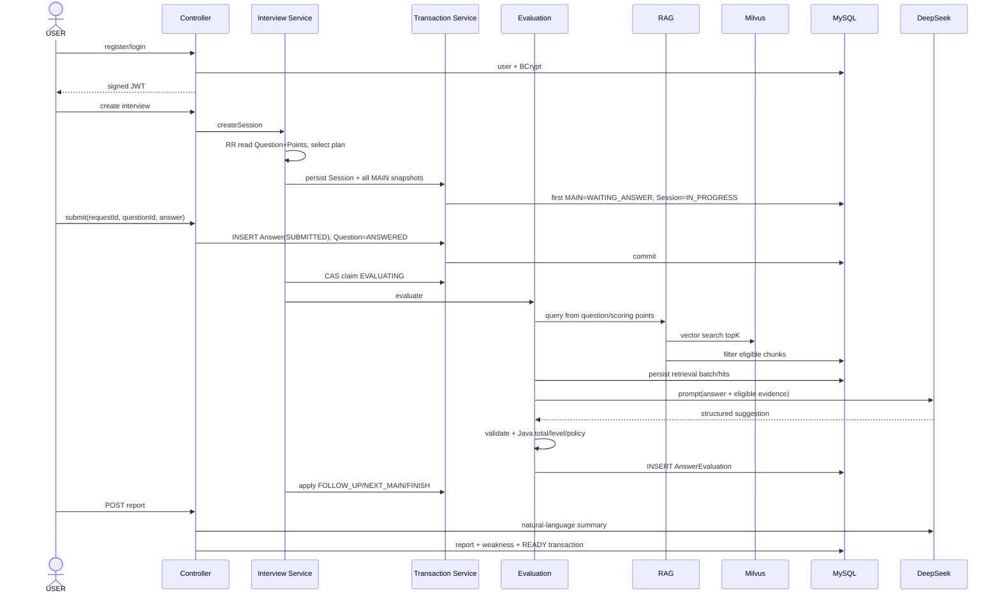
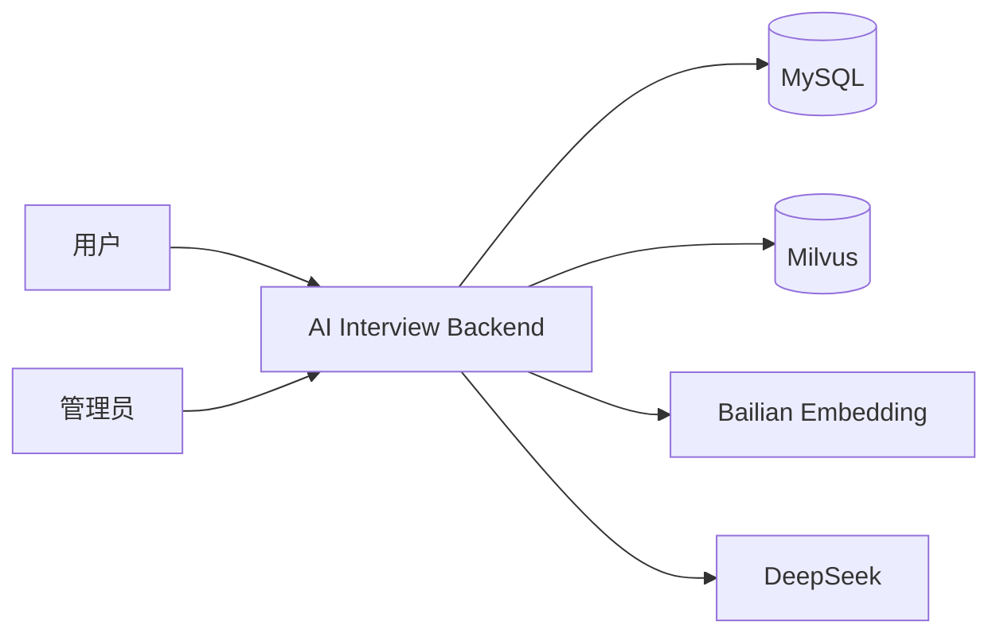
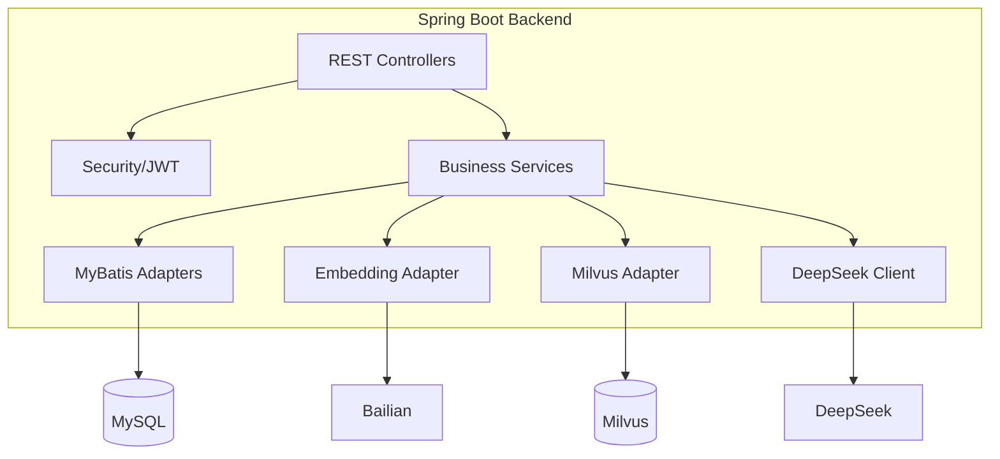
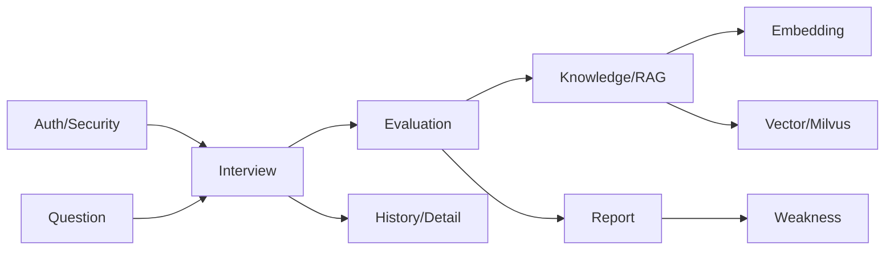

# AI 模拟面试系统后端面试学习手册

> 冻结版本：`main@20a933ae8092ef908c2f03193c0b0f9547da71c1`（提交说明 `fix: handle concurrent evaluation claim races`，意为“修复并发评价抢占竞态”；claim = 抢占执行权，race = 竞态）  
> 读者：准备第一段 Java 后端实习的本科生  
> 事实优先级：当前源码 > SQL（结构化查询语言）/Mapper（数据映射层）/配置/Tests（测试） > AGENTS.md > Git 历史 > 旧设计记录

标记说明：**【代码事实】**可由当前 HEAD 直接证明；**【历史设计意图】**来自 commit/设计记录；**【合理推断】**是基于实现的工程解释，不冒充作者原始动机。优先级：S 必须掌握，A 高频重要，B 理解即可。

## 0. 如何使用本手册

第一轮读 1～5 章并口述业务；第二轮精读 S 级并在 IDE 定位“代码证据”；第三轮关闭正文做闭卷题和源码导航；第四轮按深挖树接受连续追问。回答设计题固定使用：**问题 → 当前方案 → 原理 → 失败场景 → 替代方案 → 边界**。

<a id="glossary"></a>

### 0.1 第一次阅读前必须知道的核心术语

这不是需要背完才能往下读的字典。第一遍只看“一句话理解”；后面章节再把术语放回真实代码、SQL 和测试中。

#### 基础 Web 与 Java 分层

| 术语 | 英文全称 | 中文 | 一句话理解 | 本项目中的位置 |
| --- | --- | --- | --- | --- |
| API | Application Programming Interface | 应用程序接口 | 程序对外提供的调用入口。 | `Controller` 暴露的 `/api/...` |
| HTTP | Hypertext Transfer Protocol | 超文本传输协议 | 浏览器或客户端与后端传请求/响应的规则。 | Controller 的 GET/POST 端点 |
| JSON | JavaScript Object Notation | JSON 数据格式 | 用键值结构表示请求和响应。 | DTO、DeepSeek 和 Embedding HTTP body |
| JWT | JSON Web Token | JSON Web 令牌 | 签名后携带用户身份的访问令牌；它不加密 payload。 | `JwtTokenService` 与认证过滤器 |
| DB | Database | 数据库 | 进程结束后数据仍能保存的系统。 | 本项目业务真相源 MySQL |
| SQL | Structured Query Language | 结构化查询语言 | 读写关系数据库的语言。 | `resources/mapper/*.xml` 和 `sql/ai_interview.sql` |
| Mapper | Data Mapper | 数据映射层 | 把 Java 方法与 SQL 对应起来。 | MyBatis Mapper interface + XML |
| DTO | Data Transfer Object | 数据传输对象 | 专门承载接口输入或层间数据。 | `request` / `dto` 包 |
| VO | View Object | 视图对象 | 专门组装给客户端的输出。 | `vo` / response 类 |

#### AI 与 RAG

| 术语 | 英文全称 | 中文 | 一句话理解 | 本项目中的位置 |
| --- | --- | --- | --- | --- |
| LLM | Large Language Model | 大语言模型 | 根据输入生成文本或结构化建议的模型。 | DeepSeek 给评价建议，不改业务状态 |
| Embedding | — | 文本嵌入 / 向量化 | 把文本转成一串数字，语义越像通常越接近。 | Bailian + Spring AI 生成 1024 维向量 |
| Vector | — | 向量 | 用有顺序的数字列表表示文本语义。 | Milvus `vector` 字段 |
| RAG | Retrieval-Augmented Generation | 检索增强生成 | 先从自己的知识库找资料，再把资料与问题一起给模型。 | 仅为回答评价提供证据，不生成 MAIN |
| Prompt | — | 提示词 / 模型输入 | 发给大模型的完整任务说明与数据。 | `EvaluationPromptBuilder` |
| Chunk | — | 知识切片 | 把长文档拆成可检索的小段。 | `knowledge_chunk` |
| Top-K | Top K Results | 最相似的前 K 条 | 只取排名最前的 K 个候选。 | Milvus similarity search |
| Rerank | Re-ranking | 二次重排 | 对首次检索结果再打分排序。 | 当前项目未引入，不是 Bug |
| Milvus | — | 向量数据库 | 根据向量相似度找候选知识块。 | 候选索引，MySQL 仍是业务真相源 |
| raw hit | Raw Retrieval Hit | 原始召回结果 | Milvus 按向量相似度找到、尚未做业务检查的候选。 | `KnowledgeRetrievalService` 的搜索输入 |
| Eligibility | — | 业务资格检查 | 用 MySQL 状态、版本和模型配置判断候选是否还能用。 | `KnowledgeChunkMapper.xml` |
| eligible evidence | — | 合格证据 | raw hit 通过 MySQL 业务资格检查后，才允许进入 Prompt。 | RAG Trace 和评价 Prompt |

#### 数据库与事务

| 术语 | 英文全称 | 中文 | 一句话理解 | 本项目中的位置 |
| --- | --- | --- | --- | --- |
| Transaction | — | 事务 | 一组数据库操作要么一起成功，要么一起回滚。 | `@Transactional` 的 MySQL 短事务 |
| Isolation | Transaction Isolation | 事务隔离级别 | 规定并发事务之间可以看到什么。 | Snapshot 使用 RR |
| RR | REPEATABLE READ | 可重复读 | 同一事务按一致视图读取。 | Question 与 ScoringPoints 看同一时间点 |
| MVCC | Multi-Version Concurrency Control | 多版本并发控制 | 数据库保留多个版本，读事务按自己的快照看数据。 | InnoDB Read View 保护题目快照 |
| FOR UPDATE | SELECT ... FOR UPDATE | 锁定后读取 | 读行时加排他锁，让后来的修改等待。 | 并发改密、创建 Session |
| Optimistic Lock | Optimistic Locking | 乐观锁 | 平时不锁住，修改时才检查旧 version 是否还一样。 | Session `version` 条件 UPDATE |
| CAS | Compare-And-Set | 比较并设置 | 旧值仍符合预期才允许修改。 | SQL `WHERE old_status...` + affectedRows |
| UNIQUE | Unique Constraint | 唯一约束 | 由数据库拒绝重复的业务键。 | requestId、questionId、answerId、sessionId |
| FK | Foreign Key | 外键 | 保证引用的数据行存在。 | 13 张表的主要关联 |
| affectedRows | Affected Rows | 受影响行数 | UPDATE 真正改了几行；1 通常是成功，0 是前提已失效。 | 所有 claim / CAS 的返回信号 |

#### 并发、幂等与恢复

| 术语 | 英文全称 | 中文 | 一句话理解 | 本项目中的位置 |
| --- | --- | --- | --- | --- |
| Idempotency | — | 幂等性 | 同一业务请求重放多次，最终效果与一次一样。 | Answer `requestId` + payload 等价检查 |
| Race Condition | — | 竞态条件 | 结果取决于两个请求谁先执行某一步。 | 并发提交、评价抢占、恢复 |
| Claim | — | 抢占执行权 | 多个请求中先用数据库状态取得“由我执行”的资格。 | `tryClaimEvaluation()` |
| Owner | — | 执行权拥有者 | claim 成功、可以继续调外部服务的请求。 | `EvaluationClaim.OWNED` |
| Loser | — | 抢占失败者 | 条件 UPDATE 影响 0 行的竞争请求。 | reload 后分类为重放、冲突或恢复 |
| Stale | — | 陈旧 / 超时未更新 | 处理中状态长时间未更新，疑似原 JVM 已崩溃。 | EVALUATING / GENERATING / PROCESSING |
| Recovery | — | 恢复 | 故障后让业务回到可继续的状态。 | stale 状态的重新接管 |
| Retry | — | 重试 | 失败后再做一次，但必须先处理重复副作用。 | FAILED 状态重试 |
| Compensation | — | 补偿 | 后一步失败时，执行反向操作尽量撤销前一步。 | MySQL 失败后 `deleteByVectorIds()` |
| Reconciliation | — | 对账 / 状态校准 | 事后根据持久事实检查并清理不一致。 | 重试前 `deleteByDocumentId()` |
| Durable | — | 已持久化的 | 进程重启后仍存在；局部变量不 durable，MySQL 行是。 | 恢复前查 Evaluation / Report / documentId |
| exactly-once | — | 恰好执行一次 | 重试、网络错误、崩溃下副作用仍像只发生一次。 | 本项目不宣称跨 MySQL/Milvus exactly-once |

#### 架构与外部依赖

| 术语 | 英文全称 | 中文 | 一句话理解 | 本项目中的位置 |
| --- | --- | --- | --- | --- |
| Snapshot | — | 快照 | 把某个时间点的数据固定下来，不让后续更新改写历史。 | InterviewQuestion 题目与评分点快照 |
| Orchestration | — | 编排 | 自己不实现每个算法，而是负责按正确顺序调用多个组件。 | `EvaluationOrchestrationService` |
| Port | — | 业务端口 / 接口 | 业务只说“我需要什么能力”，不绑定具体技术。 | `EmbeddingClient`、`VectorStoreClient` |
| Adapter | — | 适配器 / 具体实现 | 把某个外部技术转成 Port 要求的样子。 | `SpringAiEmbeddingClient`、`MilvusVectorStoreClient` |
| SDK | Software Development Kit | 软件开发工具包 | 外部平台提供的客户端库。 | Milvus Java SDK |
| SPI | Service Provider Interface | 服务提供者接口 | Java 通过 `ServiceLoader` 发现实现的机制。 | 本项目的 Port 不是 Java SPI |
| Provider | — | 外部能力提供方 | 真正执行模型或向量服务的外部系统。 | DeepSeek、Bailian、Milvus |
| Contract | — | 软件契约 / 约定 | 模块之间承诺的数据格式、行为与边界，不是法律合同。 | HTTP body、Milvus schema、Port 方法 |
| Side Effect | — | 副作用 | 方法返回值之外对外部世界的改变。 | 写 MySQL、写 Milvus、调 DeepSeek |
| Invariant | — | 业务不变量 | 无论怎样并发或重试都必须保持的规则。 | 每题一 Answer、每题最多一追问 |
| Fallback | — | 兜底方案 | 主路径不可用时采用的替代处理，不等于随意吞错。 | 本项目只在明确业务边界内使用 |

#### 测试证据

| 术语 | 英文全称 | 中文 | 一句话理解 | 本项目中的位置 |
| --- | --- | --- | --- | --- |
| Unit Test | — | 单元测试 | 隔离外部依赖，验证一个小单元的规则。 | Selector、Policy、Validator |
| Integration Test | — | 集成测试 | 让多个真实组件协作。 | 真实 MyBatis/MySQL 并发测试 |
| Mock | — | 模拟对象 | 用可控的假实现代替真实依赖。 | Mockito 模拟 Mapper / provider |
| MockMvc | Mock Spring MVC | MVC 层模拟测试 | 不启动真实网络端口也能验证 HTTP 路由、权限和参数。 | Controller / Security tests |
| Wire Test | Wire-level Contract Test | HTTP 协议契约测试 | 真正穿过客户端序列化和 HTTP 组装，但服务器仍是 Mock。 | `SpringAiEmbeddingHttpContractTest` |
| Smoke Test | — | 冒烟测试 | 用少量用例连真实外部服务，证明最基本链路可用。 | `Real*SmokeTest`，必须显式开关 |
| Fail Fast | — | 快速失败 | 配置或 schema 错时在启动阶段立即报错。 | properties 校验、Milvus initializer |

#### 业务状态速查

| 值 | 中文 | 本项目中的含义 |
| --- | --- | --- |
| MAIN | 主问题 | 创建面试时从固定题库选出并快照的问题 |
| FOLLOW_UP | 追问 | Java 规则决定需要后，根据评价建议提出的一次追问 |
| INITIAL | 中间评价 | 主回答后还要追问时的暂时评价，不进报告 |
| FINAL | 最终有效评价 | 每道主题最终进入报告与弱点聚合的评价 |
| SUBMITTED / EVALUATING / EVALUATED / FAILED | 已提交 / 正在评价 / 评价完成 / 评价失败 | Answer 评价生命周期 |
| CREATED / IN_PROGRESS / COMPLETED | 已创建 / 面试进行中 / 已完成 | Session 生命周期 |
| UPLOADED / PROCESSING / READY / FAILED | 已上传 / 正在处理 / 可检索 / 处理失败 | Knowledge Document 生命周期 |
| NEXT_MAIN / FOLLOW_UP / FINISH | 进入下一道主问 / 进入追问 / 结束面试 | Java 最终决定的流程动作 |

## 1. 30 秒理解整个项目（S）

### 本章第一次会遇到

<details class="term-card"><summary>RAG、Embedding、LLM、CAS 与 stale recovery</summary>

- **RAG（Retrieval-Augmented Generation，检索增强生成）：**先找项目自己的知识证据，再让模型评价。
- **Embedding（文本向量化）：**把文本转成数字向量，用于相似度搜索。
- **LLM（Large Language Model，大语言模型）：**本项目中是 DeepSeek，只提供语义评价建议。
- **CAS（Compare-And-Set，比较并设置）：**旧状态还符合预期才修改。
- **stale recovery（超时状态恢复）：**处理状态长时间未更新时，由新请求接管。

</details>

这是一个 Java 后端求职模拟面试系统。第一遍先只记住下面的中文主线：

```text
从固定题库选出本场主问题
↓
用户提交回答
↓
从项目知识库查找相关资料
↓
让 DeepSeek 结合资料和用户回答给出评价建议
↓
Java 后端验证建议、重新计分
↓
Java 决定追问、下一题或结束面试
```

后面你会逐步学到：知识库检索叫 **RAG**；文本转数字向量叫 **Embedding**；DeepSeek 这类模型叫 **LLM**；并发请求通过带旧状态条件的 SQL 抢执行权，叫 **CAS**；对长时间卡住的状态重新接管，叫 **stale recovery**。

**这里第一遍不用深究：**HMAC 密码学证明、InnoDB undo log 的组织、Milvus 索引内部算法。你现在只需能把上面的业务顺序说清楚。

### 本章源码地图

#### 源码卡 ①：系统主入口

- **路径：** <code>src/main/java/com/kun/aiinterview/AiInterviewSystemApplication.java</code>
- **职责：**Spring Boot 应用入口；从这里确认 base package 扫描边界。
- **重点方法：** <code>main()</code>
- **学习优先级：** ★★★☆☆

#### 源码卡 ②：核心业务入口

- **路径：** <code>src/main/java/com/kun/aiinterview/interview/controller/InterviewController.java</code>
- **路径：** <code>src/main/java/com/kun/aiinterview/interview/service/InterviewService.java</code>
- **职责：**从 HTTP API 进入面试创建、答题、历史与详情。
- **学习优先级：** ★★★★★

### 源码任务

1. 用 <code>Ctrl + N</code> 打开 <code>InterviewService</code>，只看构造依赖，列出它连接的 Mapper 与子 Service。
2. 用 <code>Ctrl + Shift + N</code> 搜索 <code>application.yaml</code>，确认外部服务通过配置启用，而不是所有测试默认启动。

<details><summary>▶ 查看解析</summary><p>先从入口和依赖关系建立地图，不要一开始逐行读 300 行 Service；外部 Bean 的条件装配解释了普通测试为何能隔离真实服务。</p></details>

## 2. 项目解决什么问题

普通题库只能给静态答案；纯聊天模型又难以保证题目质量、评分标准、历史一致性和状态可靠。本项目将两者组合：题库保证可审核的 **MAIN（主问题）**；**RAG（Retrieval-Augmented Generation，检索增强生成）**为回答评价找当前知识证据；**LLM（Large Language Model，大语言模型）**提供语义反馈；Java 与 **DB（Database，数据库）**保证业务不变量。

明确边界：这不是自由出题 Agent（智能体），也不是企业级招聘系统。项目不承诺跨 MySQL/Milvus 的 **exactly-once（恰好执行一次）**：这是指即使重试、网络错误或崩溃，最终副作用仍像只发生一次的强保证。本项目的真实方案是补偿、重试和对账。当前没有 **rerank（二次重排）**和 **MQ（Message Queue，消息队列）**，不能只因为这些技术“更高级”就把它们缺席写成 Bug。

## 3. 完整业务闭环（S）

### 本章第一次会遇到

<details class="term-card"><summary>Session、Snapshot、Orchestration 与业务状态</summary>

- **Session（面试会话）：**一场完整的模拟面试记录。
- **Snapshot（快照）：**把创建当时的题干、参考答案和评分点复制进本场面试。
- **Orchestration（编排）：**自己不做某个算法，而是按正确顺序调用上下文、RAG、模型、校验、计分和持久化。
- **MAIN / FOLLOW_UP：**主问题 / 追问。**INITIAL / FINAL：**中间评价 / 最终有效评价。

</details>

```text
注册并登录，获得 JWT 访问令牌
↓
创建面试会话（Session），一次选定并保存所有主问题快照（MAIN Snapshot）
↓
当前题进入 WAITING_ANSWER（等待回答）
↓
用户提交答案，Answer 进入 SUBMITTED（已提交）
↓
单个请求抢到评价权，Answer 进入 EVALUATING（正在评价）
↓
构造评价上下文（EvaluationContext）
↓
构造知识检索问题（RAG Query）
↓
把文本转成向量（Embedding）
↓
Milvus 找最相似的前 K 条原始候选（raw Top-K）
↓
MySQL 检查候选是否仍符合业务条件（eligibility）
↓
记录真正使用的检索证据（RAG Trace）
↓
组装给 DeepSeek 的完整输入（Prompt）
↓
Java 校验模型建议、计算分数和等级、决定追问/下一题/结束
↓
产生 FINAL（最终有效）评价，完成面试后生成报告、弱点和历史详情
```



| 阶段   | Controller / Service / Mapper                                 | 状态与副作用                             | 主要保护                                             |
| ---- | ------------------------------------------------------------- | ---------------------------------- | ------------------------------------------------ |
| 注册登录 | `AuthController`→`AuthService`→`UserMapper`                   | user；JWT                           | BCrypt、UNIQUE race recovery                      |
| 创建面试 | `InterviewController`→Session/Snapshot/Transaction Service    | Session、全部 MAIN；首题激活               | RR snapshot、user FOR UPDATE、Session CAS          |
| 提交答案 | `InterviewService`→WorkflowTransaction→Answer/Question Mapper | Answer SUBMITTED；Question ANSWERED | requestId+payload、两 UNIQUE、DuplicateKey recovery |
| 评价   | Workflow→Orchestration→Context/RAG/DeepSeek                   | retrieval trace、evaluation         | status CAS、LLM validator、UNIQUE(answer_id)       |
| 推进   | WorkflowTransaction→Session/Question Mapper                   | 追问/下一题/完成                          | version+status+current CAS、FOLLOW_UP reuse       |
| 报告   | `InterviewReportService`→ReportTransaction                    | report、weakness、READY              | final-only、stale recovery、durable reuse          |

### 本章源码地图

#### 源码卡 ①：业务闭环入口

- **路径：** <code>src/main/java/com/kun/aiinterview/interview/controller/InterviewController.java</code>
- **路径：** <code>src/main/java/com/kun/aiinterview/interview/service/InterviewService.java</code>
- **职责：**创建、提交、历史与详情 API。
- **学习优先级：** ★★★★★

#### 源码卡 ②：评价与报告出口

- **路径：** <code>src/main/java/com/kun/aiinterview/interview/service/InterviewWorkflowService.java</code>
- **路径：** <code>src/main/java/com/kun/aiinterview/interview/orchestration/EvaluationOrchestrationService.java</code>
- **路径：** <code>src/main/java/com/kun/aiinterview/interview/service/InterviewReportService.java</code>
- **职责：**评价 ownership、RAG/LLM 编排、报告生成。
- **学习优先级：** ★★★★★

### 源码任务

1. 从 <code>InterviewController#submitAnswer</code> 连续跳转，直到找到第一次 DeepSeek 调用；记录每一层为什么存在。
2. 从 <code>InterviewReportService</code> 找到 final-effective evaluation 查询，解释为什么 INITIAL 不进入报告。

<details><summary>▶ 查看解析</summary><p>HTTP、业务编排、短事务、评价编排各自承担不同边界；报告只读取每道 MAIN 的最终有效评价，避免把中间 INITIAL 重复计分。</p></details>

## 4. 系统架构图（S）

### 本章第一次会遇到

<details class="term-card"><summary>Port、Adapter、Provider、SDK 与 Mapper</summary>

- **Port（业务端口）：**业务层只定义“我需要什么能力”。
- **Adapter（适配器）：**把 Spring AI、Milvus 等具体技术接到 Port 后面。
- **Provider（外部能力提供方）：**本项目中主要是 DeepSeek、Bailian 和 Milvus。
- **SDK（Software Development Kit，软件开发工具包）：**外部平台提供的 Java 客户端库。
- **Mapper（数据映射层）：**把 Java 方法与 MyBatis SQL 对应起来。

</details>

### Level 1：System Context



用户完成面试和查询结果；管理员维护题库、上传并显式处理知识文档。MySQL 是业务真相源；Milvus 是向量候选索引；Bailian 生成向量；DeepSeek 给评价/报告语言建议。

### Level 2：Containers / Infrastructure



### Level 3：Backend Components



### 本章源码地图

#### 源码卡 ①：配置与外部 Adapter

- **路径：** <code>src/main/java/com/kun/aiinterview/knowledge/embedding/EmbeddingConfiguration.java</code>
- **路径：** <code>src/main/java/com/kun/aiinterview/knowledge/vector/milvus/MilvusConfiguration.java</code>
- **职责：**把外部基础设施装配到项目 Port 后面。
- **学习优先级：** ★★★★☆

#### 源码卡 ②：持久层边界

- **路径：** <code>src/main/java/com/kun/aiinterview/interview/mapper/InterviewAnswerMapper.java</code>
- **路径：** <code>src/main/resources/mapper/InterviewAnswerMapper.xml</code>
- **职责：**Java Mapper 声明与真实 SQL 的配对示例。
- **学习优先级：** ★★★★☆

### 源码任务

1. 比较 <code>EmbeddingClient</code>、<code>VectorStoreClient</code> 与各自实现，标出业务包和基础设施包的依赖方向。
2. 任取一个 Mapper interface，使用 IDEA 跳到 XML statement，核对方法参数名与 <code>#{...}</code>。

<details><summary>▶ 查看解析</summary><p>业务 Service 依赖项目 Port；Adapter 才依赖 Spring AI 或 Milvus SDK。MyBatis interface 与 XML 共同构成持久层实现。</p></details>

## 5. 完整模块地图

| 模块               | 负责 / 不负责                     | 入口与核心 Service                                       | 依赖 / 被依赖                   | 表、状态、事务、测试                               |
| ---------------- | ---------------------------- | --------------------------------------------------- | -------------------------- | ---------------------------------------- |
| auth             | 注册登录；不做 protected-request 过滤 | AuthController/AuthService                          | user/JWT                   | user；Auth tests                          |
| security         | JWT 验签和当前授权；不信 Token role    | filter/config/token service                         | UserMapper                 | 无独立表；Security tests                      |
| user             | 改密/用户读取；不签 Token             | UserService                                         | UserMapper                 | user；FOR UPDATE；并发改密 test                |
| question         | ADMIN 题库与评分点                 | AdminQuestionController/QuestionAdminService        | two mappers                | question/scoring_point；事务与 MyBatis tests |
| interview        | 创建、提交、历史详情                   | InterviewController/Service/Session/Workflow        | question/evaluation/report | session/question/answer；状态 CAS           |
| evaluation       | 上下文、Prompt、校验、评分、策略          | OrchestrationService                                | RAG/DeepSeek               | answer_evaluation；UNIQUE(answer_id)      |
| orchestration    | claim 与应用评价决定                | InterviewWorkflowService                            | evaluation/transaction     | Answer/Session 状态；claim concurrency test |
| knowledge        | 上传、切片、处理、检索                  | Admin controller/Admin/Processing/Retrieval Service | embedding/vector/MySQL     | document/chunk；PROCESSING recovery       |
| embedding        | 项目 Port 与 Spring AI adapter  | EmbeddingClient/SpringAiEmbeddingClient             | Bailian                    | 无表；unit+wire tests                       |
| retrieval        | query、topK、eligibility       | EvaluationRagQueryBuilder/Adapter                   | knowledge/vector           | batch/hit trace                          |
| vector/milvus    | schema、预计算向量 CRUD/search     | VectorStoreClient/Milvus adapter/initializer        | native SDK                 | Milvus Collection；mock+smoke             |
| report           | 聚合 FINAL、生成报告                | InterviewReportService/Transaction                  | DeepSeek/weakness          | report；GENERATING recovery               |
| weakness         | FINAL 聚合更新                   | UserWeaknessService                                 | evaluation                 | user_weakness；report事务内                  |
| common/exception | 响应、错误映射                      | GlobalExceptionHandler                              | 全模块                        | HTTP taxonomy tests                      |
| validation       | DTO/Service/UTF-8 bytes      | validators                                          | Controller/Service         | boundary tests                           |
| recovery         | stale 配置和各流程接管               | StaleRecoveryProperties + services                  | Mapper CAS                 | updated_at；stale CAS tests               |
| configuration    | properties/conditional beans | configuration classes                               | external adapters          | startup binding tests                    |

## 6. 数据库与核心数据模型（S）

### 本章第一次会遇到

<details class="term-card"><summary>Snapshot、Invariant、UNIQUE、FK 与 final-effective</summary>

- **Snapshot（快照）：**把创建时的题目内容复制到本场面试，以后题库改动也不会改写历史。
- **Invariant（业务不变量）：**系统在并发、失败和重试下都必须保持的规则。
- **UNIQUE（唯一约束）：**由 DB 拒绝重复业务键。**FK（Foreign Key，外键）：**保证被引用行存在。
- **final-effective evaluation（每道主问题最终生效的评价）：**没有追问时选 MAIN FINAL，有追问时选 FOLLOW_UP 产生的 FINAL。

</details>

当前 `sql/ai_interview.sql` 是 13 张核心表：`user`、`question`、`question_scoring_point`、`interview_session`、`interview_question`、`interview_answer`、`answer_evaluation`、`knowledge_document`、`knowledge_chunk`、`rag_retrieval_batch`、`rag_hit_log`、`interview_report`、`user_weakness`。

### Snapshot 与 InterviewQuestion 双重角色

`InterviewQuestion` 同时表示“本场计划位置”和“真实提问实例”。MAIN 关联题库并保存 `question_content/category/knowledge_point/reference_answer/scoring_points_snapshot`；FOLLOW_UP 是运行时生成，使用 parent、follow-up content 与 target point ids，不能假装拥有完整题库字段。若评价时查最新题库，管理员修改会重写历史语义，因此必须快照。

### retrieval_batch_id

一次 Answer 可能因失败发生多次检索。`rag_retrieval_batch` 定义一次 query/profile 的头记录，`rag_hit_log` 记录真正进入 Prompt 的 eligible evidence，`answer_evaluation.retrieval_batch_id` 指回最终评价采用的那批结果。SQL 当前给该列索引但不设到 batch 的 FK；应用服务负责写入次序与关联，这是边界而非可虚构的 DB 保证。

### 业务不变量矩阵

| 不变量              | 保护机制                              | 代码 / SQL                        |
| ---------------- | --------------------------------- | ------------------------------- |
| account 唯一       | DB UNIQUE + DuplicateKey recovery | user uk；AuthService             |
| 每用户最多一个活动创建流程    | user FOR UPDATE + 锁后二查            | SessionTransactionService       |
| 一场 MAIN 创建后不重选   | 创建事务 batch INSERT snapshot        | SnapshotFactory/Question Mapper |
| Answer 每题/请求唯一   | 两个 UNIQUE                         | interview_answer SQL            |
| 同 Answer 一条评价    | `UNIQUE(answer_id)`               | answer_evaluation               |
| 一 Session 一报告    | `UNIQUE(session_id)`              | interview_report                |
| MAIN 最多一个追问      | Java reuse/结构约束                   | WorkflowTransactionService      |
| Session 不被旧快照推进  | version+status+current CAS        | InterviewSessionMapper.xml      |
| 评分点权重和 100       | Java validation + DB checks       | QuestionAdminService/SQL        |
| 只有 FINAL 入报告/弱点  | final-effective query + Service   | AnswerEvaluationMapper.xml      |
| Milvus schema 精确 | startup validation                | CollectionInitializer           |
| stale 只有一个恢复者    | timestamp/status CAS              | 三类 Mapper SQL                   |

约束分工：DB constraint 抵抗跨线程/实例最终竞态；Java Service表达跨行和可读业务规则；Transaction保证一组 MySQL 写原子；CAS保证“前提仍成立才写”。四者不可互相冒充。

【历史设计 vs 当前实现】旧记录一度写 LangChain4j、12 张表和手写 DashScope client；当前是 Spring AI Embedding、13 表（新增 retrieval batch），LangChain4j 不在 pom。

<details><summary>闭卷：为什么不能只保存 question_id？</summary>

题库会变；只存 ID 无法重现本场创建时的题干、参考答案和评分标准。Snapshot 使历史评价、详情与报告可解释。

</details>

### 本章源码地图

#### 源码卡 ①：数据库基线

- **路径：** <code>sql/ai_interview.sql</code>
- **职责：**13 张表、FK、UNIQUE、CHECK 与索引的冻结基线。
- **重点对象：** <code>interview_question</code>、<code>interview_answer</code>、<code>answer_evaluation</code>、RAG trace 表。
- **学习优先级：** ★★★★★

#### 源码卡 ②：final-effective 查询

- **路径：** <code>src/main/resources/mapper/AnswerEvaluationMapper.xml</code>
- **职责：**保存评价，并为报告/弱点选择每道 MAIN 的最终有效评价。
- **重点 SQL：** <code>listFinalEffectiveEvaluationsBySessionId</code>
- **学习优先级：** ★★★★★

### 源码任务

1. 在 SQL 基线找出 Answer、Evaluation、Report 三个 UNIQUE，分别写出它们不能防止的副作用。
2. 打开 final-effective SQL，说明 MAIN 无追问和有追问时分别选中哪一行。

<details><summary>▶ 查看解析</summary><p>UNIQUE 防重复落库但不自动防重复外部调用；无追问选 MAIN FINAL，有追问选 FOLLOW_UP 产生的综合 FINAL。</p></details>

## 7. Auth / Spring Security / JWT（认证、授权与令牌）（S）

**本章目标：**沿“登录签发 → 请求过滤 → 数据库校验 → 改密失效”读代码，回答 JWT 到底信什么。结论先行：Token 中的 userId 是查库索引；当前 status、role 和密码版本都以数据库为准。

### 本章第一次会遇到

<details class="term-card"><summary>JWT、JWS、HMAC、credential version 与 FOR UPDATE</summary>

- **JWT（JSON Web Token，JSON Web 令牌）：**用签名保护完整性的身份令牌；payload 可读，不等于加密。
- **JWS（JSON Web Signature，JSON Web 签名）：**JWT 常用的签名形式，用于发现篡改。
- **HMAC（Hash-based Message Authentication Code，基于哈希的消息认证码）：**项目用它从密码 hash 派生 credential version（凭证版本）。
- **FOR UPDATE（锁定后读取）：**改密时锁住用户行，使“验旧密码 → 写新密码”不被另一个改密请求插入。

</details>

**这里第一遍不用深究：**HMAC 的密码学安全证明和 JOSE Header 的所有字段。先理解“验签不代表用户当前仍有权”即可。

### 本章源码地图

#### 源码卡 ①：<code>AuthService.java</code>

- **路径：** <code>src/main/java/com/kun/aiinterview/auth/service/AuthService.java</code>
- **职责：**校验账号、密码与用户状态，调用 JWT 服务签发访问令牌。
- **重点方法：** <code>login()</code>
- **学习优先级：** ★★★★★
- **IDEA：** <code>Ctrl + N</code> → 输入 <code>AuthService</code>

#### 源码卡 ②：<code>JwtTokenService.java</code>

- **路径：** <code>src/main/java/com/kun/aiinterview/security/jwt/JwtTokenService.java</code>
- **职责：**签发、解析 JWT，并从 BCrypt hash 派生 credential version。
- **重点方法：** <code>generateAccessToken()</code>、<code>parseAndValidate()</code>、<code>deriveCredentialVersion()</code>、<code>matchesCredentialVersion()</code>
- **学习优先级：** ★★★★★

#### 源码卡 ③：<code>JwtAuthenticationFilter.java</code>

- **路径：** <code>src/main/java/com/kun/aiinterview/security/filter/JwtAuthenticationFilter.java</code>
- **职责：**每个 protected request 的认证入口；验签后重新加载当前数据库用户。
- **重点方法：** <code>doFilterInternal()</code>、<code>authenticate()</code>、<code>loadEnabledUser()</code>、<code>validateCredentialVersion()</code>
- **学习优先级：** ★★★★★

#### 源码卡 ④：<code>UserService.java</code> 与 <code>UserMapper.xml</code>

- **路径：** <code>src/main/java/com/kun/aiinterview/user/service/UserService.java</code>
- **路径：** <code>src/main/resources/mapper/UserMapper.xml</code>
- **职责：**在数据库行锁保护下验证旧密码并更新密码。
- **重点方法 / SQL：** <code>changePassword()</code>、<code>getUserByIdForUpdate</code>
- **学习优先级：** ★★★★★
- **IDEA：**类用 <code>Ctrl + N</code>；XML 用 <code>Ctrl + Shift + N</code>

### 调用链先看全貌

~~~text
POST /api/auth/login
→ AuthService#login
→ JwtTokenService#generateAccessToken

Authorization: Bearer ...
→ JwtAuthenticationFilter#doFilterInternal
→ JwtTokenService#parseAndValidate
→ UserMapper#getUserById
→ validateCredentialVersion + validatePasswordChange
→ 使用 DB role 创建 Authentication
~~~

### Node 1：登录时把什么写进 Token？

先打开 <code>AuthService#login</code>。重点看签发前做了哪些校验，以及传给 JWT 服务的最后一个参数是什么。

> **SOURCE** <code>AuthService.java#login</code>  
> **PATH** <code>src/main/java/com/kun/aiinterview/auth/service/AuthService.java</code>  
> **HEAD** <code>20a933ae</code>

~~~java
public LoginResponse login(@Valid LoginRequest loginRequest) {
    User user = userMapper.getUserByAccount(loginRequest.getAccount());
    if (user == null) {
        throw new BusinessException("账号或密码错误");
    }
    if (!passwordEncoder.matches(loginRequest.getPassword(),user.getPassword())) {
        throw new BusinessException("账号或密码错误");
    }

    if (user.getStatus() == UserStatus.DISABLED) {
        throw new BusinessException("账号已被禁用");
    }

    String accessToken = jwtTokenService.generateAccessToken(
            user.getId(),
            user.getAccount(),
            user.getRole(),
            user.getPassword()
    );
~~~

账号不存在和密码错误使用同一消息，避免帮助攻击者枚举账号。<code>user.getPassword()</code> 是数据库 BCrypt hash，不是明文；下一节点会看到它只用于派生认证版本标记。

### Node 2：credential_version 如何补上 iat 的同秒漏洞？

JWT 的 <code>iat</code> 与数据库时间都可能只有秒级精度。同一秒先签发、后改密时，只比较先后可能漏掉旧 Token。因此 Token 还携带当前密码 hash 的 HMAC 派生值。

> **SOURCE** <code>JwtTokenService.java#generateAccessToken</code>  
> **PATH** <code>src/main/java/com/kun/aiinterview/security/jwt/JwtTokenService.java</code>  
> **HEAD** <code>20a933ae</code>

~~~java
return Jwts.builder()
        .subject((userId.toString()))
        .claim(CLAIM_ACCOUNT, account)
        .claim(CLAIM_ROLE, role.name())
        .claim(
                CLAIM_CREDENTIAL_VERSION,
                deriveCredentialVersion(passwordHash)
        )
        .issuer(jwtProperties.getIssuer())
        .issuedAt(Date.from(issuedAt))
        .expiration(Date.from(expiration))
        .signWith(secretKey)
        .compact();
~~~

> **SOURCE** <code>JwtTokenService.java#deriveCredentialVersion / #matchesCredentialVersion</code>  
> **PATH** <code>src/main/java/com/kun/aiinterview/security/jwt/JwtTokenService.java</code>  
> **HEAD** <code>20a933ae</code>

~~~java
Mac mac = Mac.getInstance(HMAC_SHA256);
mac.init(secretKey);
byte[] digest = mac.doFinal(
        passwordHash.getBytes(StandardCharsets.UTF_8)
);
return HexFormat.of().formatHex(digest);

// 省略与当前知识点无关的代码

String expected = deriveCredentialVersion(passwordHash);
return MessageDigest.isEqual(
        tokenCredentialVersion.getBytes(StandardCharsets.UTF_8),
        expected.getBytes(StandardCharsets.UTF_8)
);
~~~

BCrypt 每次改密会产生带新盐的新 hash，因此 HMAC 结果必变。JWT payload 只是 Base64URL 编码而非加密，所以不能把数据库密码 hash 直接放进去。<code>MessageDigest.isEqual</code> 用恒时比较减少比较耗时侧信道。

### Node 3：验签成功后为什么还要查 DB？

> **SOURCE** <code>JwtAuthenticationFilter.java#authenticate</code>  
> **PATH** <code>src/main/java/com/kun/aiinterview/security/filter/JwtAuthenticationFilter.java</code>  
> **HEAD** <code>20a933ae</code>

~~~java
Claims claims = parseAndValidateClaims(token);
Long userId = extractUserId(claims);
User user = loadEnabledUser(userId);

validateCredentialVersion(claims, user);
validatePasswordChange(claims, user);

Authentication authentication = createAuthentication(user);
~~~

> **SOURCE** <code>JwtAuthenticationFilter.java#loadEnabledUser</code>  
> **PATH** <code>src/main/java/com/kun/aiinterview/security/filter/JwtAuthenticationFilter.java</code>  
> **HEAD** <code>20a933ae</code>

~~~java
User user = userMapper.getUserById(userId);

if (user == null || user.getStatus() != UserStatus.ENABLED) {
    throw new BadCredentialsException("访问令牌对应的用户不可用");
}

return user;
~~~

验签只证明“Token 是服务端过去签发且未被篡改”。用户可能已禁用、角色已改变、密码已修改。代码只从 subject 取 userId，随后重新查 DB；<code>createAuthentication(user)</code> 使用的 role 也来自刚加载的 User。

### Node 4：并发改密为什么必须 FOR UPDATE？

> **SOURCE** <code>UserService.java#changePassword</code>  
> **PATH** <code>src/main/java/com/kun/aiinterview/user/service/UserService.java</code>  
> **HEAD** <code>20a933ae</code>

~~~java
@Transactional
public void changePassword(Long userId, ChangePasswordRequest changePasswordRequest) {
    User user = userMapper.getUserByIdForUpdate(userId);
    if (user == null) {
        throw new BusinessException("用户不存在");
    }

    // 省略与当前知识点无关的用户状态校验

    if (!passwordEncoder.matches(changePasswordRequest.getCurrentPassword(),user.getPassword())) {
        throw new BusinessException("请输入正确的现存密码");
    }

    // 省略与当前知识点无关的新旧密码相同校验

    String newPassword = passwordEncoder.encode(changePasswordRequest.getNewPassword());
    LocalDateTime passwordChangeTime = LocalDateTime.now().withNano(0);
    int affectedRows = userMapper.updatePassword(userId,newPassword,passwordChangeTime);

    if (affectedRows != 1) {
        throw new BusinessException("密码修改失败");
    }
}
~~~

> **SOURCE** <code>UserMapper.xml#getUserByIdForUpdate</code>  
> **PATH** <code>src/main/resources/mapper/UserMapper.xml</code>  
> **HEAD** <code>20a933ae</code>

~~~sql
SELECT
    id,
    account,
    password,
    username,
    email,
    role,
    status,
    password_changed_at,
    created_at,
    updated_at
FROM `user`
WHERE id = #{id}
FOR UPDATE
~~~

行锁把“读当前 hash → 验证旧密码 → 写新 hash”包进临界区。没有锁时，A、B 可能都读到 OLD 并验证成功，后提交者覆盖先提交者。

### 这个机制如何被证明？

> **TEST EVIDENCE** <code>ConcurrentPasswordChangeIntegrationTest.java#concurrentPasswordChanges...</code>  
> **PATH** <code>src/test/java/com/kun/aiinterview/user/service/ConcurrentPasswordChangeIntegrationTest.java</code>  
> **HEAD** <code>20a933ae</code>

~~~java
boolean firstSucceeded = awaitPasswordChange(first);
User afterWinner = userMapper.getUserById(userId);
LocalDateTime winnerChangedAt = afterWinner.getPasswordChangedAt();
String winnerHash = afterWinner.getPassword();

boolean secondSucceeded = awaitPasswordChange(second);
User afterLoser = userMapper.getUserById(userId);

assertThat(firstSucceeded).isTrue();
assertThat(secondSucceeded).isFalse();
assertThat(winnerHash).isNotEqualTo(originalHash);
assertThat(afterLoser.getPassword()).isEqualTo(winnerHash);
assertThat(afterLoser.getPasswordChangedAt())
        .isEqualTo(winnerChangedAt);
~~~

该测试让两个线程同时用旧密码进入改密流程，最终只允许一个成功。它证明真实 MySQL 行锁路径；不证明 JWT 的网络传输安全，后者应由 HTTPS 与部署配置保证。

### 源码任务

1. 打开 <code>JwtAuthenticationFilter#authenticate</code>：列出 Token 中直接使用的信息，以及必须从 DB 重取的信息。
2. 同时打开 <code>JwtTokenService#deriveCredentialVersion</code> 与 <code>UserService#changePassword</code>：解释 BCrypt 新盐为什么会让旧 Token 失效。

<details><summary>▶ 查看解析</summary><p>直接使用的是 subject 中的 userId；enabled、role、password hash 和 password_changed_at 都来自 DB。改密生成新的 BCrypt hash，HMAC 派生值变化，旧 Token 中的 credential_version 不再匹配。</p></details>

### 从代码回答面试题

**面试官：为什么 JWT 验签通过后仍不能直接信任 role？**

推荐回答：签名只能证明 Token 是过去由服务端签发且未被篡改，不能证明用户现在仍启用、角色仍相同。项目只用 subject 定位用户，再从数据库取当前状态和角色构建 Authentication，同时校验 credential version 与改密时间。


## 8. Interview 创建与 Question Snapshot（问题快照）（S）

**本章目标：**区分两个不同的并发问题：REPEATABLE READ 防止“旧题 + 新评分点”，user 行锁防止同一用户并发创建两场活动面试。

### 阅读本章前最好先知道

- **事务（Transaction）：**一组 MySQL 操作要么一起成功，要么一起回滚。
- **并发：**两个请求可能同时读写同一批业务数据。

### 本章第一次会遇到

<details class="term-card"><summary>RR、MVCC、Read View、Snapshot 与行锁</summary>

- **RR（REPEATABLE READ，可重复读）：**本项目真正关心的是 Question 和 ScoringPoints 两次查询必须看到同一时间点。
- **MVCC（Multi-Version Concurrency Control，多版本并发控制）：**数据库保留不同版本，读事务按自己的快照看一致数据。
- **Read View（读视图）：**InnoDB 用来判断当前事务可以看到哪个版本的规则集。
- **Snapshot（快照）：**本场面试固化的题干、参考答案与评分点。

</details>

> **10 秒理解 MVCC：**数据库不是只有一份“现在的数据”。为了让正在读取的事务保持一致，它可以让该事务继续看到符合自己快照的旧版本。第一遍理解到这里即可，暂不深究 undo log 的内部组织。

### 本章源码地图

#### 源码卡 ①：<code>InterviewSessionService.java</code>

- **路径：** <code>src/main/java/com/kun/aiinterview/interview/service/InterviewSessionService.java</code>
- **职责：**创建流程编排；准备题目快照，再进入创建写事务。
- **重点方法：** <code>createSession()</code>
- **学习优先级：** ★★★★★

#### 源码卡 ②：<code>InterviewQuestionPlanSnapshotService.java</code>

- **路径：** <code>src/main/java/com/kun/aiinterview/interview/service/InterviewQuestionPlanSnapshotService.java</code>
- **职责：**在同一个 RR 读事务中读取候选 Question 和对应 Scoring Points。
- **重点方法：** <code>prepareSnapshot()</code>
- **学习优先级：** ★★★★★

#### 源码卡 ③：选择与快照

- **路径：** <code>src/main/java/com/kun/aiinterview/interview/service/QuestionPlanSelector.java</code>
- **路径：** <code>src/main/java/com/kun/aiinterview/interview/service/InterviewQuestionSnapshotFactory.java</code>
- **职责：**按分类配额选题，并把题库实体转换为本场不可变 MAIN 快照。
- **重点方法：** <code>select()</code>、<code>createMainQuestion()</code>
- **学习优先级：** ★★★★☆

#### 源码卡 ④：<code>InterviewSessionTransactionService.java</code>

- **路径：** <code>src/main/java/com/kun/aiinterview/interview/service/InterviewSessionTransactionService.java</code>
- **职责：**锁用户、锁后二查、写 Session 与全部 MAIN、激活首题。
- **重点方法：** <code>createAndStartSession()</code>
- **学习优先级：** ★★★★★

#### 源码卡 ⑤：Question Mapper

- **路径：** <code>src/main/resources/mapper/QuestionMapper.xml</code>
- **路径：** <code>src/main/resources/mapper/QuestionScoringPointMapper.xml</code>
- **职责：**按稳定顺序读取题目和启用评分点。
- **重点 SQL：** <code>selectEnabledQuestionsForInterview</code>、<code>selectEnabledByQuestionId</code>
- **IDEA：** <code>Ctrl + Shift + N</code> → 输入 XML 文件名

### 调用链

~~~text
InterviewController
→ InterviewService#createInterview
→ InterviewSessionService#createSession
→ InterviewQuestionPlanSnapshotService#prepareSnapshot  [RR read]
→ QuestionPlanSelector#select
→ InterviewSessionTransactionService#createAndStartSession [write tx]
→ UserMapper.xml FOR UPDATE
→ InterviewQuestionMapper batch INSERT
→ InterviewSessionMapper startSession CAS
~~~

### Node 1：为什么 Snapshot Service 必须是独立 Bean？

> **SOURCE** <code>InterviewQuestionPlanSnapshotService.java#prepareSnapshot</code>  
> **PATH** <code>src/main/java/com/kun/aiinterview/interview/service/InterviewQuestionPlanSnapshotService.java</code>  
> **HEAD** <code>20a933ae</code>

~~~java
@Transactional(
        readOnly = true,
        isolation = Isolation.REPEATABLE_READ
)
public List<InterviewMainQuestionDraft> prepareSnapshot(
        QuestionDifficulty difficulty,
        InterviewPlanConfig.InterviewPlanRule rule
) {
    // 省略参数非空校验

    List<Question> candidates =
            questionMapper.selectEnabledQuestionsForInterview(difficulty);
    List<Question> selectedQuestions =
            questionPlanSelector.select(candidates, rule);

    // 省略已选题数量校验

    List<InterviewMainQuestionDraft> drafts =
            new ArrayList<>(selectedQuestions.size());

    for (Question question : selectedQuestions) {
        // 省略 Question 身份校验

        List<QuestionScoringPoint> scoringPoints =
                questionScoringPointMapper
                        .selectEnabledByQuestionId(question.getId());

        // 省略评分点非空校验

        drafts.add(new InterviewMainQuestionDraft(
                question,
                scoringPoints
        ));
    }
    return List.copyOf(drafts);
}
~~~

第一次一致性读建立 InnoDB Read View，后续评分点查询继续看到同一历史版本。因此管理员夹在两次 SELECT 之间提交更新，当前事务仍得到 OLD Question + OLD Points。它独立成 Spring Bean，是为了让外部调用经过事务代理；同类 <code>this.prepareSnapshot()</code> 可能绕过代理。

### Node 2：SQL 如何保证选择结果稳定？

> **SOURCE** <code>QuestionMapper.xml#selectEnabledQuestionsForInterview</code>  
> **PATH** <code>src/main/resources/mapper/QuestionMapper.xml</code>  
> **HEAD** <code>20a933ae</code>

~~~sql
SELECT
    id,
    category,
    knowledge_point,
    difficulty,
    question_content,
    reference_answer,
    status,
    created_at,
    updated_at
FROM question
WHERE difficulty = #{difficulty}
    AND status = 'ENABLED'
ORDER BY category ASC,id ASC
~~~

> **SOURCE** <code>QuestionScoringPointMapper.xml#selectEnabledByQuestionId</code>  
> **PATH** <code>src/main/resources/mapper/QuestionScoringPointMapper.xml</code>  
> **HEAD** <code>20a933ae</code>

~~~sql
SELECT
    id,
    question_id,
    point_type,
    content,
    weight,
    sort_order,
    status,
    created_at,
    updated_at
FROM question_scoring_point
WHERE question_id = #{questionId}
    AND status = 'ENABLED'
ORDER BY sort_order ASC,id ASC
~~~

稳定排序使同一候选集合得到可复现顺序。<code>QuestionPlanSelector</code> 先满足 required categories，再按候选顺序补足 planned count；它不是运行时随机抽题器。

### Node 3：快照真正保存了什么？

> **SOURCE** <code>InterviewQuestionSnapshotFactory.java#createMainQuestion</code>  
> **PATH** <code>src/main/java/com/kun/aiinterview/interview/service/InterviewQuestionSnapshotFactory.java</code>  
> **HEAD** <code>20a933ae</code>

~~~java
List<ScoringPointSnapshot> snapshots = scoringPoints.stream()
        .map(point -> new ScoringPointSnapshot(
                point.getId(),
                point.getPointType(),
                point.getContent(),
                point.getWeight()
        ))
        .toList();

String scoringPointsSnapshot = toJson(snapshots);

return InterviewQuestion.builder()
        .sessionId(sessionId)
        .questionId(question.getId())
        .category(question.getCategory())
        .knowledgePoint(question.getKnowledgePoint())
        .questionContent(question.getQuestionContent())
        .referenceAnswerSnapshot(question.getReferenceAnswer())
        .scoringPointsSnapshot(scoringPointsSnapshot)
        .questionType(InterviewQuestionType.MAIN)
        // 省略 parentQuestionId 与 followUpTargetPoints
        .planOrder(planOrder)
        // 省略 displayOrder 的派生计算
        .status(InterviewQuestionStatus.PENDING)
        .build();
~~~

题库 ID 用于追溯，同时复制题干、分类、知识点、参考答案和评分点。之后管理员更新题库，不会改写已经创建的面试语义。

### Node 4：RR 为什么不能替代 user FOR UPDATE？

> **SOURCE** <code>InterviewSessionTransactionService.java#createAndStartSession</code>  
> **PATH** <code>src/main/java/com/kun/aiinterview/interview/service/InterviewSessionTransactionService.java</code>  
> **HEAD** <code>20a933ae</code>

~~~java
@Transactional
public InterviewSession createAndStartSession(
        InterviewSession session,
        List<InterviewMainQuestionDraft> drafts
) {
    validate(session, drafts);

    lockUser(session.getUserId());

    InterviewSession existingSession =
            interviewSessionMapper.getActiveSessionByUserId(
                    session.getUserId()
            );

    if (existingSession != null) {
        return existingSession;
    }

    insertSession(session);
    List<InterviewQuestion> mainQuestions =
            buildMainQuestions(session.getId(), drafts);
    insertMainQuestions(mainQuestions);
    // 省略首题激活与 Session 启动
}
~~~

RR 管跨表一致性读，不会自动让两个创建请求互斥。这里先锁 user 行，再在锁内重新查询 active session，才把同一用户的创建临界区串行化。

### 这个机制如何被证明？

> **TEST EVIDENCE** <code>InterviewQuestionPlanSnapshotIntegrationTest.java#shouldReadOldQuestionAndOldScoringPointsFromOneRepeatableReadView</code>  
> **PATH** <code>src/test/java/com/kun/aiinterview/interview/service/InterviewQuestionPlanSnapshotIntegrationTest.java</code>  
> **HEAD** <code>20a933ae</code>

~~~java
var snapshotFuture = executor.submit(
        () -> snapshotService.prepareSnapshot(difficulty, rule)
);

assertThat(scoringPointReadEntered.await(10, TimeUnit.SECONDS))
        .as("candidate SELECT should finish before scoring-point SELECT")
        .isTrue();

questionAdminService.updateQuestion(
        questionId,
        updatedQuestionRequest()
);

// 省略对管理员更新已提交的确认

resumeScoringPointRead.countDown();
List<InterviewMainQuestionDraft> drafts =
        snapshotFuture.get(10, TimeUnit.SECONDS);

assertThat(drafts).singleElement().satisfies(draft -> {
    // 省略 id、category、knowledgePoint 与 difficulty 断言
    assertThat(draft.question().getQuestionContent())
            .isEqualTo(OLD_QUESTION);
    assertThat(draft.question().getReferenceAnswer())
            .isEqualTo(OLD_REFERENCE);
    // 省略 scoringPoints 的旧版本断言
});
~~~

测试故意在 Question SELECT 完成、Scoring Point SELECT 尚未继续时提交管理员更新，最后断言仍读到旧版本。它证明 RR Read View；并发双 Session 由 Transaction Service 的集成测试覆盖。

### 源码任务

1. 在 <code>prepareSnapshot()</code> 中找出一致性读边界，说明为什么 <code>readOnly=true</code> 不等于“无需事务”。
2. 在 <code>createAndStartSession()</code> 中找出锁后二查；假设删除它，画出两个线程都插入 Session 的时序。

<details><summary>▶ 查看解析</summary><p>一致性快照依赖事务生命周期。锁前查询只是快速路径，锁后二查才是在互斥临界区内作出的最终决定。</p></details>

### 从代码回答面试题

**面试官：REPEATABLE READ 和 SELECT FOR UPDATE 在这里分别解决什么？**

推荐回答：RR 让 Question 与 Scoring Points 共享 MVCC 视图，避免混版；user FOR UPDATE 把同一用户创建串行化，并配合锁后二查防双 Session。二者保护的对象与失败场景不同。


## 9. Answer / Idempotency / Workflow（答案、幂等与流程）（S）

**本章目标：**从 HTTP 提交跟到两个 UNIQUE，理解“快速幂等路径”和“最终数据库仲裁”为什么必须同时存在。

### 本章第一次会遇到

<details class="term-card"><summary>Idempotency、Race Condition、UNIQUE、DuplicateKey 与 Replay</summary>

- **Idempotency（幂等性）：**同一业务意图重放多次，最终效果与执行一次一样。
- **Race Condition（竞态条件）：**两个请求都先查到“不存在”，随后竞争 INSERT，结果取决于谁先落库。
- **UNIQUE（唯一约束）：**跨线程、跨 JVM 的最终防重复仲裁。
- **DuplicateKey（重复键）：**INSERT 输给了已存在的唯一键时的数据库信号。**Replay（重放）：**同一请求被再次发送。

</details>

### 本章源码地图

#### 源码卡 ①：<code>InterviewService.java</code>

- **路径：** <code>src/main/java/com/kun/aiinterview/interview/service/InterviewService.java</code>
- **职责：**校验 ownership/current question，处理 requestId replay，并在重复键竞态后分类恢复。
- **重点方法：** <code>submitAnswer()</code>、<code>handleExistingAnswer()</code>、<code>recoverFromDuplicateKey()</code>
- **学习优先级：** ★★★★★

#### 源码卡 ②：<code>InterviewWorkflowTransactionService.java</code>

- **路径：** <code>src/main/java/com/kun/aiinterview/interview/service/InterviewWorkflowTransactionService.java</code>
- **职责：**用短事务写 Answer 并把 Question 标记为 ANSWERED。
- **重点方法：** <code>submitAnswer()</code>
- **学习优先级：** ★★★★★

#### 源码卡 ③：<code>InterviewAnswerMapper.xml</code>

- **路径：** <code>src/main/resources/mapper/InterviewAnswerMapper.xml</code>
- **职责：**Answer 查询、插入以及评价状态 CAS。
- **重点 SQL：** <code>insertInterviewAnswer</code>、<code>claimEvaluation</code>
- **学习优先级：** ★★★★★
- **IDEA：** <code>Ctrl + Shift + N</code> → 输入 <code>InterviewAnswerMapper.xml</code>

### 调用链

~~~text
HTTP Request
→ InterviewController#submitAnswer
→ InterviewService#submitAnswer
→ requestId 快速查询
→ InterviewWorkflowTransactionService#submitAnswer
→ InterviewAnswerMapper.xml INSERT
→ InterviewQuestionMapper.xml markAnswered
→ COMMIT
→ InterviewWorkflowService#evaluateAnswer
~~~

### Node 1：为什么先按 requestId 查询？

> **SOURCE** <code>InterviewService.java#submitAnswer</code>  
> **PATH** <code>src/main/java/com/kun/aiinterview/interview/service/InterviewService.java</code>  
> **HEAD** <code>20a933ae</code>

~~~java
InterviewAnswer existingByRequestId =
        interviewAnswerMapper
                .getInterviewAnswerByRequestId(
                        request.requestId()
                );

if (existingByRequestId != null) {
    return handleExistingAnswer(
            userId,
            session,
            question,
            existingByRequestId,
            request.answerContent()
    );
}

validateNormalSubmission(session, question);

InterviewAnswer existingByQuestion =
        interviewAnswerMapper
                .getInterviewAnswerByInterviewQuestionId(
                        question.getId()
                );
~~~

这是避免不必要 INSERT 的快速路径，却不是最终并发保护：T1、T2 可以同时查不到。

### Node 2：同一个 requestId 为什么还要比较 payload？

> **SOURCE** <code>InterviewService.java#handleExistingAnswer</code>  
> **PATH** <code>src/main/java/com/kun/aiinterview/interview/service/InterviewService.java</code>  
> **HEAD** <code>20a933ae</code>

~~~java
if (!Objects.equals(
        answer.getInterviewQuestionId(),
        question.getId()
)) {
    throw new ConflictException(
            "requestId已用于其他问题"
    );
}

if (!Objects.equals(
        answer.getAnswerContent(),
        submittedAnswerContent
)) {
    throw new ConflictException(
            "requestId已用于不同的答案内容"
    );
}
~~~

只有 <code>requestId + questionId + answerContent</code> 完全相同才是同一业务意图。相同 key 配不同题或不同答案不能静默返回旧结果，否则客户端 bug 会被伪装成成功。

### Node 3：短事务保存 durable fact

> **SOURCE** <code>InterviewWorkflowTransactionService.java#submitAnswer</code>  
> **PATH** <code>src/main/java/com/kun/aiinterview/interview/service/InterviewWorkflowTransactionService.java</code>  
> **HEAD** <code>20a933ae</code>

~~~java
@Transactional
public InterviewAnswer submitAnswer(
        InterviewAnswer answer,
        InterviewQuestion currentQuestion
) {
    // 省略 Answer 与 Question 身份校验、字段回填

    answer.setStatus(
            InterviewAnswerStatus.SUBMITTED
    );
    answer.setErrorCode(null);

    // 省略 submittedAt 默认值回填

    int answerRows =
            interviewAnswerMapper
                    .insertInterviewAnswer(answer);

    if (answerRows != 1) {
        throw new IllegalStateException(
                "Answer写入失败"
        );
    }

    // 省略 Answer 主键回填校验

    int questionRows =
            interviewQuestionMapper.markAnswered(
                    currentQuestion.getId(),
                    currentQuestion.getSessionId()
            );

    if (questionRows != 1) {
        throw new IllegalStateException(
                "Question状态更新为ANSWERED失败"
        );
    }
    return answer;
}
~~~

Answer 与 Question 状态在一个 MySQL 事务中提交。事务结束后才进入 RAG/DeepSeek，因此慢外部调用不占数据库锁；即使进程随后失败，SUBMITTED Answer 仍是可恢复的 durable fact。

### Node 4：真正的并发仲裁在两个 UNIQUE

> **SOURCE** <code>ai_interview.sql#interview_answer unique constraints</code>  
> **PATH** <code>sql/ai_interview.sql</code>  
> **HEAD** <code>20a933ae</code>

~~~sql
constraint uk_interview_answer_question
    unique(interview_question_id),

constraint uk_interview_answer_request
    unique(request_id),
~~~

一个约束保证“一题最多一个 Answer”，另一个保证“一个 requestId 最多接受一次”。并发 loser 捕获 <code>DuplicateKeyException</code> 后不能直接说成功，而是 reload 并分类。

> **SOURCE** <code>InterviewService.java#recoverFromDuplicateKey</code>  
> **PATH** <code>src/main/java/com/kun/aiinterview/interview/service/InterviewService.java</code>  
> **HEAD** <code>20a933ae</code>

~~~java
InterviewAnswer existingByRequestId =
        interviewAnswerMapper
                .getInterviewAnswerByRequestId(
                        request.requestId()
                );

if (existingByRequestId != null) {
    InterviewSession latestSession = loadOwnedSession(sessionId, userId);
    return handleExistingAnswer(
            userId,
            latestSession,
            question,
            existingByRequestId,
            request.answerContent()
    );
}

InterviewAnswer existingByQuestion =
        interviewAnswerMapper
                .getInterviewAnswerByInterviewQuestionId(
                        question.getId()
                );

if (existingByQuestion != null) {
    throw new ConflictException(
            "当前问题已经使用其他requestId提交过答案",
            duplicateKeyException
    );
}
~~~

### 这个机制如何被证明？

> **TEST EVIDENCE** <code>InterviewServiceTest.java</code>  
> **PATH** <code>src/test/java/com/kun/aiinterview/interview/service/InterviewServiceTest.java</code>  
> **HEAD** <code>20a933ae</code>

~~~java
when(transactionService.submitAnswer(any(), any()))
        .thenThrow(new DuplicateKeyException("duplicate"));

assertThatThrownBy(() -> service.submitAnswer(
        USER_ID,
        SESSION_ID,
        request()
)).isInstanceOf(ConflictException.class)
        .hasMessage("requestId已用于不同的答案内容");

verifyNoInteractions(workflowService, answerEvaluationMapper);
~~~

该测试覆盖相同 requestId 的合法 replay、同 key 不同 question/content 的 409，以及 DuplicateKey 后 reload。<code>src/test/java/com/kun/aiinterview/interview/mapper/InterviewAnswerMapperTest.java</code> 则用真实 MyBatis SQL 证明 generated key、两个查询键与状态更新。前者证明业务分支，后者证明 SQL Contract；不能互相替代。

### 源码任务

1. 找出 requestId 相同但 answerContent 不同的 409 分支；说明为什么不能返回第一次提交的结果。
2. 假设删除 <code>uk_interview_answer_question</code>，只保留 requestId UNIQUE：说明同一题用两个 requestId 并发提交会发生什么。

<details><summary>▶ 查看解析</summary><p>第一种场景是两个不同业务意图共享 key；第二种情况下两个 requestId 不同，仅 requestId UNIQUE 无法阻止一题两答。</p></details>

### 从代码回答面试题

**面试官：做了“先查再插”，为什么还需要 UNIQUE？**

推荐回答：先查只优化正常重放，无法关闭 check-then-act race。两个线程都可能在任一 INSERT 提交前查到不存在；数据库 UNIQUE 才是跨线程、跨实例的最终仲裁。loser 再根据 requestId、questionId 和 answerContent reload 分类。


## 10. Evaluation Core（评价核心流程）（S）

**本章目标：**完整跟读 <code>EvaluationOrchestrationService#evaluate</code>。它把持久事实、RAG、LLM 不可信输出与 Java 最终决策连接起来，是全项目最高优先级方法。

### 本章第一次会遇到

<details class="term-card"><summary>Orchestration、Context、Provider、Validator、Persistence 与 durable lookup</summary>

- **Orchestration（编排）：**`EvaluationOrchestrationService`（评价编排服务）不主攻某一个算法，而是保证 Context → RAG → Prompt → DeepSeek → Validator → Score → Policy → Persistence 的顺序。
- **Context（上下文）：**一次评价需要的 Answer、Question 快照和评分点集合。
- **Provider（外部能力提供方）：**这一章主要指 DeepSeek。**Validator（校验器）：**把模型返回当作不可信输入检查。
- **Persistence（持久化）：**将结果写入 MySQL。**durable lookup（已持久结果查找）：**先查 DB 是否已有跨进程、跨重启保留的 Evaluation。

</details>

`EvaluationOrchestrationService`（评价编排服务）的“编排”可以先理解为：它不代替每个专业组件，只负责让各组件在正确时机、按正确顺序运行。

### 本章源码地图

#### 源码卡 ①：<code>EvaluationOrchestrationService.java</code>（评价编排服务）

- **路径：** <code>src/main/java/com/kun/aiinterview/interview/orchestration/EvaluationOrchestrationService.java</code>
- **职责：**依次执行 durable lookup、Context、RAG、Trace、Prompt、DeepSeek、校验、评分、决策与落库。
- **重点方法：** <code>evaluate()</code>、<code>buildAnswerEvaluation()</code>
- **学习优先级：** ★★★★★

#### 源码卡 ②：<code>EvaluationContextService.java</code>

- **路径：** <code>src/main/java/com/kun/aiinterview/interview/service/EvaluationContextService.java</code>
- **职责：**从 Answer 与 InterviewQuestion 快照构造 MAIN 或 FOLLOW_UP 上下文。
- **重点方法：** <code>buildContext()</code>、<code>buildMainContext()</code>、<code>buildFollowUpContext()</code>
- **学习优先级：** ★★★★★

#### 源码卡 ③：Validator / Score / Policy

- **路径：** <code>src/main/java/com/kun/aiinterview/interview/evaluation/validation/LlmEvaluationValidator.java</code>
- **路径：** <code>src/main/java/com/kun/aiinterview/interview/evaluation/score/EvaluationScoreCalculator.java</code>
- **路径：** <code>src/main/java/com/kun/aiinterview/interview/evaluation/decision/FollowUpPolicy.java</code>
- **职责：**把 LLM 建议变成经过验证、由 Java 计算和裁决的业务结果。
- **学习优先级：** ★★★★★

#### 源码卡 ④：<code>AnswerEvaluationMapper.xml</code>

- **路径：** <code>src/main/resources/mapper/AnswerEvaluationMapper.xml</code>
- **职责：**保存最终评价事实，并按 answerId 支持 crash 后复用。
- **重点 SQL：** <code>getByAnswerId</code>、<code>insertEvaluation</code>
- **学习优先级：** ★★★★★

### 调用链

~~~text
InterviewWorkflowService [只有 claim owner 到达]
→ EvaluationOrchestrationService#evaluate
  → existing evaluation lookup
  → EvaluationContextService
  → EvaluationRetrievalAdapter / RAG
  → RagTracePersistenceService
  → EvaluationPromptBuilder
  → DeepSeekEvaluationClient
  → LlmEvaluationValidator
  → EvaluationScoreCalculator
  → EvaluationStandard
  → FollowUpPolicy
  → AnswerEvaluationMapper INSERT
→ InterviewWorkflowTransactionService 应用决定
~~~

### Node 1：第一步是 durable lookup

> **SOURCE** <code>EvaluationOrchestrationService.java#evaluate — existing evaluation lookup</code>  
> **PATH** <code>src/main/java/com/kun/aiinterview/interview/orchestration/EvaluationOrchestrationService.java</code>  
> **HEAD** <code>20a933ae</code>

~~~java
AnswerEvaluation existingEvaluation =
        answerEvaluationMapper
                .getByAnswerId(answerId);

if (existingEvaluation != null) {
    return toResult(
            existingEvaluation,
            recoverFollowUpTargetPointIds(
                    existingEvaluation
            )
    );
}
~~~

这不是普通缓存，而是崩溃恢复边界：若 evaluation 已落库、应用决定尚未完成，重试复用数据库事实，不再次调用 DeepSeek。若原决定是 FOLLOW_UP，代码根据已存 scoring results 重建 target IDs。

### Node 2：构建 EvaluationContext

> **SOURCE** <code>EvaluationContextService.java#buildContext</code>  
> **PATH** <code>src/main/java/com/kun/aiinterview/interview/service/EvaluationContextService.java</code>  
> **HEAD** <code>20a933ae</code>

~~~java
InterviewAnswer currentAnswer =
        interviewAnswerMapper.getInterviewAnswerById(answerId);

// 省略 Answer 存在性、内容与身份校验

InterviewQuestion currentQuestion =
        interviewQuestionMapper.getInterviewQuestionById(
                currentAnswer.getInterviewQuestionId()
        );

// 省略 Question 存在性、身份与类型校验

return switch (currentQuestion.getQuestionType()) {
    case MAIN ->
        buildMainContext(currentAnswer,currentQuestion);

    case FOLLOW_UP ->
        buildFollowUpContext(currentAnswer,currentQuestion);
};
~~~

MAIN 使用本题快照；FOLLOW_UP 会回到 parent MAIN，加载主回答、完整 MAIN scoring points、追问题与追问目标。因此追问回答产生的是主问题的综合 FINAL，而不是独立给追问题打分。

### Node 3：RAG 与 Trace 在调用 LLM 之前

> **SOURCE** <code>EvaluationOrchestrationService.java#evaluate — retrieval and trace</code>  
> **PATH** <code>src/main/java/com/kun/aiinterview/interview/orchestration/EvaluationOrchestrationService.java</code>  
> **HEAD** <code>20a933ae</code>

~~~java
String retrievalBatchId =
        UUID.randomUUID().toString();

EvaluationRetrievalResult retrievalResult =
        retrievalAdapter.retrieve(
                context,
                RETRIEVAL_TOP_K
        );

ragTracePersistenceService.persist(
        retrievalBatchId,
        context.currentAnswerId(),
        retrievalResult
);
~~~

每次尝试都有独立 batch ID。Trace 在 Prompt/DeepSeek 之前落库，后续评价能指回“本次检索的 query、profile 与 eligible evidence”。raw hit 保留在内存诊断对象中，不逐条写 hit log。

### Node 4：构建 Prompt 并调用 DeepSeek

> **SOURCE** <code>EvaluationOrchestrationService.java#evaluate — prompt and provider</code>  
> **PATH** <code>src/main/java/com/kun/aiinterview/interview/orchestration/EvaluationOrchestrationService.java</code>  
> **HEAD** <code>20a933ae</code>

~~~java
EvaluationPrompt prompt =
        promptBuilder.build(
                context,
                retrievalResult
        );

DeepSeekEvaluationResult llmResult =
        deepSeekEvaluationClient.evaluate(
                prompt
        );
~~~

Prompt 可以包含用户答案，Retrieval Query 不包含。Query 用题目和评分点找知识；Prompt 才把真实回答与筛选后的证据一起交给模型分析。

### Node 5：模型输出进入 Java 信任边界

> **SOURCE** <code>EvaluationOrchestrationService.java#evaluate — validate, score, level</code>  
> **PATH** <code>src/main/java/com/kun/aiinterview/interview/orchestration/EvaluationOrchestrationService.java</code>  
> **HEAD** <code>20a933ae</code>

~~~java
ValidatedEvaluationSuggestion validated =
        validator.validate(
                context,
                llmResult.suggestion()
        );

EvaluationScore score =
        scoreCalculator.calculate(
                validated
        );

EvaluationLevel level =
        evaluationStandard.resolveLevel(
                score.totalScore()
        );
~~~

Validator 检查五项分数范围、文本、所有 MAIN scoringPoint ID 恰好一次、covered evidence 和追问字段。总分不接受模型直接给值，而由 Java 相加。

> **SOURCE** <code>EvaluationScoreCalculator.java#calculate</code>  
> **PATH** <code>src/main/java/com/kun/aiinterview/interview/evaluation/score/EvaluationScoreCalculator.java</code>  
> **HEAD** <code>20a933ae</code>

~~~java
int totalScore =
        evaluation.correctnessScore()
            + evaluation.completenessScore()
            + evaluation.depthScore()
            + evaluation.clarityScore()
            + evaluation.practiceScore();
~~~

### Node 6：LLM 只能推荐，Java 才决定追问

> **SOURCE** <code>FollowUpPolicy.java#decide</code>  
> **PATH** <code>src/main/java/com/kun/aiinterview/interview/evaluation/decision/FollowUpPolicy.java</code>  
> **HEAD** <code>20a933ae</code>

~~~java
if (context.mode()
        == EvaluationMode.FOLLOW_UP_ANSWER) {
    return finalDecision(
            hasNextMainQuestion
    );
}

if (shouldFollowUp(
        context,
        suggestion,
        score
)) {
    List<Long> targetPointIds =
            followUpTargetResolver.resolve(
                    context,
                    suggestion.scoringPointResults()
            );

    if (targetPointIds.isEmpty()) {
        return finalDecision(
                hasNextMainQuestion
        );
    }

    return new EvaluationDecision(
            EvaluationPhase.INITIAL,
            DecisionAction.FOLLOW_UP,
            targetPointIds
    );
}
~~~

<code>shouldFollowUp</code> 还要求模型推荐，并满足 <code>totalScore &lt; 60</code> 或存在未覆盖 CORE。FOLLOW_UP 回答直接 FINAL，保证一道 MAIN 最多一次追问。

### Node 7：构造并写入 AnswerEvaluation

> **SOURCE** <code>EvaluationOrchestrationService.java#evaluate — persistence</code>  
> **PATH** <code>src/main/java/com/kun/aiinterview/interview/orchestration/EvaluationOrchestrationService.java</code>  
> **HEAD** <code>20a933ae</code>

~~~java
AnswerEvaluation evaluation =
        buildAnswerEvaluation(
                context,
                validated,
                score,
                level,
                decision,
                retrievalBatchId,
                prompt,
                llmResult
        );

int affectedRows =
        answerEvaluationMapper
                .insertEvaluation(evaluation);

if (affectedRows != 1) {
    throw new IllegalStateException(
            "AnswerEvaluation写入失败"
    );
}
~~~

实体保存 Java 最终分数、等级、decision，以及 model、promptVersion、standardVersion、rawResult 和 retrievalBatchId，使结果可追溯、可复用。

### 这个机制如何被证明？

> **TEST EVIDENCE** <code>EvaluationOrchestrationServiceTest.java</code>  
> **PATH** <code>src/test/java/com/kun/aiinterview/interview/evaluation/orchestration/EvaluationOrchestrationServiceTest.java</code>  
> **HEAD** <code>20a933ae</code>

~~~java
order.verify(answerEvaluationMapper).getByAnswerId(ANSWER_ID);
order.verify(contextService).buildContext(ANSWER_ID);
order.verify(retrievalAdapter).retrieve(fixture.context(), 5);
order.verify(ragTracePersistenceService).persist(
        traceBatchIdCaptor.getValue(),
        fixture.context().currentAnswerId(),
        fixture.retrievalResult()
);
order.verify(promptBuilder).build(
        eq(fixture.context()),
        same(fixture.retrievalResult())
);
order.verify(deepSeekEvaluationClient).evaluate(fixture.prompt());
order.verify(validator).validate(fixture.context(), fixture.llmSuggestion());
order.verify(scoreCalculator).calculate(fixture.validated());
order.verify(evaluationStandard).resolveLevel(59);
order.verify(followUpPolicy).decide(
        fixture.context(),
        fixture.validated(),
        score,
        true
);
order.verify(answerEvaluationMapper).insertEvaluation(any(AnswerEvaluation.class));
~~~

该单测证明调用顺序与参数传递，不证明真实 DeepSeek 或 MySQL。真实 SQL 由 Mapper/Integration tests 证明，HTTP contract 由 client contract tests 证明。

### 源码任务

1. 给 <code>evaluate()</code> 每个调用标注“可信内部数据 / 外部不可信输入 / Java 最终决策”。
2. 思考：若把 existing evaluation lookup 移到 DeepSeek 调用之后，crash recovery 会多出什么副作用？

<details><summary>▶ 查看解析</summary><p>LLM suggestion 是不可信输入；validated、Java total、level 与 decision 才是受控结果。durable lookup 后移会让“evaluation 已落库但 workflow 尚未推进”的重试重复调用 provider。</p></details>

### 从代码回答面试题

**面试官：你如何保证 LLM 不控制业务？**

推荐回答：模型结果先经过 <code>LlmEvaluationValidator</code>；Java 再计算 total、解析 level，并由 <code>FollowUpPolicy</code> 根据阶段、分数和 CORE 覆盖决定动作。数据库写入与状态推进也由 Java Service/Mapper 完成，LLM 只能提供建议。


## 11. RAG Retrieval / Trace（RAG 检索与证据追踪）（S）

**本章目标：**亲眼看到 raw Milvus hit 如何经过 MySQL eligibility，按原 rank 重组为真正进入 Prompt 的 evidence。检索 Query 不含用户答案；Prompt 才包含答案。

### 本章第一次会遇到

<details class="term-card"><summary>RAG、raw hit、eligibility、eligible evidence、Top-K 与 Trace</summary>

- **RAG（Retrieval-Augmented Generation，检索增强生成）：**先从项目知识库找证据，再让 DeepSeek 结合证据评价回答；它不生成 MAIN。
- **raw hit（原始召回结果）：**Milvus 只根据向量相似度找出的候选，尚未通过 MySQL 业务检查。
- **eligibility（资格检查）：**确认 document READY、chunk ACTIVE、文档版本和 Embedding 配置仍匹配。
- **eligible evidence（合格证据）：**通过上述检查，允许进入 Prompt 的内容。**Top-K：**最相似的前 K 条。
- **Trace（证据追踪）：**记录某次评价真正使用了哪些证据。

</details>

```text
Milvus 原始召回（raw hits）
↓
MySQL 业务资格过滤（eligibility）
↓
合格证据（eligible evidence）
↓
进入给 DeepSeek 的 Prompt
```

### 本章源码地图

#### 源码卡 ①：Query 与 Adapter

- **路径：** <code>src/main/java/com/kun/aiinterview/interview/evaluation/EvaluationRagQueryBuilder.java</code>
- **路径：** <code>src/main/java/com/kun/aiinterview/interview/evaluation/EvaluationRetrievalAdapter.java</code>
- **职责：**从 EvaluationContext 构造稳定 query，并把知识检索结果适配成评价层对象。
- **重点方法：** <code>build()</code>、<code>retrieve()</code>
- **学习优先级：** ★★★★★

#### 源码卡 ②：<code>KnowledgeRetrievalService.java</code>（知识检索服务）

- **路径：** <code>src/main/java/com/kun/aiinterview/knowledge/service/KnowledgeRetrievalService.java</code>
- **职责：**Query Embedding、Milvus 搜索、MySQL eligibility 与顺序重组。
- **重点方法：** <code>retrieve()</code>
- **学习优先级：** ★★★★★

#### 源码卡 ③：Trace 与 Prompt

- **路径：** <code>src/main/java/com/kun/aiinterview/knowledge/service/RagTracePersistenceService.java</code>
- **路径：** <code>src/main/java/com/kun/aiinterview/interview/evaluation/prompt/EvaluationPromptBuilder.java</code>
- **职责：**持久化 batch/eligible hits，并把 eligible evidence 追加到 Prompt。
- **重点方法：** <code>persist()</code>、<code>appendRetrievalEvidence()</code>
- **学习优先级：** ★★★★★

#### 源码卡 ④：Eligibility SQL

- **路径：** <code>src/main/resources/mapper/KnowledgeChunkMapper.xml</code>
- **重点 SQL：** <code>selectRetrievableByVectorIds</code>
- **IDEA：** <code>Ctrl + Shift + N</code> → 输入 <code>KnowledgeChunkMapper.xml</code>

### 调用链

~~~text
EvaluationContext
→ EvaluationRagQueryBuilder
→ EmbeddingClient
→ VectorStoreClient.search
→ raw VectorSearchHit[]
→ vectorIds
→ KnowledgeChunkMapper eligibility SQL
→ rowByVectorId
→ 按 raw hits 顺序重组
→ eligible RetrievedChunk[]
→ trace + prompt
~~~

### Node 1：Query 为什么不含 answer？

> **SOURCE** <code>EvaluationRagQueryBuilder.java#buildMainQuery</code>  
> **PATH** <code>src/main/java/com/kun/aiinterview/interview/evaluation/EvaluationRagQueryBuilder.java</code>  
> **HEAD** <code>20a933ae</code>

~~~java
query.append("主问题：")
        .append(context.mainQuestionContent().strip())
        .append("\n评分点：");

for (ScoringPointSnapshot scoringPoint : context.scoringPoints()) {
    query.append("\n- ")
            .append(scoringPoint.content().strip());
}

return query.toString();
~~~

Query 用题目与评分标准表达“需要什么知识”，避免把可能错误、跑题或带 prompt injection 的用户答案变成召回方向。答案并未丢失；<code>EvaluationPromptBuilder</code> 在评价阶段把它加入 Prompt。

### Node 2：先得到 raw hit，再让 MySQL决定资格

> **SOURCE** <code>KnowledgeRetrievalService.java#retrieve — search and eligibility</code>  
> **PATH** <code>src/main/java/com/kun/aiinterview/knowledge/service/KnowledgeRetrievalService.java</code>  
> **HEAD** <code>20a933ae</code>

~~~java
List<VectorSearchHit> hits =
        vectorStoreClient.search(
                queryEmbedding.values(),
                embeddingResult.profileVersion(),
                topK
        );

// 省略 raw hits 为空时的早返回

List<String> vectorIds =
        hits.stream()
                .map(VectorSearchHit::vectorId)
                .distinct()
                .toList();

List<KnowledgeRetrievalRow> rows =
        knowledgeChunkMapper
                .selectRetrievableByVectorIds(
                        vectorIds,
                        embeddingResult.model(),
                        embeddingResult.profileVersion()
                );
~~~

Milvus 只知道向量索引元数据，不是业务真相源。删除、版本升级或处理失败后，旧向量可能短暂存在；因此必须回 MySQL 查当前文档与切片状态。

> **SOURCE** <code>KnowledgeChunkMapper.xml#selectRetrievableByVectorIds</code>  
> **PATH** <code>src/main/resources/mapper/KnowledgeChunkMapper.xml</code>  
> **HEAD** <code>20a933ae</code>

~~~sql
FROM knowledge_chunk kc
INNER JOIN knowledge_document kd
    ON kd.id=kc.document_id
WHERE kc.vector_id IN

<foreach collection="vectorIds"
         item="vectorId"
         open="("
         separator=","
         close=")">
    #{vectorId}
</foreach>

    AND kc.status = 'ACTIVE'
    AND kd.processing_status = 'READY'
    AND kc.document_version = kd.document_version
    AND kc.embedding_model = #{embeddingModel}
    AND kc.embedding_version = #{embeddingVersion}
~~~

这里同时验证 ACTIVE、READY、当前文档版本、model 与 profile。Milvus 命中不满足其中任一条件，都不会进入 Prompt。

### Node 3：eligibility 后为什么还要按 raw 顺序重组？

> **SOURCE** <code>KnowledgeRetrievalService.java#retrieve — rebuild order</code>  
> **PATH** <code>src/main/java/com/kun/aiinterview/knowledge/service/KnowledgeRetrievalService.java</code>  
> **HEAD** <code>20a933ae</code>

~~~java
for (int i = 0;i < hits.size();i++) {
    VectorSearchHit hit = hits.get(i);
    KnowledgeRetrievalRow row =
            rowByVectorId.get(
                    hit.vectorId()
            );

    if (row == null) {
        continue;
    }

    // 省略 Milvus 与 MySQL 的 documentId / chunkIndex 一致性校验

    retrievedChunks.add(
            new RetrievedChunk(
                    i + 1,
                    hit.similarityScore(),
                    row.getChunkId(),
                    row.getDocumentId(),
                    row.getDocumentVersion(),
                    row.getChunkIndex(),
                    row.getVectorId(),
                    row.getTitle(),
                    row.getCategory(),
                    row.getSource(),
                    row.getContent()
            )
    );
}
~~~

MyBatis 的 <code>IN (...)</code> 结果顺序不保证等于 Milvus rank。代码先做 vectorId→row 映射，再遍历原 hits，既保留 raw rank/score，又跳过无资格候选。

### Node 4：Trace 只保存真正用过的证据

> **SOURCE** <code>RagTracePersistenceService.java#persist</code>  
> **PATH** <code>src/main/java/com/kun/aiinterview/knowledge/service/RagTracePersistenceService.java</code>  
> **HEAD** <code>20a933ae</code>

~~~java
int batchAffectedRows =
        ragRetrievalBatchMapper
                .insertBatch(batch);

// 省略 batch affectedRows 校验

if (retrievalResult.evidence().isEmpty()) {
    return;
}

List<RagHitLog> hits =
        buildHits(
                retrievalBatchId,
                answerId,
                retrievalResult
        );

int hitAffectedRows =
        ragHitLogMapper
                .batchInsert(hits);
~~~

batch 保存 rawHitCount 与 evidenceHitCount；hit log 只保存 eligible evidence。Prompt 也只遍历 <code>retrievalResult.evidence()</code>，所以持久化证据与实际模型输入一致。

### 这个机制如何被证明？

> **TEST EVIDENCE** <code>KnowledgeRetrievalServiceTest.java</code>  
> **PATH** <code>src/test/java/com/kun/aiinterview/knowledge/service/KnowledgeRetrievalServiceTest.java</code>  
> **HEAD** <code>20a933ae</code>

~~~java
stubRetrieval(
        TOP_K,
        List.of(hitA, hitB, hitC),
        List.of("A", "B", "C"),
        List.of(rowC, rowA, rowB)
);

RetrievalResult result = retrievalService.retrieve(QUERY, TOP_K);

assertThat(result.items())
        .extracting(RetrievedChunk::vectorId)
        .containsExactly("A", "B", "C");
assertThat(result.items())
        .extracting(RetrievedChunk::vectorRank)
        .containsExactly(1, 2, 3);
~~~

重点测试让 Milvus 返回有序 raw hits，让 Mapper 只返回其中一部分且顺序不同，断言输出仍按 raw rank 重组。<code>RagTracePersistenceServiceIntegrationTest</code> 进一步用真实 MySQL 证明 batch 与 eligible hit rows 的关联；两者都不等于真实 Milvus smoke。

### 源码任务

1. 从 <code>EvaluationRagQueryBuilder</code> 找出所有输入字段，确认没有 main/follow-up answer。
2. 从 eligibility SQL 列出五个过滤条件，并说明删除 <code>document_version = current version</code> 的后果。

<details><summary>▶ 查看解析</summary><p>查询由题目、评分点以及追问题/目标点构成。缺少版本条件会让旧版本 chunk 在文档升级后仍可能成为评价证据。</p></details>

### 从代码回答面试题

**面试官：Milvus 已经返回 topK，为什么还要查 MySQL？**

推荐回答：Milvus 是候选索引，不保存完整业务状态。MySQL 才能判断 chunk ACTIVE、document READY、版本和 embedding profile 是否仍当前。项目按 vectorId 批量查资格，再沿 raw hits 重组，保留 rank 与 score，只把 eligible evidence 写 trace 并送入 Prompt。


## 12. Spring AI Embedding Migration（Spring AI 向量化迁移）（S）

<a id="ch12-port"></a>

**本章目标：**通过真实代码理解 Port、Adapter、Spring AI <code>EmbeddingModel</code>、批处理、provider index 重排、维度/finite/usage 校验，以及 MIG-01/02/03。迁移的是 Embedding adapter，不是整个知识模块。

### 本章第一次会遇到

<details class="term-card"><summary>Embedding、Port、Adapter、Contract、Provider 与 Wire Test</summary>

- **Embedding（向量化 / 文本嵌入）：**把“Java HashMap 为什么线程不安全”转成类似 `[0.13, -0.27, 0.41, ...]` 的数字列表，供 Milvus 按语义相似度搜索。
- **Port（业务接口）：**`EmbeddingClient`。业务只知道“我要把文本转向量”。
- **Adapter（适配器）：**`SpringAiEmbeddingClient`。它处理 Spring AI、Bailian、HTTP 和 `OpenAiApi` 细节。
- **Contract（软件契约）：**模块承诺的数据格式、顺序、边界与失败行为。**Provider（提供方）：**这里是 Bailian。
- **Wire-level HTTP Contract Test（HTTP 协议契约测试）：**真实穿过 Spring AI → OpenAiApi → RestClient → JSON 序列化/反序列化，只是最终 HTTP Server 是 Mock Server。

</details>

> **10 秒理解 Port / Adapter：**业务层只向 `EmbeddingClient` 下单：“请把这些文本转成向量”。`SpringAiEmbeddingClient` 像转接员，负责与具体框架和提供方沟通。因此业务不需要知道 Spring AI、Bailian 或 HTTP 细节。

**这里第一遍不用深究：**Jackson Converter 的继承体系与 Spring AI 内部的所有 option 合并规则。先看清项目如何保住 null、index、dimension 和 usage 契约。

### 本章源码地图

#### 源码卡 ①：<code>EmbeddingClient.java</code>

- **路径：** <code>src/main/java/com/kun/aiinterview/knowledge/embedding/EmbeddingClient.java</code>
- **职责：**项目业务层可见的 provider-neutral Port。
- **重点方法：** <code>embed()</code>
- **学习优先级：** ★★★★★

#### 源码卡 ②：<code>EmbeddingConfiguration.java</code>

- **路径：** <code>src/main/java/com/kun/aiinterview/knowledge/embedding/EmbeddingConfiguration.java</code>
- **职责：**装配专用 RestClient、OpenAiApi、EmbeddingModel 和 Adapter。
- **重点方法：** <code>embeddingOpenAiApi()</code>、<code>embeddingModel()</code>、<code>springAiEmbeddingClient()</code>、<code>enableFailOnNullForPrimitives()</code>
- **学习优先级：** ★★★★★

#### 源码卡 ③：<code>EmbeddingProperties.java</code>

- **路径：** <code>src/main/java/com/kun/aiinterview/knowledge/embedding/EmbeddingProperties.java</code>
- **职责：**集中绑定并验证 baseUrl、model、dimension、batchSize、profile 与 timeout。
- **重点字段：** <code>@Max(20) batchSize</code>
- **学习优先级：** ★★★★☆

#### 源码卡 ④：<code>SpringAiEmbeddingClient.java</code>

- **路径：** <code>src/main/java/com/kun/aiinterview/knowledge/embedding/springai/SpringAiEmbeddingClient.java</code>
- **职责：**调用 Spring AI，保留项目自己的分批、重排与响应校验语义。
- **重点方法：** <code>embed()</code>、<code>requestBatch()</code>、<code>validateAndConvertResponse()</code>、<code>extractTokenCount()</code>
- **学习优先级：** ★★★★★

#### 源码卡 ⑤：HTTP Contract Test

- **路径：** <code>src/test/java/com/kun/aiinterview/knowledge/embedding/springai/SpringAiEmbeddingHttpContractTest.java</code>
- **职责：**穿过真实 OpenAiApi、EmbeddingModel、RestClient 与 Jackson wiring，使用 Mock HTTP server 验证线协议。
- **重点方法：** <code>setUp()</code>、<code>shouldSendExactBailianOpenAiCompatibleHttpContract()</code>
- **学习优先级：** ★★★★★

### 调用链

~~~text
Knowledge service
→ EmbeddingClient                      [项目 Port]
→ SpringAiEmbeddingClient              [项目 Adapter]
→ EmbeddingModel.call(EmbeddingRequest)
→ OpenAiEmbeddingModel
→ OpenAiApi
→ dedicated RestClient + strict Jackson
→ Bailian /embeddings
~~~

### Node 1：业务层依赖 Port，不依赖 Spring AI 类型

> **SOURCE** <code>EmbeddingClient.java</code>  
> **PATH** <code>src/main/java/com/kun/aiinterview/knowledge/embedding/EmbeddingClient.java</code>  
> **HEAD** <code>20a933ae</code>

~~~java
public interface EmbeddingClient {
    EmbeddingBatchResult embed(List<String> texts);
}
~~~

接口只暴露项目自己的 <code>EmbeddingBatchResult</code>。<code>KnowledgeDocumentProcessingService</code> 和 <code>KnowledgeRetrievalService</code> 因而不认识 Spring AI 的 EmbeddingResponse。这里不是 Java SPI：仓库没有 ServiceLoader/provider registration；它是 project-owned Port + Spring Bean Adapter。

### Node 2：Spring AI 接管的是哪一层？

> **SOURCE** <code>EmbeddingConfiguration.java#bean wiring</code>  
> **PATH** <code>src/main/java/com/kun/aiinterview/knowledge/embedding/EmbeddingConfiguration.java</code>  
> **HEAD** <code>20a933ae</code>

~~~java
@Bean
public OpenAiApi embeddingOpenAiApi(EmbeddingProperties properties) {
    return createOpenAiApi(
            properties,
            createEmbeddingRestClientBuilder(properties)
    );
}

@Bean
public EmbeddingModel embeddingModel(
        OpenAiApi embeddingOpenAiApi,
        EmbeddingProperties properties
) {
    return createEmbeddingModel(embeddingOpenAiApi, properties);
}

@Bean
public EmbeddingClient springAiEmbeddingClient(
        EmbeddingModel embeddingModel,
        EmbeddingProperties properties
) {
    return new SpringAiEmbeddingClient(embeddingModel, properties);
}
~~~

Spring AI 接管 OpenAI-compatible HTTP 映射与模型调用；项目仍掌握输入分批、响应索引、维度、finite、model/profile 与 usage 语义。这就是保留 Port 的实际价值，不是为了“多一层看起来高级”。

### Node 3：Adapter 如何分批并保留全局索引？

> **SOURCE** <code>SpringAiEmbeddingClient.java#embed</code>  
> **PATH** <code>src/main/java/com/kun/aiinterview/knowledge/embedding/springai/SpringAiEmbeddingClient.java</code>  
> **HEAD** <code>20a933ae</code>

~~~java
for (int batchStart = 0;
     batchStart < validatedTexts.size();
     batchStart += batchSize) {
    int batchEnd = Math.min(
            batchStart + batchSize,
            validatedTexts.size()
    );
    List<String> batchTexts = List.copyOf(
            validatedTexts.subList(batchStart, batchEnd)
    );

    EmbeddingResponse response = requestBatch(batchTexts);
    allVectors.addAll(validateAndConvertResponse(
            response,
            batchTexts.size(),
            batchStart
    ));

    Long batchTokenCount = extractTokenCount(response);
    if (batchTokenCount == null) {
        tokenCountAvailable = false;
    } else {
        accumulatedTokenCount += batchTokenCount;
    }
}
~~~

最后一个 batch 可以比配置小。usage 是请求级元数据；只有每批都有可信 total_tokens 才汇总，否则整次调用的 totalTokenCount 为 null，绝不把请求 token 平均分给 chunk。

### Node 4：provider 乱序为什么不会打乱文本映射？

> **SOURCE** <code>SpringAiEmbeddingClient.java#validateAndConvertResponse</code>  
> **PATH** <code>src/main/java/com/kun/aiinterview/knowledge/embedding/springai/SpringAiEmbeddingClient.java</code>  
> **HEAD** <code>20a933ae</code>

~~~java
List<EmbeddingVector> orderedVectors = new ArrayList<>(
        Collections.nCopies(expectedCount, null)
);
for (Embedding result : results) {
    // 省略 result 非空校验

    Integer localIndex = result.getIndex();
    validateResponseIndex(
            localIndex,
            expectedCount,
            orderedVectors
    );
    List<Float> values = validateAndCopyEmbeddingValues(
            result.getOutput(),
            localIndex
    );

    orderedVectors.set(
            localIndex,
            new EmbeddingVector(batchStart + localIndex, values)
    );
}
~~~

provider index 是 batch-local。Adapter 先按 localIndex 放回固定槽，再用 <code>batchStart + localIndex</code> 转成全局输入索引；重复、缺失、负数和越界全部拒绝。

<a id="ch12-mig01"></a>

### MIG-01：为什么 finite 校验抓不到 JSON null？

Spring AI 的响应类型最终给出 primitive <code>float[]</code>。若 Jackson 默认把 JSON null 反序列化为 0.0F，那么下面的 finite 校验会认为 0 是合法值，原始协议错误已经丢失。

> **SOURCE** <code>SpringAiEmbeddingClient.java#validateAndCopyEmbeddingValues</code>  
> **PATH** <code>src/main/java/com/kun/aiinterview/knowledge/embedding/springai/SpringAiEmbeddingClient.java</code>  
> **HEAD** <code>20a933ae</code>

~~~java
private List<Float> validateAndCopyEmbeddingValues(
        float[] values,
        int localIndex
) {
    if (values == null) {
        throw new ExternalServiceException(
                "Embedding响应缺少向量，索引：" + localIndex
        );
    }
    if (values.length != properties.getDimension()) {
        throw new ExternalServiceException(
                "Embedding向量维度不一致，索引："
                        + localIndex
                        + "，预期维度："
                        + properties.getDimension()
                        + "，实际维度："
                        + values.length
        );
    }

    List<Float> copiedValues = new ArrayList<>(values.length);
    for (int dimensionIndex = 0;
         dimensionIndex < values.length;
         dimensionIndex++) {
        float value = values[dimensionIndex];
        if (!Float.isFinite(value)) {
            throw new ExternalServiceException(
                    "Embedding向量包含非法数值，向量索引："
                            + localIndex
                            + "，维度索引"
                            + dimensionIndex
            );
        }
        copiedValues.add(value);
    }
    return List.copyOf(copiedValues);
}
~~~

修复位置必须更早，在反序列化边界拒绝 null：

> **SOURCE** <code>EmbeddingConfiguration.java#enableFailOnNullForPrimitives</code>  
> **PATH** <code>src/main/java/com/kun/aiinterview/knowledge/embedding/EmbeddingConfiguration.java</code>  
> **HEAD** <code>20a933ae</code>

~~~java
private static ObjectMapper enableFailOnNullForPrimitives(
        ObjectMapper source
) {
    return source.copy().enable(
            DeserializationFeature.FAIL_ON_NULL_FOR_PRIMITIVES
    );
}
~~~

<code>source.copy()</code> 很关键：严格设置只属于 Embedding RestClient，不改变 Spring MVC 全局 JSON Contract。

<a id="ch12-mig02"></a>

### MIG-02：为什么 batchSize 上限写进 Properties？

> **SOURCE** <code>EmbeddingProperties.java#batchSize</code>  
> **PATH** <code>src/main/java/com/kun/aiinterview/knowledge/embedding/EmbeddingProperties.java</code>  
> **HEAD** <code>20a933ae</code>

~~~java
@Positive(message = "Embedding 批次大小必须大于 0")
@Max(value = MAX_BATCH_SIZE, message = "Embedding 批次大小不能超过百炼单次上限 20")
private int batchSize;
~~~

配置在应用启动绑定时就被拒绝，而不是等处理文档时收到 provider 400。上限 20 是当前 Bailian Contract，因此放在边界配置对象中可测试、可见。

<a id="ch12-mig03"></a>

### MIG-03：HTTP Contract Test 到底穿过了什么？

> **TEST EVIDENCE** <code>SpringAiEmbeddingHttpContractTest.java#setUp</code>  
> **PATH** <code>src/test/java/com/kun/aiinterview/knowledge/embedding/springai/SpringAiEmbeddingHttpContractTest.java</code>  
> **HEAD** <code>20a933ae</code>

~~~java
RestClient.Builder restClientBuilder =
        EmbeddingConfiguration.createEmbeddingRestClientBuilder(
                properties
        );
mockServer = MockRestServiceServer.bindTo(restClientBuilder).build();
OpenAiApi openAiApi = EmbeddingConfiguration.createOpenAiApi(
        properties,
        restClientBuilder
);
EmbeddingModel embeddingModel =
        EmbeddingConfiguration.createEmbeddingModel(
                openAiApi,
                properties
        );
client = new SpringAiEmbeddingClient(embeddingModel, properties);
~~~

> **TEST EVIDENCE** <code>SpringAiEmbeddingHttpContractTest.java#shouldSendExactBailianOpenAiCompatibleHttpContract</code>  
> **PATH** <code>src/test/java/com/kun/aiinterview/knowledge/embedding/springai/SpringAiEmbeddingHttpContractTest.java</code>  
> **HEAD** <code>20a933ae</code>

~~~java
expectOnce().andExpect(method(HttpMethod.POST))
        .andExpect(header(
                HttpHeaders.AUTHORIZATION,
                "Bearer " + API_KEY
        ))
        .andExpect(content().contentTypeCompatibleWith(
                MediaType.APPLICATION_JSON
        ))
        .andExpect(jsonPath("$.model").value(MODEL))
        .andExpect(jsonPath("$.input[0]")
                .value("  preserve whitespace  "))
        .andExpect(jsonPath("$.dimensions").value(DIMENSION))
        .andExpect(jsonPath("$.encoding_format").value("float"))
        .andRespond(withSuccess(
                validResponse(0),
                MediaType.APPLICATION_JSON
        ));
~~~

它证明本地 wiring 最终发送 POST、Bearer、model/input/dimensions/float，并能走完整反序列化。它仍是 Mock server，不是“真实 Bailian 成功”；真实服务证据只能来自带双 guard 的 <code>RealEmbeddingSmokeTest</code>。

### 源码任务

1. 从 <code>EmbeddingClient</code> 一路跟到 <code>OpenAiApi</code>，标出项目 Contract 与框架 Contract 的分界。
2. 在 <code>validateAndConvertResponse()</code> 中找出四类 index 错误；解释为什么只检查结果数量仍不够。

<details><summary>▶ 查看解析</summary><p>项目边界是 EmbeddingClient/EmbeddingBatchResult；框架边界从 EmbeddingModel 开始。数量相同仍可能出现重复 index 与缺失 index，导致文本和向量错配。</p></details>

### 从代码回答面试题

**面试官：既然用了 Spring AI，为什么还保留 EmbeddingClient？**

推荐回答：Spring AI 接管 OpenAI-compatible HTTP 与模型对象，但业务仍需要稳定的 batch、global index、dimension、finite、model/profile 与 usage Contract。项目 Port 隔离框架类型，使 Knowledge Service 不依赖 Spring AI，也让迁移能通过现有 Contract tests 验证，而不是一次性重写上层。


## 13. 为什么 Milvus 保留 Native SDK（原生客户端）（S）

**本章目标：**看到 <code>VectorStoreClient</code> 与 <code>MilvusVectorStoreClient</code> 的真实边界，理解“Embedding 迁 Spring AI”不等于“所有向量能力都要迁”。

### 本章第一次会遇到

<details class="term-card"><summary>Native SDK、Schema、Contract、Fail Fast 与 metadata</summary>

- **Native SDK（原生 SDK）：**Milvus 官方 Java 客户端，项目直接用它表达现有写入、搜索和删除规则。
- **Schema（数据结构定义）：**Collection 有哪些字段、类型、主键和向量维度。
- **Contract（契约 / 约定）：**这里指五个字段、1024 维向量、COSINE 搜索、raw hit 返回和两种删除能力。
- **Fail Fast（快速失败）：**既有 Collection 不兼容时在启动阶段报错，不带着错 schema 继续运行。
- **metadata（元数据）：**描述向量来自哪份文档、哪个切片和哪个 Embedding 版本的附加信息。

</details>

**这里第一遍不用深究：**Milvus AUTOINDEX/HNSW 的底层索引算法。先能说清“业务依赖 `VectorStoreClient` Port，具体 Adapter 保住现有 Milvus Contract”。

### 本章源码地图

#### 源码卡 ①：<code>VectorStoreClient.java</code>

- **路径：** <code>src/main/java/com/kun/aiinterview/knowledge/vector/VectorStoreClient.java</code>
- **职责：**业务层向量 Port，定义 insert、两类 delete 与 raw search。
- **重点方法：**全部四个方法
- **学习优先级：** ★★★★★

#### 源码卡 ②：<code>MilvusVectorStoreClient.java</code>

- **路径：** <code>src/main/java/com/kun/aiinterview/knowledge/vector/milvus/MilvusVectorStoreClient.java</code>
- **职责：**使用 native Milvus SDK 实现项目 Contract。
- **重点方法：** <code>insert()</code>、<code>deleteByVectorIds()</code>、<code>deleteByDocumentId()</code>、<code>search()</code>
- **学习优先级：** ★★★★★

#### 源码卡 ③：Schema 启动校验

- **路径：** <code>src/main/java/com/kun/aiinterview/knowledge/vector/milvus/MilvusCollectionInitializer.java</code>
- **路径：** <code>src/main/java/com/kun/aiinterview/knowledge/vector/milvus/MilvusSchemaConstants.java</code>
- **路径：** <code>src/main/java/com/kun/aiinterview/knowledge/vector/milvus/MilvusProperties.java</code>
- **职责：**创建缺失 Collection；对已有 Collection 精确校验而不破坏性修复。
- **学习优先级：** ★★★★☆

### Port 与实现

> **SOURCE** <code>VectorStoreClient.java</code>  
> **PATH** <code>src/main/java/com/kun/aiinterview/knowledge/vector/VectorStoreClient.java</code>  
> **HEAD** <code>20a933ae</code>

~~~java
public interface VectorStoreClient {

    void insert(List<VectorWriteItem> items);

    void deleteByVectorIds(List<String> vectorIds);

    void deleteByDocumentId(long documentId);

    List<VectorSearchHit> search(
            List<Float> queryVector,
            String embeddingVersion,
            int topK
    );
}
~~~

业务 Service 依赖这个 Port，而不是 <code>MilvusClientV2</code>。特别注意两种删除语义：vectorIds 用于本批精确补偿，documentId 用于跨 crash 的重试前对账。

> **SOURCE** <code>MilvusVectorStoreClient.java#class and insert</code>  
> **PATH** <code>src/main/java/com/kun/aiinterview/knowledge/vector/milvus/MilvusVectorStoreClient.java</code>  
> **HEAD** <code>20a933ae</code>

~~~java
public class MilvusVectorStoreClient implements VectorStoreClient {

    private final MilvusClientV2 milvusClient;
    private final MilvusProperties properties;

    // 省略构造器

    @Override
    public void insert(List<VectorWriteItem> items) {
        List<VectorWriteItem> validatedItems =  validateAndCopyItems(items);

        try {
            InsertResp response = milvusClient.insert(
                    buildInsertRequest(validatedItems)
            );

            validateInsertResponse(response, validatedItems.size());
        } catch (MilvusClientException exception) {
            throw new ExternalServiceException(
                    "Milvus批量写入向量失败",
                    exception
            );
        }
    }
~~~

实现先在 Java 边界检查 null、重复 ID、字符串长度与维度，再调用 SDK；响应插入数必须等于请求数。上层只看到项目异常与项目记录。

### 启动时为什么宁可失败，也不自动重建？

> **SOURCE** <code>MilvusCollectionInitializer.java#run</code>  
> **PATH** <code>src/main/java/com/kun/aiinterview/knowledge/vector/milvus/MilvusCollectionInitializer.java</code>  
> **HEAD** <code>20a933ae</code>

~~~java
boolean collectionExists =
        Boolean.TRUE.equals(
                milvusClient.hasCollection(request)
        );

if (collectionExists) {
    validateExistingCollection();
    return;
}

createCollection();
~~~

> **SOURCE** <code>MilvusCollectionInitializer.java#validateCollectionSchema</code>  
> **PATH** <code>src/main/java/com/kun/aiinterview/knowledge/vector/milvus/MilvusCollectionInitializer.java</code>  
> **HEAD** <code>20a933ae</code>

~~~java
Set<String> expectedFieldNames = new LinkedHashSet<>(List.of(
        VECTOR_ID_FIELD,
        DOCUMENT_ID_FIELD,
        CHUNK_INDEX_FIELD,
        EMBEDDING_VERSION_FIELD,
        VECTOR_FIELD
));
if (!fields.keySet().equals(expectedFieldNames)) {
    throw schemaMismatch(
            "field set",
            expectedFieldNames,
            fields.keySet()
    );
}
~~~

已有 Collection 可能含真实数据。自动 drop/recreate 会造成不可恢复的数据破坏，所以 schema 或 COSINE/AUTOINDEX 不匹配时 fail fast，由人工迁移处理。

### 为什么当前不迁 Spring AI VectorStore？

当前 Contract 明确需要：预计算向量写入、Java 生成主键、固定五字段 schema、raw rank/COSINE score、embedding version filter、按 vectorIds 与 documentId 的补偿删除，以及启动时精确 schema/index 验证。是否迁移应以这些能力的等价测试为准，不能因为框架“也有 Milvus VectorStore”就假设兼容。

### 这个机制如何被证明？

<code>src/test/java/com/kun/aiinterview/knowledge/vector/milvus/MilvusVectorStoreClientTest.java</code> 用 mock SDK 覆盖请求映射和异常边界；<code>MilvusCollectionInitializerTest.java</code> 覆盖 schema/index 不变量；guarded real smoke 才证明真实 Milvus。三层证据不可混称。

### 源码任务

1. 从 <code>VectorStoreClient</code> 找出跨存储补偿所需的两个删除粒度。
2. 从 <code>MilvusCollectionInitializer</code> 列出五个字段，并解释为什么 <code>vector_id</code> 必须 <code>autoID=false</code>。

<details><summary>▶ 查看解析</summary><p>本批失败用 vectorIds；跨 crash 重试用 documentId。vector_id 由 Java 生成并同时写 MySQL，关闭 autoID 才能跨存储稳定关联。</p></details>

### 从代码回答面试题

**面试官：为什么 Embedding 迁了 Spring AI，Milvus 却保留 native SDK？**

推荐回答：两次决策按 Contract 分开评估。EmbeddingModel 能覆盖 HTTP 调用，同时项目 Port 保留批次与校验；现有 Milvus 流程还依赖精确 schema、预计算向量、raw hit 与两类补偿删除。当前 Spring AI VectorStore 未被证明等价，所以保留 native adapter 是保护既有业务 Contract，不是拒绝框架。


## 14. Knowledge Processing Pipeline（知识文档处理流水线）（S）

**本章目标：**沿一次管理员 process 请求理解 UPLOADED/FAILED/stale PROCESSING 如何取得 ownership，随后完成切片、Embedding、Milvus 写入和 MySQL READY。

### 本章第一次会遇到

<details class="term-card"><summary>Pipeline、Chunk、Claim、Retry、Side Effect 与状态值</summary>

- **Pipeline（处理流水线）：**文档按“抢占 → 切片 → 向量化 → 写 Milvus → 写 MySQL”的固定顺序处理。
- **Chunk（知识切片）：**从长文档切出的可检索小段。
- **claim（抢占执行权）：**这里不是“声明”；它表示通过条件 UPDATE 取得“由我处理这份文档”的资格。
- **Retry（重试）：**FAILED（处理失败）后再处理，但必须先清理可能残留的向量。
- **Side Effect（副作用）：**对方法外部世界的改动；这里包括写 Milvus 和写 MySQL。
- **UPLOADED / PROCESSING / READY / FAILED：**已上传 / 正在处理 / 可检索 / 处理失败。

</details>

### 本章源码地图

#### 源码卡 ①：<code>KnowledgeDocumentProcessingService.java</code>

- **路径：** <code>src/main/java/com/kun/aiinterview/knowledge/service/KnowledgeDocumentProcessingService.java</code>
- **职责：**处理流程总编排与失败补偿。
- **重点方法：** <code>processDocument()</code>（处理文档）、<code>reconcileExistingVectors()</code>（清理并对账旧向量）、<code>compensateMilvus()</code>（补偿删除 Milvus 向量）
- **学习优先级：** ★★★★★

#### 源码卡 ②：<code>KnowledgeDocumentProcessingTransactionService.java</code>

- **路径：** <code>src/main/java/com/kun/aiinterview/knowledge/service/KnowledgeDocumentProcessingTransactionService.java</code>
- **职责：**在一个 MySQL 事务中写 chunks 并把 document 标成 READY。
- **重点方法：** <code>persistChunksAndMarkReady()</code>
- **学习优先级：** ★★★★★

#### 源码卡 ③：Document / Chunk Mapper

- **路径：** <code>src/main/resources/mapper/KnowledgeDocumentMapper.xml</code>
- **路径：** <code>src/main/resources/mapper/KnowledgeChunkMapper.xml</code>
- **职责：**processing claim/reclaim、状态更新、chunk batch insert/delete。
- **学习优先级：** ★★★★★

### 调用链

~~~text
POST /api/admin/knowledge/documents/{id}/process
→ KnowledgeDocumentProcessingService#processDocument
→ claim/retry/reclaim PROCESSING
→ deleteByDocumentId + delete old MySQL chunks
→ KnowledgeTextChunker#split
→ EmbeddingClient#embed
→ build shared vectorId pairs
→ VectorStoreClient#insert
→ ProcessingTransactionService#persistChunksAndMarkReady
→ chunks INSERT + document READY
~~~

### Node 1：主流程为什么先清理再生成？

> **SOURCE** <code>KnowledgeDocumentProcessingService.java#processDocument</code>  
> **PATH** <code>src/main/java/com/kun/aiinterview/knowledge/service/KnowledgeDocumentProcessingService.java</code>  
> **HEAD** <code>20a933ae</code>

~~~java
KnowledgeDocument occupied = occupyProcessing(documentId);

// 省略阶段化 failureMessage 初始值

boolean milvusWriteMayExist = false;
List<String> vectorIds = new ArrayList<>();

try {
    reconcileExistingVectors(occupied);

    // 省略切片阶段 failureMessage 更新

    List<KnowledgeChunkDraft> drafts = knowledgeTextChunker.split(
            occupied.getContent()
    );

    List<String> texts = drafts.stream()
            .map(KnowledgeChunkDraft::content)
            .toList();

    // 省略 Embedding 阶段 failureMessage 更新

    EmbeddingBatchResult embeddingResult = embeddingClient.embed(texts);
    List<EmbeddingVector> orderedVectors = orderEmbeddingVectors(
            embeddingResult,
            drafts.size()
    );
~~~

先取得 PROCESSING ownership，再按持久 documentId 清理历史向量和本版本旧 chunk，保证 FAILED 或 crash 后重试不会把孤儿向量与新向量叠加。

### Node 2：Java 如何把 MySQL chunk 与 Milvus row 绑在一起？

> **SOURCE** <code>KnowledgeDocumentProcessingService.java#buildProcessingItems</code>  
> **PATH** <code>src/main/java/com/kun/aiinterview/knowledge/service/KnowledgeDocumentProcessingService.java</code>  
> **HEAD** <code>20a933ae</code>

~~~java
String vectorId = UUID.randomUUID().toString();

vectorIds.add(vectorId);

KnowledgeChunk chunk =
        KnowledgeChunk.builder()
                .documentId(document.getId())
                .documentVersion(
                        document.getDocumentVersion()
                )
                .chunkIndex(draft.chunkIndex())
                .content(draft.content())
                .tokenCount(null)
                .vectorId(vectorId)
                .embeddingModel(
                        embeddingResult.model()
                )
                .embeddingVersion(
                        embeddingResult.profileVersion()
                )
                .status(
                        KnowledgeChunkStatus.ACTIVE
                )
                .build();

VectorWriteItem vectorWriteItem =
        new VectorWriteItem(
                vectorId,
                document.getId(),
                draft.chunkIndex(),
                embeddingResult.profileVersion(),
                embeddingVector.values()
        );
~~~

同一个 Java 生成的 vectorId 同时进入 MySQL 与 Milvus。<code>tokenCount=null</code> 是有意语义：provider usage 是请求级，不能假装成每个 chunk 的 token 数。

### Node 3：为什么 Milvus 写在 MySQL READY 之前？

> **SOURCE** <code>KnowledgeDocumentProcessingService.java#processDocument — final writes</code>  
> **PATH** <code>src/main/java/com/kun/aiinterview/knowledge/service/KnowledgeDocumentProcessingService.java</code>  
> **HEAD** <code>20a933ae</code>

~~~java
milvusWriteMayExist = true;

// 省略 Milvus 阶段 failureMessage 更新

vectorStoreClient.insert(processingItems.vectorItems());

// 省略 MySQL 持久化阶段 failureMessage 更新

knowledgeDocumentProcessingTransactionService
        .persistChunksAndMarkReady(
                documentId,
                processingItems.chunks()
        );
~~~

只有向量写成功后，MySQL 才把 chunks 与 READY 一起提交。反向顺序会出现 READY 文档却没有可搜索向量。当前顺序仍可能出现“Milvus 成功、MySQL 失败”，第 15 章用补偿处理。

> **SOURCE** <code>KnowledgeDocumentProcessingTransactionService.java#persistChunksAndMarkReady</code>  
> **PATH** <code>src/main/java/com/kun/aiinterview/knowledge/service/KnowledgeDocumentProcessingTransactionService.java</code>  
> **HEAD** <code>20a933ae</code>

~~~java
@Transactional
public void persistChunksAndMarkReady(
        Long documentId,
        List<KnowledgeChunk> chunks
) {
    // 省略 documentId 与 chunks 参数校验

    int insertedRows = knowledgeChunkMapper.batchInsert(chunks);

    if (insertedRows != chunks.size()) {
        throw new BusinessException(
                "知识切片持久化数量异常，期望写入："
                    + chunks.size()
                    +",实际写入："
                    + insertedRows
        );
    }

    int updatedRows = knowledgeDocumentMapper.markReady(documentId);

    if (updatedRows != 1) {
        throw new BusinessException("知识文档READY状态更新失败");
    }
}
~~~

affected-row 检查不是装饰：任一步数量异常都抛错，让整个 MySQL 事务回滚。

### 这个机制如何被证明？

<code>src/test/java/com/kun/aiinterview/knowledge/service/KnowledgeDocumentProcessingServiceTest.java</code> 证明各阶段调用顺序、索引重排与补偿触发；<code>KnowledgeDocumentProcessingTransactionServiceTest.java</code> 证明事务边界和 affected rows；guarded real pipeline smoke 才是实际 Embedding + Milvus + MySQL 证据。

### 源码任务

1. 找出 <code>milvusWriteMayExist</code> 在哪里设为 true，解释为什么在 insert 返回前就设置。
2. 跟踪一个 <code>vectorId</code> 从 UUID 生成到 VectorWriteItem 和 KnowledgeChunk 的两个去向。

<details><summary>▶ 查看解析</summary><p>insert 超时并不代表服务端一定没写入，因此调用前先标记“可能存在”。同一个 vectorId 是跨存储精确补偿和检索回表的稳定关联键。</p></details>

### 从代码回答面试题

**面试官：知识文档处理为什么不直接放在一个大事务里？**

推荐回答：MySQL 事务无法原子覆盖 Embedding 与 Milvus，长事务还会在外部网络等待期间占连接和锁。项目把外部步骤放在事务外，最后用短 MySQL 事务写 chunks+READY，并针对跨存储失败做补偿与重试前对账。


## 15. MySQL + Milvus Cross-store Consistency（跨存储一致性）（S）

**本章目标：**沿失败路径读代码：Milvus SUCCESS → MySQL FAIL → 精确补偿；若补偿也失败，则下一次基于 durable documentId 对账。项目承诺可恢复，不虚构分布式 exactly-once。

### 本章第一次会遇到

<details class="term-card"><summary>Cross-store、exactly-once、Compensation、Reconciliation、Durable 与 orphan vector</summary>

- **Cross-store（跨存储系统）：**一个业务同时修改 MySQL 和 Milvus，但两者没有同一个本地事务。
- **exactly-once（恰好执行一次）：**无论重试、网络错误或崩溃，副作用最终都像只发生一次。这是很强的保证，本项目没有宣称做到。
- **Compensation（补偿）：**Milvus insert 已成功、MySQL 失败后，立即执行 `deleteByVectorIds()` 尽量撤销本批写入。
- **Reconciliation（对账 / 状态校准）：**下次重试前根据已持久的 documentId 执行 `deleteByDocumentId()`，清理上次可能遗留的数据。
- **Durable（持久化的）：**进程重启后仍存在。内存 vectorIds 不 durable，MySQL documentId 是 durable fact（已持久事实）。
- **orphan vector（孤儿向量）：**Milvus 中存在、但 MySQL 已没有对应可用 chunk 的残留向量。

</details>

> **10 秒区分补偿与对账：**补偿是“我刚做完第一步，第二步失败，现在立即尝试撤销第一步”；对账是“进程可能早已死掉，下次根据持久事实检查和清理旧残留”。

### 本章源码地图

#### 源码卡 ①：失败编排

- **路径：** <code>src/main/java/com/kun/aiinterview/knowledge/service/KnowledgeDocumentProcessingService.java</code>
- **重点方法：** <code>processDocument()</code>（处理文档）、<code>reconcileExistingVectors()</code>（清理并对账旧向量）、<code>compensateMilvus()</code>（补偿删除）、<code>markDocumentFailed()</code>（标记处理失败）
- **学习优先级：** ★★★★★

#### 源码卡 ②：两种删除能力

- **路径：** <code>src/main/java/com/kun/aiinterview/knowledge/vector/VectorStoreClient.java</code>
- **路径：** <code>src/main/java/com/kun/aiinterview/knowledge/vector/milvus/MilvusVectorStoreClient.java</code>
- **重点方法：** <code>deleteByVectorIds()</code>、<code>deleteByDocumentId()</code>
- **学习优先级：** ★★★★★

#### 源码卡 ③：补偿证据

- **路径：** <code>src/test/java/com/kun/aiinterview/knowledge/service/KnowledgeDocumentProcessingServiceTest.java</code>
- **路径：** <code>src/test/java/com/kun/aiinterview/knowledge/service/RealKnowledgeDocumentProcessingFailureIntegrationTest.java</code>
- **职责：**分别证明逻辑分支和 guarded 真实跨存储补偿。
- **学习优先级：** ★★★★★

### 失败矩阵

| 失败点 | 已发生事实 | 当前动作 | 下一次如何恢复 |
| --- | --- | --- | --- |
| 切片/Embedding 前 | 无新向量 | 标 FAILED | FAILED claim 后重试 |
| Milvus insert 抛错 | 可能部分/全部写入 | 按本批 vectorIds 删除 | 仍会先按 documentId 清场 |
| MySQL chunks/READY 失败 | Milvus 已成功 | 按本批 vectorIds 删除 | durable documentId 清场 |
| compensation 也失败 | 孤儿向量可能存在 | 原异常为主，补偿异常 suppressed | 下次 deleteByDocumentId |
| 进程直接消失 | catch 未执行 | PROCESSING 保留 | stale reclaim + documentId 清场 |

### Node 1：为什么 insert 抛错也要补偿？

> **SOURCE** <code>KnowledgeDocumentProcessingService.java#processDocument — catch</code>  
> **PATH** <code>src/main/java/com/kun/aiinterview/knowledge/service/KnowledgeDocumentProcessingService.java</code>  
> **HEAD** <code>20a933ae</code>

~~~java
} catch (RuntimeException originalException) {
    if (milvusWriteMayExist && !vectorIds.isEmpty()) {
        compensateMilvus(
                documentId,
                vectorIds,
                originalException
        );
    }

    markDocumentFailed(
            documentId,
            failureMessage,
            originalException
    );

    throw originalException;
}
~~~

网络超时表示客户端不知道结果，不等于 Milvus 一定没写。<code>milvusWriteMayExist</code> 在调用 insert 前设为 true，所以超时也进入补偿。

### Node 2：为什么补偿失败不能覆盖原始异常？

> **SOURCE** <code>KnowledgeDocumentProcessingService.java#compensateMilvus</code>  
> **PATH** <code>src/main/java/com/kun/aiinterview/knowledge/service/KnowledgeDocumentProcessingService.java</code>  
> **HEAD** <code>20a933ae</code>

~~~java
private void compensateMilvus(
        Long documentId,
        List<String> vectorIds,
        RuntimeException originalException
) {
    try {
        vectorStoreClient.deleteByVectorIds(
                List.copyOf(vectorIds)
        );
    } catch (RuntimeException compensationException) {
        log.error(
                "Milvus compensation failed,documentId = {}",
                documentId,
                compensationException
        );

        originalException.addSuppressed(compensationException);
    }
}
~~~

主失败解释了业务为什么未完成，补偿失败是第二事实。把它作为 suppressed 保留两者，同时让调用者仍看到原始主因。

### Node 3：补偿也失败后，下一次凭什么清理？

> **SOURCE** <code>KnowledgeDocumentProcessingService.java#reconcileExistingVectors</code>  
> **PATH** <code>src/main/java/com/kun/aiinterview/knowledge/service/KnowledgeDocumentProcessingService.java</code>  
> **HEAD** <code>20a933ae</code>

~~~java
private void reconcileExistingVectors(KnowledgeDocument document) {
    vectorStoreClient.deleteByDocumentId(document.getId());
    knowledgeChunkMapper.deleteByDocumentIdAndVersion(
            document.getId(),
            document.getDocumentVersion()
    );
}
~~~

进程崩溃后本批内存 vectorIds 会丢失，但 documentId 已持久化且同时写在每个 Milvus row 中。因此重试先做文档级删除，再写新批次。删除是幂等的，0 条也接受。

### Production Code / Test Evidence

> **TEST EVIDENCE** <code>KnowledgeDocumentProcessingServiceTest.java#givenCompensationFailure...</code>  
> **PATH** <code>src/test/java/com/kun/aiinterview/knowledge/service/KnowledgeDocumentProcessingServiceTest.java</code>  
> **HEAD** <code>20a933ae</code>

~~~java
RuntimeException actual = assertThrows(
        RuntimeException.class,
        () -> processingService.processDocument(DOCUMENT_ID)
);

assertSame(originalException, actual);
assertThat(actual.getSuppressed()).containsExactly(compensationException);
verify(vectorStoreClient).deleteByVectorIds(anyList());
verify(knowledgeDocumentMapper).markFailed(
        DOCUMENT_ID,
        "知识切片持久化或文档状态更新失败"
);
~~~

> **TEST EVIDENCE** <code>KnowledgeDocumentProcessingServiceTest.java#givenFailedDocument_whenRetrying...</code>  
> **PATH** <code>src/test/java/com/kun/aiinterview/knowledge/service/KnowledgeDocumentProcessingServiceTest.java</code>  
> **HEAD** <code>20a933ae</code>

~~~java
order.verify(vectorStoreClient).deleteByDocumentId(DOCUMENT_ID);
order.verify(knowledgeChunkMapper).deleteByDocumentIdAndVersion(
        DOCUMENT_ID,
        DOCUMENT_VERSION
);
order.verify(knowledgeTextChunker).split(DOCUMENT_CONTENT);
order.verify(embeddingClient).embed(chunkTexts());
order.verify(vectorStoreClient).insert(anyList());
order.verify(transactionService).persistChunksAndMarkReady(
        eq(DOCUMENT_ID),
        anyList()
);
~~~

第一个测试证明异常优先级与精确补偿调用；第二个证明重试顺序。<code>RealKnowledgeDocumentProcessingFailureIntegrationTest</code> 在显式 opt-in 下才证明真实 Milvus 写入可见后被删除，并验证 sentinel 非目标数据仍存在。

### 源码任务

1. 画出 “insert timeout，但服务端其实已写入” 的时序，说明 <code>milvusWriteMayExist</code> 的作用。
2. 比较 <code>deleteByVectorIds</code> 与 <code>deleteByDocumentId</code>：哪个更精确，哪个能跨进程恢复？

<details><summary>▶ 查看解析</summary><p>vectorIds 精确但只存在于本次内存；documentId 粒度较粗，却是持久事实，能在 JVM kill 后用于对账。</p></details>

### 从代码回答面试题

**面试官：不用 XA，如何处理 Milvus 成功但 MySQL 失败？**

推荐回答：项目先写 Milvus，再用短 MySQL 事务写 chunks+READY。MySQL 失败时按本批 Java 生成的 vectorIds 精确删除；若补偿失败或进程消失，下次 FAILED/stale 重试会按持久 documentId 先清场。它是补偿+对账的 at-least-recoverable 设计，不宣称跨存储 exactly-once。


## 16. Transaction / Concurrency（事务与并发控制）总结（S）

**本章目标：**把“CAS”还原成 SQL WHERE：旧状态仍满足时 affectedRows=1，别人先改过时 affectedRows=0。事务保证一组 MySQL 写原子；CAS 决定谁有执行权。

### 阅读本章前最好先知道

- **事务（Transaction）：**一组数据库操作要么一起成功，要么一起回滚。
- **并发（Concurrency）：**两个请求可能在同一时间操作同一条 Answer。
- **affectedRows（受影响行数）：**SQL UPDATE 真正修改了多少行。

### 本章第一次会遇到

<details class="term-card" open><summary>CAS、Claim、Owner、Loser 与 Optimistic Lock</summary>

- **CAS（Compare-And-Set，比较并设置）：**只有旧值还是我预期的值，我才修改它。本项目主要指数据库条件 UPDATE，不是 Java `AtomicInteger`。
- **claim（抢占执行权）：**多个请求都想评价同一份 Answer 时，先用 CAS 取得“我是执行者”的资格。
- **claim owner（抢占成功者）：**affectedRows=1，可以继续调 DeepSeek。**claim loser（抢占失败者）：**affectedRows=0，不能继续调外部模型。
- **Optimistic Lock（乐观锁）：**平时不提前锁住数据，真正修改时检查 status/version 是否还是旧值。

</details>

#### 10 秒理解 CAS

```sql
UPDATE interview_answer
SET status = 'EVALUATING'
WHERE id = ?
  AND status = 'SUBMITTED';
```

- `affectedRows = 1`：原状态确实还是 `SUBMITTED`（答案已提交），本请求修改成功，取得评价执行权。
- `affectedRows = 0`：状态已被其他请求改过，本请求没有取得执行权。

**你现在先记住：**CAS = 带旧状态前提的修改，多个竞争者中只有一个能成功。

### 本章源码地图

#### 源码卡 ①：评价 claim

- **路径：** <code>src/main/java/com/kun/aiinterview/interview/service/InterviewWorkflowService.java</code>
- **路径：** <code>src/main/java/com/kun/aiinterview/interview/service/InterviewWorkflowTransactionService.java</code>
- **路径：** <code>src/main/resources/mapper/InterviewAnswerMapper.xml</code>
- **重点方法：** <code>claimOrRecoverEvaluation()</code>（抢占或恢复评价）、<code>tryClaimEvaluation()</code>（尝试抢占评价执行权）、<code>tryRetryEvaluation()</code>（尝试抢占失败后的重试权）
- **学习优先级：** ★★★★★

#### 源码卡 ②：报告与知识 claim

- **路径：** <code>src/main/resources/mapper/InterviewSessionMapper.xml</code>
- **路径：** <code>src/main/resources/mapper/KnowledgeDocumentMapper.xml</code>
- **重点 SQL：** <code>claimReportGeneration</code>（抢占报告生成权）、<code>claimProcessing</code>（抢占文档处理权）
- **学习优先级：** ★★★★★

#### 源码卡 ③：并发证明

- **路径：** <code>src/test/java/com/kun/aiinterview/interview/service/InterviewEvaluationClaimConcurrencyIntegrationTest.java</code>
- **职责：**让两线程同时到 CAS，证明只有 owner 到 provider。
- **学习优先级：** ★★★★★

### Node 1：Java 的 boolean 来自 affected rows

> **SOURCE** <code>InterviewWorkflowTransactionService.java#tryClaimEvaluation</code>  
> **PATH** <code>src/main/java/com/kun/aiinterview/interview/service/InterviewWorkflowTransactionService.java</code>  
> **HEAD** <code>20a933ae</code>

~~~java
@Transactional
public boolean tryClaimEvaluation(Long answerId) {
    int affectedRows =
            interviewAnswerMapper.claimEvaluation(answerId);
    return affectedRows == 1;
}

@Transactional
public boolean tryRetryEvaluation(Long answerId) {
    int affectedRows =
            interviewAnswerMapper.retryEvaluation(answerId);
    return affectedRows == 1;
}
~~~

> **SOURCE** <code>InterviewAnswerMapper.xml#claimEvaluation / #retryEvaluation</code>  
> **PATH** <code>src/main/resources/mapper/InterviewAnswerMapper.xml</code>  
> **HEAD** <code>20a933ae</code>

~~~sql
UPDATE interview_answer
SET
    status = 'EVALUATING',
    error_code = NULL
WHERE id = #{id}
    AND status = 'SUBMITTED'

-- 省略两个 MyBatis update 标签之间与当前知识点无关的内容

UPDATE interview_answer
SET
    status = 'EVALUATING',
    error_code = NULL
WHERE id = #{id}
    AND status = 'FAILED'
~~~

affectedRows=1 表示旧状态正好符合且本线程改变成功；0 表示别的线程已经改变状态，当前线程不是 owner。CAS 不是 JVM 原子类，而是数据库条件 UPDATE。

### Node 2：只有 claim owner 可以到 provider

> **SOURCE** <code>InterviewWorkflowService.java#claimOrRecoverEvaluation</code>  
> **PATH** <code>src/main/java/com/kun/aiinterview/interview/service/InterviewWorkflowService.java</code>  
> **HEAD** <code>20a933ae</code>

~~~java
if (answer.getStatus()
        == InterviewAnswerStatus.SUBMITTED) {
    if (transactionService.tryClaimEvaluation(
            answer.getId()
    )) {
        return EvaluationClaim.OWNED;
    }
    return resolveLostEvaluationClaim(answer.getId());
}

if (answer.getStatus()
        == InterviewAnswerStatus.FAILED) {
    if (transactionService.tryRetryEvaluation(
            answer.getId()
    )) {
        return EvaluationClaim.OWNED;
    }
    return resolveLostEvaluationClaim(answer.getId());
}
~~~

loser 不把 0 行当作系统异常，而是 reload 最新 Answer，分类为 EVALUATED replay、EVALUATING conflict/stale recovery 或 FAILED retry。只有返回 OWNED 的路径继续 <code>EvaluationOrchestrationService#evaluate</code>。

### Node 3：同一种模式出现在 Report 与 Knowledge

> **SOURCE** <code>InterviewSessionMapper.xml#claimReportGeneration</code>  
> **PATH** <code>src/main/resources/mapper/InterviewSessionMapper.xml</code>  
> **HEAD** <code>20a933ae</code>

~~~sql
UPDATE interview_session
SET
    report_status = 'GENERATING',
    version = version + 1
WHERE id = #{id}
    AND version = #{expectedVersion}
    AND status = 'COMPLETED'
    AND report_status = #{expectedReportStatus}
    AND report_status IN ('NOT_STARTED', 'FAILED')
~~~

> **SOURCE** <code>KnowledgeDocumentMapper.xml#claimProcessing</code>  
> **PATH** <code>src/main/resources/mapper/KnowledgeDocumentMapper.xml</code>  
> **HEAD** <code>20a933ae</code>

~~~sql
UPDATE knowledge_document
SET
processing_status = 'PROCESSING',
error_message = NULL
WHERE id = #{id}
    AND processing_status = 'UPLOADED'
~~~

Report 额外比较 version，因为 Session 同时承载更多状态推进；Knowledge 用 processing_status 已足以表达当前 claim 前提。不要机械要求所有 CAS 都长得相同。

### Production Code / Test Evidence

> **TEST EVIDENCE** <code>InterviewEvaluationClaimConcurrencyIntegrationTest.java</code>  
> **PATH** <code>src/test/java/com/kun/aiinterview/interview/service/InterviewEvaluationClaimConcurrencyIntegrationTest.java</code>  
> **HEAD** <code>20a933ae</code>

~~~java
completion.submit(() -> runEvaluateAnswer());
completion.submit(() -> runEvaluateAnswer());

assertThat(enteredCas.await(10, TimeUnit.SECONDS))
        .as("both threads should reach the evaluation CAS")
        .isTrue();
startCas.countDown();

assertThat(evaluateEntered.await(10, TimeUnit.SECONDS))
        .as("exactly one CAS winner should enter evaluation")
        .isTrue();

// 省略 loser 冲突分类与 winner 完成断言

verify(evaluationOrchestrationService, times(1))
        .evaluate(eq(answerId), anyBoolean());
assertThat(evaluateCalls.get()).isEqualTo(1);
~~~

测试用 barrier 确保两个线程都到达 CAS，再同时放行；断言 loser 是业务冲突而非 500，provider count 恰为 1。它证明真实 DB claim 与 Service 分支，但 Orchestration 本身在本测试中是 mock。

### 源码任务

1. 把三类 claim SQL 的 WHERE 条件逐项翻译成业务前提。
2. 解释为什么 <code>UNIQUE(answer_id)</code> 只能防重复 evaluation row，不能保证 provider count=1。

<details><summary>▶ 查看解析</summary><p>UNIQUE 在 provider 调用之后才参与 INSERT 仲裁；两个线程可能先各调一次 provider，再由一个落库失败。调用前 CAS 才能限制 owner。</p></details>

### 从代码回答面试题

**面试官：你项目里的 CAS 具体是什么？**

推荐回答：它是带旧状态、必要时带 version/currentId 的 conditional UPDATE。affectedRows=1 的线程取得 ownership；0 行表示前提已被别人改变，Service reload 并分类，而不是盲目继续或返回 500。


## 17. Crash Recovery（崩溃恢复）（S）

**本章目标：**理解 catch 只能处理活着的进程；JVM kill 后必须依靠持久状态、updated_at cutoff 与 stale CAS。恢复者还要优先复用已经落库的 side effect。

### 阅读本章前最好先知道

- Java 方法中的局部变量只存在于当前进程；JVM 被杀后它们全部消失。
- MySQL 中已提交的行是持久事实，进程重启后仍可查到。

### 本章第一次会遇到

<details class="term-card" open><summary>Stale、Reclaim、Cutoff、Durable、Recovery 与 Fallback</summary>

- **stale（陈旧 / 超时未更新）：**Answer 长时间停在 `EVALUATING`（正在评价），可能说明之前负责评价的 JVM 已崩溃。
- **reclaim（重新接管）：**原执行者可能已消失，状态超时后由新请求通过 CAS 抢到恢复权。
- **cutoff（超时分界时间）：**用“当前时间 - 超时阈值”得到；`updated_at` 早于它才可能 stale。
- **durable（持久化的）：**进程重启后仍存在。**durable lookup（已持久结果查找）：**重做外部调用前先查 MySQL 是否已有 Evaluation 或 Report。
- **Recovery（恢复）：**将卡死业务恢复到可继续状态。**Fallback（兜底方案）：**主路径不可用时采用的替代处理；不等于随意吞掉错误。

</details>

> **10 秒理解 stale recovery：**“正在处理”不一定真的还在处理。如果它长时间没有更新，新请求可以尝试接管；但必须用条件 UPDATE 保证只有一个恢复者，并先查数据库中是否已有可复用结果。

### 本章源码地图

#### 源码卡 ①：Evaluation 恢复

- **路径：** <code>src/main/java/com/kun/aiinterview/interview/service/InterviewWorkflowService.java</code>
- **路径：** <code>src/main/resources/mapper/InterviewAnswerMapper.xml</code>
- **重点方法：** <code>recoverStaleEvaluating()</code>、<code>tryReclaimStaleEvaluating()</code>
- **学习优先级：** ★★★★★

#### 源码卡 ②：Report 恢复

- **路径：** <code>src/main/java/com/kun/aiinterview/interview/service/InterviewReportService.java</code>
- **路径：** <code>src/main/resources/mapper/InterviewSessionMapper.xml</code>
- **重点方法：** <code>recoverGenerating()</code>（恢复报告生成）、<code>existingReportOrContinue()</code>（复用已有报告或继续）、<code>reclaimStaleGenerating()</code>（重新接管超时报告生成）
- **学习优先级：** ★★★★★

#### 源码卡 ③：Knowledge 恢复

- **路径：** <code>src/main/java/com/kun/aiinterview/knowledge/service/KnowledgeDocumentProcessingService.java</code>
- **路径：** <code>src/main/resources/mapper/KnowledgeDocumentMapper.xml</code>
- **重点方法：** <code>occupyStaleProcessing()</code>（占有超时处理状态）、<code>reconcileExistingVectors()</code>（清理并对账旧向量）、<code>reclaimStaleProcessing()</code>（重新接管超时文档处理）
- **学习优先级：** ★★★★★

#### 源码卡 ④：单 winner 证明

- **路径：** <code>src/test/java/com/kun/aiinterview/common/recovery/StaleRecoveryCasIntegrationTest.java</code>
- **职责：**用两线程分别竞争三种 stale CAS，断言结果总是 1/0。
- **学习优先级：** ★★★★★

### 三类状态的共同模式

~~~text
读取状态与 updated_at
→ 未过 cutoff：409，避免误抢正常慢请求
→ 已过 cutoff：conditional UPDATE
→ affectedRows=1：本线程成为恢复 owner
→ affectedRows=0：reload，按最新持久状态分类
→ owner 先找 durable side effect，再决定是否重做外部调用
~~~

### Node 1：EVALUATING 如何恢复且保持单 winner？

> **SOURCE** <code>InterviewWorkflowService.java#recoverStaleEvaluating</code>  
> **PATH** <code>src/main/java/com/kun/aiinterview/interview/service/InterviewWorkflowService.java</code>  
> **HEAD** <code>20a933ae</code>

~~~java
if (!staleRecoveryProperties
        .isEvaluatingStale(answer.getUpdatedAt())) {
    throw new ConflictException(
            "答案正在评估中，请稍后重试"
    );
}

boolean reclaimed =
        transactionService.tryReclaimStaleEvaluating(
                answer.getId(),
                staleRecoveryProperties.evaluatingCutoff()
        );
if (reclaimed) {
    return EvaluationClaim.OWNED;
}
~~~

> **SOURCE** <code>InterviewAnswerMapper.xml#reclaimStaleEvaluating</code>  
> **PATH** <code>src/main/resources/mapper/InterviewAnswerMapper.xml</code>  
> **HEAD** <code>20a933ae</code>

~~~sql
UPDATE interview_answer
SET
    updated_at = CURRENT_TIMESTAMP,
    error_code = NULL
WHERE id = #{id}
    AND status = 'EVALUATING'
    AND updated_at &lt;= #{cutoff}
~~~

第一个恢复者把 updated_at 刷新到当前时间；第二个仍带旧 cutoff，因此 affectedRows=0。owner 随后进入 Orchestration，而第 10 章的 existing evaluation lookup 会优先复用已落库结果。

### Node 2：Report 已经落库但 Session 仍 GENERATING 怎么办？

> **SOURCE** <code>InterviewReportService.java#recoverGenerating / #existingReportOrContinue</code>  
> **PATH** <code>src/main/java/com/kun/aiinterview/interview/service/InterviewReportService.java</code>  
> **HEAD** <code>20a933ae</code>

~~~java
int reclaimed = interviewSessionMapper.reclaimStaleGenerating(
        session.getId(),
        staleRecoveryProperties.generatingCutoff()
);
if (reclaimed == 1) {
    return existingReportOrContinue(session);
}

// 省略 reload 分类

InterviewReport report = interviewReportMapper
        .getBySessionId(session.getId());
if (report == null) {
    return null;
}

InterviewSession generating = reloadGeneratingSession(
        session.getId(),
        session.getUserId()
);
// 省略 report.overallScore 非空校验
int affectedRows = interviewSessionMapper.markReportReady(
        generating.getId(),
        generating.getVersion(),
        report.getOverallScore()
);
~~~

若 Report 已存在，只对账 Session READY，不再次调用报告 LLM，也不重复 weakness 更新。若 Report 不存在，恢复 owner 才继续生成。

> **SOURCE** <code>InterviewSessionMapper.xml#reclaimStaleGenerating</code>  
> **PATH** <code>src/main/resources/mapper/InterviewSessionMapper.xml</code>  
> **HEAD** <code>20a933ae</code>

~~~sql
UPDATE interview_session
SET
    version = version + 1,
    updated_at = CURRENT_TIMESTAMP
WHERE id = #{id}
    AND status = 'COMPLETED'
    AND report_status = 'GENERATING'
    AND updated_at &lt;= #{cutoff}
~~~

### Node 3：PROCESSING 恢复为什么还要 documentId cleanup？

> **SOURCE** <code>KnowledgeDocumentMapper.xml#reclaimStaleProcessing</code>  
> **PATH** <code>src/main/resources/mapper/KnowledgeDocumentMapper.xml</code>  
> **HEAD** <code>20a933ae</code>

~~~sql
UPDATE knowledge_document
SET
error_message = NULL,
updated_at = CURRENT_TIMESTAMP
WHERE id = #{id}
    AND processing_status = 'PROCESSING'
    AND updated_at &lt;= #{cutoff}
~~~

Knowledge 外部 side effect 在 Milvus，无法像 evaluation/report 一样只查 MySQL 判断本批是否完整。因此 stale owner 取得权后先 <code>deleteByDocumentId</code> 对账，再重做切片、Embedding 与插入。

### 这个机制如何被证明？

> **TEST EVIDENCE** <code>StaleRecoveryCasIntegrationTest.java</code>  
> **PATH** <code>src/test/java/com/kun/aiinterview/common/recovery/StaleRecoveryCasIntegrationTest.java</code>  
> **HEAD** <code>20a933ae</code>

~~~java
List<Integer> results = runConcurrentCas(() ->
        interviewAnswerMapper.reclaimStaleEvaluating(
                answerId,
                cutoff
        )
);

assertThat(results).containsExactlyInAnyOrder(1, 0);

// 省略：报告与知识处理分别用各自 Mapper 重复同一并发断言
~~~

该测试使用真实 MySQL 条件 UPDATE，证明两个并发恢复者只有一个 winner。它没有证明 cutoff 一定不会误判正常慢请求；阈值选择仍是 accepted risk，未来可用 heartbeat/fencing 加强。

### 源码任务

1. 对比三条 stale SQL：各自通过修改哪个字段让第二个恢复者失败？
2. 分别指出 evaluation、report、knowledge 在重做外部调用前如何处理 durable side effect。

<details><summary>▶ 查看解析</summary><p>三者都刷新 updated_at；report 同时 version+1。evaluation 查已有 AnswerEvaluation，report 查已有 InterviewReport，knowledge 无完整外部事务记录，因此按 documentId 清理后重建。</p></details>

### 从代码回答面试题

**面试官：为什么 try/catch 不能解决服务崩溃后的卡状态？**

推荐回答：进程被杀时 catch 根本不会执行。项目把 EVALUATING、GENERATING、PROCESSING 持久化，用 updated_at+cutoff 判断 stale，再用条件 UPDATE 选出单一恢复者。恢复者优先复用已落库 evaluation/report；知识流程则按持久 documentId 清理可能的孤儿向量后重建。


## 18. Report / Weakness / History（报告、弱点与历史）（A）

显式`POST /api/interviews/{id}/report`将第二次LLM调用与最后答题解耦，状态NOT_STARTED/GENERATING/READY/FAILED可独立重试。Report只读final-effective evaluations；Java算平均分（2位HALF_UP），LLM写自然语言。report insert、weakness update、Session READY在同一短事务。

Weakness按本Session的FINAL以category+knowledgePoint聚合：平均<80 upsert active并累计，≥80 resolve已有项。当前无独立Weakness查询API，是产品边界。History只返回COMPLETED并按ended_at,id稳定分页；Detail验证ownership并批量读问题/答案/评价组装时间线，避免N+1。

**代码证据：** Report Service/Transaction/Mapper；UserWeaknessService/Mapper；`InterviewService#getHistory/#getDetail`及tests。

## 19. HTTP / Validation / Configuration Contract（HTTP、校验与配置契约）（A）

| HTTP | 语义              | 例子                         |
| ----:| --------------- | -------------------------- |
| 400  | 输入/validation   | 非法DTO、UTF-8                |
| 401  | 未认证             | Token缺失/无效                 |
| 403  | 已认证无权限          | USER访问ADMIN                |
| 404  | 不存在/隐藏ownership | 他人Session                  |
| 405  | method不支持       | MVC method                 |
| 409  | 状态/并发/幂等冲突      | fresh EVALUATING、payload不同 |
| 413  | 上传过大            | multipart                  |
| 502  | 外部依赖失败          | DeepSeek/Bailian/Milvus    |
| 500  | 未预期内部错误         | sanitized兜底                |

502说明客户端请求有效但上游无有效结果；不能回传provider body、URL、API key或stack trace，详细根因只进服务端日志。

MySQL TEXT是65,535 **bytes**，`@Size(max=65535)`统计Java字符/UTF-16单元；emoji可占4 UTF-8 bytes，因此需`@Utf8ByteSize`。Controller DTO防HTTP入口，Service boundary还要保护内部/测试调用。

业务文件上限5MiB必须与Servlet对齐：`max-file-size=5MB`、`max-request-size=6MB`、Tomcat`max-swallow-size=6MB`，Service再按`5*1024*1024`检查，超限映射413。Embedding model≤VARCHAR(100)、profile≤50、batch≤20等配置在startup binding fail fast。

**代码证据：** `GlobalExceptionHandler`；Security handlers；UTF-8 validator；Properties/config；application.yaml；`HttpErrorTaxonomyControllerTest`、`EmbeddingConfigurationTest`。

## 20. Testing Strategy（测试策略）（A）

### 先区分 Mock、Wire Test 和 Real Smoke

- **Mock（模拟对象）测试：**把 Mapper 或外部提供方换成可控的假对象。它能证明本类的分支、参数和调用顺序，不能证明真实 SQL 或网络。
- **Wire-level HTTP Contract Test（HTTP 协议契约测试）：**不真正访问 Bailian，但会经过 Spring AI → `OpenAiApi` → `RestClient` → JSON 序列化/反序列化 → HTTP request；只是最终 Server 是 Mock Server。
- **Smoke Test（冒烟测试）：**用少量用例连接真实 Bailian、Milvus 或知识处理链路，证明最基本真实路径能工作。它是显式开关的小范围验证，不是普通回归测试。

**你现在先记住：**Mock 证明本地逻辑；Wire Test 证明本地 HTTP 组装契约；Real Smoke 才证明少量真实外部链路。三者不能互相冒充。

| 测试层                     | 证明什么                          | 不能冒充        | 代表测试                                 |
| ----------------------- | ----------------------------- | ----------- | ------------------------------------ |
| Unit                    | 纯规则边界                         | SQL/HTTP    | Selector/Calculator tests            |
| Mock Service            | 分支、协作、补偿顺序                    | wiring/真实依赖 | Processing/Embedding client tests    |
| MockMvc                 | 路由、validation、Security、HTTP   | 真实DB        | HTTP taxonomy/controllers            |
| MyBatis/MySQL           | XML SQL、约束、事务                 | 外部AI/Milvus | Persistence/Snapshot tests           |
| Concurrency integration | 两线程真实竞态/CAS                   | 全生产负载       | Password/Claim/Stale tests           |
| Wire HTTP               | URL/header/JSON/Jackson/retry | 真实Bailian   | EmbeddingHttpContractTest            |
| Guarded real smoke      | 本地真实依赖最小贯通                    | 普通回归/SLA    | RealEmbedding/Milvus/Knowledge tests |

重点：Snapshot test用同步点夹入管理员更新；Password test证明B等待后旧密码失败；Claim test证明一个provider call；Stale test证明三类CAS各1/0。`TestProfileExternalServiceIsolationTest`证明test profile禁用外部Bean。

BUILD SUCCESS不等于测试执行：必须看Surefire discovery与run/failure/error/skipped。`RUN_REAL_*`使用环境变量、`@EnabledIfEnvironmentVariable`和Assumptions双guard；普通`mvn test`必须关闭真实DeepSeek/Bailian/Milvus以保证可重复、无费用、不污染资源。冻结阶段历史记录为1318 tests、0 failure/error、18 guarded skips；这是那次验证事实，不是永久成绩。

## 21. Git Evolution 与六个 Case Study（Git 演进与案例研究）（A）

主链：`a202fd0 Context → 60a0735 Core → 621efe5 Orchestration/RAG Trace → 925da8c Workflow → 5322cf2 Creation → 28d17ac API → b1e85b2 Report → 76b5234 Weakness → bea3b2c History`。

| Commit   | Before/Problem/Failure                 | Fix/Why                                       | Tests/面试价值                  |
| -------- | -------------------------------------- | --------------------------------------------- | --------------------------- |
| d29efad  | 手写DashScope；迁移可能破坏index/null/URL/retry | Spring AI adapter但保留Port；strict专用mapper、一次尝试  | unit+binding+wire；会讲迁移边界    |
| 2d42be4  | process Service无生产caller；Servlet 1MB错配 | ADMIN endpoint+ObjectProvider；multipart三层对齐   | controller/limit；代码存在≠生产可达  |
| e699f2b  | OLD题+NEW点；key错误重放；字符≠bytes             | RR Bean；payload等价+UNIQUE recovery；UTF-8 bytes | 并发/边界tests；事务幂等编码           |
| 1c7b875  | iat同秒；错误分类与外泄                          | credential_version+DB状态；taxonomy/sanitize     | auth/concurrency/HTTP tests |
| 6f426f7  | crash卡状态；补偿UUID丢失                      | stale CAS、durable reuse、documentId对账          | stale/compensation tests    |
| 20a933ae | claim loser被当500/可能继续                  | boolean CAS+reload分类，仅owner评价                 | 并发test provider=1           |

【历史设计 vs 当前实现】旧文档的LangChain4j、12表、手写DashScope和取消设想都不是当前事实；当前pom无LangChain4j、SQL13表、Spring AI embedding，CANCELLED仅schema/enum保留而无对外cancel API。

## 22. Accepted Risks / Non-goals（已接受风险与非目标）

| 项目点                                   | 分类                        | 当前判断                        |
| ------------------------------------- | ------------------------- | --------------------------- |
| native Milvus                         | Intentional Architecture  | 保护既有Contract                |
| no rerank / fixed topK / no threshold | Accepted Risk/Enhancement | 尚无评测证明需升级                   |
| no distributed exactly-once           | Accepted Risk             | UNIQUE/CAS/补偿/reuse，不虚构全局一次 |
| READY不可再process                       | Intentional boundary      | 未定义版本升级语义                   |
| 显式POST report                         | Intentional Architecture  | 解耦延迟与恢复                     |
| Weakness无查询API                        | Product boundary          | 更新已实现，展示未在冻结Contract        |
| CANCELLED无API                         | Reserved schema           | 不可声称已实现取消                   |
| 修复前无process caller                    | Bug                       | 违反生产可达Contract，已修复          |
| 修复前claim loser 500                    | Bug                       | 正常竞态错误分类，已修复                |

判断准则：**Bug违反当前有效Contract；“还能更复杂”只说明增强空间。**

## 23. 面试高频问答（71题）

<div class="qa-study-order"><strong>建议学习顺序：</strong><ol><li>第一次只练“必会题”的 10 秒回答和标准回答。</li><li>第二次遮住答案，自己完整口述。</li><li>第三次再展开“继续深挖”，练习故障、并发和取舍。</li><li>最后使用 HTML 的随机抽题，进行 Mock Interview。</li></ol><p>不要第一次就背 71 道长答案。答案要从源码推出来，而不是背成论文。</p></div>

### 面试问题地图

<nav class="qa-map" aria-label="面试问题地图"><a href="#qa-foundation">项目全貌与基础</a><a href="#q-04">Interview Workflow</a><a href="#q-10">Evaluation</a><a href="#q-03">RAG</a><a href="#q-16">Spring AI / Milvus</a><a href="#q-18">Security</a><a href="#q-23">Transaction</a><a href="#q-27">Concurrency</a><a href="#q-50">Recovery</a><a href="#q-49">Testing</a></nav>

<div class="qa-honesty"><strong>诚实表达边界</strong><p><strong>我可以说：</strong>当前项目最终采用……；当前实现通过……；后来在审查中发现……；项目最终增加了……</p><p><strong>不要说：</strong>我一开始就预见了所有问题；我亲自发现了所有 Bug；我从零手写了全部实现；系统已经承受某个没有证据的线上 QPS。</p><p>当前项目是单体 MVP。未来方案请使用“如果进入多实例或更高负载，我会考虑……”，不要描述成已实现事实。</p></div>

<div class="qa-toolbar" role="group" aria-label="问题筛选"><button type="button" data-qa-filter="all" class="active">全部 71 题</button><button type="button" data-qa-filter="必会">只看必会</button><button type="button" data-qa-filter="高频">只看高频</button><button type="button" id="qa-random">随机抽一题</button><button type="button" id="qa-reset">退出随机模式</button></div>


<a id="qa-foundation"></a>
### 基础 22 题


<a id="q-01"></a>
<article class="interview-question-card" data-level="基础" data-priority="必会" data-theme="Project / 项目">
<header class="qa-head"><span class="qa-number">Q01</span><span class="qa-level">基础</span><span class="qa-theme">Project / 项目</span><span class="qa-priority priority-必会">必会</span></header>
<h4>这个项目解决什么问题，价值在哪里？</h4>
<div class="qa-core"><strong>10 秒核心回答</strong><p>它不是一个只会调用大模型的聊天壳，而是一套完整的 Java 后端模拟面试流程：固定题库保证主问题可审核，RAG 和 DeepSeek 提供有依据的语义评价，Java 与数据库负责状态、分数和并发边界。</p></div>
<div class="qa-keywords"><strong>回答关键词：</strong>业务闭环；固定题库；RAG；Java 最终决策；可恢复</div>
<details class="qa-standard"><summary>▶ 查看 60～90 秒标准回答</summary><div class="qa-intent"><strong>面试官想确认什么？</strong><p>考察你能否从业务目标解释设计，而不是只罗列技术栈。</p></div><p>我会先从业务闭环介绍：用户登录后创建一场面试，系统一次选定全部主问题；用户逐题作答，系统检索知识证据、调用 DeepSeek 给出结构化建议，再由 Java 校验建议、重算总分并决定是否追问。最后生成报告、更新弱点并支持历史查询。项目真正想展示的不是“接了一个模型 API”，而是怎样让外部 AI 能力进入一个可审核、可恢复的后端流程。具体保证包括题目快照、Answer 幂等、评价执行权 CAS、JWT 改密失效，以及 MySQL 与 Milvus 之间的补偿和对账。</p></details>

<details class="qa-source"><summary>▶ 查看源码证据</summary><p><a href="#chapter-1">查看第 1 章源码讲解</a> <a href="#chapter-3">查看第 3 章源码讲解</a> <a href="#chapter-4">查看第 4 章源码讲解</a></p></details>
<details class="qa-mistake"><summary>▶ 容易答错的点</summary><p><strong>不要这样答：</strong>只背 Spring Boot、MyBatis、Milvus 等技术名，或者虚构线上 QPS、集群规模。</p><p><strong>表达边界：</strong>可以说“当前项目最终采用 / 当前实现通过 / 审查后增加”；不要虚构线上规模、事故或声称从零独立写完全部实现。</p></details>
<details class="qa-next"><summary>▶ 可能的下一问</summary><p>为什么主问题不用 LLM 生成？RAG 在哪一步？Java 为什么必须做最终决策？</p></details>
</article>

<a id="q-02"></a>
<article class="interview-question-card" data-level="基础" data-priority="必会" data-theme="Project / 项目">
<header class="qa-head"><span class="qa-number">Q02</span><span class="qa-level">基础</span><span class="qa-theme">Project / 项目</span><span class="qa-priority priority-必会">必会</span></header>
<h4>为什么主问题不用 LLM 自由生成？</h4>
<div class="qa-core"><strong>10 秒核心回答</strong><p>因为主问题需要审核、难度和分类配额、跨场可比性以及稳定快照；这些要求固定题库比运行时自由生成更可靠。LLM 只参与回答评价、候选追问和报告语言。</p></div>
<div class="qa-keywords"><strong>回答关键词：</strong>固定题库；QuestionPlanSelector；快照；可审核；可比较</div>
<details class="qa-standard"><summary>▶ 查看 60～90 秒标准回答</summary><div class="qa-intent"><strong>面试官想确认什么？</strong><p>考察你能否从业务目标解释设计，而不是只罗列技术栈。</p></div><p>这个项目把“提什么主问题”和“怎样评价回答”分开。主问题来自管理员维护的题库，<code>QuestionPlanSelector</code> 按分类和难度选择，创建 Session 时由 <code>InterviewQuestionSnapshotFactory</code> 冻结到本场计划。这样题目可以预先审核，整场难度可控，也方便比较不同面试。DeepSeek 仍有价值，但它的位置在回答之后：结合评分点和 RAG 证据做语义分析，并可以推荐追问。最终是否追问仍由 Java 的 <code>FollowUpPolicy</code> 决定。这个边界避免模型临时生成偏题、重复或难度失控的主问题。</p></details>

<details class="qa-source"><summary>▶ 查看源码证据</summary><p><a href="#chapter-2">查看第 2 章源码讲解</a> <a href="#chapter-8">查看第 8 章源码讲解</a> <a href="#chapter-10">查看第 10 章源码讲解</a></p></details>
<details class="qa-mistake"><summary>▶ 容易答错的点</summary><p><strong>不要这样答：</strong>说成“LLM 不可靠，所以项目不用 LLM”；实际上项目只是限制它的决策边界。</p><p><strong>表达边界：</strong>可以说“当前项目最终采用 / 当前实现通过 / 审查后增加”；不要虚构线上规模、事故或声称从零独立写完全部实现。</p></details>
<details class="qa-next"><summary>▶ 可能的下一问</summary><p>追问是不是模型自由生成？题库更新后历史面试怎么办？</p></details>
</article>

<a id="q-03"></a>
<article class="interview-question-card" data-level="基础" data-priority="必会" data-theme="RAG / 检索增强">
<header class="qa-head"><span class="qa-number">Q03</span><span class="qa-level">基础</span><span class="qa-theme">RAG / 检索增强</span><span class="qa-priority priority-必会">必会</span></header>
<h4>为什么这个项目需要 RAG？</h4>
<div class="qa-core"><strong>10 秒核心回答</strong><p>RAG 是 Retrieval-Augmented Generation，即先检索再生成。本项目先从知识库找出与题目和评分点相关的合格证据，再让 DeepSeek 对照证据评价答案；它服务于“有依据的评价”，不负责生成主问题。</p></div>
<div class="qa-keywords"><strong>回答关键词：</strong>RAG；Query 不含 Answer；raw hit；MySQL eligibility；eligible evidence；Prompt</div>
<details class="qa-standard"><summary>▶ 查看 60～90 秒标准回答</summary><div class="qa-intent"><strong>面试官想确认什么？</strong><p>考察你是否理解本项目的检索链和证据边界，而不是只会说“减少幻觉”。</p></div><p>我的 RAG 查询不是把用户答案直接拿去搜索。<code>EvaluationRagQueryBuilder</code> 对 MAIN 使用题目和全部评分点，对 FOLLOW_UP 使用主问题、追问题和目标评分点，目的是围绕标准知识召回，避免错误答案或提示注入把检索方向带偏。查询先经过 Embedding，Milvus 返回按语义相似度排序的 raw hits；<code>KnowledgeRetrievalService</code> 再回 MySQL 检查文档和分片状态、当前版本、模型与 embedding profile。只有合格证据才按原始 rank 重组、写入 trace，并进入 <code>EvaluationPromptBuilder</code> 构造的 Prompt。所以这里的 RAG 不只是“减少幻觉”，而是一条可追溯、受业务状态约束的评价证据链。</p></details>
<details class="qa-deep"><summary>▶ 如果继续深挖</summary><p>当前检索保留 Top-K 但没有业务相似度阈值，这是已接受风险，不应声称低相关证据已经被完全过滤。</p></details>
<details class="qa-source"><summary>▶ 查看源码证据</summary><p><a href="#chapter-10">查看第 10 章源码讲解</a> <a href="#chapter-11">查看第 11 章源码讲解</a></p></details>
<details class="qa-mistake"><summary>▶ 容易答错的点</summary><p><strong>不要这样答：</strong>只说“RAG 可以减少幻觉、提高准确率”，却说不出 Query、Milvus、MySQL 和 Prompt 的关系。</p><p><strong>表达边界：</strong>可以说“当前项目最终采用 / 当前实现通过 / 审查后增加”；不要虚构线上规模、事故或声称从零独立写完全部实现。</p></details>
<details class="qa-next"><summary>▶ 可能的下一问</summary><p>为什么 Query 不含用户 Answer？raw hit 为什么还要回 MySQL？无阈值有什么风险？</p></details>
</article>

<a id="q-04"></a>
<article class="interview-question-card" data-level="基础" data-priority="高频" data-theme="Interview Workflow / 面试流程">
<header class="qa-head"><span class="qa-number">Q04</span><span class="qa-level">基础</span><span class="qa-theme">Interview Workflow / 面试流程</span><span class="qa-priority priority-高频">高频</span></header>
<h4>一场面试的 MAIN 在什么时候确定？</h4>
<div class="qa-core"><strong>10 秒核心回答</strong><p>创建 Session 时一次性选择并持久化全部 MAIN，之后答题过程中不重新选择。</p></div>

<details class="qa-standard"><summary>▶ 查看 60～90 秒标准回答</summary><div class="qa-intent"><strong>面试官想确认什么？</strong><p>考察你是否理解 MAIN、FOLLOW_UP、评价和报告之间的业务不变量。</p></div><p><code>InterviewSessionService#createSession</code> 在创建阶段调用快照服务准备完整计划，再由 <code>InterviewSessionTransactionService</code> 在写事务中保存 Session 与全部 <code>InterviewQuestion</code>。因此后续接口只是按已持久化的顺序推进，不会每答一题再去题库抽下一题。这样可以提前校验题量和配额，也避免管理员改题或重试请求改变本场计划。</p></details>

<details class="qa-source"><summary>▶ 查看源码证据</summary><p><a href="#chapter-8">查看第 8 章源码讲解</a></p></details>
<details class="qa-mistake"><summary>▶ 容易答错的点</summary><p><strong>不要这样答：</strong>说成“每答完一道题再动态选下一道”，这与当前实现不符。</p><p><strong>表达边界：</strong>可以说“当前项目最终采用 / 当前实现通过 / 审查后增加”；不要虚构线上规模、事故或声称从零独立写完全部实现。</p></details>
<details class="qa-next"><summary>▶ 可能的下一问</summary><p>为什么要一次持久化？并发创建两场 Session 怎么防？</p></details>
</article>

<a id="q-05"></a>
<article class="interview-question-card" data-level="基础" data-priority="必会" data-theme="Interview Workflow / 面试流程">
<header class="qa-head"><span class="qa-number">Q05</span><span class="qa-level">基础</span><span class="qa-theme">Interview Workflow / 面试流程</span><span class="qa-priority priority-必会">必会</span></header>
<h4>Interview Snapshot 快照里保存了什么，为什么要保存？</h4>
<div class="qa-core"><strong>10 秒核心回答</strong><p>它保存本场题目的题干、分类、知识点、参考答案和评分点等评价事实，使历史面试不受题库后续修改影响。</p></div>
<div class="qa-keywords"><strong>回答关键词：</strong>InterviewQuestion；历史一致性；题干；参考答案；评分点快照</div>
<details class="qa-standard"><summary>▶ 查看 60～90 秒标准回答</summary><div class="qa-intent"><strong>面试官想确认什么？</strong><p>考察你是否理解 MAIN、FOLLOW_UP、评价和报告之间的业务不变量。</p></div><p><code>InterviewQuestion</code> 不只是关联 <code>question_id</code>，还保存创建时的 <code>question_content</code>、<code>category</code>、<code>knowledge_point</code>、<code>reference_answer</code> 和 <code>scoring_points_snapshot</code>。原因是题库属于可维护数据，管理员以后可能修改题干、答案或评分点。如果历史评价重新读取最新题库，就会用新的标准解释旧回答，报告也失去可复现性。<code>InterviewQuestionPlanSnapshotService#prepareSnapshot</code> 先在一致性读事务中取题和评分点，<code>InterviewQuestionSnapshotFactory</code> 再构造本场快照。</p></details>

<details class="qa-source"><summary>▶ 查看源码证据</summary><p><a href="#chapter-6">查看第 6 章源码讲解</a> <a href="#chapter-8">查看第 8 章源码讲解</a></p></details>
<details class="qa-mistake"><summary>▶ 容易答错的点</summary><p><strong>不要这样答：</strong>把快照理解成只保存 <code>question_id</code>，或者认为历史详情应该永远查最新题库。</p><p><strong>表达边界：</strong>可以说“当前项目最终采用 / 当前实现通过 / 审查后增加”；不要虚构线上规模、事故或声称从零独立写完全部实现。</p></details>
<details class="qa-next"><summary>▶ 可能的下一问</summary><p>为什么题目和评分点要在同一个 RR 事务读取？FOLLOW_UP 为什么没有完整题库快照？</p></details>
</article>

<a id="q-06"></a>
<article class="interview-question-card" data-level="基础" data-priority="高频" data-theme="Database / 数据库">
<header class="qa-head"><span class="qa-number">Q06</span><span class="qa-level">基础</span><span class="qa-theme">Database / 数据库</span><span class="qa-priority priority-高频">高频</span></header>
<h4>为什么历史面试不能直接查询最新题库？</h4>
<div class="qa-core"><strong>10 秒核心回答</strong><p>因为最新题库会变化，直接查询会改写历史面试当时的题意和评分依据。</p></div>

<details class="qa-standard"><summary>▶ 查看 60～90 秒标准回答</summary><div class="qa-intent"><strong>面试官想确认什么？</strong><p>考察你能否把数据库约束、查询和业务一致性联系起来。</p></div><p>历史回答必须对应当时真实展示给用户的问题和当时使用的评分标准。若只保存 <code>question_id</code>，管理员更新题干或替换评分点后，同一份旧 Answer 会被新的标准解释，历史报告也可能前后不一致。因此当前实现把稳定事实复制到 <code>interview_question</code>，而题库表继续承担未来面试的模板。这里接受少量数据冗余，换取历史可复现和审计能力。</p></details>

<details class="qa-source"><summary>▶ 查看源码证据</summary><p><a href="#chapter-6">查看第 6 章源码讲解</a> <a href="#chapter-8">查看第 8 章源码讲解</a></p></details>
<details class="qa-mistake"><summary>▶ 容易答错的点</summary><p><strong>不要这样答：</strong>说“为了查询更快”是次要理由；核心是历史语义不能漂移。</p><p><strong>表达边界：</strong>可以说“当前项目最终采用 / 当前实现通过 / 审查后增加”；不要虚构线上规模、事故或声称从零独立写完全部实现。</p></details>
<details class="qa-next"><summary>▶ 可能的下一问</summary><p>快照数据冗余如何接受？哪些字段仍保留题库关联？</p></details>
</article>

<a id="q-07"></a>
<article class="interview-question-card" data-level="基础" data-priority="高频" data-theme="Interview Workflow / 面试流程">
<header class="qa-head"><span class="qa-number">Q07</span><span class="qa-level">基础</span><span class="qa-theme">Interview Workflow / 面试流程</span><span class="qa-priority priority-高频">高频</span></header>
<h4>MAIN 和 FOLLOW_UP 有什么区别？</h4>
<div class="qa-core"><strong>10 秒核心回答</strong><p>MAIN 来自固定题库并组成整场计划；FOLLOW_UP 是针对某道 MAIN 的运行时追问，通过 parent 关联，每道 MAIN 最多一个。</p></div>

<details class="qa-standard"><summary>▶ 查看 60～90 秒标准回答</summary><div class="qa-intent"><strong>面试官想确认什么？</strong><p>考察你是否理解 MAIN、FOLLOW_UP、评价和报告之间的业务不变量。</p></div><p>MAIN 在 Session 创建时选定并拥有完整题目快照。FOLLOW_UP 只有在主回答评价后、模型推荐且 Java 规则允许时才生成，它通过 <code>parentInterviewQuestionId</code> 关联 MAIN，并保存追问内容与目标评分点。业务约束是每道 MAIN 至多一个 FOLLOW_UP，追问不是新的主问题，也不重新进入题库抽题。这样报告可以始终以 MAIN 为聚合单位。</p></details>

<details class="qa-source"><summary>▶ 查看源码证据</summary><p><a href="#chapter-6">查看第 6 章源码讲解</a> <a href="#chapter-10">查看第 10 章源码讲解</a></p></details>
<details class="qa-mistake"><summary>▶ 容易答错的点</summary><p><strong>不要这样答：</strong>把 FOLLOW_UP 当成下一道 MAIN，或声称模型可以无限连续追问。</p><p><strong>表达边界：</strong>可以说“当前项目最终采用 / 当前实现通过 / 审查后增加”；不要虚构线上规模、事故或声称从零独立写完全部实现。</p></details>
<details class="qa-next"><summary>▶ 可能的下一问</summary><p>INITIAL/FINAL 如何配合？追问由谁最终决定？</p></details>
</article>

<a id="q-08"></a>
<article class="interview-question-card" data-level="基础" data-priority="必会" data-theme="Interview Workflow / 面试流程">
<header class="qa-head"><span class="qa-number">Q08</span><span class="qa-level">基础</span><span class="qa-theme">Interview Workflow / 面试流程</span><span class="qa-priority priority-必会">必会</span></header>
<h4>INITIAL 和 FINAL 评价分别表示什么？</h4>
<div class="qa-core"><strong>10 秒核心回答</strong><p>如果不追问，MAIN 评价直接是 FINAL；如果要追问，MAIN 评价是 INITIAL，FOLLOW_UP 回答产生该主问题的综合 FINAL。报告和弱点只使用 FINAL。</p></div>
<div class="qa-keywords"><strong>回答关键词：</strong>MAIN；FOLLOW_UP；INITIAL；FINAL；final-effective</div>
<details class="qa-standard"><summary>▶ 查看 60～90 秒标准回答</summary><div class="qa-intent"><strong>面试官想确认什么？</strong><p>考察你是否理解 MAIN、FOLLOW_UP、评价和报告之间的业务不变量。</p></div><p>评价阶段表示的是“这道 MAIN 是否已经形成最终结论”。<code>FollowUpPolicy</code> 如果决定不追问，主回答的评价就是 FINAL；如果决定追问，主回答先保存 INITIAL，等 FOLLOW_UP 回答后再综合主回答和追问形成 FINAL。这样既保留第一次回答的分析，又避免报告把同一道 MAIN 的 INITIAL 和追问评价重复计分。<code>final-effective</code> 查询会为每道 MAIN 选择唯一最终有效评价。</p></details>

<details class="qa-source"><summary>▶ 查看源码证据</summary><p><a href="#chapter-6">查看第 6 章源码讲解</a> <a href="#chapter-10">查看第 10 章源码讲解</a> <a href="#chapter-18">查看第 18 章源码讲解</a></p></details>
<details class="qa-mistake"><summary>▶ 容易答错的点</summary><p><strong>不要这样答：</strong>说成 INITIAL 是低分、FINAL 是高分；它们表示阶段，不表示质量。</p><p><strong>表达边界：</strong>可以说“当前项目最终采用 / 当前实现通过 / 审查后增加”；不要虚构线上规模、事故或声称从零独立写完全部实现。</p></details>
<details class="qa-next"><summary>▶ 可能的下一问</summary><p>final-effective SQL 怎样选？追问失败时报告能否生成？</p></details>
</article>

<a id="q-09"></a>
<article class="interview-question-card" data-level="基础" data-priority="高频" data-theme="Database / 数据库">
<header class="qa-head"><span class="qa-number">Q09</span><span class="qa-level">基础</span><span class="qa-theme">Database / 数据库</span><span class="qa-priority priority-高频">高频</span></header>
<h4>报告和弱点更新使用哪些评价？</h4>
<div class="qa-core"><strong>10 秒核心回答</strong><p>只使用每道 MAIN 的 final-effective evaluation：无追问取 MAIN FINAL，有追问取 FOLLOW_UP 产生的综合 FINAL。</p></div>

<details class="qa-standard"><summary>▶ 查看 60～90 秒标准回答</summary><div class="qa-intent"><strong>面试官想确认什么？</strong><p>考察你能否把数据库约束、查询和业务一致性联系起来。</p></div><p>报告聚合不能直接查询所有 <code>answer_evaluation</code>，否则有追问的主问题会同时出现 INITIAL 和 FINAL，造成重复计分。Mapper 的 final-effective 查询以 MAIN 为单位：没有追问时选择 MAIN 的 FINAL，有追问时选择对应 FOLLOW_UP 的 FINAL。<code>InterviewReportService</code> 和弱点更新共用这个业务口径，所以总分、分类统计和弱点是一致的。</p></details>

<details class="qa-source"><summary>▶ 查看源码证据</summary><p><a href="#chapter-6">查看第 6 章源码讲解</a> <a href="#chapter-18">查看第 18 章源码讲解</a></p></details>
<details class="qa-mistake"><summary>▶ 容易答错的点</summary><p><strong>不要这样答：</strong>回答“取最新一条 evaluation”过于模糊，最新时间不等于业务上的 final-effective。</p><p><strong>表达边界：</strong>可以说“当前项目最终采用 / 当前实现通过 / 审查后增加”；不要虚构线上规模、事故或声称从零独立写完全部实现。</p></details>
<details class="qa-next"><summary>▶ 可能的下一问</summary><p>数据库如何保证每个 Answer 只有一个评价？</p></details>
</article>

<a id="q-10"></a>
<article class="interview-question-card" data-level="基础" data-priority="必会" data-theme="Project / 项目">
<header class="qa-head"><span class="qa-number">Q10</span><span class="qa-level">基础</span><span class="qa-theme">Project / 项目</span><span class="qa-priority priority-必会">必会</span></header>
<h4>LLM 在项目里负责什么？</h4>
<div class="qa-core"><strong>10 秒核心回答</strong><p>DeepSeek 负责自然语言分析、五维分数建议、评分点覆盖、纠错、候选追问和报告文本；它提供建议，不直接修改业务状态。</p></div>
<div class="qa-keywords"><strong>回答关键词：</strong>DeepSeek；结构化建议；不可信输入；Java 决策</div>
<details class="qa-standard"><summary>▶ 查看 60～90 秒标准回答</summary><div class="qa-intent"><strong>面试官想确认什么？</strong><p>考察你能否从业务目标解释设计，而不是只罗列技术栈。</p></div><p><code>EvaluationOrchestrationService</code> 把上下文、RAG 证据和用户答案交给 DeepSeek，得到结构化建议。建议内容包括各维度得分、覆盖点、优缺点、纠错和是否建议追问。随后 <code>LlmEvaluationValidator</code> 校验分数范围与评分点 ID，Java 重算总分和等级，<code>FollowUpPolicy</code> 决定动作，Service 与 Mapper 才负责落库和推进状态。报告摘要也可由模型生成，但 Session 状态、弱点更新和失败恢复仍由 Java 控制。</p></details>

<details class="qa-source"><summary>▶ 查看源码证据</summary><p><a href="#chapter-10">查看第 10 章源码讲解</a> <a href="#chapter-18">查看第 18 章源码讲解</a></p></details>
<details class="qa-mistake"><summary>▶ 容易答错的点</summary><p><strong>不要这样答：</strong>说“LLM 根据回答直接决定是否通过、是否追问并更新数据库”。</p><p><strong>表达边界：</strong>可以说“当前项目最终采用 / 当前实现通过 / 审查后增加”；不要虚构线上规模、事故或声称从零独立写完全部实现。</p></details>
<details class="qa-next"><summary>▶ 可能的下一问</summary><p>模型输出 JSON 可解析就可信吗？模型建议追问时 Java 一定追问吗？</p></details>
</article>

<a id="q-11"></a>
<article class="interview-question-card" data-level="基础" data-priority="必会" data-theme="Project / 项目">
<header class="qa-head"><span class="qa-number">Q11</span><span class="qa-level">基础</span><span class="qa-theme">Project / 项目</span><span class="qa-priority priority-必会">必会</span></header>
<h4>Java 后端负责什么，和 LLM 的边界在哪里？</h4>
<div class="qa-core"><strong>10 秒核心回答</strong><p>Java 负责认证授权、所有状态转换、校验、总分与等级、追问规则、事务、幂等、并发和持久化；LLM 只提供语义建议。</p></div>
<div class="qa-keywords"><strong>回答关键词：</strong>可信边界；Validator；Java 总分；FollowUpPolicy；状态机</div>
<details class="qa-standard"><summary>▶ 查看 60～90 秒标准回答</summary><div class="qa-intent"><strong>面试官想确认什么？</strong><p>考察你能否从业务目标解释设计，而不是只罗列技术栈。</p></div><p>我把模型看成一个不可信外部 Provider。Java 先构造明确的 <code>EvaluationContext</code> 和 Prompt，拿到建议后做结构校验，再按确定公式计算 <code>totalScore</code>、解析等级并执行 <code>FollowUpPolicy</code>。数据库写入、Session 推进、报告聚合和弱点更新都在 Java Service 中完成。这样模型偶尔返回越界分数、未知评分点或不一致总分时，不会直接破坏业务状态，也能用单元测试验证规则。</p></details>

<details class="qa-source"><summary>▶ 查看源码证据</summary><p><a href="#chapter-10">查看第 10 章源码讲解</a> <a href="#chapter-16">查看第 16 章源码讲解</a></p></details>
<details class="qa-mistake"><summary>▶ 容易答错的点</summary><p><strong>不要这样答：</strong>笼统说“Java 做业务，AI 做智能”，却说不出校验、计分和状态推进的位置。</p><p><strong>表达边界：</strong>可以说“当前项目最终采用 / 当前实现通过 / 审查后增加”；不要虚构线上规模、事故或声称从零独立写完全部实现。</p></details>
<details class="qa-next"><summary>▶ 可能的下一问</summary><p>为什么 totalScore 必须重算？模型不可用时当前系统怎样表现？</p></details>
</article>

<a id="q-12"></a>
<article class="interview-question-card" data-level="基础" data-priority="高频" data-theme="Interview Workflow / 面试流程">
<header class="qa-head"><span class="qa-number">Q12</span><span class="qa-level">基础</span><span class="qa-theme">Interview Workflow / 面试流程</span><span class="qa-priority priority-高频">高频</span></header>
<h4>为什么总分由 Java 计算？</h4>
<div class="qa-core"><strong>10 秒核心回答</strong><p>因为分项到总分的计算是确定性业务规则，Java 重算可以保证可测试、可复现，并发现模型返回的不一致结果。</p></div>

<details class="qa-standard"><summary>▶ 查看 60～90 秒标准回答</summary><div class="qa-intent"><strong>面试官想确认什么？</strong><p>考察你是否理解 MAIN、FOLLOW_UP、评价和报告之间的业务不变量。</p></div><p>DeepSeek 可以理解自然语言并给出五个维度的建议分，但算术和业务等级不应交给外部模型。<code>EvaluationScoreCalculator</code> 使用经过校验的分项在 Java 中计算 total，<code>EvaluationStandard</code> 再解析等级。即使 Provider 返回了自己的总分，当前业务也不把它当权威。这样同一组分项永远得到同一结果，边界测试和回归测试也容易覆盖。</p></details>

<details class="qa-source"><summary>▶ 查看源码证据</summary><p><a href="#chapter-10">查看第 10 章源码讲解</a></p></details>
<details class="qa-mistake"><summary>▶ 容易答错的点</summary><p><strong>不要这样答：</strong>说“因为 Java 算得比模型快”；真正原因是确定性和可信边界。</p><p><strong>表达边界：</strong>可以说“当前项目最终采用 / 当前实现通过 / 审查后增加”；不要虚构线上规模、事故或声称从零独立写完全部实现。</p></details>
<details class="qa-next"><summary>▶ 可能的下一问</summary><p>分项本身为什么仍允许模型建议？越界分数在哪里拒绝？</p></details>
</article>

<a id="q-13"></a>
<article class="interview-question-card" data-level="基础" data-priority="高频" data-theme="RAG / 检索增强">
<header class="qa-head"><span class="qa-number">Q13</span><span class="qa-level">基础</span><span class="qa-theme">RAG / 检索增强</span><span class="qa-priority priority-高频">高频</span></header>
<h4>RAG Query 为什么不包含用户 Answer？</h4>
<div class="qa-core"><strong>10 秒核心回答</strong><p>Query 要围绕标准知识召回，所以使用题目和评分点；用户 Answer 只进入最终评价 Prompt，避免错误内容或提示注入带偏检索。</p></div>

<details class="qa-standard"><summary>▶ 查看 60～90 秒标准回答</summary><div class="qa-intent"><strong>面试官想确认什么？</strong><p>考察你是否理解本项目的检索链和证据边界，而不是只会说“减少幻觉”。</p></div><p><code>EvaluationRagQueryBuilder</code> 的职责是表达“这道题应该检索什么知识”，而不是复述候选人的答案。MAIN 查询包含题目和全部评分点，FOLLOW_UP 还会加入主问题、追问题和目标点。用户 Answer 当然仍会进入 <code>EvaluationPromptBuilder</code>，因为模型需要评价它，只是不参与召回方向。这个设计能减少错误答案中的关键词、缺失内容或恶意指令影响知识候选。</p></details>

<details class="qa-source"><summary>▶ 查看源码证据</summary><p><a href="#chapter-11">查看第 11 章源码讲解</a></p></details>
<details class="qa-mistake"><summary>▶ 容易答错的点</summary><p><strong>不要这样答：</strong>说“用户答案完全不会发送给模型”；它不进 Query，但会进评价 Prompt。</p><p><strong>表达边界：</strong>可以说“当前项目最终采用 / 当前实现通过 / 审查后增加”；不要虚构线上规模、事故或声称从零独立写完全部实现。</p></details>
<details class="qa-next"><summary>▶ 可能的下一问</summary><p>不含 Answer 会失去什么信息？未来是否可能做双路召回？</p></details>
</article>

<a id="q-14"></a>
<article class="interview-question-card" data-level="基础" data-priority="高频" data-theme="Milvus / 向量库">
<header class="qa-head"><span class="qa-number">Q14</span><span class="qa-level">基础</span><span class="qa-theme">Milvus / 向量库</span><span class="qa-priority priority-高频">高频</span></header>
<h4>MySQL 和 Milvus 在知识检索中怎样分工？</h4>
<div class="qa-core"><strong>10 秒核心回答</strong><p>Milvus 是语义候选索引，MySQL 是内容和业务状态的事实来源。Milvus 找相似 vectorId，MySQL 决定对应分片当前是否有资格进入 Prompt。</p></div>

<details class="qa-standard"><summary>▶ 查看 60～90 秒标准回答</summary><div class="qa-intent"><strong>面试官想确认什么？</strong><p>考察你是否理解向量库在项目中的职责、现有契约和失败边界。</p></div><p>Milvus 保存向量和最小关联字段，按 COSINE 相似度返回 raw hits；它不承担文档启用状态、当前版本或处理状态这些业务事实。<code>KnowledgeRetrievalService</code> 根据 vectorId 回 MySQL 查询 chunk 和 document，检查 ACTIVE、READY、documentVersion、embedding model/profile，再按 Milvus 原 rank 重组。这样即使向量库残留了旧数据，仍不会直接成为评价证据。</p></details>

<details class="qa-source"><summary>▶ 查看源码证据</summary><p><a href="#chapter-11">查看第 11 章源码讲解</a> <a href="#chapter-13">查看第 13 章源码讲解</a> <a href="#chapter-15">查看第 15 章源码讲解</a></p></details>
<details class="qa-mistake"><summary>▶ 容易答错的点</summary><p><strong>不要这样答：</strong>说“MySQL 存文本、Milvus 存向量”后结束，没有说明谁做业务资格判断。</p><p><strong>表达边界：</strong>可以说“当前项目最终采用 / 当前实现通过 / 审查后增加”；不要虚构线上规模、事故或声称从零独立写完全部实现。</p></details>
<details class="qa-next"><summary>▶ 可能的下一问</summary><p>为什么 eligibility 后还要恢复原 rank？Milvus 残留向量如何清理？</p></details>
</article>

<a id="q-15"></a>
<article class="interview-question-card" data-level="基础" data-priority="了解" data-theme="RAG / 检索增强">
<header class="qa-head"><span class="qa-number">Q15</span><span class="qa-level">基础</span><span class="qa-theme">RAG / 检索增强</span><span class="qa-priority priority-了解">了解</span></header>
<h4>为什么要有 rag_retrieval_batch？</h4>
<div class="qa-core"><strong>10 秒核心回答</strong><p>它把一次评价绑定到一次具体检索，记录 Query、profile 和结果数量，便于失败重试与证据追溯。</p></div>

<details class="qa-standard"><summary>▶ 查看 60～90 秒标准回答</summary><div class="qa-intent"><strong>面试官想确认什么？</strong><p>考察你是否理解本项目的检索链和证据边界，而不是只会说“减少幻觉”。</p></div><p>同一个 Answer 可能因为外部失败或恢复执行多次检索，只靠 <code>rag_hit_log</code> 难以区分每一批结果。<code>rag_retrieval_batch</code> 作为头记录描述这次 query 和 embedding profile，hit log 只记录真正进入 Prompt 的 eligible evidence；评价再引用对应 batch。这样可以回答“这次评价具体看过哪批证据”，而 raw hits 仍只保留在运行时诊断中。</p></details>

<details class="qa-source"><summary>▶ 查看源码证据</summary><p><a href="#chapter-6">查看第 6 章源码讲解</a> <a href="#chapter-11">查看第 11 章源码讲解</a></p></details>
<details class="qa-mistake"><summary>▶ 容易答错的点</summary><p><strong>不要这样答：</strong>说它保存了所有 Milvus raw hits；当前持久化的是最终进入 Prompt 的证据。</p><p><strong>表达边界：</strong>可以说“当前项目最终采用 / 当前实现通过 / 审查后增加”；不要虚构线上规模、事故或声称从零独立写完全部实现。</p></details>
<details class="qa-next"><summary>▶ 可能的下一问</summary><p>为什么不把每个 raw hit 都入库？</p></details>
</article>

<a id="q-16"></a>
<article class="interview-question-card" data-level="基础" data-priority="必会" data-theme="Spring AI / 向量化">
<header class="qa-head"><span class="qa-number">Q16</span><span class="qa-level">基础</span><span class="qa-theme">Spring AI / 向量化</span><span class="qa-priority priority-必会">必会</span></header>
<h4>当前 Embedding 调用链是什么？</h4>
<div class="qa-core"><strong>10 秒核心回答</strong><p>业务依赖项目自有 <code>EmbeddingClient</code>，生产实现是 <code>SpringAiEmbeddingClient</code>，再通过 Spring AI 的 <code>EmbeddingModel</code> 和 <code>OpenAiApi</code> 调用 Bailian OpenAI-compatible Embeddings API。</p></div>
<div class="qa-keywords"><strong>回答关键词：</strong>EmbeddingClient；SpringAiEmbeddingClient；EmbeddingModel；OpenAiApi；Bailian</div>
<details class="qa-standard"><summary>▶ 查看 60～90 秒标准回答</summary><div class="qa-intent"><strong>面试官想确认什么？</strong><p>考察你是否理解迁移边界、框架适配和供应商响应校验。</p></div><p>迁移后的调用链是：知识处理或检索业务 → <code>EmbeddingClient</code> Port → <code>SpringAiEmbeddingClient</code> Adapter → Spring AI <code>EmbeddingModel</code> → <code>OpenAiApi</code> → Bailian。业务层看不到 Spring AI 类型，仍使用项目定义的 <code>EmbeddingBatchResult</code> 和 <code>EmbeddingVector</code>。Adapter 还保留批次切分、provider index 重排、维度、finite value、model 和 usage 校验，因此迁移的是底层 HTTP/provider adapter，而不是把业务契约交给框架。</p></details>

<details class="qa-source"><summary>▶ 查看源码证据</summary><p><a href="#chapter-12">查看第 12 章源码讲解</a></p></details>
<details class="qa-mistake"><summary>▶ 容易答错的点</summary><p><strong>不要这样答：</strong>说“项目全面迁移到 Spring AI”；当前只迁了 Embedding Provider Adapter。</p><p><strong>表达边界：</strong>可以说“当前项目最终采用 / 当前实现通过 / 审查后增加”；不要虚构线上规模、事故或声称从零独立写完全部实现。</p></details>
<details class="qa-next"><summary>▶ 可能的下一问</summary><p>迁移前后替换了哪一层？为什么保留 EmbeddingClient？</p></details>
</article>

<a id="q-17"></a>
<article class="interview-question-card" data-level="基础" data-priority="必会" data-theme="Milvus / 向量库">
<header class="qa-head"><span class="qa-number">Q17</span><span class="qa-level">基础</span><span class="qa-theme">Milvus / 向量库</span><span class="qa-priority priority-必会">必会</span></header>
<h4>为什么 Milvus 没有一起迁到 Spring AI VectorStore？</h4>
<div class="qa-core"><strong>10 秒核心回答</strong><p>因为现有 Milvus 适配器已经承载五字段 schema、预计算向量、Java 主键、raw hit 顺序与补偿删除等契约，尚未证明 Spring AI stock VectorStore 能等价满足，所以保留 native SDK。</p></div>
<div class="qa-keywords"><strong>回答关键词：</strong>VectorStoreClient；native SDK；schema；预计算向量；raw hit；补偿</div>
<details class="qa-standard"><summary>▶ 查看 60～90 秒标准回答</summary><div class="qa-intent"><strong>面试官想确认什么？</strong><p>考察你是否理解向量库在项目中的职责、现有契约和失败边界。</p></div><p>这不是排斥框架，而是按兼容性证据决定迁移边界。业务仍依赖项目自有 <code>VectorStoreClient</code> Port，具体实现 <code>MilvusVectorStoreClient</code> 使用原生 SDK。当前 Collection 关闭动态字段，Java 生成 <code>vector_id</code>，写入预计算向量；搜索要保留 raw rank 和 COSINE 分数，失败时还要支持按 vectorIds 或 documentId 删除。Embedding 的 Spring AI 迁移有明确收益和契约测试，而 Milvus 若迁移，必须先证明 schema、写入、检索、过滤和补偿语义等价，并准备数据迁移与真实服务验证。</p></details>
<details class="qa-deep"><summary>▶ 如果继续深挖</summary><p>替代方案是迁移到 Spring AI Milvus VectorStore，但只有在现有契约可表达、历史数据可迁移且测试证明等价时才值得做。</p></details>
<details class="qa-source"><summary>▶ 查看源码证据</summary><p><a href="#chapter-12">查看第 12 章源码讲解</a> <a href="#chapter-13">查看第 13 章源码讲解</a> <a href="#chapter-15">查看第 15 章源码讲解</a> <a href="#chapter-24">查看第 24 章源码讲解</a></p></details>
<details class="qa-mistake"><summary>▶ 容易答错的点</summary><p><strong>不要这样答：</strong>说“Spring AI 不支持 Milvus”或“项目已经全面迁移 Spring AI”。</p><p><strong>表达边界：</strong>可以说“当前项目最终采用 / 当前实现通过 / 审查后增加”；不要虚构线上规模、事故或声称从零独立写完全部实现。</p></details>
<details class="qa-next"><summary>▶ 可能的下一问</summary><p>业务为什么仍不直接依赖 SDK？未来迁移验收清单是什么？</p></details>
</article>

<a id="q-18"></a>
<article class="interview-question-card" data-level="基础" data-priority="必会" data-theme="Security / 安全">
<header class="qa-head"><span class="qa-number">Q18</span><span class="qa-level">基础</span><span class="qa-theme">Security / 安全</span><span class="qa-priority priority-必会">必会</span></header>
<h4>JWT 是加密的吗？项目到底信任 Token 中什么？</h4>
<div class="qa-core"><strong>10 秒核心回答</strong><p>当前 JWT 是签名令牌，不是加密令牌，payload 可以被读取。验签证明它由服务端签发且未被篡改，并验证 issuer 和 expiration；当前用户状态和角色仍以数据库为准。</p></div>
<div class="qa-keywords"><strong>回答关键词：</strong>签名非加密；subject；DB 当前状态；role；issuer；expiration</div>
<details class="qa-standard"><summary>▶ 查看 60～90 秒标准回答</summary><div class="qa-intent"><strong>面试官想确认什么？</strong><p>考察你是否真正理解 JWT、数据库当前状态和改密失效机制。</p></div><p><code>JwtTokenService</code> 使用签名保护 Token 完整性，但签名不会隐藏 payload。<code>JwtAuthenticationFilter</code> 解析后主要使用 subject 中的 userId 定位数据库用户，再由 <code>loadEnabledUser</code> 检查当前 enabled 状态并取当前 role，同时校验 credential version 和改密时间。也就是说，Token 提供过去签发的身份声明，数据库提供现在是否仍有权访问的事实。</p></details>

<details class="qa-source"><summary>▶ 查看源码证据</summary><p><a href="#chapter-7">查看第 7 章源码讲解</a></p></details>
<details class="qa-mistake"><summary>▶ 容易答错的点</summary><p><strong>不要这样答：</strong>回答“JWT 是加密的，所以客户端看不到内容”，或者直接信任 Token 内旧 role。</p><p><strong>表达边界：</strong>可以说“当前项目最终采用 / 当前实现通过 / 审查后增加”；不要虚构线上规模、事故或声称从零独立写完全部实现。</p></details>
<details class="qa-next"><summary>▶ 可能的下一问</summary><p>为什么 protected request 每次查 DB？这样还算无状态吗？</p></details>
</article>

<a id="q-19"></a>
<article class="interview-question-card" data-level="基础" data-priority="必会" data-theme="Security / 安全">
<header class="qa-head"><span class="qa-number">Q19</span><span class="qa-level">基础</span><span class="qa-theme">Security / 安全</span><span class="qa-priority priority-必会">必会</span></header>
<h4>为什么每个受保护请求都要重新查询数据库用户？</h4>
<div class="qa-core"><strong>10 秒核心回答</strong><p>因为验签只能证明 Token 没被篡改，不能证明用户现在仍启用、角色仍相同或密码没有修改；这些当前事实必须从数据库获得。</p></div>
<div class="qa-keywords"><strong>回答关键词：</strong></div>
<details class="qa-standard"><summary>▶ 查看 60～90 秒标准回答</summary><div class="qa-intent"><strong>面试官想确认什么？</strong><p>考察你是否真正理解 JWT、数据库当前状态和改密失效机制。</p></div><p>Filter 从 JWT 取得 userId 后调用 <code>UserService</code>/Mapper 加载当前用户。若用户被禁用，认证立即失败；Spring Security 中的 authorities 使用数据库当前 role；<code>matchesCredentialVersion</code> 还会比较当前 BCrypt hash 派生出的版本。代价是每次请求多一次数据库读取，但对于当前单体 MVP，它换来了立即生效的禁用、角色变化和改密失效语义。未来如果引入缓存，也必须设计失效和一致性策略，不能只是省掉查询。</p></details>

<details class="qa-source"><summary>▶ 查看源码证据</summary><p><a href="#chapter-7">查看第 7 章源码讲解</a></p></details>
<details class="qa-mistake"><summary>▶ 容易答错的点</summary><p><strong>不要这样答：</strong>说“JWT 无状态，所以服务端绝不能查数据库”；无状态不等于忽略服务端当前授权事实。</p><p><strong>表达边界：</strong>可以说“当前项目最终采用 / 当前实现通过 / 审查后增加”；不要虚构线上规模、事故或声称从零独立写完全部实现。</p></details>
<details class="qa-next"><summary>▶ 可能的下一问</summary><p>credential_version 怎样让旧 Token 失效？缓存用户状态会有什么风险？</p></details>
</article>

<a id="q-20"></a>
<article class="interview-question-card" data-level="基础" data-priority="必会" data-theme="Concurrency / 并发">
<header class="qa-head"><span class="qa-number">Q20</span><span class="qa-level">基础</span><span class="qa-theme">Concurrency / 并发</span><span class="qa-priority priority-必会">必会</span></header>
<h4>requestId 在 Answer 提交中有什么作用，为什么它还不够？</h4>
<div class="qa-core"><strong>10 秒核心回答</strong><p>requestId 标识一次提交意图，支持网络重试；但合法重放还必须确认 questionId 和 answerContent 与已接受事实完全相同。</p></div>
<div class="qa-keywords"><strong>回答关键词：</strong>requestId；questionId；answerContent；等价重放；UNIQUE；409</div>
<details class="qa-standard"><summary>▶ 查看 60～90 秒标准回答</summary><div class="qa-intent"><strong>面试官想确认什么？</strong><p>考察你能否讲清并发时序、数据库仲裁和失败请求的处理。</p></div><p><code>InterviewService#submitAnswer</code> 会先按 requestId 查已有 Answer。命中后，<code>handleExistingAnswer</code> 比较 questionId 与 answerContent：都相同才返回已存在结果，任何一个不同都说明相同 key 被用于不同业务意图，应返回 409。并发下两个请求仍可能同时查不到，所以数据库还有 requestId UNIQUE 和 questionId UNIQUE；DuplicateKey loser 会 reload 再做同样的等价判断。requestId 是幂等键，不是“无条件成功键”。</p></details>

<details class="qa-source"><summary>▶ 查看源码证据</summary><p><a href="#chapter-9">查看第 9 章源码讲解</a> <a href="#chapter-16">查看第 16 章源码讲解</a></p></details>
<details class="qa-mistake"><summary>▶ 容易答错的点</summary><p><strong>不要这样答：</strong>只要 requestId 相同就直接返回成功，忽略 payload 冲突。</p><p><strong>表达边界：</strong>可以说“当前项目最终采用 / 当前实现通过 / 审查后增加”；不要虚构线上规模、事故或声称从零独立写完全部实现。</p></details>
<details class="qa-next"><summary>▶ 可能的下一问</summary><p>为什么要两个 UNIQUE？先查再插为什么关闭不了 race？</p></details>
</article>

<a id="q-21"></a>
<article class="interview-question-card" data-level="基础" data-priority="了解" data-theme="HTTP / 接口">
<header class="qa-head"><span class="qa-number">Q21</span><span class="qa-level">基础</span><span class="qa-theme">HTTP / 接口</span><span class="qa-priority priority-了解">了解</span></header>
<h4>为什么外部 Provider 失败通常映射为 HTTP 502？</h4>
<div class="qa-core"><strong>10 秒核心回答</strong><p>请求对本服务是有效的，但服务依赖的上游没有给出可用响应，所以用 502 表达网关/上游失败比 400 或 500 更准确。</p></div>

<details class="qa-standard"><summary>▶ 查看 60～90 秒标准回答</summary><div class="qa-intent"><strong>面试官想确认什么？</strong><p>考察你能否把 HTTP 语义和项目实际错误边界对应起来。</p></div><p>Embedding、DeepSeek 或 Milvus 的超时、非法响应和协议错误会被转换为项目的外部服务异常，再由全局异常处理映射为 502。400 表示客户端请求本身无效，500 更像本服务内部未知错误；502 能让调用方和日志更快区分依赖故障。它不代表系统已经自动完成重试，具体状态仍由 workflow 的 FAILED 或恢复逻辑处理。</p></details>

<details class="qa-source"><summary>▶ 查看源码证据</summary><p><a href="#chapter-19">查看第 19 章源码讲解</a></p></details>
<details class="qa-mistake"><summary>▶ 容易答错的点</summary><p><strong>不要这样答：</strong>把所有异常都返回 200，或把外部超时误报为用户参数错误。</p><p><strong>表达边界：</strong>可以说“当前项目最终采用 / 当前实现通过 / 审查后增加”；不要虚构线上规模、事故或声称从零独立写完全部实现。</p></details>
<details class="qa-next"><summary>▶ 可能的下一问</summary><p>502 后客户端能否安全重试？哪些接口需要幂等键？</p></details>
</article>

<a id="q-22"></a>
<article class="interview-question-card" data-level="基础" data-priority="高频" data-theme="Interview Workflow / 面试流程">
<header class="qa-head"><span class="qa-number">Q22</span><span class="qa-level">基础</span><span class="qa-theme">Interview Workflow / 面试流程</span><span class="qa-priority priority-高频">高频</span></header>
<h4>为什么报告生成使用显式 POST，而不是最后答题时自动完成？</h4>
<div class="qa-core"><strong>10 秒核心回答</strong><p>报告生成包含第二次 LLM 调用和弱点更新，显式 POST 能把它与答题事务解耦，并为失败重试、并发 claim 和 stale recovery 提供独立边界。</p></div>

<details class="qa-standard"><summary>▶ 查看 60～90 秒标准回答</summary><div class="qa-intent"><strong>面试官想确认什么？</strong><p>考察你是否理解 MAIN、FOLLOW_UP、评价和报告之间的业务不变量。</p></div><p>最后一题完成只表示 Interview 已具备生成报告的条件，不必让用户提交 Answer 的请求一直等待另一条慢外部链路。<code>InterviewReportService</code> 通过独立接口 claim <code>GENERATING</code>，聚合 final-effective evaluations、生成报告、更新 weakness，再把状态推进到 READY；失败可以标记 FAILED，崩溃后还能依据 report 是否已落库恢复。这样 Answer 幂等和 Report 幂等互不混杂。</p></details>

<details class="qa-source"><summary>▶ 查看源码证据</summary><p><a href="#chapter-17">查看第 17 章源码讲解</a> <a href="#chapter-18">查看第 18 章源码讲解</a></p></details>
<details class="qa-mistake"><summary>▶ 容易答错的点</summary><p><strong>不要这样答：</strong>说“为了前端多一个按钮”或声称报告一定由后台队列自动生成；当前是显式请求驱动。</p><p><strong>表达边界：</strong>可以说“当前项目最终采用 / 当前实现通过 / 审查后增加”；不要虚构线上规模、事故或声称从零独立写完全部实现。</p></details>
<details class="qa-next"><summary>▶ 可能的下一问</summary><p>重复点击生成报告会怎样？report 已落库但 Session 仍 GENERATING 怎么恢复？</p></details>
</article>


<a id="qa-intermediate"></a>
### 中等 27 题


<a id="q-23"></a>
<article class="interview-question-card" data-level="中等" data-priority="必会" data-theme="Transaction / 事务">
<header class="qa-head"><span class="qa-number">Q23</span><span class="qa-level">中等</span><span class="qa-theme">Transaction / 事务</span><span class="qa-priority priority-必会">必会</span></header>
<h4>为什么 Question 和 ScoringPoints 必须在同一个 REPEATABLE READ 事务读取？</h4>
<div class="qa-core"><strong>10 秒核心回答</strong><p>因为创建面试时题目和评分点必须来自同一个一致快照，否则管理员并发更新可能产生 OLD Question + NEW ScoringPoints。</p></div>
<div class="qa-keywords"><strong>回答关键词：</strong>Snapshot；OLD Question + NEW Points；REPEATABLE_READ；MVCC Read View；独立事务 Bean</div>
<details class="qa-standard"><summary>▶ 查看 60～90 秒标准回答</summary><div class="qa-intent"><strong>面试官想确认什么？</strong><p>考察你能否区分一致性读、行锁和短事务各自解决的问题。</p></div><p>创建 Session 时，<code>InterviewQuestionPlanSnapshotService#prepareSnapshot</code> 会先读取 Question，再读取对应 ScoringPoints。假设 T1 读到旧题后，管理员 T2 更新题目、替换评分点并提交；如果两次 SELECT 不共享事务快照，T1 可能再读到新评分点，得到历史上从未存在过的组合。当前方法使用 <code>@Transactional(readOnly = true, isolation = Isolation.REPEATABLE_READ)</code>，InnoDB 的 MVCC Read View 让同一事务中的一致性读取看到同一个数据版本。这里 RR 保护跨查询的题库历史一致性；它和创建写事务里的 user <code>FOR UPDATE</code> 不是同一个问题。</p></details>
<details class="qa-deep"><summary>▶ 如果继续深挖</summary><p>替代方案可以是显式题库版本号加校验重试，但会引入版本建模和重试复杂度；当前 MySQL RR 已直接覆盖所需一致性窗口。</p></details>
<details class="qa-source"><summary>▶ 查看源码证据</summary><p><a href="#chapter-8">查看第 8 章源码讲解</a> <a href="#chapter-16">查看第 16 章源码讲解</a></p></details>
<details class="qa-mistake"><summary>▶ 容易答错的点</summary><p><strong>不要这样答：</strong>只背“RR 防止不可重复读”，却说不出 OLD Question + NEW Points 的具体时序。</p><p><strong>表达边界：</strong>可以说“当前项目最终采用 / 当前实现通过 / 审查后增加”；不要虚构线上规模、事故或声称从零独立写完全部实现。</p></details>
<details class="qa-next"><summary>▶ 可能的下一问</summary><p>RR 会锁住管理员更新吗？为什么 Snapshot Service 必须是独立 Bean？</p></details>
</article>

<a id="q-24"></a>
<article class="interview-question-card" data-level="中等" data-priority="高频" data-theme="Transaction / 事务">
<header class="qa-head"><span class="qa-number">Q24</span><span class="qa-level">中等</span><span class="qa-theme">Transaction / 事务</span><span class="qa-priority priority-高频">高频</span></header>
<h4>为什么 Snapshot Service 要做成独立 Bean？</h4>
<div class="qa-core"><strong>10 秒核心回答</strong><p>因为 Spring 声明式事务依赖代理；把 <code>prepareSnapshot()</code> 放在独立 Bean 并从外部调用，才能确保 RR 事务拦截实际生效。</p></div>

<details class="qa-standard"><summary>▶ 查看 60～90 秒标准回答</summary><div class="qa-intent"><strong>面试官想确认什么？</strong><p>考察你能否区分一致性读、行锁和短事务各自解决的问题。</p></div><p>如果在 <code>InterviewSessionService</code> 内部用 <code>this.prepareSnapshot()</code> 调一个带 <code>@Transactional</code> 的方法，调用不会经过 Spring 代理，注解可能不生效。当前项目把一致性读取放到 <code>InterviewQuestionPlanSnapshotService</code> 的 public 方法，再由 Session Service 注入调用。这个拆分不是为了形式上的分层，而是让事务边界具有可验证的运行语义；Integration Test 通过并发管理员更新证明两次查询共享快照。</p></details>
<details class="qa-deep"><summary>▶ 如果继续深挖</summary><p>继续追问时，应把答案落到当前项目的状态、数据库仲裁和测试证据；不要把未来可选方案描述成已经实现。</p></details>
<details class="qa-source"><summary>▶ 查看源码证据</summary><p><a href="#chapter-8">查看第 8 章源码讲解</a> <a href="#chapter-20">查看第 20 章源码讲解</a></p></details>
<details class="qa-mistake"><summary>▶ 容易答错的点</summary><p><strong>不要这样答：</strong>说“只要方法上写了 @Transactional 就一定生效”，忽略 self-invocation。</p><p><strong>表达边界：</strong>可以说“当前项目最终采用 / 当前实现通过 / 审查后增加”；不要虚构线上规模、事故或声称从零独立写完全部实现。</p></details>
<details class="qa-next"><summary>▶ 可能的下一问</summary><p>private 方法加事务有效吗？测试怎样证明不是注解摆设？</p></details>
</article>

<a id="q-25"></a>
<article class="interview-question-card" data-level="中等" data-priority="高频" data-theme="Transaction / 事务">
<header class="qa-head"><span class="qa-number">Q25</span><span class="qa-level">中等</span><span class="qa-theme">Transaction / 事务</span><span class="qa-priority priority-高频">高频</span></header>
<h4>REPEATABLE READ 会把管理员更新锁住吗？</h4>
<div class="qa-core"><strong>10 秒核心回答</strong><p>普通一致性 SELECT 主要通过 MVCC Read View 读取旧版本，不等于给整张题库加锁；管理员可以提交更新，而快照事务继续看到自己的版本。</p></div>

<details class="qa-standard"><summary>▶ 查看 60～90 秒标准回答</summary><div class="qa-intent"><strong>面试官想确认什么？</strong><p>考察你能否区分一致性读、行锁和短事务各自解决的问题。</p></div><p>Snapshot Service 使用的是 readOnly RR 下的普通 SELECT，不是 <code>SELECT ... FOR UPDATE</code>。InnoDB 通过多版本数据让 T1 保持一致视图，所以 T2 可以更新并提交。集成测试故意把管理员更新夹在 Question 与 Points 两次读取之间，目标不是证明 T2 被阻塞，而是证明 T1 最终仍得到同一历史版本。是否出现锁等待还受具体 SQL 和索引影响，但当前设计的核心不是锁全表。</p></details>
<details class="qa-deep"><summary>▶ 如果继续深挖</summary><p>继续追问时，应把答案落到当前项目的状态、数据库仲裁和测试证据；不要把未来可选方案描述成已经实现。</p></details>
<details class="qa-source"><summary>▶ 查看源码证据</summary><p><a href="#chapter-8">查看第 8 章源码讲解</a> <a href="#chapter-16">查看第 16 章源码讲解</a></p></details>
<details class="qa-mistake"><summary>▶ 容易答错的点</summary><p><strong>不要这样答：</strong>把 RR 和悲观锁混为一谈，声称所有管理员更新都会等到 Session 创建结束。</p><p><strong>表达边界：</strong>可以说“当前项目最终采用 / 当前实现通过 / 审查后增加”；不要虚构线上规模、事故或声称从零独立写完全部实现。</p></details>
<details class="qa-next"><summary>▶ 可能的下一问</summary><p>当前读视图何时建立？为什么 user 锁仍然必要？</p></details>
</article>

<a id="q-26"></a>
<article class="interview-question-card" data-level="中等" data-priority="必会" data-theme="Transaction / 事务">
<header class="qa-head"><span class="qa-number">Q26</span><span class="qa-level">中等</span><span class="qa-theme">Transaction / 事务</span><span class="qa-priority priority-必会">必会</span></header>
<h4>既然有 RR，创建 Session 为什么还要锁 user 行？</h4>
<div class="qa-core"><strong>10 秒核心回答</strong><p>RR 解决题目和评分点的一致性读取；user <code>FOR UPDATE</code> 解决同一用户并发创建两场活动 Session 的互斥，两者保护对象和问题不同。</p></div>
<div class="qa-keywords"><strong>回答关键词：</strong>FOR UPDATE；user 锁锚点；锁后二查；活动 Session 唯一性</div>
<details class="qa-standard"><summary>▶ 查看 60～90 秒标准回答</summary><div class="qa-intent"><strong>面试官想确认什么？</strong><p>考察你能否区分一致性读、行锁和短事务各自解决的问题。</p></div><p>两个请求可能同时通过“当前没有活动 Session”的快速检查，然后各自创建一场。<code>InterviewSessionTransactionService</code> 在写事务里通过 <code>UserMapper#getUserByIdForUpdate</code> 锁住同一 user 行，锁后再检查活动 Session，只有一个请求可以继续插入。用 user 作为锁锚点，是因为即使目前不存在 Session 行也有稳定可锁记录。RR 不能自动表达“同一用户只能有一场活动 Session”这个写入互斥规则。</p></details>
<details class="qa-deep"><summary>▶ 如果继续深挖</summary><p>继续追问时，应把答案落到当前项目的状态、数据库仲裁和测试证据；不要把未来可选方案描述成已经实现。</p></details>
<details class="qa-source"><summary>▶ 查看源码证据</summary><p><a href="#chapter-7">查看第 7 章源码讲解</a> <a href="#chapter-8">查看第 8 章源码讲解</a> <a href="#chapter-16">查看第 16 章源码讲解</a></p></details>
<details class="qa-mistake"><summary>▶ 容易答错的点</summary><p><strong>不要这样答：</strong>回答“RR 已经防并发，所以行锁只是性能优化”。</p><p><strong>表达边界：</strong>可以说“当前项目最终采用 / 当前实现通过 / 审查后增加”；不要虚构线上规模、事故或声称从零独立写完全部实现。</p></details>
<details class="qa-next"><summary>▶ 可能的下一问</summary><p>为什么不能只锁现有 Session 行？不同用户会互相阻塞吗？</p></details>
</article>

<a id="q-27"></a>
<article class="interview-question-card" data-level="中等" data-priority="高频" data-theme="Concurrency / 并发">
<header class="qa-head"><span class="qa-number">Q27</span><span class="qa-level">中等</span><span class="qa-theme">Concurrency / 并发</span><span class="qa-priority priority-高频">高频</span></header>
<h4>同一个 requestId 携带不同内容时为什么返回 409？</h4>
<div class="qa-core"><strong>10 秒核心回答</strong><p>因为服务已经接受了这个幂等键代表的事实，新 payload 是另一个业务意图，二者冲突，不能把它伪装成成功重放。</p></div>

<details class="qa-standard"><summary>▶ 查看 60～90 秒标准回答</summary><div class="qa-intent"><strong>面试官想确认什么？</strong><p>考察你能否讲清并发时序、数据库仲裁和失败请求的处理。</p></div><p>合法 replay 的语义是“同一请求因为超时等原因再次发送”，所以 requestId、questionId 和 answerContent 都应一致。若 key 相同而题目或内容不同，<code>handleExistingAnswer</code> 会抛业务冲突；并发 DuplicateKey 恢复也执行同样判断。409 表示当前资源状态与请求意图冲突，比返回旧 Answer 更安全，否则客户端可能误以为新答案已被保存。</p></details>
<details class="qa-deep"><summary>▶ 如果继续深挖</summary><p>继续追问时，应把答案落到当前项目的状态、数据库仲裁和测试证据；不要把未来可选方案描述成已经实现。</p></details>
<details class="qa-source"><summary>▶ 查看源码证据</summary><p><a href="#chapter-9">查看第 9 章源码讲解</a> <a href="#chapter-19">查看第 19 章源码讲解</a></p></details>
<details class="qa-mistake"><summary>▶ 容易答错的点</summary><p><strong>不要这样答：</strong>把幂等理解成“相同 key 永远返回 200”，从而吞掉不同 payload。</p><p><strong>表达边界：</strong>可以说“当前项目最终采用 / 当前实现通过 / 审查后增加”；不要虚构线上规模、事故或声称从零独立写完全部实现。</p></details>
<details class="qa-next"><summary>▶ 可能的下一问</summary><p>同题不同 requestId 应怎样处理？</p></details>
</article>

<a id="q-28"></a>
<article class="interview-question-card" data-level="中等" data-priority="高频" data-theme="Concurrency / 并发">
<header class="qa-head"><span class="qa-number">Q28</span><span class="qa-level">中等</span><span class="qa-theme">Concurrency / 并发</span><span class="qa-priority priority-高频">高频</span></header>
<h4>为什么做了先查再插，仍然需要数据库 UNIQUE？</h4>
<div class="qa-core"><strong>10 秒核心回答</strong><p>先查只是正常重放的快速路径，并发请求可以同时查不到；UNIQUE 才是跨线程、跨实例的最终仲裁。</p></div>

<details class="qa-standard"><summary>▶ 查看 60～90 秒标准回答</summary><div class="qa-intent"><strong>面试官想确认什么？</strong><p>考察你能否讲清并发时序、数据库仲裁和失败请求的处理。</p></div><p>A、B 使用同一 requestId 同时到达时，都可能在任一 INSERT 提交前执行 <code>getByRequestId</code> 并得到空。如果只靠 Java 分支，两边都会继续写入。数据库的 requestId UNIQUE 和 questionId UNIQUE 会让一个提交成功、另一个得到 DuplicateKey。<code>recoverFromDuplicateKey</code> 再查询已落库事实：payload 等价则返回 replay，不等价则 409。这个组合既优化正常路径，也关闭 check-then-act race。</p></details>
<details class="qa-deep"><summary>▶ 如果继续深挖</summary><p>继续追问时，应把答案落到当前项目的状态、数据库仲裁和测试证据；不要把未来可选方案描述成已经实现。</p></details>
<details class="qa-source"><summary>▶ 查看源码证据</summary><p><a href="#chapter-9">查看第 9 章源码讲解</a> <a href="#chapter-16">查看第 16 章源码讲解</a></p></details>
<details class="qa-mistake"><summary>▶ 容易答错的点</summary><p><strong>不要这样答：</strong>说“Service 已经判断过，所以数据库唯一索引只是冗余”。</p><p><strong>表达边界：</strong>可以说“当前项目最终采用 / 当前实现通过 / 审查后增加”；不要虚构线上规模、事故或声称从零独立写完全部实现。</p></details>
<details class="qa-next"><summary>▶ 可能的下一问</summary><p>为什么需要两个 UNIQUE？loser 为什么不能直接返回 500？</p></details>
</article>

<a id="q-29"></a>
<article class="interview-question-card" data-level="中等" data-priority="高频" data-theme="Transaction / 事务">
<header class="qa-head"><span class="qa-number">Q29</span><span class="qa-level">中等</span><span class="qa-theme">Transaction / 事务</span><span class="qa-priority priority-高频">高频</span></header>
<h4>为什么 Answer 要先用短事务提交，再调用 RAG 和 DeepSeek？</h4>
<div class="qa-core"><strong>10 秒核心回答</strong><p>Answer 是可恢复的持久事实；先提交它可以避免在外部网络调用期间长期占用数据库事务、连接和锁。</p></div>

<details class="qa-standard"><summary>▶ 查看 60～90 秒标准回答</summary><div class="qa-intent"><strong>面试官想确认什么？</strong><p>考察你能否区分一致性读、行锁和短事务各自解决的问题。</p></div><p><code>InterviewWorkflowTransactionService#submitAnswer</code> 只负责校验当前题、插入 Answer 和推进必要状态，事务提交后 workflow 才进行评价 claim、RAG 与 DeepSeek。外部调用可能耗时或失败，如果包在一个大事务里，会延长锁持有、消耗连接，而且 JVM 崩溃时整条链缺少明确恢复点。先落库后，系统可以从 SUBMITTED/FAILED/EVALUATING 状态继续，幂等请求也能找到已接受的 Answer。</p></details>
<details class="qa-deep"><summary>▶ 如果继续深挖</summary><p>继续追问时，应把答案落到当前项目的状态、数据库仲裁和测试证据；不要把未来可选方案描述成已经实现。</p></details>
<details class="qa-source"><summary>▶ 查看源码证据</summary><p><a href="#chapter-9">查看第 9 章源码讲解</a> <a href="#chapter-10">查看第 10 章源码讲解</a> <a href="#chapter-16">查看第 16 章源码讲解</a> <a href="#chapter-17">查看第 17 章源码讲解</a></p></details>
<details class="qa-mistake"><summary>▶ 容易答错的点</summary><p><strong>不要这样答：</strong>把“一个 HTTP 请求”误认为“必须一个数据库事务包到底”。</p><p><strong>表达边界：</strong>可以说“当前项目最终采用 / 当前实现通过 / 审查后增加”；不要虚构线上规模、事故或声称从零独立写完全部实现。</p></details>
<details class="qa-next"><summary>▶ 可能的下一问</summary><p>先提交后评价失败，用户看到什么状态？</p></details>
</article>

<a id="q-30"></a>
<article class="interview-question-card" data-level="中等" data-priority="高频" data-theme="Project / 项目">
<header class="qa-head"><span class="qa-number">Q30</span><span class="qa-level">中等</span><span class="qa-theme">Project / 项目</span><span class="qa-priority priority-高频">高频</span></header>
<h4>DeepSeek 返回了合法 JSON，为什么仍要 Java 校验？</h4>
<div class="qa-core"><strong>10 秒核心回答</strong><p>JSON 可解析只证明语法正确，不证明分数范围、评分点 ID、必填字段和业务语义正确。</p></div>

<details class="qa-standard"><summary>▶ 查看 60～90 秒标准回答</summary><div class="qa-intent"><strong>面试官想确认什么？</strong><p>考察你能否从业务目标解释设计，而不是只罗列技术栈。</p></div><p><code>LlmEvaluationValidator</code> 会验证五维建议、覆盖点和追问信息是否符合当前 <code>EvaluationContext</code>。例如评分点 ID 必须来自本题快照，分数要在允许范围内，列表和字段不能缺失。验证通过后 Java 仍重算 total 和 level，并由 <code>FollowUpPolicy</code> 决策。Provider 是外部不可信输入边界，即使 prompt 很严格，也不能把模型自律当作业务保证。</p></details>
<details class="qa-deep"><summary>▶ 如果继续深挖</summary><p>继续追问时，应把答案落到当前项目的状态、数据库仲裁和测试证据；不要把未来可选方案描述成已经实现。</p></details>
<details class="qa-source"><summary>▶ 查看源码证据</summary><p><a href="#chapter-10">查看第 10 章源码讲解</a></p></details>
<details class="qa-mistake"><summary>▶ 容易答错的点</summary><p><strong>不要这样答：</strong>把“结构化输出”当成“可信输出”，或者只检查能否反序列化。</p><p><strong>表达边界：</strong>可以说“当前项目最终采用 / 当前实现通过 / 审查后增加”；不要虚构线上规模、事故或声称从零独立写完全部实现。</p></details>
<details class="qa-next"><summary>▶ 可能的下一问</summary><p>校验失败怎样映射状态？为什么不让模型返回最终 total？</p></details>
</article>

<a id="q-31"></a>
<article class="interview-question-card" data-level="中等" data-priority="高频" data-theme="Interview Workflow / 面试流程">
<header class="qa-head"><span class="qa-number">Q31</span><span class="qa-level">中等</span><span class="qa-theme">Interview Workflow / 面试流程</span><span class="qa-priority priority-高频">高频</span></header>
<h4>项目在什么条件下生成 FOLLOW_UP？</h4>
<div class="qa-core"><strong>10 秒核心回答</strong><p>只有当前题是 MAIN、模型建议追问，并且 Java 判断总分低于 60 或存在未覆盖 CORE 评分点时，才生成追问；每个 MAIN 最多一次。</p></div>

<details class="qa-standard"><summary>▶ 查看 60～90 秒标准回答</summary><div class="qa-intent"><strong>面试官想确认什么？</strong><p>考察你是否理解 MAIN、FOLLOW_UP、评价和报告之间的业务不变量。</p></div><p>DeepSeek 的 recommendation 只是输入。<code>FollowUpPolicy</code> 还会检查问题类型和阶段，避免 FOLLOW_UP 再追问；再结合 Java 计算的 totalScore 与经过校验的 CORE coverage 决定 FOLLOW_UP、NEXT_MAIN 或 FINISH。这样模型不能单独改变流程，低分和关键点缺失也有确定规则。生成的追问题作为运行时 <code>InterviewQuestion</code> 关联 parent MAIN，主评价标记 INITIAL。</p></details>
<details class="qa-deep"><summary>▶ 如果继续深挖</summary><p>继续追问时，应把答案落到当前项目的状态、数据库仲裁和测试证据；不要把未来可选方案描述成已经实现。</p></details>
<details class="qa-source"><summary>▶ 查看源码证据</summary><p><a href="#chapter-10">查看第 10 章源码讲解</a></p></details>
<details class="qa-mistake"><summary>▶ 容易答错的点</summary><p><strong>不要这样答：</strong>说“模型想追问就一定追问”，或者把 60 分阈值说成模型 prompt 里的软规则。</p><p><strong>表达边界：</strong>可以说“当前项目最终采用 / 当前实现通过 / 审查后增加”；不要虚构线上规模、事故或声称从零独立写完全部实现。</p></details>
<details class="qa-next"><summary>▶ 可能的下一问</summary><p>如果分数 70 但遗漏 CORE 怎么办？FOLLOW_UP 回答后如何形成 FINAL？</p></details>
</article>

<a id="q-32"></a>
<article class="interview-question-card" data-level="中等" data-priority="高频" data-theme="RAG / 检索增强">
<header class="qa-head"><span class="qa-number">Q32</span><span class="qa-level">中等</span><span class="qa-theme">RAG / 检索增强</span><span class="qa-priority priority-高频">高频</span></header>
<h4>raw hit 和 eligible evidence 有什么区别？</h4>
<div class="qa-core"><strong>10 秒核心回答</strong><p>raw hit 是 Milvus 按向量相似度返回的候选；eligible evidence 是候选通过 MySQL 当前状态、版本和模型配置检查后，真正允许进入 Prompt 的证据。</p></div>

<details class="qa-standard"><summary>▶ 查看 60～90 秒标准回答</summary><div class="qa-intent"><strong>面试官想确认什么？</strong><p>考察你是否理解本项目的检索链和证据边界，而不是只会说“减少幻觉”。</p></div><p>Milvus 只知道 Collection 中的向量和最小元数据，可能仍包含旧版本或待补偿数据。<code>KnowledgeRetrievalService</code> 收集 raw hits 的 vectorIds，批量从 MySQL 读取 chunk/document，验证文档 ACTIVE、处理 READY、当前 documentVersion、embedding model/profile 一致。通过者再沿 raw hit 顺序重组。<code>RagTracePersistenceService</code> 只持久化最终选择的证据，所以“召回过”和“评价实际使用过”是两个概念。</p></details>
<details class="qa-deep"><summary>▶ 如果继续深挖</summary><p>继续追问时，应把答案落到当前项目的状态、数据库仲裁和测试证据；不要把未来可选方案描述成已经实现。</p></details>
<details class="qa-source"><summary>▶ 查看源码证据</summary><p><a href="#chapter-11">查看第 11 章源码讲解</a></p></details>
<details class="qa-mistake"><summary>▶ 容易答错的点</summary><p><strong>不要这样答：</strong>把 Milvus Top-K 原样塞进 Prompt，忽略 MySQL 才是业务事实来源。</p><p><strong>表达边界：</strong>可以说“当前项目最终采用 / 当前实现通过 / 审查后增加”；不要虚构线上规模、事故或声称从零独立写完全部实现。</p></details>
<details class="qa-next"><summary>▶ 可能的下一问</summary><p>为什么过滤后不能直接按 SQL 返回顺序？</p></details>
</article>

<a id="q-33"></a>
<article class="interview-question-card" data-level="中等" data-priority="了解" data-theme="RAG / 检索增强">
<header class="qa-head"><span class="qa-number">Q33</span><span class="qa-level">中等</span><span class="qa-theme">RAG / 检索增强</span><span class="qa-priority priority-了解">了解</span></header>
<h4>没有 similarity threshold 是 Bug 吗？</h4>
<div class="qa-core"><strong>10 秒核心回答</strong><p>当前它被明确记录为 Accepted Risk，不是已经证明的代码错误；Top-K 仍可能返回低相关候选，需要通过评测决定阈值或 rerank。</p></div>

<details class="qa-standard"><summary>▶ 查看 60～90 秒标准回答</summary><div class="qa-intent"><strong>面试官想确认什么？</strong><p>考察你是否理解本项目的检索链和证据边界，而不是只会说“减少幻觉”。</p></div><p>系统当前按 COSINE Top-K 召回并做业务 eligibility，但没有基于真实问答数据校准相似度阈值。直接拍一个数字可能误删有用证据，而且不同 embedding 模型的分数分布也不同。因此更诚实的说法是：业务状态过滤已经实现，相关性过滤仍待离线评测。若评测显示低相关证据影响评价，再引入 threshold、rerank 或无证据 fallback。</p></details>
<details class="qa-deep"><summary>▶ 如果继续深挖</summary><p>继续追问时，应把答案落到当前项目的状态、数据库仲裁和测试证据；不要把未来可选方案描述成已经实现。</p></details>
<details class="qa-source"><summary>▶ 查看源码证据</summary><p><a href="#chapter-11">查看第 11 章源码讲解</a> <a href="#chapter-22">查看第 22 章源码讲解</a></p></details>
<details class="qa-mistake"><summary>▶ 容易答错的点</summary><p><strong>不要这样答：</strong>把任何未实现增强都称为 Bug，或者声称 Top-K 已保证每条都相关。</p><p><strong>表达边界：</strong>可以说“当前项目最终采用 / 当前实现通过 / 审查后增加”；不要虚构线上规模、事故或声称从零独立写完全部实现。</p></details>
<details class="qa-next"><summary>▶ 可能的下一问</summary><p>如何设计离线评测集？无合格证据时 Prompt 怎么处理？</p></details>
</article>

<a id="q-34"></a>
<article class="interview-question-card" data-level="中等" data-priority="必会" data-theme="Spring AI / 向量化">
<header class="qa-head"><span class="qa-number">Q34</span><span class="qa-level">中等</span><span class="qa-theme">Spring AI / 向量化</span><span class="qa-priority priority-必会">必会</span></header>
<h4>为什么迁移 Spring AI 后仍保留 EmbeddingClient？</h4>
<div class="qa-core"><strong>10 秒核心回答</strong><p><code>EmbeddingClient</code> 是业务 Port，用来隔离框架类型，并保留项目自己的批次、索引、维度、finite value 和 usage 契约。</p></div>
<div class="qa-keywords"><strong>回答关键词：</strong>Port；Adapter；框架隔离；batch；index reorder；dimension；usage</div>
<details class="qa-standard"><summary>▶ 查看 60～90 秒标准回答</summary><div class="qa-intent"><strong>面试官想确认什么？</strong><p>考察你是否理解迁移边界、框架适配和供应商响应校验。</p></div><p>上层知识处理只需要“把一组文本变成按输入顺序排列的向量”，不应知道 <code>EmbeddingModel</code> 或 OpenAI DTO。<code>SpringAiEmbeddingClient</code> 把 Spring AI 的响应转换为项目记录，并执行供应商 index 重排、模型和维度校验、非有限值拒绝、批次合并和 token usage 可信传播。以后更换 Provider 或测试 fake 时，业务层无需改动。这里的 Port 不是为了抽象而抽象，而是把稳定业务语义与可替换框架边界分开。</p></details>
<details class="qa-deep"><summary>▶ 如果继续深挖</summary><p>继续追问时，应把答案落到当前项目的状态、数据库仲裁和测试证据；不要把未来可选方案描述成已经实现。</p></details>
<details class="qa-source"><summary>▶ 查看源码证据</summary><p><a href="#chapter-12">查看第 12 章源码讲解</a></p></details>
<details class="qa-mistake"><summary>▶ 容易答错的点</summary><p><strong>不要这样答：</strong>回答“为了以后随便换框架”后结束，没有说明 Port 当前就承载哪些校验语义。</p><p><strong>表达边界：</strong>可以说“当前项目最终采用 / 当前实现通过 / 审查后增加”；不要虚构线上规模、事故或声称从零独立写完全部实现。</p></details>
<details class="qa-next"><summary>▶ 可能的下一问</summary><p>它和 Java SPI 有什么区别？Adapter 里哪些逻辑不能丢？</p></details>
</article>

<a id="q-35"></a>
<article class="interview-question-card" data-level="中等" data-priority="了解" data-theme="Spring AI / 向量化">
<header class="qa-head"><span class="qa-number">Q35</span><span class="qa-level">中等</span><span class="qa-theme">Spring AI / 向量化</span><span class="qa-priority priority-了解">了解</span></header>
<h4>EmbeddingClient 是 Java SPI 吗？</h4>
<div class="qa-core"><strong>10 秒核心回答</strong><p>不是。它是项目业务 Port，由 Spring Bean 注入具体 Adapter；没有使用 ServiceLoader、META-INF/services 等 Java SPI 发现机制。</p></div>

<details class="qa-standard"><summary>▶ 查看 60～90 秒标准回答</summary><div class="qa-intent"><strong>面试官想确认什么？</strong><p>考察你是否理解迁移边界、框架适配和供应商响应校验。</p></div><p>二者都可能表现为 interface + implementation，但装配方式和目的不同。当前 <code>EmbeddingConfiguration</code> 创建 Spring AI 相关 Bean，<code>SpringAiEmbeddingClient</code> 作为生产实现注入业务 Service；测试可以提供 fake/mock。Java SPI 通常通过 <code>ServiceLoader</code> 在运行时发现 provider，本项目没有这套机制。面试中应准确说“Ports and Adapters 风格的项目接口”，不要为了显得高级误称 SPI。</p></details>
<details class="qa-deep"><summary>▶ 如果继续深挖</summary><p>继续追问时，应把答案落到当前项目的状态、数据库仲裁和测试证据；不要把未来可选方案描述成已经实现。</p></details>
<details class="qa-source"><summary>▶ 查看源码证据</summary><p><a href="#chapter-12">查看第 12 章源码讲解</a> <a href="#chapter-13">查看第 13 章源码讲解</a></p></details>
<details class="qa-mistake"><summary>▶ 容易答错的点</summary><p><strong>不要这样答：</strong>看到 interface 就称为 SPI。</p><p><strong>表达边界：</strong>可以说“当前项目最终采用 / 当前实现通过 / 审查后增加”；不要虚构线上规模、事故或声称从零独立写完全部实现。</p></details>
<details class="qa-next"><summary>▶ 可能的下一问</summary><p>为什么 Milvus 也放在 VectorStoreClient 后面？</p></details>
</article>

<a id="q-36"></a>
<article class="interview-question-card" data-level="中等" data-priority="高频" data-theme="Spring AI / 向量化">
<header class="qa-head"><span class="qa-number">Q36</span><span class="qa-level">中等</span><span class="qa-theme">Spring AI / 向量化</span><span class="qa-priority priority-高频">高频</span></header>
<h4>为什么要按 provider 返回的 index 重新排序 Embedding？</h4>
<div class="qa-core"><strong>10 秒核心回答</strong><p>Provider 响应顺序不应被默认信任；Adapter 用 local index 校验并恢复输入顺序，再转换为 global index，保证文本、chunk、vectorId 一一对应。</p></div>

<details class="qa-standard"><summary>▶ 查看 60～90 秒标准回答</summary><div class="qa-intent"><strong>面试官想确认什么？</strong><p>考察你是否理解迁移边界、框架适配和供应商响应校验。</p></div><p><code>SpringAiEmbeddingClient</code> 会按 batchSize 拆请求。每个响应 item 带批内 index，代码检查 index 非空、非负、不重复且不越界，再用 <code>globalIndex = batchStart + localIndex</code> 放回结果数组。若只按响应列表顺序拼接，一旦 Provider 乱序，某个 chunk 会拿到别的文本向量，后续检索证据就被静默污染。缺项或重复项会整批失败，不做部分成功。</p></details>
<details class="qa-deep"><summary>▶ 如果继续深挖</summary><p>继续追问时，应把答案落到当前项目的状态、数据库仲裁和测试证据；不要把未来可选方案描述成已经实现。</p></details>
<details class="qa-source"><summary>▶ 查看源码证据</summary><p><a href="#chapter-12">查看第 12 章源码讲解</a></p></details>
<details class="qa-mistake"><summary>▶ 容易答错的点</summary><p><strong>不要这样答：</strong>说“HTTP 返回数组肯定和 input 顺序一致”，或只检查数量不检查 index。</p><p><strong>表达边界：</strong>可以说“当前项目最终采用 / 当前实现通过 / 审查后增加”；不要虚构线上规模、事故或声称从零独立写完全部实现。</p></details>
<details class="qa-next"><summary>▶ 可能的下一问</summary><p>为什么少一个向量不能保存其余 chunk？</p></details>
</article>

<a id="q-37"></a>
<article class="interview-question-card" data-level="中等" data-priority="了解" data-theme="Spring AI / 向量化">
<header class="qa-head"><span class="qa-number">Q37</span><span class="qa-level">中等</span><span class="qa-theme">Spring AI / 向量化</span><span class="qa-priority priority-了解">了解</span></header>
<h4>为什么不能把一次请求的 token usage 平均分给每个 chunk？</h4>
<div class="qa-core"><strong>10 秒核心回答</strong><p>因为 Provider 给的是请求级统计，平均分配没有事实依据；项目只累计可信的 batch 总量，不伪造每个 chunk 的 tokenCount。</p></div>

<details class="qa-standard"><summary>▶ 查看 60～90 秒标准回答</summary><div class="qa-intent"><strong>面试官想确认什么？</strong><p>考察你是否理解迁移边界、框架适配和供应商响应校验。</p></div><p>多个 batch 都提供可信 <code>total_tokens</code> 时，<code>EmbeddingBatchResult</code> 可以累加总量；任何一批缺失或不可信，整个调用的 totalTokenCount 就保持 null。<code>KnowledgeChunk.tokenCount</code> 也允许 NULL，表示没有可靠的逐分片模型 token 数。字符数、平均值或估算值可以用于另一个明确字段，但不能冒充 Provider 实测 token。</p></details>
<details class="qa-deep"><summary>▶ 如果继续深挖</summary><p>继续追问时，应把答案落到当前项目的状态、数据库仲裁和测试证据；不要把未来可选方案描述成已经实现。</p></details>
<details class="qa-source"><summary>▶ 查看源码证据</summary><p><a href="#chapter-12">查看第 12 章源码讲解</a> <a href="#chapter-14">查看第 14 章源码讲解</a></p></details>
<details class="qa-mistake"><summary>▶ 容易答错的点</summary><p><strong>不要这样答：</strong>用 <code>total / chunkCount</code> 写入每个 chunk，并把估算数据描述成真实 usage。</p><p><strong>表达边界：</strong>可以说“当前项目最终采用 / 当前实现通过 / 审查后增加”；不要虚构线上规模、事故或声称从零独立写完全部实现。</p></details>
<details class="qa-next"><summary>▶ 可能的下一问</summary><p>若未来需要每 chunk token，应在哪一层计算并怎样命名？</p></details>
</article>

<a id="q-38"></a>
<article class="interview-question-card" data-level="中等" data-priority="了解" data-theme="Spring AI / 向量化">
<header class="qa-head"><span class="qa-number">Q38</span><span class="qa-level">中等</span><span class="qa-theme">Spring AI / 向量化</span><span class="qa-priority priority-了解">了解</span></header>
<h4>Embedding baseUrl 已含 /v1 时，为什么请求 path 只配置 /embeddings？</h4>
<div class="qa-core"><strong>10 秒核心回答</strong><p>因为 <code>OpenAiApi</code> 会把 base URL 与 endpoint path 组合；重复写 /v1 会形成错误地址。</p></div>

<details class="qa-standard"><summary>▶ 查看 60～90 秒标准回答</summary><div class="qa-intent"><strong>面试官想确认什么？</strong><p>考察你是否理解迁移边界、框架适配和供应商响应校验。</p></div><p>当前 <code>EmbeddingProperties.baseUrl</code> 指向 OpenAI-compatible API 的版本根路径，例如包含 <code>/v1</code>，而 Spring AI 客户端使用 <code>/embeddings</code> endpoint。配置契约必须明确哪一部分属于 base、哪一部分属于 path，并由 Wire Test 检查真实请求路径、Authorization 和 JSON body。这里不是通用地断言所有 Provider 都同样配置，而是当前 Bailian 兼容接口的约定。</p></details>
<details class="qa-deep"><summary>▶ 如果继续深挖</summary><p>继续追问时，应把答案落到当前项目的状态、数据库仲裁和测试证据；不要把未来可选方案描述成已经实现。</p></details>
<details class="qa-source"><summary>▶ 查看源码证据</summary><p><a href="#chapter-12">查看第 12 章源码讲解</a> <a href="#chapter-19">查看第 19 章源码讲解</a></p></details>
<details class="qa-mistake"><summary>▶ 容易答错的点</summary><p><strong>不要这样答：</strong>把 endpoint 文档中的完整 URL 原样同时填进 baseUrl 和 path。</p><p><strong>表达边界：</strong>可以说“当前项目最终采用 / 当前实现通过 / 审查后增加”；不要虚构线上规模、事故或声称从零独立写完全部实现。</p></details>
<details class="qa-next"><summary>▶ 可能的下一问</summary><p>Wire Test 如何发现路径拼接错误？</p></details>
</article>

<a id="q-39"></a>
<article class="interview-question-card" data-level="中等" data-priority="了解" data-theme="HTTP / 接口">
<header class="qa-head"><span class="qa-number">Q39</span><span class="qa-level">中等</span><span class="qa-theme">HTTP / 接口</span><span class="qa-priority priority-了解">了解</span></header>
<h4>connect timeout 和 read timeout 分别控制什么？</h4>
<div class="qa-core"><strong>10 秒核心回答</strong><p>connect timeout 控制建立连接等待时间；read timeout 控制连接建立后等待响应数据的时间。</p></div>

<details class="qa-standard"><summary>▶ 查看 60～90 秒标准回答</summary><div class="qa-intent"><strong>面试官想确认什么？</strong><p>考察你能否把 HTTP 语义和项目实际错误边界对应起来。</p></div><p>Embedding 配置把两者分开并校验为正值。上游不可达、DNS/网络握手慢更可能触发 connect timeout；Provider 已接收请求但推理或响应过慢更可能触发 read timeout。两者最终都会转换为外部服务失败，但排障含义不同。当前值属于配置事实，不应把超时说成自动取消了 Provider 端可能已经发生的副作用。</p></details>
<details class="qa-deep"><summary>▶ 如果继续深挖</summary><p>继续追问时，应把答案落到当前项目的状态、数据库仲裁和测试证据；不要把未来可选方案描述成已经实现。</p></details>
<details class="qa-source"><summary>▶ 查看源码证据</summary><p><a href="#chapter-12">查看第 12 章源码讲解</a> <a href="#chapter-19">查看第 19 章源码讲解</a></p></details>
<details class="qa-mistake"><summary>▶ 容易答错的点</summary><p><strong>不要这样答：</strong>把 read timeout 解释成整个业务请求的精确总时限。</p><p><strong>表达边界：</strong>可以说“当前项目最终采用 / 当前实现通过 / 审查后增加”；不要虚构线上规模、事故或声称从零独立写完全部实现。</p></details>
<details class="qa-next"><summary>▶ 可能的下一问</summary><p>超时后为什么补偿逻辑仍要假设远端可能已成功？</p></details>
</article>

<a id="q-40"></a>
<article class="interview-question-card" data-level="中等" data-priority="了解" data-theme="Spring AI / 向量化">
<header class="qa-head"><span class="qa-number">Q40</span><span class="qa-level">中等</span><span class="qa-theme">Spring AI / 向量化</span><span class="qa-priority priority-了解">了解</span></header>
<h4>RetryTemplate 的 maxAttempts=1 表示什么？</h4>
<div class="qa-core"><strong>10 秒核心回答</strong><p>表示总共只尝试一次，不是“失败后再重试一次”；当前迁移没有偷偷增加 Provider 自动重试。</p></div>

<details class="qa-standard"><summary>▶ 查看 60～90 秒标准回答</summary><div class="qa-intent"><strong>面试官想确认什么？</strong><p>考察你是否理解迁移边界、框架适配和供应商响应校验。</p></div><p>外部调用重试会影响费用、延迟和幂等边界，所以不能让框架默认策略悄悄改变行为。<code>EmbeddingConfiguration</code> 使用一尝试 RetryTemplate，失败直接暴露给上层 workflow，由业务状态与显式重试控制恢复。未来若要增加自动重试，需要先区分可重试错误、退避策略和远端可能成功的情况，并用测试验证调用次数。</p></details>
<details class="qa-deep"><summary>▶ 如果继续深挖</summary><p>继续追问时，应把答案落到当前项目的状态、数据库仲裁和测试证据；不要把未来可选方案描述成已经实现。</p></details>
<details class="qa-source"><summary>▶ 查看源码证据</summary><p><a href="#chapter-12">查看第 12 章源码讲解</a></p></details>
<details class="qa-mistake"><summary>▶ 容易答错的点</summary><p><strong>不要这样答：</strong>把 maxAttempts 当成 retry 次数，声称 1 等于“第一次失败后再来一次”。</p><p><strong>表达边界：</strong>可以说“当前项目最终采用 / 当前实现通过 / 审查后增加”；不要虚构线上规模、事故或声称从零独立写完全部实现。</p></details>
<details class="qa-next"><summary>▶ 可能的下一问</summary><p>哪些 HTTP 错误适合重试？怎样防重试放大？</p></details>
</article>

<a id="q-41"></a>
<article class="interview-question-card" data-level="中等" data-priority="高频" data-theme="Spring AI / 向量化">
<header class="qa-head"><span class="qa-number">Q41</span><span class="qa-level">中等</span><span class="qa-theme">Spring AI / 向量化</span><span class="qa-priority priority-高频">高频</span></header>
<h4>为什么普通 finite 检查可能抓不到 JSON null 向量值？</h4>
<div class="qa-core"><strong>10 秒核心回答</strong><p>因为 Spring AI DTO 使用 primitive <code>float[]</code>；若 Jackson 把 JSON null 反序列化成 <code>0.0F</code>，后面的 finite 检查看到的是合法有限数，原始错误已经丢失。</p></div>

<details class="qa-standard"><summary>▶ 查看 60～90 秒标准回答</summary><div class="qa-intent"><strong>面试官想确认什么？</strong><p>考察你是否理解迁移边界、框架适配和供应商响应校验。</p></div><p>MIG-01 的根因在反序列化边界：Provider 返回向量元素 null，本应拒绝，但 primitive 没有 null 表示。若 ObjectMapper 没有启用 <code>FAIL_ON_NULL_FOR_PRIMITIVES</code>，null 可能静默变成 0.0F；<code>Float.isFinite(0.0F)</code> 当然通过。最终修复不是在 Adapter 再加一个猜测性的“零值禁止”，而是在 Embedding 专用 RestClient 复制 ObjectMapper 后启用严格反序列化，让错误在信息仍完整时失败。Wire-level Contract Test 用 Mock Server 返回含 null 的真实 JSON 证明修复。</p></details>
<details class="qa-deep"><summary>▶ 如果继续深挖</summary><p>这是修复边界错误，不是把全局 MVC JSON 规则一起收紧；局部修改降低了无关接口兼容风险。</p></details>
<details class="qa-source"><summary>▶ 查看源码证据</summary><p><a href="#chapter-12">查看第 12 章源码讲解</a></p></details>
<details class="qa-mistake"><summary>▶ 容易答错的点</summary><p><strong>不要这样答：</strong>说 finite 校验能拒绝所有非法 JSON，或禁止所有 0 向量元素。</p><p><strong>表达边界：</strong>可以说“当前项目最终采用 / 当前实现通过 / 审查后增加”；不要虚构线上规模、事故或声称从零独立写完全部实现。</p></details>
<details class="qa-next"><summary>▶ 可能的下一问</summary><p>为什么只修改 Embedding ObjectMapper？MIG-03 证明了什么？</p></details>
</article>

<a id="q-42"></a>
<article class="interview-question-card" data-level="中等" data-priority="高频" data-theme="Spring AI / 向量化">
<header class="qa-head"><span class="qa-number">Q42</span><span class="qa-level">中等</span><span class="qa-theme">Spring AI / 向量化</span><span class="qa-priority priority-高频">高频</span></header>
<h4>为什么不直接修改应用全局 ObjectMapper？</h4>
<div class="qa-core"><strong>10 秒核心回答</strong><p>因为问题只存在于 Embedding Provider 响应边界；全局修改会改变所有 MVC 请求响应的 JSON 契约，影响范围过大。</p></div>

<details class="qa-standard"><summary>▶ 查看 60～90 秒标准回答</summary><div class="qa-intent"><strong>面试官想确认什么？</strong><p>考察你是否理解迁移边界、框架适配和供应商响应校验。</p></div><p><code>EmbeddingConfiguration</code> 从 source mapper 复制配置，再只对专用 RestClient 启用 <code>FAIL_ON_NULL_FOR_PRIMITIVES</code>。这样保留已有模块的序列化约定，同时确保外部向量 null 不被吞掉。局部 mapper 仍继承日期、命名等公共配置，避免完全新建造成另一套行为。这个选择体现的是最小影响面，而不是认为全局严格模式永远不好。</p></details>
<details class="qa-deep"><summary>▶ 如果继续深挖</summary><p>继续追问时，应把答案落到当前项目的状态、数据库仲裁和测试证据；不要把未来可选方案描述成已经实现。</p></details>
<details class="qa-source"><summary>▶ 查看源码证据</summary><p><a href="#chapter-12">查看第 12 章源码讲解</a></p></details>
<details class="qa-mistake"><summary>▶ 容易答错的点</summary><p><strong>不要这样答：</strong>为了修一个 Provider DTO，直接声称项目所有 JSON null 都已被禁止。</p><p><strong>表达边界：</strong>可以说“当前项目最终采用 / 当前实现通过 / 审查后增加”；不要虚构线上规模、事故或声称从零独立写完全部实现。</p></details>
<details class="qa-next"><summary>▶ 可能的下一问</summary><p>复制 mapper 会不会漏掉后续全局配置？怎样用测试守住？</p></details>
</article>

<a id="q-43"></a>
<article class="interview-question-card" data-level="中等" data-priority="必会" data-theme="Security / 安全">
<header class="qa-head"><span class="qa-number">Q43</span><span class="qa-level">中等</span><span class="qa-theme">Security / 安全</span><span class="qa-priority priority-必会">必会</span></header>
<h4>修改密码为什么要 SELECT ... FOR UPDATE？</h4>
<div class="qa-core"><strong>10 秒核心回答</strong><p>它把读取当前 hash、校验旧密码和写入新 hash 放进同一个行锁临界区，避免并发改密都基于同一个旧密码成功。</p></div>
<div class="qa-keywords"><strong>回答关键词：</strong>FOR UPDATE；锁后读取；旧密码验证；并发覆盖；affectedRows</div>
<details class="qa-standard"><summary>▶ 查看 60～90 秒标准回答</summary><div class="qa-intent"><strong>面试官想确认什么？</strong><p>考察你是否真正理解 JWT、数据库当前状态和改密失效机制。</p></div><p><code>UserService#changePassword</code> 在事务内调用 <code>UserMapper#getUserByIdForUpdate</code>。请求 A 锁住 user 行后验证旧密码并更新 BCrypt hash；请求 B 必须等待，拿到锁后读取的是新 hash，原旧密码验证失败。若只是先普通查询再 UPDATE，A、B 可能都验证旧 hash 后依次覆盖。受影响行数也必须检查，不能把 0 行更新当成功。锁粒度是单个 user，不会让不同用户的改密串行。</p></details>
<details class="qa-deep"><summary>▶ 如果继续深挖</summary><p>继续追问时，应把答案落到当前项目的状态、数据库仲裁和测试证据；不要把未来可选方案描述成已经实现。</p></details>
<details class="qa-source"><summary>▶ 查看源码证据</summary><p><a href="#chapter-7">查看第 7 章源码讲解</a> <a href="#chapter-16">查看第 16 章源码讲解</a></p></details>
<details class="qa-mistake"><summary>▶ 容易答错的点</summary><p><strong>不要这样答：</strong>说 FOR UPDATE 是为了防 SQL 注入，或只强调“加锁更安全”而没有并发时序。</p><p><strong>表达边界：</strong>可以说“当前项目最终采用 / 当前实现通过 / 审查后增加”；不要虚构线上规模、事故或声称从零独立写完全部实现。</p></details>
<details class="qa-next"><summary>▶ 可能的下一问</summary><p>它与 Session 创建的 user 锁有什么共同点？</p></details>
</article>

<a id="q-44"></a>
<article class="interview-question-card" data-level="中等" data-priority="必会" data-theme="Security / 安全">
<header class="qa-head"><span class="qa-number">Q44</span><span class="qa-level">中等</span><span class="qa-theme">Security / 安全</span><span class="qa-priority priority-必会">必会</span></header>
<h4>credential_version 为什么能让改密后旧 JWT 立即失效？</h4>
<div class="qa-core"><strong>10 秒核心回答</strong><p>Token 保存由当前 BCrypt hash 派生的 HMAC 版本；改密生成新 hash 后，数据库派生值变化，旧 Token 的 credential_version 不再匹配。</p></div>
<div class="qa-keywords"><strong>回答关键词：</strong>credential_version；HMAC；BCrypt hash；改密失效；不暴露 hash</div>
<details class="qa-standard"><summary>▶ 查看 60～90 秒标准回答</summary><div class="qa-intent"><strong>面试官想确认什么？</strong><p>考察你是否真正理解 JWT、数据库当前状态和改密失效机制。</p></div><p>登录签发时，<code>JwtTokenService#deriveCredentialVersion</code> 使用签名 key 对当前 password hash 做 HMAC 派生，并写入 Token。受保护请求查到当前 User 后，<code>matchesCredentialVersion</code> 用数据库里的当前 hash 重新派生并比较。BCrypt 每次改密会得到新的 hash，因此旧 Token 即使签名和过期时间都合法，也会在版本校验处失效。HMAC 的目的之一是避免直接把 BCrypt hash 暴露到可读 payload。</p></details>
<details class="qa-deep"><summary>▶ 如果继续深挖</summary><p>继续追问时，应把答案落到当前项目的状态、数据库仲裁和测试证据；不要把未来可选方案描述成已经实现。</p></details>
<details class="qa-source"><summary>▶ 查看源码证据</summary><p><a href="#chapter-7">查看第 7 章源码讲解</a></p></details>
<details class="qa-mistake"><summary>▶ 容易答错的点</summary><p><strong>不要这样答：</strong>说服务端保存了 JWT 黑名单；当前机制不是 Redis blacklist。</p><p><strong>表达边界：</strong>可以说“当前项目最终采用 / 当前实现通过 / 审查后增加”；不要虚构线上规模、事故或声称从零独立写完全部实现。</p></details>
<details class="qa-next"><summary>▶ 可能的下一问</summary><p>为什么还保留 iat/passwordChangedAt 校验？签名 key 轮换会怎样？</p></details>
</article>

<a id="q-45"></a>
<article class="interview-question-card" data-level="中等" data-priority="高频" data-theme="Security / 安全">
<header class="qa-head"><span class="qa-number">Q45</span><span class="qa-level">中等</span><span class="qa-theme">Security / 安全</span><span class="qa-priority priority-高频">高频</span></header>
<h4>有 credential_version 后为什么还保留 iat 校验？</h4>
<div class="qa-core"><strong>10 秒核心回答</strong><p>它是纵深校验和历史语义；credential_version 专门补足 iat 秒精度下同秒签发与改密的缺口。</p></div>

<details class="qa-standard"><summary>▶ 查看 60～90 秒标准回答</summary><div class="qa-intent"><strong>面试官想确认什么？</strong><p>考察你是否真正理解 JWT、数据库当前状态和改密失效机制。</p></div><p>传统做法会比较 Token <code>issuedAt</code> 与数据库 <code>passwordChangedAt</code>，但 JWT 时间通常是秒精度，同一秒内先签发再改密可能被判断为不早于。credential_version 与当前 hash 直接绑定，不依赖时间精度，因此能关闭这个窗口。项目仍保留 iat，用于检查签发时间语义和纵深防御；两者不是互相替代的重复代码。</p></details>
<details class="qa-deep"><summary>▶ 如果继续深挖</summary><p>继续追问时，应把答案落到当前项目的状态、数据库仲裁和测试证据；不要把未来可选方案描述成已经实现。</p></details>
<details class="qa-source"><summary>▶ 查看源码证据</summary><p><a href="#chapter-7">查看第 7 章源码讲解</a></p></details>
<details class="qa-mistake"><summary>▶ 容易答错的点</summary><p><strong>不要这样答：</strong>声称 iat 本身已经能保证同秒旧 Token 失效。</p><p><strong>表达边界：</strong>可以说“当前项目最终采用 / 当前实现通过 / 审查后增加”；不要虚构线上规模、事故或声称从零独立写完全部实现。</p></details>
<details class="qa-next"><summary>▶ 可能的下一问</summary><p>时钟偏差怎样影响 iat？</p></details>
</article>

<a id="q-46"></a>
<article class="interview-question-card" data-level="中等" data-priority="高频" data-theme="Concurrency / 并发">
<header class="qa-head"><span class="qa-number">Q46</span><span class="qa-level">中等</span><span class="qa-theme">Concurrency / 并发</span><span class="qa-priority priority-高频">高频</span></header>
<h4>Session 推进的 CAS 条件包含什么？</h4>
<div class="qa-core"><strong>10 秒核心回答</strong><p>条件 UPDATE 会同时约束 Session id、version、旧 status 和预期 currentQuestion，只有仍处于调用者看到的状态才推进。</p></div>

<details class="qa-standard"><summary>▶ 查看 60～90 秒标准回答</summary><div class="qa-intent"><strong>面试官想确认什么？</strong><p>考察你能否讲清并发时序、数据库仲裁和失败请求的处理。</p></div><p>推进流程不是“查到状态后直接 UPDATE id”。Mapper SQL 把旧 version、status 和 current interviewQuestion id 放进 WHERE，SET 时更新下一个问题/状态并增加 version。affectedRows=1 表示当前请求成功推进；0 表示另一个请求已经改变前提，Service 应 reload 或报告冲突。多条件能防止迟到请求把流程从错误节点向前推。</p></details>
<details class="qa-deep"><summary>▶ 如果继续深挖</summary><p>继续追问时，应把答案落到当前项目的状态、数据库仲裁和测试证据；不要把未来可选方案描述成已经实现。</p></details>
<details class="qa-source"><summary>▶ 查看源码证据</summary><p><a href="#chapter-9">查看第 9 章源码讲解</a> <a href="#chapter-16">查看第 16 章源码讲解</a></p></details>
<details class="qa-mistake"><summary>▶ 容易答错的点</summary><p><strong>不要这样答：</strong>把它说成 Java <code>AtomicInteger</code>，或只提 version 不提业务状态和当前题。</p><p><strong>表达边界：</strong>可以说“当前项目最终采用 / 当前实现通过 / 审查后增加”；不要虚构线上规模、事故或声称从零独立写完全部实现。</p></details>
<details class="qa-next"><summary>▶ 可能的下一问</summary><p>为什么 affectedRows=0 不是数据库故障？</p></details>
</article>

<a id="q-47"></a>
<article class="interview-question-card" data-level="中等" data-priority="了解" data-theme="Recovery / 恢复">
<header class="qa-head"><span class="qa-number">Q47</span><span class="qa-level">中等</span><span class="qa-theme">Recovery / 恢复</span><span class="qa-priority priority-了解">了解</span></header>
<h4>知识文档 READY 后为什么不允许直接重复 process？</h4>
<div class="qa-core"><strong>10 秒核心回答</strong><p>因为当前没有定义版本替换、旧向量清理和新旧内容切换语义；拒绝重复处理比静默覆盖更安全。</p></div>

<details class="qa-standard"><summary>▶ 查看 60～90 秒标准回答</summary><div class="qa-intent"><strong>面试官想确认什么？</strong><p>考察你是否考虑过进程崩溃后仅靠 catch 无法恢复的情况。</p></div><p><code>claimProcessing</code> 只允许 UPLOADED，以及明确支持的 FAILED/stale 恢复路径进入 PROCESSING。READY 表示当前文档版本和向量已经生效；若允许无条件重处理，需要定义 documentVersion、检索期间双版本、旧 chunks 与 Milvus 数据何时删除、失败时回退哪一版。当前 MVP 没有这套 reindex contract，所以不把“再点一次”伪装成已支持的更新功能。</p></details>
<details class="qa-deep"><summary>▶ 如果继续深挖</summary><p>继续追问时，应把答案落到当前项目的状态、数据库仲裁和测试证据；不要把未来可选方案描述成已经实现。</p></details>
<details class="qa-source"><summary>▶ 查看源码证据</summary><p><a href="#chapter-14">查看第 14 章源码讲解</a> <a href="#chapter-17">查看第 17 章源码讲解</a> <a href="#chapter-22">查看第 22 章源码讲解</a></p></details>
<details class="qa-mistake"><summary>▶ 容易答错的点</summary><p><strong>不要这样答：</strong>说 READY 重处理只是漏写一个状态分支。</p><p><strong>表达边界：</strong>可以说“当前项目最终采用 / 当前实现通过 / 审查后增加”；不要虚构线上规模、事故或声称从零独立写完全部实现。</p></details>
<details class="qa-next"><summary>▶ 可能的下一问</summary><p>未来增加文档更新需要哪些迁移步骤？</p></details>
</article>

<a id="q-48"></a>
<article class="interview-question-card" data-level="中等" data-priority="高频" data-theme="Interview Workflow / 面试流程">
<header class="qa-head"><span class="qa-number">Q48</span><span class="qa-level">中等</span><span class="qa-theme">Interview Workflow / 面试流程</span><span class="qa-priority priority-高频">高频</span></header>
<h4>用户弱点是怎样更新的？</h4>
<div class="qa-core"><strong>10 秒核心回答</strong><p>报告生成后只基于 FINAL 评价按 category 和 knowledge point 聚合；低于阈值就 upsert 弱点，达到阈值则 resolve。</p></div>

<details class="qa-standard"><summary>▶ 查看 60～90 秒标准回答</summary><div class="qa-intent"><strong>面试官想确认什么？</strong><p>考察你是否理解 MAIN、FOLLOW_UP、评价和报告之间的业务不变量。</p></div><p><code>InterviewReportService</code> 使用 final-effective evaluations，避免 INITIAL 重复计分。弱点服务按分类/知识点计算表现，对低于 80 的项插入或更新累计信息，对已达到标准的既有弱点标记解决。它不是让 LLM 随意写用户画像，而是 Java 从持久评价结果执行确定性聚合。报告恢复时若 report 已存在，也不能重复执行 LLM 和 weakness side effect。</p></details>
<details class="qa-deep"><summary>▶ 如果继续深挖</summary><p>继续追问时，应把答案落到当前项目的状态、数据库仲裁和测试证据；不要把未来可选方案描述成已经实现。</p></details>
<details class="qa-source"><summary>▶ 查看源码证据</summary><p><a href="#chapter-18">查看第 18 章源码讲解</a></p></details>
<details class="qa-mistake"><summary>▶ 容易答错的点</summary><p><strong>不要这样答：</strong>说弱点完全来自模型自由文本，或把 INITIAL 和 FINAL 都累加。</p><p><strong>表达边界：</strong>可以说“当前项目最终采用 / 当前实现通过 / 审查后增加”；不要虚构线上规模、事故或声称从零独立写完全部实现。</p></details>
<details class="qa-next"><summary>▶ 可能的下一问</summary><p>为什么阈值是业务规则？恢复时怎样防重复更新？</p></details>
</article>

<a id="q-49"></a>
<article class="interview-question-card" data-level="中等" data-priority="高频" data-theme="Testing / 测试">
<header class="qa-head"><span class="qa-number">Q49</span><span class="qa-level">中等</span><span class="qa-theme">Testing / 测试</span><span class="qa-priority priority-高频">高频</span></header>
<h4>为什么普通测试默认禁止访问真实外部服务？</h4>
<div class="qa-core"><strong>10 秒核心回答</strong><p>为了可重复、无费用、不泄露凭据且不污染共享数据；真实能力由显式 opt-in 的 smoke test 单独证明。</p></div>

<details class="qa-standard"><summary>▶ 查看 60～90 秒标准回答</summary><div class="qa-intent"><strong>面试官想确认什么？</strong><p>考察你是否知道不同测试层分别能证明什么、不能证明什么。</p></div><p>普通 <code>mvn test</code> 使用隔离配置，Milvus 默认关闭，Embedding 和 DeepSeek 用 mock/fake，数据库集成测试只在具备明确测试环境时运行。真实服务 Smoke Test 同时使用环境变量条件和 Assumption 双 guard，需要临时开关才执行，并且只能清理自己创建的数据。这样日常回归稳定，真实集成证据也不会被 Mock 成功冒充。报告测试结果时还必须区分 run、skipped 和 real-service passed。</p></details>
<details class="qa-deep"><summary>▶ 如果继续深挖</summary><p>继续追问时，应把答案落到当前项目的状态、数据库仲裁和测试证据；不要把未来可选方案描述成已经实现。</p></details>
<details class="qa-source"><summary>▶ 查看源码证据</summary><p><a href="#chapter-20">查看第 20 章源码讲解</a></p></details>
<details class="qa-mistake"><summary>▶ 容易答错的点</summary><p><strong>不要这样答：</strong>说“Mock 通过就说明真实 Provider 可用”，或把真实 API key 写进 test YAML。</p><p><strong>表达边界：</strong>可以说“当前项目最终采用 / 当前实现通过 / 审查后增加”；不要虚构线上规模、事故或声称从零独立写完全部实现。</p></details>
<details class="qa-next"><summary>▶ 可能的下一问</summary><p>Wire Test 和 Smoke Test 的边界是什么？</p></details>
</article>


<a id="qa-deep"></a>
### 深挖 22 题


<a id="q-50"></a>
<article class="interview-question-card" data-level="深挖" data-priority="必会" data-theme="Recovery / 恢复">
<header class="qa-head"><span class="qa-number">Q50</span><span class="qa-level">深挖</span><span class="qa-theme">Recovery / 恢复</span><span class="qa-priority priority-必会">必会</span></header>
<h4>取得 evaluation claim 后 JVM crash，为什么 catch 无效？</h4>
<div class="qa-core"><strong>10 秒核心回答</strong><p>进程被杀时 catch 根本不会执行，数据库可能永久停在 EVALUATING；必须依赖持久状态、updated_at cutoff 和条件 UPDATE 做 stale recovery。</p></div>
<div class="qa-keywords"><strong>回答关键词：</strong>持久状态；EVALUATING；updated_at；cutoff；stale CAS；durable result reuse</div>
<details class="qa-standard"><summary>▶ 查看 60～90 秒标准回答</summary><div class="qa-intent"><strong>面试官想确认什么？</strong><p>考察你是否考虑过进程崩溃后仅靠 catch 无法恢复的情况。</p></div><p>正常异常可以进入 catch 并把 Answer 标成 FAILED，但 JVM kill、机器断电或进程强退不会执行任何清理。当前 workflow 把 EVALUATING 持久化并更新时间。后续请求发现它超过 <code>StaleRecoveryProperties</code> 阈值后，调用 <code>tryReclaimStaleEvaluating</code>：SQL 同时约束 status 和旧 updated_at，affectedRows=1 的请求成为唯一恢复者。恢复后不能立刻盲调 DeepSeek，而要先查 <code>AnswerEvaluation</code> 是否已经落库；若存在就重建后续决策，否则才重新编排评价。</p></details>
<details class="qa-deep"><summary>▶ 如果继续深挖</summary><p>当前是 request-driven recovery：必须有后续请求触发。它没有 heartbeat、lease 或 durable worker，也不能完全排除超长合法请求被误判；这些属于未来更强方案，不是当前已实现能力。</p></details>
<details class="qa-source"><summary>▶ 查看源码证据</summary><p><a href="#chapter-16">查看第 16 章源码讲解</a> <a href="#chapter-17">查看第 17 章源码讲解</a></p></details>
<details class="qa-mistake"><summary>▶ 容易答错的点</summary><p><strong>不要这样答：</strong>说“外层 try/catch 会把所有失败改成 FAILED”，忽略进程根本不存在的情况。</p><p><strong>表达边界：</strong>可以说“当前项目最终采用 / 当前实现通过 / 审查后增加”；不要虚构线上规模、事故或声称从零独立写完全部实现。</p></details>
<details class="qa-next"><summary>▶ 可能的下一问</summary><p>stale threshold 会误判慢请求吗？evaluation 已落库后怎样恢复？</p></details>
</article>

<a id="q-51"></a>
<article class="interview-question-card" data-level="深挖" data-priority="高频" data-theme="Recovery / 恢复">
<header class="qa-head"><span class="qa-number">Q51</span><span class="qa-level">深挖</span><span class="qa-theme">Recovery / 恢复</span><span class="qa-priority priority-高频">高频</span></header>
<h4>多个请求同时发现 stale 状态，怎样保证只有一个恢复者？</h4>
<div class="qa-core"><strong>10 秒核心回答</strong><p>它们执行同一条带 status 和 cutoff 的条件 UPDATE；第一个更新成功并刷新 updated_at，后续请求不再满足旧条件，因此只有一个 affectedRows=1。</p></div>

<details class="qa-standard"><summary>▶ 查看 60～90 秒标准回答</summary><div class="qa-intent"><strong>面试官想确认什么？</strong><p>考察你是否考虑过进程崩溃后仅靠 catch 无法恢复的情况。</p></div><p>以 Answer 为例，A、B 都读到 EVALUATING 且 updated_at 小于 cutoff。A 先执行 <code>tryReclaimStaleEvaluating</code>，WHERE 条件仍成立，更新 timestamp 并得到 1；B 再执行时，行已经被 A 刷新，不再 stale，得到 0。Service 把 1 解释为 owner，把 0 当正常竞态信号并 reload。Report 的 <code>reclaimStaleGenerating</code> 和 Knowledge 的 <code>reclaimStaleProcessing</code> 使用同一模式，只是各自状态和 version 条件不同。</p></details>
<details class="qa-deep"><summary>▶ 如果继续深挖</summary><p>继续追问时，应把答案落到当前项目的状态、数据库仲裁和测试证据；不要把未来可选方案描述成已经实现。</p></details>
<details class="qa-source"><summary>▶ 查看源码证据</summary><p><a href="#chapter-17">查看第 17 章源码讲解</a></p></details>
<details class="qa-mistake"><summary>▶ 容易答错的点</summary><p><strong>不要这样答：</strong>先 SELECT 判断 stale 后就直接继续，没有让 UPDATE 再次约束旧状态。</p><p><strong>表达边界：</strong>可以说“当前项目最终采用 / 当前实现通过 / 审查后增加”；不要虚构线上规模、事故或声称从零独立写完全部实现。</p></details>
<details class="qa-next"><summary>▶ 可能的下一问</summary><p>数据库时钟和应用时钟怎么选？0 行后怎样分类？</p></details>
</article>

<a id="q-52"></a>
<article class="interview-question-card" data-level="深挖" data-priority="高频" data-theme="Recovery / 恢复">
<header class="qa-head"><span class="qa-number">Q52</span><span class="qa-level">深挖</span><span class="qa-theme">Recovery / 恢复</span><span class="qa-priority priority-高频">高频</span></header>
<h4>stale threshold 会不会误判一个合法的慢请求？</h4>
<div class="qa-core"><strong>10 秒核心回答</strong><p>会。只看 updated_at 的固定阈值无法区分“进程已死”和“调用仍慢”，所以阈值必须大于正常长尾并接受边界风险。</p></div>

<details class="qa-standard"><summary>▶ 查看 60～90 秒标准回答</summary><div class="qa-intent"><strong>面试官想确认什么？</strong><p>考察你是否考虑过进程崩溃后仅靠 catch 无法恢复的情况。</p></div><p>当前实现是适合单体 MVP 的 request-driven lease-like 方案，但没有持续 heartbeat。若 Provider 合法调用超过阈值，另一个请求可能把原 owner 当 stale 并接管。现有 CAS 只能保证恢复者单 winner，不能阻止旧 owner 稍后回来继续产生副作用。因此文档把它明确为边界，而不是声称 exactly-once。未来进入多实例和更高负载时，可以增加 heartbeat/lease、fencing token 让旧 owner 的后续写入失效，或者改成 durable job worker。</p></details>
<details class="qa-deep"><summary>▶ 如果继续深挖</summary><p>继续追问时，应把答案落到当前项目的状态、数据库仲裁和测试证据；不要把未来可选方案描述成已经实现。</p></details>
<details class="qa-source"><summary>▶ 查看源码证据</summary><p><a href="#chapter-17">查看第 17 章源码讲解</a> <a href="#chapter-22">查看第 22 章源码讲解</a></p></details>
<details class="qa-mistake"><summary>▶ 容易答错的点</summary><p><strong>不要这样答：</strong>说“CAS 已经完全杜绝重复外部调用”；它只仲裁当前数据库状态。</p><p><strong>表达边界：</strong>可以说“当前项目最终采用 / 当前实现通过 / 审查后增加”；不要虚构线上规模、事故或声称从零独立写完全部实现。</p></details>
<details class="qa-next"><summary>▶ 可能的下一问</summary><p>fencing token 解决什么？阈值怎样通过观测数据调整？</p></details>
</article>

<a id="q-53"></a>
<article class="interview-question-card" data-level="深挖" data-priority="高频" data-theme="Recovery / 恢复">
<header class="qa-head"><span class="qa-number">Q53</span><span class="qa-level">深挖</span><span class="qa-theme">Recovery / 恢复</span><span class="qa-priority priority-高频">高频</span></header>
<h4>Evaluation 已落库但流程推进前 crash，重试为什么不会再调 DeepSeek？</h4>
<div class="qa-core"><strong>10 秒核心回答</strong><p><code>EvaluationOrchestrationService#evaluate</code> 入口先按 answerId 查已有评价；存在时复用 durable result 并重建 decision，而不是再次调用 RAG 和 Provider。</p></div>

<details class="qa-standard"><summary>▶ 查看 60～90 秒标准回答</summary><div class="qa-intent"><strong>面试官想确认什么？</strong><p>考察你是否考虑过进程崩溃后仅靠 catch 无法恢复的情况。</p></div><p>故障窗口可能是：DeepSeek 已返回、<code>answer_evaluation</code> 已插入，但 Answer/Session 还没推进，进程就退出。新请求通过 stale reclaim 获得执行权后进入 orchestration；第一步 existing evaluation lookup 命中 UNIQUE(answer_id) 对应记录，代码把持久化分数、阶段和 follow-up 信息重新组装为结果，继续 workflow。这个顺序必须在检索和 Provider 调用之前。数据库 UNIQUE 防重复评价落库，入口复用则减少已经完成副作用的重复执行，两者共同覆盖不同窗口。</p></details>
<details class="qa-deep"><summary>▶ 如果继续深挖</summary><p>继续追问时，应把答案落到当前项目的状态、数据库仲裁和测试证据；不要把未来可选方案描述成已经实现。</p></details>
<details class="qa-source"><summary>▶ 查看源码证据</summary><p><a href="#chapter-10">查看第 10 章源码讲解</a> <a href="#chapter-16">查看第 16 章源码讲解</a> <a href="#chapter-17">查看第 17 章源码讲解</a></p></details>
<details class="qa-mistake"><summary>▶ 容易答错的点</summary><p><strong>不要这样答：</strong>只提 UNIQUE(answer_id)；UNIQUE 在 Provider 调用后才生效，单独不能避免重复调用。</p><p><strong>表达边界：</strong>可以说“当前项目最终采用 / 当前实现通过 / 审查后增加”；不要虚构线上规模、事故或声称从零独立写完全部实现。</p></details>
<details class="qa-next"><summary>▶ 可能的下一问</summary><p>如果 evaluation INSERT 成功但响应丢失怎么办？</p></details>
</article>

<a id="q-54"></a>
<article class="interview-question-card" data-level="深挖" data-priority="高频" data-theme="Concurrency / 并发">
<header class="qa-head"><span class="qa-number">Q54</span><span class="qa-level">深挖</span><span class="qa-theme">Concurrency / 并发</span><span class="qa-priority priority-高频">高频</span></header>
<h4>复用已有 Evaluation 后，还依赖哪些机制防止重复流程副作用？</h4>
<div class="qa-core"><strong>10 秒核心回答</strong><p>还依赖 UNIQUE(answer_id)、FOLLOW_UP 复用/唯一约束，以及 Session 的 version+status+currentQuestion CAS。</p></div>

<details class="qa-standard"><summary>▶ 查看 60～90 秒标准回答</summary><div class="qa-intent"><strong>面试官想确认什么？</strong><p>考察你能否讲清并发时序、数据库仲裁和失败请求的处理。</p></div><p>已有 evaluation 能让评分计算不重做，但后续仍可能并发创建 FOLLOW_UP 或推进 Session。Workflow 会先查是否已有追问题并复用，数据库约束阻止同一 MAIN 出现多个有效追问；Session 更新则要求调用者看到的 version、status 和 currentQuestion 仍匹配。这样迟到请求即使拿到同一评价结果，也不能再次把流程跨过当前节点。幂等不是某一个字段，而是各个副作用边界都要有自己的稳定键和数据库仲裁。</p></details>
<details class="qa-deep"><summary>▶ 如果继续深挖</summary><p>继续追问时，应把答案落到当前项目的状态、数据库仲裁和测试证据；不要把未来可选方案描述成已经实现。</p></details>
<details class="qa-source"><summary>▶ 查看源码证据</summary><p><a href="#chapter-6">查看第 6 章源码讲解</a> <a href="#chapter-9">查看第 9 章源码讲解</a> <a href="#chapter-16">查看第 16 章源码讲解</a> <a href="#chapter-17">查看第 17 章源码讲解</a></p></details>
<details class="qa-mistake"><summary>▶ 容易答错的点</summary><p><strong>不要这样答：</strong>把整个 workflow 的 exactly-once 归功于一个 UNIQUE。</p><p><strong>表达边界：</strong>可以说“当前项目最终采用 / 当前实现通过 / 审查后增加”；不要虚构线上规模、事故或声称从零独立写完全部实现。</p></details>
<details class="qa-next"><summary>▶ 可能的下一问</summary><p>哪个约束负责 Answer，哪个负责 Evaluation，哪个负责 Session？</p></details>
</article>

<a id="q-55"></a>
<article class="interview-question-card" data-level="深挖" data-priority="高频" data-theme="Concurrency / 并发">
<header class="qa-head"><span class="qa-number">Q55</span><span class="qa-level">深挖</span><span class="qa-theme">Concurrency / 并发</span><span class="qa-priority priority-高频">高频</span></header>
<h4>claim loser 为什么不应该直接返回 500？</h4>
<div class="qa-core"><strong>10 秒核心回答</strong><p>affectedRows=0 通常说明并发前提被别人改变，是预期竞态信号；loser 应 reload 数据库并分类为处理中冲突、合法复用或可恢复状态。</p></div>

<details class="qa-standard"><summary>▶ 查看 60～90 秒标准回答</summary><div class="qa-intent"><strong>面试官想确认什么？</strong><p>考察你能否讲清并发时序、数据库仲裁和失败请求的处理。</p></div><p>A、B 都读到 SUBMITTED 时，A 的 conditional UPDATE 先成功，B 得到 0。这不是 SQL 执行失败，也不是服务器未知异常。B 重新读取后，如果 A 正在 EVALUATING，可以返回明确冲突；如果评价已经落库，可以复用；如果状态已失败或 stale，则按恢复规则处理。把 0 行统一变成 500 会把正常并发伪装成故障，也丢失幂等机会。相反，loser 也不能继续调用 Provider，否则 claim 就失去意义。</p></details>
<details class="qa-deep"><summary>▶ 如果继续深挖</summary><p>继续追问时，应把答案落到当前项目的状态、数据库仲裁和测试证据；不要把未来可选方案描述成已经实现。</p></details>
<details class="qa-source"><summary>▶ 查看源码证据</summary><p><a href="#chapter-16">查看第 16 章源码讲解</a> <a href="#chapter-17">查看第 17 章源码讲解</a></p></details>
<details class="qa-mistake"><summary>▶ 容易答错的点</summary><p><strong>不要这样答：</strong>把所有 affectedRows=0 当数据库故障，或者 loser 仍继续执行“保证完成”。</p><p><strong>表达边界：</strong>可以说“当前项目最终采用 / 当前实现通过 / 审查后增加”；不要虚构线上规模、事故或声称从零独立写完全部实现。</p></details>
<details class="qa-next"><summary>▶ 可能的下一问</summary><p>什么情况下返回 409？怎样避免 reload 后无限循环？</p></details>
</article>

<a id="q-56"></a>
<article class="interview-question-card" data-level="深挖" data-priority="必会" data-theme="Concurrency / 并发">
<header class="qa-head"><span class="qa-number">Q56</span><span class="qa-level">深挖</span><span class="qa-theme">Concurrency / 并发</span><span class="qa-priority priority-必会">必会</span></header>
<h4>两个请求同时评价一个 Answer，为什么不会同时调用 DeepSeek？</h4>
<div class="qa-core"><strong>10 秒核心回答</strong><p>Provider 调用前先通过数据库状态 CAS 抢评价执行权；只有 conditional UPDATE 的 affectedRows=1 的 claim owner 能进入 Evaluation，loser 必须停止并 reload。</p></div>
<div class="qa-keywords"><strong>回答关键词：</strong>SUBMITTED；conditional UPDATE；affectedRows；claim owner/loser；providerCallCount=1</div>
<details class="qa-standard"><summary>▶ 查看 60～90 秒标准回答</summary><div class="qa-intent"><strong>面试官想确认什么？</strong><p>考察你能否讲清并发时序、数据库仲裁和失败请求的处理。</p></div><p>时序上，A、B 都可能先读到 Answer=SUBMITTED。两者调用 <code>InterviewWorkflowTransactionService#tryClaimEvaluation</code>，对应 Mapper SQL 类似 <code>UPDATE interview_answer SET status=&#x27;EVALUATING&#x27; ... WHERE id=? AND status=&#x27;SUBMITTED&#x27;</code>。A 先提交得到 1，成为 owner，才能进入 <code>EvaluationOrchestrationService</code> 和 DeepSeek；B 得到 0，不能调用 Provider，而是重新读取当前状态分类。不能只靠 UNIQUE(answer_id)，因为它在两次 Provider 调用之后的 INSERT 阶段才仲裁；也不能只用 <code>synchronized</code>，因为它不跨实例且 crash 后状态丢失。<code>InterviewEvaluationClaimConcurrencyIntegrationTest</code> 用两线程 barrier 制造 race，并断言 providerCallCount=1。</p></details>
<details class="qa-deep"><summary>▶ 如果继续深挖</summary><p>当前保证依赖数据库可见状态和测试覆盖的并发窗口；在未来多实例、超长调用和 stale 接管场景，还需要结合 fencing 等更强机制，不能夸大为全局 exactly-once。</p></details>
<details class="qa-source"><summary>▶ 查看源码证据</summary><p><a href="#chapter-10">查看第 10 章源码讲解</a> <a href="#chapter-16">查看第 16 章源码讲解</a> <a href="#chapter-17">查看第 17 章源码讲解</a> <a href="#chapter-20">查看第 20 章源码讲解</a></p></details>
<details class="qa-mistake"><summary>▶ 容易答错的点</summary><p><strong>不要这样答：</strong>说“我们用了 Java CAS”或“UNIQUE 保证只调一次”；当前核心是 SQL 条件 UPDATE 在调用前取得 ownership。</p><p><strong>表达边界：</strong>可以说“当前项目最终采用 / 当前实现通过 / 审查后增加”；不要虚构线上规模、事故或声称从零独立写完全部实现。</p></details>
<details class="qa-next"><summary>▶ 可能的下一问</summary><p>如果 owner 在调用后落库前 crash 怎么办？为什么 loser 不是 500？</p></details>
</article>

<a id="q-57"></a>
<article class="interview-question-card" data-level="深挖" data-priority="高频" data-theme="Concurrency / 并发">
<header class="qa-head"><span class="qa-number">Q57</span><span class="qa-level">深挖</span><span class="qa-theme">Concurrency / 并发</span><span class="qa-priority priority-高频">高频</span></header>
<h4>为什么不用 synchronized 保护评价执行？</h4>
<div class="qa-core"><strong>10 秒核心回答</strong><p><code>synchronized</code> 只保护单个 JVM 内的对象，不跨实例，也不会把 ownership 持久化；进程 crash 后无法说明任务做到哪一步。</p></div>

<details class="qa-standard"><summary>▶ 查看 60～90 秒标准回答</summary><div class="qa-intent"><strong>面试官想确认什么？</strong><p>考察你能否讲清并发时序、数据库仲裁和失败请求的处理。</p></div><p>当前项目虽然是单体 MVP，但数据库本来就是 workflow 的共享事实来源。SQL CAS 能让所有线程、未来多个实例和重启后的请求观察同一状态；updated_at 还能支持 stale recovery。<code>synchronized</code> 可以减少单实例内竞争，却不能替代数据库约束，若和数据库状态并用还会增加两套锁顺序和理解成本。只有完全进程内、无持久副作用的临界区才更适合单纯 Java 锁。</p></details>
<details class="qa-deep"><summary>▶ 如果继续深挖</summary><p>继续追问时，应把答案落到当前项目的状态、数据库仲裁和测试证据；不要把未来可选方案描述成已经实现。</p></details>
<details class="qa-source"><summary>▶ 查看源码证据</summary><p><a href="#chapter-16">查看第 16 章源码讲解</a> <a href="#chapter-17">查看第 17 章源码讲解</a> <a href="#chapter-22">查看第 22 章源码讲解</a></p></details>
<details class="qa-mistake"><summary>▶ 容易答错的点</summary><p><strong>不要这样答：</strong>回答“因为 synchronized 性能差”；核心不是性能，而是作用域和持久性。</p><p><strong>表达边界：</strong>可以说“当前项目最终采用 / 当前实现通过 / 审查后增加”；不要虚构线上规模、事故或声称从零独立写完全部实现。</p></details>
<details class="qa-next"><summary>▶ 可能的下一问</summary><p>Redis 分布式锁是否更好？</p></details>
</article>

<a id="q-58"></a>
<article class="interview-question-card" data-level="深挖" data-priority="必会" data-theme="Milvus / 向量库">
<header class="qa-head"><span class="qa-number">Q58</span><span class="qa-level">深挖</span><span class="qa-theme">Milvus / 向量库</span><span class="qa-priority priority-必会">必会</span></header>
<h4>Milvus 写入成功但 MySQL 提交失败怎么办？</h4>
<div class="qa-core"><strong>10 秒核心回答</strong><p>项目先按本批 Java 生成的 vectorIds 精确补偿删除；若补偿也失败或进程消失，下一次重试会按持久 documentId 先清场再写入。</p></div>
<div class="qa-keywords"><strong>回答关键词：</strong>Milvus SUCCESS；MySQL FAIL；vectorIds 补偿；documentId 对账；suppressed；非 exactly-once</div>
<details class="qa-standard"><summary>▶ 查看 60～90 秒标准回答</summary><div class="qa-intent"><strong>面试官想确认什么？</strong><p>考察你是否理解向量库在项目中的职责、现有契约和失败边界。</p></div><p>知识处理顺序是切片和 Embedding 后先 <code>vectorStoreClient.insert</code>，再由短 MySQL 事务 <code>persistChunksAndMarkReady</code>。这样不会出现 READY 文档没有向量，但会产生 Milvus 成功、MySQL 失败的窗口。代码在调用 insert 前就把 <code>milvusMayContainVectors</code> 视为 true，因为 timeout 也可能是服务端已写入但响应丢失；catch 中按本批 vectorIds 调 <code>compensateMilvus</code>。若删除仍失败，异常保留为 suppressed 线索。下次 FAILED/stale 重试通过 <code>reconcileExistingVectors</code> 按 durable documentId 删除旧残留，cleanup 成功后才 insert。它是补偿加对账，不宣称跨存储 exactly-once。</p></details>
<details class="qa-deep"><summary>▶ 如果继续深挖</summary><p>XA/Seata 不是当前直接答案，因为 Milvus 不是现有 XA 参与者。更复杂方案如 durable outbox/job 能改善调度，但消费者仍要幂等、补偿和对账。</p></details>
<details class="qa-source"><summary>▶ 查看源码证据</summary><p><a href="#chapter-14">查看第 14 章源码讲解</a> <a href="#chapter-15">查看第 15 章源码讲解</a> <a href="#chapter-17">查看第 17 章源码讲解</a></p></details>
<details class="qa-mistake"><summary>▶ 容易答错的点</summary><p><strong>不要这样答：</strong>只说“事务会回滚”，MySQL 本地事务不能回滚 Milvus；也不要声称补偿永远成功。</p><p><strong>表达边界：</strong>可以说“当前项目最终采用 / 当前实现通过 / 审查后增加”；不要虚构线上规模、事故或声称从零独立写完全部实现。</p></details>
<details class="qa-next"><summary>▶ 可能的下一问</summary><p>为什么先写 Milvus？为什么需要 vectorId 和 documentId 两种删除？</p></details>
</article>

<a id="q-59"></a>
<article class="interview-question-card" data-level="深挖" data-priority="高频" data-theme="Milvus / 向量库">
<header class="qa-head"><span class="qa-number">Q59</span><span class="qa-level">深挖</span><span class="qa-theme">Milvus / 向量库</span><span class="qa-priority priority-高频">高频</span></header>
<h4>为什么重试前 cleanup 必须先于新的 insert？</h4>
<div class="qa-core"><strong>10 秒核心回答</strong><p>如果旧孤儿向量尚未删除就写入新向量，同一文档会同时存在旧批和新批，检索可能得到重复或过期证据。</p></div>

<details class="qa-standard"><summary>▶ 查看 60～90 秒标准回答</summary><div class="qa-intent"><strong>面试官想确认什么？</strong><p>考察你是否理解向量库在项目中的职责、现有契约和失败边界。</p></div><p><code>reconcileExistingVectors</code> 以 documentId 清理可能存在的残留，只有删除成功后流程才继续生成/写入新批。若把 cleanup 放到 insert 之后，或者 cleanup 失败仍继续，新的随机 vectorIds 无法覆盖旧记录，Collection 会积累两套数据。MySQL eligibility 能挡住部分旧版本，但不能把“依赖过滤容忍脏数据”当作正常写入策略，因此写前清场是重建不变量。</p></details>
<details class="qa-deep"><summary>▶ 如果继续深挖</summary><p>继续追问时，应把答案落到当前项目的状态、数据库仲裁和测试证据；不要把未来可选方案描述成已经实现。</p></details>
<details class="qa-source"><summary>▶ 查看源码证据</summary><p><a href="#chapter-14">查看第 14 章源码讲解</a> <a href="#chapter-15">查看第 15 章源码讲解</a></p></details>
<details class="qa-mistake"><summary>▶ 容易答错的点</summary><p><strong>不要这样答：</strong>认为 Java 生成新 vectorId 就自然覆盖旧向量。</p><p><strong>表达边界：</strong>可以说“当前项目最终采用 / 当前实现通过 / 审查后增加”；不要虚构线上规模、事故或声称从零独立写完全部实现。</p></details>
<details class="qa-next"><summary>▶ 可能的下一问</summary><p>cleanup 删除 0 条是否算失败？</p></details>
</article>

<a id="q-60"></a>
<article class="interview-question-card" data-level="深挖" data-priority="高频" data-theme="Milvus / 向量库">
<header class="qa-head"><span class="qa-number">Q60</span><span class="qa-level">深挖</span><span class="qa-theme">Milvus / 向量库</span><span class="qa-priority priority-高频">高频</span></header>
<h4>按 documentId 删除会不会误删别人的数据？</h4>
<div class="qa-core"><strong>10 秒核心回答</strong><p>它是单个知识文档的重建边界，不是全 Collection 清空；processing claim 保证同一 document 同时只有一个合法处理者。</p></div>

<details class="qa-standard"><summary>▶ 查看 60～90 秒标准回答</summary><div class="qa-intent"><strong>面试官想确认什么？</strong><p>考察你是否理解向量库在项目中的职责、现有契约和失败边界。</p></div><p>Milvus schema 为每个向量保存 document_id，<code>deleteByDocumentId</code> 使用模板参数构造过滤条件。重试时删除该文档过去可能留下的所有向量，随后根据 MySQL 当前内容重建。它会删除同一文档旧批次，这是设计目的；不会匹配其他 documentId。前提是同文档处理由 <code>claimProcessing/reclaimStaleProcessing</code> 仲裁，否则两个处理者可能互相删数据。当前 READY 不允许随意重处理，也是为了守住这条版本边界。</p></details>
<details class="qa-deep"><summary>▶ 如果继续深挖</summary><p>继续追问时，应把答案落到当前项目的状态、数据库仲裁和测试证据；不要把未来可选方案描述成已经实现。</p></details>
<details class="qa-source"><summary>▶ 查看源码证据</summary><p><a href="#chapter-13">查看第 13 章源码讲解</a> <a href="#chapter-15">查看第 15 章源码讲解</a> <a href="#chapter-17">查看第 17 章源码讲解</a></p></details>
<details class="qa-mistake"><summary>▶ 容易答错的点</summary><p><strong>不要这样答：</strong>说 documentId 删除是“清空 Milvus”，或忽略同文档并发 claim。</p><p><strong>表达边界：</strong>可以说“当前项目最终采用 / 当前实现通过 / 审查后增加”；不要虚构线上规模、事故或声称从零独立写完全部实现。</p></details>
<details class="qa-next"><summary>▶ 可能的下一问</summary><p>未来支持同文档多版本共存时要怎样调整 filter？</p></details>
</article>

<a id="q-61"></a>
<article class="interview-question-card" data-level="深挖" data-priority="高频" data-theme="Project / 项目">
<header class="qa-head"><span class="qa-number">Q61</span><span class="qa-level">深挖</span><span class="qa-theme">Project / 项目</span><span class="qa-priority priority-高频">高频</span></header>
<h4>为什么不用 XA 或 Seata 做 MySQL 与 Milvus 的分布式事务？</h4>
<div class="qa-core"><strong>10 秒核心回答</strong><p>当前 Milvus 写入不是现有 XA 参与者，强行引入 Seata 也不能自动获得真正原子提交；项目用明确的补偿和重试前对账更符合实际边界。</p></div>

<details class="qa-standard"><summary>▶ 查看 60～90 秒标准回答</summary><div class="qa-intent"><strong>面试官想确认什么？</strong><p>考察你能否从业务目标解释设计，而不是只罗列技术栈。</p></div><p>真实需求是知识文档处理频率有限，但必须避免 READY 无向量和长期孤儿向量。当前顺序、vectorIds 精确补偿、documentId durable reconciliation 已覆盖主要失败窗口，并有真实服务失败测试。Seata/XA 会增加协调器、协议、部署和故障模型，却不能在缺少资源管理器支持时凭空回滚 Milvus。若未来写入量和自动任务显著增加，我会先考虑 durable job/outbox、可观测重试和幂等消费者，而不是只为技术名引入分布式事务。</p></details>
<details class="qa-deep"><summary>▶ 如果继续深挖</summary><p>继续追问时，应把答案落到当前项目的状态、数据库仲裁和测试证据；不要把未来可选方案描述成已经实现。</p></details>
<details class="qa-source"><summary>▶ 查看源码证据</summary><p><a href="#chapter-15">查看第 15 章源码讲解</a> <a href="#chapter-22">查看第 22 章源码讲解</a></p></details>
<details class="qa-mistake"><summary>▶ 容易答错的点</summary><p><strong>不要这样答：</strong>只说“因为项目规模小”；需要说明复杂方案为什么不能直接解决当前异构资源问题。</p><p><strong>表达边界：</strong>可以说“当前项目最终采用 / 当前实现通过 / 审查后增加”；不要虚构线上规模、事故或声称从零独立写完全部实现。</p></details>
<details class="qa-next"><summary>▶ 可能的下一问</summary><p>当前方案没有解决什么？什么条件下会升级？</p></details>
</article>

<a id="q-62"></a>
<article class="interview-question-card" data-level="深挖" data-priority="了解" data-theme="Recovery / 恢复">
<header class="qa-head"><span class="qa-number">Q62</span><span class="qa-level">深挖</span><span class="qa-theme">Recovery / 恢复</span><span class="qa-priority priority-了解">了解</span></header>
<h4>Outbox 能完全解决跨存储一致性吗？</h4>
<div class="qa-core"><strong>10 秒核心回答</strong><p>不能。Outbox 能把“需要执行的 Milvus 操作”持久化并可靠调度，但消费者仍可能重复、超时或部分成功，仍需幂等、补偿和对账。</p></div>

<details class="qa-standard"><summary>▶ 查看 60～90 秒标准回答</summary><div class="qa-intent"><strong>面试官想确认什么？</strong><p>考察你是否考虑过进程崩溃后仅靠 catch 无法恢复的情况。</p></div><p>如果把 MySQL 业务状态与 outbox event 放进同一事务，可以避免“数据库已提交但任务没记录”的窗口，也适合异步 worker。不过 worker 调 Milvus 后可能在确认 event 前 crash，导致再次消费；删除或插入也可能响应丢失。因此 vectorId/documentId、幂等语义和 reconciliation 仍然必要。当前项目没有 MQ/outbox worker，使用显式请求驱动处理；未来只有在需要自动化吞吐、解耦请求延迟时才值得增加。</p></details>
<details class="qa-deep"><summary>▶ 如果继续深挖</summary><p>继续追问时，应把答案落到当前项目的状态、数据库仲裁和测试证据；不要把未来可选方案描述成已经实现。</p></details>
<details class="qa-source"><summary>▶ 查看源码证据</summary><p><a href="#chapter-15">查看第 15 章源码讲解</a> <a href="#chapter-22">查看第 22 章源码讲解</a></p></details>
<details class="qa-mistake"><summary>▶ 容易答错的点</summary><p><strong>不要这样答：</strong>把 Outbox 描述成 exactly-once 魔法。</p><p><strong>表达边界：</strong>可以说“当前项目最终采用 / 当前实现通过 / 审查后增加”；不要虚构线上规模、事故或声称从零独立写完全部实现。</p></details>
<details class="qa-next"><summary>▶ 可能的下一问</summary><p>至少一次消费怎样设计幂等键？</p></details>
</article>

<a id="q-63"></a>
<article class="interview-question-card" data-level="深挖" data-priority="高频" data-theme="Recovery / 恢复">
<header class="qa-head"><span class="qa-number">Q63</span><span class="qa-level">深挖</span><span class="qa-theme">Recovery / 恢复</span><span class="qa-priority priority-高频">高频</span></header>
<h4>Report 已经落库但 Session 仍是 GENERATING，怎样恢复？</h4>
<div class="qa-core"><strong>10 秒核心回答</strong><p>恢复者先查询已有 InterviewReport；如果存在，只把 Session 对账到 READY，不再调用 LLM，也不重复更新 weakness。</p></div>

<details class="qa-standard"><summary>▶ 查看 60～90 秒标准回答</summary><div class="qa-intent"><strong>面试官想确认什么？</strong><p>考察你是否考虑过进程崩溃后仅靠 catch 无法恢复的情况。</p></div><p>故障可能发生在 report insert 与 Session 状态推进之间。后续请求发现 GENERATING stale，通过 <code>reclaimStaleGenerating</code> 成为 owner。<code>InterviewReportService</code> 的恢复分支先走 <code>existingReportOrContinue</code>：命中 durable report 时执行 <code>recoverGenerating</code> 完成状态对账，而不是重新生成。这样避免第二次自然语言报告调用和重复 weakness side effect。若 report 不存在，才继续正常聚合与生成路径。</p></details>
<details class="qa-deep"><summary>▶ 如果继续深挖</summary><p>继续追问时，应把答案落到当前项目的状态、数据库仲裁和测试证据；不要把未来可选方案描述成已经实现。</p></details>
<details class="qa-source"><summary>▶ 查看源码证据</summary><p><a href="#chapter-17">查看第 17 章源码讲解</a> <a href="#chapter-18">查看第 18 章源码讲解</a></p></details>
<details class="qa-mistake"><summary>▶ 容易答错的点</summary><p><strong>不要这样答：</strong>看到 GENERATING 就直接重跑整条链，造成报告和弱点重复副作用。</p><p><strong>表达边界：</strong>可以说“当前项目最终采用 / 当前实现通过 / 审查后增加”；不要虚构线上规模、事故或声称从零独立写完全部实现。</p></details>
<details class="qa-next"><summary>▶ 可能的下一问</summary><p>report UNIQUE 能独立防止重复 LLM 吗？</p></details>
</article>

<a id="q-64"></a>
<article class="interview-question-card" data-level="深挖" data-priority="高频" data-theme="Concurrency / 并发">
<header class="qa-head"><span class="qa-number">Q64</span><span class="qa-level">深挖</span><span class="qa-theme">Concurrency / 并发</span><span class="qa-priority priority-高频">高频</span></header>
<h4>UNIQUE(answer_id) 能保证 DeepSeek 只调用一次吗？</h4>
<div class="qa-core"><strong>10 秒核心回答</strong><p>不能。UNIQUE 只在评价结果 INSERT 时防重复落库，而两个请求可能在此之前都完成 Provider 调用；调用前必须先做 evaluation claim。</p></div>

<details class="qa-standard"><summary>▶ 查看 60～90 秒标准回答</summary><div class="qa-intent"><strong>面试官想确认什么？</strong><p>考察你能否讲清并发时序、数据库仲裁和失败请求的处理。</p></div><p>假设 A、B 都直接调用 DeepSeek，之后同时插入 <code>answer_evaluation</code>。UNIQUE(answer_id) 会让一个成功、一个 DuplicateKey，但费用和外部副作用已经发生两次。当前项目把 conditional UPDATE 放在 Provider 之前，只有 claim owner 才能进入 orchestration；UNIQUE 仍作为最后持久化不变量，覆盖恢复或代码路径异常。前置 ownership 和后置唯一约束解决的是不同窗口。</p></details>
<details class="qa-deep"><summary>▶ 如果继续深挖</summary><p>继续追问时，应把答案落到当前项目的状态、数据库仲裁和测试证据；不要把未来可选方案描述成已经实现。</p></details>
<details class="qa-source"><summary>▶ 查看源码证据</summary><p><a href="#chapter-10">查看第 10 章源码讲解</a> <a href="#chapter-16">查看第 16 章源码讲解</a></p></details>
<details class="qa-mistake"><summary>▶ 容易答错的点</summary><p><strong>不要这样答：</strong>把数据库唯一索引当成外部调用去重器。</p><p><strong>表达边界：</strong>可以说“当前项目最终采用 / 当前实现通过 / 审查后增加”；不要虚构线上规模、事故或声称从零独立写完全部实现。</p></details>
<details class="qa-next"><summary>▶ 可能的下一问</summary><p>如果 Provider 自身支持 idempotency key，能替代 claim 吗？</p></details>
</article>

<a id="q-65"></a>
<article class="interview-question-card" data-level="深挖" data-priority="高频" data-theme="RAG / 检索增强">
<header class="qa-head"><span class="qa-number">Q65</span><span class="qa-level">深挖</span><span class="qa-theme">RAG / 检索增强</span><span class="qa-priority priority-高频">高频</span></header>
<h4>MySQL eligibility 过滤后怎样保留 Milvus 的相似度顺序？</h4>
<div class="qa-core"><strong>10 秒核心回答</strong><p>先把 MySQL 结果按 vectorId 建映射，再遍历原始 raw hits 依次挑出合格项；不能直接采用 SQL <code>IN</code> 查询的返回顺序。</p></div>

<details class="qa-standard"><summary>▶ 查看 60～90 秒标准回答</summary><div class="qa-intent"><strong>面试官想确认什么？</strong><p>考察你是否理解本项目的检索链和证据边界，而不是只会说“减少幻觉”。</p></div><p>Milvus raw hits 已按相似度排序并携带 score。批量 <code>WHERE vector_id IN (...)</code> 回表的结果顺序没有保证，若直接返回会打乱 rank。<code>KnowledgeRetrievalService</code> 把 eligible rows 建成 map，然后沿 raw hit list 重组，保留原 rank 与 score，同时丢弃不合格 vectorId。这个顺序随后决定 Prompt 中证据的排列和 trace rank。</p></details>
<details class="qa-deep"><summary>▶ 如果继续深挖</summary><p>继续追问时，应把答案落到当前项目的状态、数据库仲裁和测试证据；不要把未来可选方案描述成已经实现。</p></details>
<details class="qa-source"><summary>▶ 查看源码证据</summary><p><a href="#chapter-11">查看第 11 章源码讲解</a></p></details>
<details class="qa-mistake"><summary>▶ 容易答错的点</summary><p><strong>不要这样答：</strong>认为 SQL IN 会按参数列表顺序返回。</p><p><strong>表达边界：</strong>可以说“当前项目最终采用 / 当前实现通过 / 审查后增加”；不要虚构线上规模、事故或声称从零独立写完全部实现。</p></details>
<details class="qa-next"><summary>▶ 可能的下一问</summary><p>重复 vectorId 或缺失 row 怎样处理？</p></details>
</article>

<a id="q-66"></a>
<article class="interview-question-card" data-level="深挖" data-priority="高频" data-theme="Spring AI / 向量化">
<header class="qa-head"><span class="qa-number">Q66</span><span class="qa-level">深挖</span><span class="qa-theme">Spring AI / 向量化</span><span class="qa-priority priority-高频">高频</span></header>
<h4>少一个 Embedding 为什么不接受部分成功？</h4>
<div class="qa-core"><strong>10 秒核心回答</strong><p>因为 chunk、输入 index、vectorId 和向量必须一一对应；部分保存会让文档进入无法可靠检索和补偿的半成品状态。</p></div>

<details class="qa-standard"><summary>▶ 查看 60～90 秒标准回答</summary><div class="qa-intent"><strong>面试官想确认什么？</strong><p>考察你是否理解迁移边界、框架适配和供应商响应校验。</p></div><p>Adapter 要求响应数据数量、index 集合、维度和 finite value 全部正确，之后才合并 batch。知识处理也只在全部向量准备好后写 Milvus 和 MySQL READY。若 20 个 chunk 只返回 19 个却继续，缺失项可能被错误对齐，或者文档声称 READY 但知识不完整。当前选择整批失败并允许 workflow 重试，代价是重做一些已成功计算，但保持状态和关联简单可验证。</p></details>
<details class="qa-deep"><summary>▶ 如果继续深挖</summary><p>继续追问时，应把答案落到当前项目的状态、数据库仲裁和测试证据；不要把未来可选方案描述成已经实现。</p></details>
<details class="qa-source"><summary>▶ 查看源码证据</summary><p><a href="#chapter-12">查看第 12 章源码讲解</a> <a href="#chapter-14">查看第 14 章源码讲解</a></p></details>
<details class="qa-mistake"><summary>▶ 容易答错的点</summary><p><strong>不要这样答：</strong>说“能存多少存多少，下一次补缺的就行”，当前没有分片级恢复协议。</p><p><strong>表达边界：</strong>可以说“当前项目最终采用 / 当前实现通过 / 审查后增加”；不要虚构线上规模、事故或声称从零独立写完全部实现。</p></details>
<details class="qa-next"><summary>▶ 可能的下一问</summary><p>未来超大文档若要增量处理，需要哪些额外状态？</p></details>
</article>

<a id="q-67"></a>
<article class="interview-question-card" data-level="深挖" data-priority="高频" data-theme="Testing / 测试">
<header class="qa-head"><span class="qa-number">Q67</span><span class="qa-level">深挖</span><span class="qa-theme">Testing / 测试</span><span class="qa-priority priority-高频">高频</span></header>
<h4>Wire Test 是真实外部集成测试吗，它能证明什么？</h4>
<div class="qa-core"><strong>10 秒核心回答</strong><p>不是，服务器仍是 Mock Server；它证明本地 <code>EmbeddingModel → OpenAiApi → RestClient → Jackson</code> 的真实 HTTP wiring、请求契约和反序列化行为。</p></div>

<details class="qa-standard"><summary>▶ 查看 60～90 秒标准回答</summary><div class="qa-intent"><strong>面试官想确认什么？</strong><p>考察你是否知道不同测试层分别能证明什么、不能证明什么。</p></div><p>普通 mock service test 会直接伪造 Java 返回对象，发现不了 URL 拼接、Authorization、JSON 字段和 null 到 primitive 的转换问题。<code>SpringAiEmbeddingHttpContractTest</code> 启动本地 Mock HTTP Server，让生产客户端真正发送请求，再返回受控 JSON，因此 MIG-01/02/03 的协议边界可验证。但它不证明 Bailian 当前在线、网络、账号权限或真实模型质量；这些属于显式 opt-in 的 RealEmbeddingSmokeTest。测试报告必须把两层证据分开。</p></details>
<details class="qa-deep"><summary>▶ 如果继续深挖</summary><p>继续追问时，应把答案落到当前项目的状态、数据库仲裁和测试证据；不要把未来可选方案描述成已经实现。</p></details>
<details class="qa-source"><summary>▶ 查看源码证据</summary><p><a href="#chapter-12">查看第 12 章源码讲解</a> <a href="#chapter-20">查看第 20 章源码讲解</a></p></details>
<details class="qa-mistake"><summary>▶ 容易答错的点</summary><p><strong>不要这样答：</strong>把 Mock Server 称为“真实 Bailian 集成已通过”。</p><p><strong>表达边界：</strong>可以说“当前项目最终采用 / 当前实现通过 / 审查后增加”；不要虚构线上规模、事故或声称从零独立写完全部实现。</p></details>
<details class="qa-next"><summary>▶ 可能的下一问</summary><p>Mock Service、Wire、Smoke 三层各发现什么错误？</p></details>
</article>

<a id="q-68"></a>
<article class="interview-question-card" data-level="深挖" data-priority="高频" data-theme="Security / 安全">
<header class="qa-head"><span class="qa-number">Q68</span><span class="qa-level">深挖</span><span class="qa-theme">Security / 安全</span><span class="qa-priority priority-高频">高频</span></header>
<h4>401 和 403 在这个项目里怎样区分？</h4>
<div class="qa-core"><strong>10 秒核心回答</strong><p>401 表示没有建立有效认证，例如缺 Token、签名失败、用户禁用或 credential_version 不匹配；403 表示已认证，但数据库当前角色无权访问资源。</p></div>

<details class="qa-standard"><summary>▶ 查看 60～90 秒标准回答</summary><div class="qa-intent"><strong>面试官想确认什么？</strong><p>考察你是否真正理解 JWT、数据库当前状态和改密失效机制。</p></div><p>Spring Security Filter 先解析 Token、查数据库并构建 Authentication。这个阶段失败属于认证问题，返回 401。认证成功后，<code>/api/admin/**</code> 等授权规则再检查当前 DB role；普通 USER 访问管理员接口返回 403。业务资源 ownership 通常在 Service 中检查，项目对他人资源返回 404 以避免泄露是否存在。需要注意角色来自数据库，不是盲信 JWT 的旧 claim。</p></details>
<details class="qa-deep"><summary>▶ 如果继续深挖</summary><p>继续追问时，应把答案落到当前项目的状态、数据库仲裁和测试证据；不要把未来可选方案描述成已经实现。</p></details>
<details class="qa-source"><summary>▶ 查看源码证据</summary><p><a href="#chapter-7">查看第 7 章源码讲解</a> <a href="#chapter-19">查看第 19 章源码讲解</a> <a href="#chapter-20">查看第 20 章源码讲解</a></p></details>
<details class="qa-mistake"><summary>▶ 容易答错的点</summary><p><strong>不要这样答：</strong>把“登录了但不是管理员”返回 401，或把所有权限失败都写成 403。</p><p><strong>表达边界：</strong>可以说“当前项目最终采用 / 当前实现通过 / 审查后增加”；不要虚构线上规模、事故或声称从零独立写完全部实现。</p></details>
<details class="qa-next"><summary>▶ 可能的下一问</summary><p>ownership 为什么用 404？</p></details>
</article>

<a id="q-69"></a>
<article class="interview-question-card" data-level="深挖" data-priority="高频" data-theme="Security / 安全">
<header class="qa-head"><span class="qa-number">Q69</span><span class="qa-level">深挖</span><span class="qa-theme">Security / 安全</span><span class="qa-priority priority-高频">高频</span></header>
<h4>为什么资源 ownership 失败返回 404，而不是 403？</h4>
<div class="qa-core"><strong>10 秒核心回答</strong><p>为了不向已认证用户泄露其他用户的 Session、Answer 或 Report 是否存在；对调用者统一表现为找不到。</p></div>

<details class="qa-standard"><summary>▶ 查看 60～90 秒标准回答</summary><div class="qa-intent"><strong>面试官想确认什么？</strong><p>考察你是否真正理解 JWT、数据库当前状态和改密失效机制。</p></div><p>Service 查询资源后会同时校验 owner。若对“存在但属于别人”返回 403、对不存在返回 404，攻击者可以枚举 ID 判断资源存在性。统一 404 缩小了信息泄露，但日志和内部诊断仍应保留真实原因。它不替代管理员授权规则，也不能把所有业务冲突都改成 404；只用于需要隐藏资源存在性的 ownership 边界。</p></details>
<details class="qa-deep"><summary>▶ 如果继续深挖</summary><p>继续追问时，应把答案落到当前项目的状态、数据库仲裁和测试证据；不要把未来可选方案描述成已经实现。</p></details>
<details class="qa-source"><summary>▶ 查看源码证据</summary><p><a href="#chapter-7">查看第 7 章源码讲解</a> <a href="#chapter-19">查看第 19 章源码讲解</a></p></details>
<details class="qa-mistake"><summary>▶ 容易答错的点</summary><p><strong>不要这样答：</strong>认为 404 表示数据库一定没有这条记录。</p><p><strong>表达边界：</strong>可以说“当前项目最终采用 / 当前实现通过 / 审查后增加”；不要虚构线上规模、事故或声称从零独立写完全部实现。</p></details>
<details class="qa-next"><summary>▶ 可能的下一问</summary><p>管理员是否允许跨用户查看？当前接口契约怎样定义？</p></details>
</article>

<a id="q-70"></a>
<article class="interview-question-card" data-level="深挖" data-priority="高频" data-theme="Recovery / 恢复">
<header class="qa-head"><span class="qa-number">Q70</span><span class="qa-level">深挖</span><span class="qa-theme">Recovery / 恢复</span><span class="qa-priority priority-高频">高频</span></header>
<h4>如果未来进入多实例和自动任务，应该先升级什么？</h4>
<div class="qa-core"><strong>10 秒核心回答</strong><p>先把工作项和 ownership 做成 durable job，明确至少一次消费、幂等键、lease/heartbeat 与 fencing，再加定时 reconciliation；不是先堆 MQ 名字。</p></div>

<details class="qa-standard"><summary>▶ 查看 60～90 秒标准回答</summary><div class="qa-intent"><strong>面试官想确认什么？</strong><p>考察你是否考虑过进程崩溃后仅靠 catch 无法恢复的情况。</p></div><p>当前是单体、请求驱动恢复，适合 MVP。多实例和后台自动处理后，我会把评价、报告或知识处理的待办持久化，由 worker claim；用 lease/heartbeat 判断存活，用 fencing token 阻止过期 owner 写回，消费者按 Answer/Session/document 稳定键幂等；定时对账扫描长期中间状态和跨存储残留。MQ 可以作为调度载体，但不能替代数据库状态机与幂等。只有吞吐、延迟和运维需求明确时才引入。</p></details>
<details class="qa-deep"><summary>▶ 如果继续深挖</summary><p>继续追问时，应把答案落到当前项目的状态、数据库仲裁和测试证据；不要把未来可选方案描述成已经实现。</p></details>
<details class="qa-source"><summary>▶ 查看源码证据</summary><p><a href="#chapter-17">查看第 17 章源码讲解</a> <a href="#chapter-22">查看第 22 章源码讲解</a></p></details>
<details class="qa-mistake"><summary>▶ 容易答错的点</summary><p><strong>不要这样答：</strong>虚构当前已经有 MQ、定时任务、fencing 或多机部署。</p><p><strong>表达边界：</strong>可以说“当前项目最终采用 / 当前实现通过 / 审查后增加”；不要虚构线上规模、事故或声称从零独立写完全部实现。</p></details>
<details class="qa-next"><summary>▶ 可能的下一问</summary><p>Redis 分布式锁与 durable job 各解决什么？</p></details>
</article>

<a id="q-71"></a>
<article class="interview-question-card" data-level="深挖" data-priority="高频" data-theme="Milvus / 向量库">
<header class="qa-head"><span class="qa-number">Q71</span><span class="qa-level">深挖</span><span class="qa-theme">Milvus / 向量库</span><span class="qa-priority priority-高频">高频</span></header>
<h4>未来如果迁移 Milvus 到 Spring AI VectorStore，怎样验收？</h4>
<div class="qa-core"><strong>10 秒核心回答</strong><p>必须证明现有 schema、预计算向量写入、主键、raw rank/score、过滤和两种补偿删除都等价，再做数据迁移与真实服务回归。</p></div>

<details class="qa-standard"><summary>▶ 查看 60～90 秒标准回答</summary><div class="qa-intent"><strong>面试官想确认什么？</strong><p>考察你是否理解向量库在项目中的职责、现有契约和失败边界。</p></div><p>我不会以“能搜索出结果”作为迁移完成。首先对照五字段 Collection、dimension、COSINE/AUTOINDEX、动态字段关闭和 Java 生成 vector_id；其次验证 batch insert 能使用已有 Embedding，而不是框架重复计算；search 要保留原始顺序、分数和所需元数据；删除要支持 vectorIds 精确补偿与 documentId 重建清场。然后设计双写或离线迁移、旧数据校验、回滚路径，并用 unit、wire/adapter 和 real Milvus smoke 分层证明。没有这些证据就继续保留 native Adapter。</p></details>
<details class="qa-deep"><summary>▶ 如果继续深挖</summary><p>继续追问时，应把答案落到当前项目的状态、数据库仲裁和测试证据；不要把未来可选方案描述成已经实现。</p></details>
<details class="qa-source"><summary>▶ 查看源码证据</summary><p><a href="#chapter-13">查看第 13 章源码讲解</a> <a href="#chapter-15">查看第 15 章源码讲解</a> <a href="#chapter-20">查看第 20 章源码讲解</a> <a href="#chapter-24">查看第 24 章源码讲解</a></p></details>
<details class="qa-mistake"><summary>▶ 容易答错的点</summary><p><strong>不要这样答：</strong>把依赖替换和数据迁移当成改一个 Bean。</p><p><strong>表达边界：</strong>可以说“当前项目最终采用 / 当前实现通过 / 审查后增加”；不要虚构线上规模、事故或声称从零独立写完全部实现。</p></details>
<details class="qa-next"><summary>▶ 可能的下一问</summary><p>如何比较迁移前后同一查询的结果？</p></details>
</article>

## 24. Interview Drill-down Chains（面试连续深挖链）

使用方式：每次只沿一张主题卡向下追问。每一行都是一个完整问题节点；HTML 版提供“查看回答 / 跳到章节 / 源码”操作，不再按字符或缩进解析。

### Spring AI

| 问题 | 回答提示 | 跳到章节 | 源码 |
| --- | --- | --- | --- |
| Spring AI 在项目中解决了什么问题？ | 接管 OpenAI-compatible Embedding HTTP 与模型对象，减少手写协议代码。← [返回 Q16 详细回答](#q-16) | [12](#chapter-12) | <code>src/main/java/com/kun/aiinterview/knowledge/embedding/EmbeddingConfiguration.java</code> |
| 迁移前后真正替换的是哪一层？ | 替换 Embedding adapter，不改 Knowledge Service 的业务 Port。 | [12](#chapter-12) | <code>src/main/java/com/kun/aiinterview/knowledge/embedding/springai/SpringAiEmbeddingClient.java</code> |
| 为什么保留 EmbeddingClient？ | 它是业务 Port（接口），用来隔离框架类型，并保留批次、索引、维度、有限数值和用量契约（Contract）。 | [12 · Port](#ch12-port) | <code>src/main/java/com/kun/aiinterview/knowledge/embedding/EmbeddingClient.java</code> |
| 当前 Milvus 的接口约定（Contract）有哪些，为什么不一起迁移？ | 现有字段结构（schema）、预计算向量、原始召回（raw hit）与补偿删除尚未证明可等价表达。← [返回 Q17 详细回答](#q-17) | [13](#chapter-13) | <code>src/main/java/com/kun/aiinterview/knowledge/vector/VectorStoreClient.java</code> |
| MIG-01 为什么必须在 Jackson 边界修？ | JSON null 进入 primitive float[] 后可能变 0.0F，finite 校验已太晚。 | [12 · MIG-01](#ch12-mig01) | <code>src/main/java/com/kun/aiinterview/knowledge/embedding/EmbeddingConfiguration.java</code> |
| 未来迁移 Milvus 要如何验收？ | 先建立 schema、写入、raw search、过滤、删除与真实 smoke 的等价证据。 | [13](#chapter-13) | <code>src/test/java/com/kun/aiinterview/knowledge/vector/milvus/MilvusVectorStoreClientTest.java</code> |

### RAG

| 问题 | 回答提示 | 跳到章节 | 源码 |
| --- | --- | --- | --- |
| Evaluation 的 RAG Query 如何构造？ | MAIN 使用题目+全部评分点；FOLLOW_UP 使用主问题+追问+目标评分点。 | [11](#chapter-11) | <code>src/main/java/com/kun/aiinterview/interview/evaluation/EvaluationRagQueryBuilder.java</code> |
| 为什么 Query 不含用户答案？ | 让召回围绕标准知识，避免错误答案与 prompt injection 改变检索方向。← [返回 Q03 详细回答](#q-03) | [11](#chapter-11) | <code>src/main/java/com/kun/aiinterview/interview/evaluation/EvaluationRagQueryBuilder.java</code> |
| Milvus 原始召回（raw hits）会全部进入 Prompt 吗？ | 不会；必须通过 MySQL 业务资格检查（eligibility）。 | [11](#chapter-11) | <code>src/main/java/com/kun/aiinterview/knowledge/service/KnowledgeRetrievalService.java</code> |
| MySQL eligibility 检查什么？ | ACTIVE、READY、current document version、model、embedding version。 | [11](#chapter-11) | <code>src/main/resources/mapper/KnowledgeChunkMapper.xml</code> |
| eligibility 后怎样保留 Milvus rank？ | 用 vectorId 映射 MySQL row，再沿原 raw hits 顺序重组。 | [11](#chapter-11) | <code>src/main/java/com/kun/aiinterview/knowledge/service/KnowledgeRetrievalService.java</code> |
| retrieval batch 如何保证可追溯？ | batch 记录本次 query/profile/count，hit log 只记录真正进入 Prompt 的 evidence。 | [11](#chapter-11) | <code>src/main/java/com/kun/aiinterview/knowledge/service/RagTracePersistenceService.java</code> |

### 事务 / MVCC

| 问题 | 回答提示 | 跳到章节 | 源码 |
| --- | --- | --- | --- |
| 为什么创建面试要用 REPEATABLE_READ？ | 防止先读 OLD Question、后读 NEW Scoring Points。← [返回 Q23 详细回答](#q-23) | [8](#chapter-8) | <code>src/main/java/com/kun/aiinterview/interview/service/InterviewQuestionPlanSnapshotService.java</code> |
| MVCC 怎样避免跨表混读？ | 同一事务中的一致性读共享 Read View。 | [8](#chapter-8) | <code>src/test/java/com/kun/aiinterview/interview/service/InterviewQuestionPlanSnapshotIntegrationTest.java</code> |
| 为什么 Snapshot Service 是独立 Bean？ | 声明式事务依赖 Spring 代理，self-invocation 可能绕过代理。 | [8](#chapter-8) | <code>src/main/java/com/kun/aiinterview/interview/service/InterviewQuestionPlanSnapshotService.java</code> |
| RR 能防止并发双 Session 吗？ | 不能；它解决一致性读，不提供同用户创建互斥。 | [8](#chapter-8) | <code>src/main/java/com/kun/aiinterview/interview/service/InterviewSessionTransactionService.java</code> |
| user FOR UPDATE 具体解决什么？ | 把同用户创建或改密临界区串行化，并允许锁后二查/验证。 | [7 / 8](#chapter-8) | <code>src/main/resources/mapper/UserMapper.xml</code> |

### Answer 幂等

| 问题 | 回答提示 | 跳到章节 | 源码 |
| --- | --- | --- | --- |
| requestId 本身足够判断幂等吗？ | 不够；必须同时比较 questionId 与 answerContent。← [返回 Q20 详细回答](#q-20) | [9](#chapter-9) | <code>src/main/java/com/kun/aiinterview/interview/service/InterviewService.java</code> |
| 同 key 不同 payload 为什么返回 409？ | 这是新业务意图与已接受事实冲突，不能伪装 replay 成功。 | [9](#chapter-9) | <code>src/main/java/com/kun/aiinterview/interview/service/InterviewService.java</code> |
| 为什么先查再插仍不安全？ | 两个线程可以同时查不到，形成 check-then-act race。 | [9](#chapter-9) | <code>src/main/java/com/kun/aiinterview/interview/service/InterviewService.java</code> |
| 两个 UNIQUE 分别保护什么？ | 一题最多一答；一个 requestId 最多接受一次。 | [9](#chapter-9) | <code>sql/ai_interview.sql</code> |
| DuplicateKey loser 如何恢复？ | reload request/question，等价则 replay，不等价则 409。 | [9](#chapter-9) | <code>src/main/java/com/kun/aiinterview/interview/service/InterviewService.java</code> |

### Evaluation 并发

| 问题 | 回答提示 | 跳到章节 | 源码 |
| --- | --- | --- | --- |
| 谁可以调用 DeepSeek？ | 只有把 SUBMITTED/FAILED CAS 成 EVALUATING 的 owner。 | [16](#chapter-16) | <code>src/main/java/com/kun/aiinterview/interview/service/InterviewWorkflowService.java</code> |
| CAS 在代码中究竟是什么？ | SQL WHERE 约束 old status；affectedRows=1 才取得权。← [返回 Q56 详细回答](#q-56) | [16](#chapter-16) | <code>src/main/resources/mapper/InterviewAnswerMapper.xml</code> |
| 两个请求同时抢评价权时，抢占失败的请求（claim loser）为什么不该返回 500？ | affectedRows=0 是正常竞态信号，应重新查库（reload），分类为冲突、合法重放或恢复。 | [16](#chapter-16) | <code>src/main/java/com/kun/aiinterview/interview/service/InterviewWorkflowService.java</code> |
| UNIQUE(answer_id) 能保证 provider 只调用一次吗？ | 不能；UNIQUE 在调用后落库时才仲裁。 | [16](#chapter-16) | <code>src/main/resources/mapper/AnswerEvaluationMapper.xml</code> |
| 如何用测试证明 providerCount == 1？ | 两线程 barrier 同时到 CAS，只有 winner 进入 mocked provider。 | [16](#chapter-16) | <code>src/test/java/com/kun/aiinterview/interview/service/InterviewEvaluationClaimConcurrencyIntegrationTest.java</code> |

### JWT / Security

| 问题 | 回答提示 | 跳到章节 | 源码 |
| --- | --- | --- | --- |
| JWT 验签成功证明了什么？ | 证明过去由服务端签发、issuer/expiration 合法且未被篡改。 | [7](#chapter-7) | <code>src/main/java/com/kun/aiinterview/security/jwt/JwtTokenService.java</code> |
| 为什么 protected request 每次查 DB？ | 当前 enabled、role、password 可能在签发后改变。← [返回 Q19 详细回答](#q-19) | [7](#chapter-7) | <code>src/main/java/com/kun/aiinterview/security/filter/JwtAuthenticationFilter.java</code> |
| role 最终来自 Token 还是 DB？ | 来自 loadEnabledUser 返回的数据库 User。 | [7](#chapter-7) | <code>src/main/java/com/kun/aiinterview/security/filter/JwtAuthenticationFilter.java</code> |
| iat 为什么有同秒漏洞？ | 秒精度下先签发后改密仍可能比较为“不早于”。 | [7](#chapter-7) | <code>src/main/java/com/kun/aiinterview/security/filter/JwtAuthenticationFilter.java</code> |
| credential_version 为什么用 HMAC？ | 不暴露 BCrypt hash，并用签名 key 派生随改密变化的标记。 | [7](#chapter-7) | <code>src/main/java/com/kun/aiinterview/security/jwt/JwtTokenService.java</code> |
| 并发改密为什么 FOR UPDATE？ | 把读 hash、验旧密码与写新 hash 包进同一行锁临界区。 | [7](#chapter-7) | <code>src/main/resources/mapper/UserMapper.xml</code> |

### Cross-store Consistency（跨存储一致性）

| 问题 | 回答提示 | 跳到章节 | 源码 |
| --- | --- | --- | --- |
| 为什么先写 Milvus 再提交 MySQL READY？ | 避免 READY 文档没有向量；反方向失败可补偿。 | [14](#chapter-14) | <code>src/main/java/com/kun/aiinterview/knowledge/service/KnowledgeDocumentProcessingService.java</code> |
| Milvus SUCCESS、MySQL FAIL 怎么办？ | 按本批 vectorIds 精确删除。← [返回 Q58 详细回答](#q-58) | [15](#chapter-15) | <code>src/main/java/com/kun/aiinterview/knowledge/service/KnowledgeDocumentProcessingService.java</code> |
| Milvus insert 抛错为何仍补偿？ | timeout 后服务端可能已经部分或全部写入。 | [15](#chapter-15) | <code>src/main/java/com/kun/aiinterview/knowledge/service/KnowledgeDocumentProcessingService.java</code> |
| 补偿也失败怎么办？ | 保留 suppressed 异常，下一次按 durable documentId 清场。 | [15](#chapter-15) | <code>src/main/java/com/kun/aiinterview/knowledge/service/KnowledgeDocumentProcessingService.java</code> |
| 为什么不用 XA / Seata？ | Milvus 不是当前 XA 参与者；补偿对本科 MVP 更直接。 | [15](#chapter-15) | <code>src/main/java/com/kun/aiinterview/knowledge/vector/VectorStoreClient.java</code> |

### Crash Recovery（崩溃恢复）

| 问题 | 回答提示 | 跳到章节 | 源码 |
| --- | --- | --- | --- |
| try/catch 为什么抓不到 JVM kill？ | 进程消失时 catch 根本不会执行。← [返回 Q50 详细回答](#q-50) | [17](#chapter-17) | <code>src/main/java/com/kun/aiinterview/interview/service/InterviewWorkflowService.java</code> |
| stale 如何判断？ | 当前时间减配置阈值得到 cutoff，与持久 updated_at 比较。 | [17](#chapter-17) | <code>src/main/java/com/kun/aiinterview/common/recovery/StaleRecoveryProperties.java</code> |
| 为什么 stale reclaim 只有一个 winner？ | 第一个 UPDATE 刷新 updated_at；第二个不再满足旧 cutoff。 | [17](#chapter-17) | <code>src/main/resources/mapper/InterviewAnswerMapper.xml</code> |
| evaluation 已落库后 crash 如何恢复？ | Orchestration 首先 getByAnswerId，复用结果而不重调 provider。 | [10 / 17](#chapter-17) | <code>src/main/java/com/kun/aiinterview/interview/orchestration/EvaluationOrchestrationService.java</code> |
| report 已存在但状态仍 GENERATING 怎么办？ | 只把 Session 对账到 READY，不重复 LLM 与 weakness。 | [17](#chapter-17) | <code>src/main/java/com/kun/aiinterview/interview/service/InterviewReportService.java</code> |
| stale threshold 有什么边界？ | 可能误判超慢请求；未来可用 heartbeat/fencing。 | [17](#chapter-17) | <code>src/test/java/com/kun/aiinterview/common/recovery/StaleRecoveryCasIntegrationTest.java</code> |

### Testing（测试证据）

| 问题 | 回答提示 | 跳到章节 | 源码 |
| --- | --- | --- | --- |
| BUILD SUCCESS 等于测试执行了吗？ | 不等于；必须检查 discovered/run/failure/error/skipped。 | [20](#chapter-20) | <code>target/surefire-reports</code> |
| Mock Service Test 能证明什么？ | 证明本类分支、参数和协作顺序，不证明真实 SQL/网络。 | [20](#chapter-20) | <code>src/test/java/com/kun/aiinterview/interview/evaluation/orchestration/EvaluationOrchestrationServiceTest.java</code> |
| MyBatis Integration Test 能证明什么？ | 证明 XML SQL、约束、事务与真实数据库竞态。 | [20](#chapter-20) | <code>src/test/java/com/kun/aiinterview/common/recovery/StaleRecoveryCasIntegrationTest.java</code> |
| Wire Test 是真实外部集成吗？ | 不是；它穿过本地 HTTP wiring，但 server 仍是 Mock。← [返回 Q67 详细回答](#q-67) | [12 / 20](#ch12-mig03) | <code>src/test/java/com/kun/aiinterview/knowledge/embedding/springai/SpringAiEmbeddingHttpContractTest.java</code> |
| Real Smoke 如何防误执行？ | EnvironmentVariable condition + Assumption 双 guard，并显式临时开关。 | [20](#chapter-20) | <code>src/test/java/com/kun/aiinterview/knowledge/service/RealKnowledgeDocumentProcessingSmokeTest.java</code> |


## 25. Debug Navigation Exercises（问题定位 / 源码导航练习）

### Exercise 1：怀疑一次 Answer 调用了两次 DeepSeek

**场景：**日志显示同一个 answerId 附近出现两次评价请求。目标不是先看 DeepSeek client，而是证明谁获得执行权。

1. 打开 <code>src/main/java/com/kun/aiinterview/interview/service/InterviewWorkflowService.java</code> 的 <code>evaluateAnswer()</code> 与 <code>claimOrRecoverEvaluation()</code>。确认 provider 调用前必须得到 <code>EvaluationClaim.OWNED</code>。
2. 打开 <code>src/main/java/com/kun/aiinterview/interview/service/InterviewWorkflowTransactionService.java</code> 的 <code>tryClaimEvaluation()</code>。
3. 打开 <code>src/main/resources/mapper/InterviewAnswerMapper.xml</code> 的 <code>claimEvaluation</code>，检查 <code>WHERE status='SUBMITTED'</code>。
4. 再看 <code>src/main/java/com/kun/aiinterview/interview/orchestration/EvaluationOrchestrationService.java</code>，确认 existing evaluation lookup 在 provider 之前。
5. 最后看 <code>src/test/java/com/kun/aiinterview/interview/service/InterviewEvaluationClaimConcurrencyIntegrationTest.java</code>。

**最终希望证明：**只有 claim owner 能到达 provider；loser 是 409/replay/recovery，不是第二个 evaluator。

### Exercise 2：快照出现“旧题 + 新评分点”

1. 从 <code>InterviewSessionService#createSession</code> 找到 Snapshot Service 调用。
2. 检查 <code>InterviewQuestionPlanSnapshotService#prepareSnapshot</code> 的 RR 注解是否仍在 public proxy method 上。
3. 检查 <code>QuestionMapper.xml</code> 与 <code>QuestionScoringPointMapper.xml</code> 是否都在该方法内执行。
4. 运行/阅读 <code>InterviewQuestionPlanSnapshotIntegrationTest</code> 的 barrier：管理员更新必须夹在两次 SELECT 之间。

**最终希望证明：**Question 与 Points 来自同一个 MVCC Read View。

### Exercise 3：同 requestId 偶发 409

1. 查看 <code>InterviewService#handleExistingAnswer</code> 是否同时比较 questionId 与 answerContent。
2. 查看 <code>#recoverFromDuplicateKey</code> 是按 requestId 命中，还是按 question 命中。
3. 在 <code>sql/ai_interview.sql</code> 核对两个 UNIQUE。
4. 用 <code>InterviewServiceTest</code> 区分合法 replay、key/payload 冲突与同题不同 key。

**最终希望证明：**409 是业务意图冲突还是正常并发 loser，而不是把所有 DuplicateKey 都误报成同一原因。

### Exercise 4：Milvus hit 没进入 Prompt

1. 在 <code>MilvusVectorStoreClient#search</code> 确认 raw hit 与 embeddingVersion。
2. 在 <code>KnowledgeRetrievalService#retrieve</code> 记录 raw vectorIds。
3. 在 <code>KnowledgeChunkMapper.xml#selectRetrievableByVectorIds</code> 逐项核对 ACTIVE、READY、版本、model/profile。
4. 确认重组时是否因 MySQL row 缺失而 <code>continue</code>。
5. 在 <code>EvaluationPromptBuilder#appendRetrievalEvidence</code> 确认只消费 evidence。

**最终希望证明：**hit 是在 Milvus 搜索阶段缺失，还是被 MySQL eligibility 正确过滤。

### Exercise 5：JSON null vector 变成 0.0

1. 打开 <code>SpringAiEmbeddingClient#validateAndCopyEmbeddingValues(float[] values,...)</code>，确认 0.0F 会通过 finite。
2. 打开 <code>EmbeddingConfiguration#enableFailOnNullForPrimitives</code>，确认使用 <code>source.copy()</code>。
3. 打开 <code>SpringAiEmbeddingHttpContractTest#shouldRejectNullEmbeddingElementWithoutAcceptingVector</code>，确认测试穿过真实 Jackson wiring。

**最终希望证明：**错误在反序列化边界被拒绝，而不是寄希望于已经失真后的 finite 校验。

### Exercise 6：PROCESSING 长时间不结束

1. 读 <code>StaleRecoveryProperties</code> 的 processing cutoff。
2. 读 <code>KnowledgeDocumentProcessingService#occupyStaleProcessing</code>。
3. 读 <code>KnowledgeDocumentMapper.xml#reclaimStaleProcessing</code> 的 status+cutoff WHERE。
4. 读 <code>#reconcileExistingVectors</code>，确认重做前按 documentId 清场。
5. 用 <code>StaleRecoveryCasIntegrationTest</code> 证明两个恢复者返回 1/0。

**最终希望证明：**只有 stale CAS winner 会重建，并且旧孤儿向量不会与新批次叠加。

### Exercise 7：报告生成疑似重复副作用

1. 查看 <code>InterviewReportService#handleExistingReportStatus</code> 与 <code>#recoverGenerating</code>。
2. 查看 <code>#existingReportOrContinue</code> 是否先按 sessionId 查已存在 Report。
3. 查看 <code>InterviewReportTransactionService#completeReportGeneration</code>，确认 report、weakness、READY 在同一事务。
4. 查看 <code>InterviewSessionMapper.xml#reclaimStaleGenerating</code> 与 report UNIQUE。

**最终希望证明：**已有 durable Report 时只对账 READY，不重复 LLM 与 weakness。

### Exercise 8：改密后旧 Token 仍可访问

1. 用 <code>JwtTokenService</code> 检查 Token 是否含 credential_version。
2. 用 <code>JwtAuthenticationFilter#authenticate</code> 检查是否重新查 DB。
3. 检查 <code>validateCredentialVersion</code> 与 <code>validatePasswordChange</code> 是否都执行。
4. 用 <code>UserMapper.xml#getUserByIdForUpdate</code> 与并发改密测试排除丢失更新。

**最终希望证明：**旧 Token 失败来自当前 DB password hash 派生值不匹配，而不是只依赖 iat。


## 26. 最终一页 Cheat Sheet（面试前速查表）

### 30秒项目介绍

“这是一个面向 Java 后端求职者的模拟面试系统。系统从可审核的固定题库选题，并在创建面试时冻结本场计划；用户回答后，后端先检索相关知识证据，再让 DeepSeek 给出评价建议，最终分数、追问和状态都由 Java 控制。项目重点不只是接入 AI，而是用快照、幂等、并发仲裁、跨存储补偿和崩溃恢复把整条业务流程做完整。”

### 2分钟项目介绍

“系统流程是注册登录、创建Session、按固定计划逐题回答、必要时追问、生成报告和弱点。主问题不用LLM自由生成，因为需要审核、分类配额和跨场可比；创建时一次选定并快照。Question和ScoringPoints在独立REPEATABLE READ事务读取，避免管理员并发更新造成旧题配新评分点。

回答先用短事务持久化，再做RAG和DeepSeek。Query由问题与评分点构成，不含用户答案；Milvus raw hit还要回MySQL检查READY/ACTIVE、版本和embedding profile。真正用于Prompt的证据通过retrieval batch追溯。DeepSeek给五维建议，Java校验、重算totalScore，再按分数与CORE覆盖决定FOLLOW_UP/NEXT_MAIN/FINISH。

工程上，提交幂等同时验证requestId、questionId和content，并用UNIQUE处理race；评价claim使用状态CAS，loser不会调用provider；crash后用stale CAS接管并优先复用已落库evaluation/report。知识入库跨MySQL和Milvus不用分布式事务，而用vectorId补偿和documentId重试前清场，符合当前本科MVP规模。”

### 5分钟项目介绍

“业务上，这不是聊天壳，而是完整模拟面试：固定题库MAIN、回答评价、最多一次追问、最终报告、弱点和历史详情。创建Session时全部MAIN持久化，`InterviewQuestion`既是计划项也是实际实例；MAIN保存题干、参考答案和评分点快照。Snapshot Service用RR的MVCC read view保证跨表读一致，创建写事务再以user FOR UPDATE阻止并发双Session。

评价链中，Answer先提交为durable fact，慢外部调用不持DB锁。RAG Query只用题目和评分点；Embedding通过项目自有`EmbeddingClient`接Spring AI/Bailian。Milvus保留native SDK，因为项目需要已有五字段schema、预计算向量、原始rank/COSINE分数和补偿删除。Milvus只给候选，MySQL才决定chunk/document是否仍有资格。batch、hit log与evaluation引用让证据可追溯。

DeepSeek输出结构化建议仍是不可信输入：Validator检查分数和评分点ID，Java求五维总分和等级，FollowUpPolicy根据MAIN阶段、模型建议、60分阈值和CORE覆盖决定动作。有追问时MAIN评价只是INITIAL，FOLLOW_UP才是综合FINAL；报告/弱点只用FINAL。

并发上，requestId必须与question和answer完全等价，race由两个UNIQUE与DuplicateKey reload收口；Session推进用version+status+current CAS；评价两线程都看到SUBMITTED时，只有CAS winner调provider，loser reload为409/复用/恢复。故障上，catch抓不到JVM kill，所以EVALUATING、GENERATING、PROCESSING都有updated_at阈值与stale CAS。恢复先找durable side effect：evaluation存在就重放决定，report存在只对账READY。

知识处理是UPLOADED→管理员显式process→PROCESSING→切片/Embedding→Milvus→MySQL chunks+READY。Milvus成功而MySQL失败时按vectorIds补偿；补偿也失败，下一次用持久化documentId先清理再insert。没有宣称exactly-once，也没为简历强上MQ、Redis锁或Seata。

测试分层证明不同事实：规则单测、Service mock、MockMvc、真实MyBatis/MySQL并发集成、穿过OpenAiApi/RestClient/Jackson的wire test，以及双guard的real smoke。MIG-01就是wire test发现JSON null到primitive float可能变0，因此只在Embedding RestClient启用严格Jackson。”

### 状态/不变量速记

```text
Session: CREATED→IN_PROGRESS→COMPLETED；report: NOT_STARTED→GENERATING→READY/FAILED
Question: PENDING→WAITING_ANSWER→ANSWERED
Answer: SUBMITTED→EVALUATING→EVALUATED 或 FAILED→EVALUATING
Document: UPLOADED/FAILED/stale PROCESSING→PROCESSING→READY/FAILED

MAIN最多一个FOLLOW_UP；Answer每question/request唯一；Evaluation每answer唯一；
Report每session唯一；只有FINAL进报告/弱点；claim owner才调provider；
Knowledge cleanup成功前不新写Milvus。
```

### 掌握度 Checklist

**L1 知道是什么**

- [ ] 我能30秒说清业务闭环与13张表。
- [ ] 我能区分MAIN/FOLLOW_UP、INITIAL/FINAL。
- [ ] 我知道Embedding迁Spring AI而Milvus保留native。
- [ ] 我能区分Mock、DB integration、wire、real smoke。

**L2 解释完整实现**

- [ ] 我能画出Answer→RAG→DeepSeek→Java决策链。
- [ ] 我能从Controller定位Transaction Service、Mapper与SQL。
- [ ] 我能解释Snapshot字段、eligible evidence和trace。
- [ ] 我能解释batch、provider index reorder、dimension与usage。
- [ ] 我能解释Report/Weakness为何只选FINAL。

**L3 解释为什么与替代方案**

- [ ] 我能解释为何主问题不用LLM、为何保留EmbeddingClient。
- [ ] 我能解释为何Milvus不迁Spring AI VectorStore。
- [ ] 我能解释RR独立代理Bean与password FOR UPDATE。
- [ ] 我能解释requestId不够、credential_version同秒修复。
- [ ] 我能解释为何当前不用MQ、Redis lock、XA/Seata。

**L4 处理故障/并发追问**

- [ ] 我能说全evaluation claim loser各分支及provider=1证据。
- [ ] 我能解释stale recovery的阈值、CAS与误判边界。
- [ ] 我能解释evaluation/report durable result reuse。
- [ ] 我能处理Milvus success+MySQL fail+compensation fail。
- [ ] 我能解释MIG-01/02/03并诚实区分Bug、Enhancement、Risk。

### 学习优先级

**S（14项）：** 业务闭环、13表模型、Interview状态、Snapshot、Answer幂等、Evaluation Core、RAG/Trace、Spring AI migration、Native Milvus决策、JWT、事务并发、跨存储一致性、Crash Recovery、测试证据边界。

**A：** Question管理、Knowledge上传/切片、Report/Weakness/History、HTTP/validation/config、Git repair cases。  
**B：** 普通DTO/VO细节、基础CRUD逐方法、未对外实现的保留schema能力。

> 最终标准：关掉文档后，能画状态与时序、定位源码证据，并说明现有保护、替代方案和仍然存在的边界。
