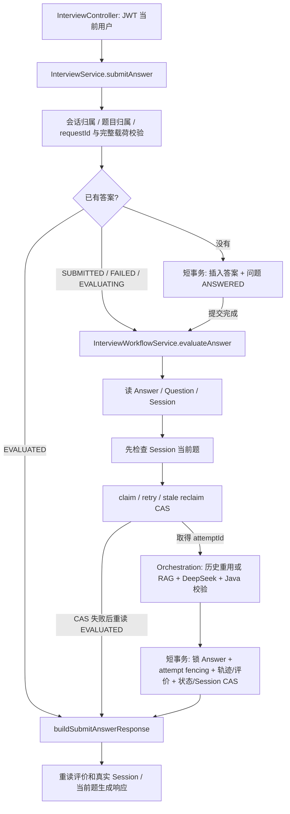
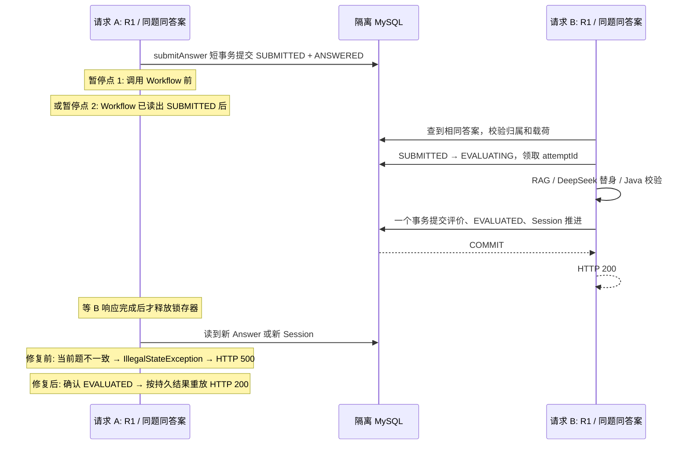

# B1：并发幂等重放边界修复与源码学习报告

执行日期：2026-11-11（Asia/Shanghai）。B1 已编码、编译并通过定向测试、真实隔离 MySQL 验证及完整普通回归；未暂存、未 commit、未 push、未合并 PR。

报告绝对路径：`/Users/kun/Developer/projects/ai-interview-system/docs/verification/B1_CONCURRENT_IDEMPOTENT_REPLAY_20261111.md`。

## 1. 基线、J1 验收与修改范围

### Git 与 J1 验收

- 分支：`main`；实际 HEAD：`afbd1c5ab010f3a0a296e15e25c016f81eb2b74f`。本轮不访问远端、不更改提交历史，不把本地状态描述为新代码已发布。
- 已阅读仓库 `AGENTS.md`、J1 报告 `docs/verification/JEV_REMOVAL_DEEPSEEK_ONLY_20261111.md`、相关生产代码、Mapper XML、事务及并发测试，并检查工作区 diff。
- 开始时有 **58 个未提交路径**，包含 J1 的实现删除、配置/工具/测试/文档调整，以及更早的 `mvnw` 可执行位、密码并发测试诊断 SQL 和未跟踪的 `compose.mac.local.yaml`。本轮不处理这些改动；对初始文件内容计算 SHA-256，删除路径记录为不存在，结束复核 58 项均未被本轮更改。未执行 reset、clean、checkout、stash 或覆盖用户文件。
- J1 的生产删除限于 `JudgeProperties` 和 `judge/jev/` 专属实现；`JudgeConfiguration` 仅装配 DeepSeek，生产 YAML 删除旧 selector。DeepSeek 客户端、JudgeProvider 公共接口、校验/算分/追问、RAG、Workflow 事务和 Mapper 等公共业务代码保留。
- 复核 J1 的原始 Surefire XML，而非仅引用报告摘要：改前 **1790 / 0 / 0 / 19**，改后 **1526 / 0 / 0 / 19**。逐类核对为：删除 10 个 Jev 专属测试类共 246 项；`JudgeConfigurationTest` 从 34 改为 7，净减 27；`FullInterviewBusinessOfflineTest` 从 76 改为 85，净增 9。即 **1790 − 246 − 27 + 9 = 1526**，没有其他测试类数量差异。
- 覆盖迁移有依据：退役协议、预算、代理、分数映射、Jev 反馈组合和跨模型 fallback 随实现删除；DeepSeek 的五维输入边界仍保留并扩大非法类型覆盖。历史 `jev-*` 模型/Prompt 元数据与 opaque `raw_result` 通过历史 FINAL/FOLLOW_UP、详情、API 重放和 Orchestration 重用测试验证，无强制反序列化成 DeepSeek DTO。
- J1 367 项聚焦、1526 项完整回归及工具/打包记录已核对；这是 J1 历史验证记录，不计为 B1 新执行的测试。B1 的新回归再次运行了公共业务和历史兼容测试。
- **J1 无阻断 B1 的问题**。J1 已标注的并发重放问题进入本批；claim 后查询异常保护范围（B2）、报告 FINAL-only（B3）继续保留；B4 自动重试/退避/限流不在本批实现。

### 本轮文件及原因

修改：

1. `/Users/kun/Developer/projects/ai-interview-system/src/main/java/com/kun/aiinterview/interview/service/InterviewWorkflowService.java`：新增 10 行，两处只读完成判断。首次加载已完成答案直接走重放；会话指针不匹配时重读答案，确认并发完成后走重放。
2. `/Users/kun/Developer/projects/ai-interview-system/src/test/java/com/kun/aiinterview/interview/service/InterviewWorkflowServiceTest.java`：将原“首次 EVALUATED 必须拒绝”用例更新为本批明确要求的重放契约；新增 3 个旧状态快照完成重读用例及 2 个重读身份/缺失错误用例。保留不合法当前题、fresh/stale、FAILED、CAS 和所有转移断言。

新增：

3. `/Users/kun/Developer/projects/ai-interview-system/src/test/java/com/kun/aiinterview/interview/service/InterviewConcurrentReplayIntegrationTest.java`：18 项真实 MySQL + MockMvc 测试；没有外围测试事务，保留真实 Service、事务代理、Orchestration、MyBatis XML 与安全链，仅替换外部依赖及测试同步入口。
4. `/Users/kun/Developer/projects/ai-interview-system/docs/verification/B1_CONCURRENT_IDEMPOTENT_REPLAY_20261111.md`：本报告、验证证据和学习路径。

不改 Schema、依赖、API、Mapper SQL、事务写入、失败恢复和 J1 文件。`InterviewService` 与 Controller 的现有身份校验和响应重建足以承接修复，不需要修改。

## 2. 问题、调用链与可达性

### 修复前真实调用链



`InterviewService.submitAnswer` 不带事务。新答案由事务代理 `InterviewWorkflowTransactionService.submitAnswer` 插入，并把题目改为 ANSWERED；该事务提交后才调用 Workflow。因此，A 在这两个调用之间被调度暂停时，B 能从另一连接看到已经提交的 SUBMITTED 答案，且可领取评价资格。这是实际生产调用顺序允许的窗口。

### 已固定并复现的两种交错



两处暂停点各覆盖 `MAIN → FOLLOW_UP`、`MAIN → NEXT_MAIN`、`MAIN → FINISH`、`FOLLOW_UP → NEXT_MAIN`、`FOLLOW_UP → FINISH`，共 10 项。FINISH 将当前题设为 null；FOLLOW_UP/NEXT_MAIN 将指针移至另一题，都能触发旧顺序中的错误。

测试使用请求 A 的 ThreadLocal 标记及两个 CountDownLatch，只暂停指定线程。主测试线程在观察到 A 的答案已提交为 SUBMITTED 后发起 B；等待 B 的 HTTP 200 和数据库最终状态断言完成，再释放 A。没有用 Thread.sleep 制造竞争，没有生产测试 Hook，也没有外围 `@Transactional` 隐藏跨请求提交。

第二同步点通过同一个 `SqlSessionTemplate` 执行 `InterviewAnswerMapper.getInterviewAnswerById` 对应的真实 XML SELECT，再延迟返回该快照；没有伪造数据库状态。首次夹具尝试对 MyBatis JDK 代理使用 `callRealMethod()` 不适用，已单独记录并修正。

### 根因与修复前证据

1. Workflow 的 Session 当前题检查先于完成重放，已完成的正常并发请求被当成当前题不一致的内部错误。
2. 首次读到 EVALUATED 与 CAS 失败后读到 EVALUATED 的处理不对称：后者已有 `EvaluationClaim.REPLAY`，前者没有专用入口，原单测甚至显式要求拒绝该状态。实际复现中，Session 当前题检查先报错，遮住了后续状态拒绝分支。
3. 仅加首次 EVALUATED 判断不够：A 可以持有旧 SUBMITTED 快照，而后续 Session SELECT 已看到 B 提交的新指针，需要在该边界重读 Answer。

修正夹具且未修改生产代码的正式复现：**16 tests / 10 failures / 0 errors / 0 skipped，退出 1**。10 项均为期望 200、实际 500；日志对应 `IllegalStateException: 当前Answer不属于Session正在处理的问题`。失败发生前已经断言 B 的答案 EVALUATED、有效评价和检索批次各一份、Session version 仅递增一次、当前题/完成计数符合转移规则。因此这是数据库已成功但 A 收到 500 的业务缺陷，不是数据库连接或模型网络失败。

### 最小修复及取舍

- 在已校验 answerId 和题目标识后，首次 EVALUATED 直接返回既有重放信号 `null`；调用方 `InterviewService` 本来就不使用 Workflow 返回值，而是重新查询持久评价和当前 Session 构建响应。未引入新的返回类型或 API 契约。
- 当前题不一致时，只追加一次 `requireReloadedAnswer`。该方法检查答案存在且 ID 一致；只有实际 EVALUATED 才重放，否则保留原 IllegalStateException。无循环、无泛化异常捕获。
- 保留正常路径的原有读取/领取顺序，避免“为了判断是否完成而先 claim”导致不合法当前题先被改为 EVALUATING；未扩大 claim 后异常保护范围。
- 不添加长事务或 SELECT FOR UPDATE 包裹模型调用，不采用 JVM synchronized、全局锁、Redis 锁或任意重试，也不把所有冲突/异常都变成成功。

## 3. 实际测试与环境

### 环境及证据保存

- 实测 macOS 26.7.1 / ARM64，Temurin Java 21.0.13，项目 Maven Wrapper。采用 macOS 的 `sh mvnw`，不使用 Windows `.cmd`。
- 临时容器 `ai-interview-b1-20261111-mysql`，本地已有 MySQL **8.0.45** 镜像；只暴露 `127.0.0.1:13319`，数据位于本次临时内存目录。
- JDBC 目标：`jdbc:mysql://127.0.0.1:13319/ai_interview_test?useUnicode=true&characterEncoding=utf8&serverTimezone=Asia/Shanghai`；MySQL 全局时区 `+08:00`。DDL 只在临时副本替换建库/USE 目标，项目 Schema 未改。数据库清单只有 `ai_interview_test` 和 MySQL 系统库。
- 没有读取/复制真实 API key、JWT secret 或正式数据库凭据。测试进程仅注入本轮临时 DB_* / TEST_DB_*，先移除继承的 RUN_REAL_*、SPRING_*、MILVUS_*、DEEPSEEK_*、JEV_*、AI_JUDGE_* 及 JVM/Maven 覆盖。保留 EnvironmentIsolationInitializer、test 隔离配置及 Smoke 双层门禁。
- 新并发测试显式启用业务 Bean，并 Mock DeepSeekEvaluationClient、EmbeddingClient、VectorStoreClient、MilvusClientV2、MilvusCollectionInitializer；真实 DeepSeekJudgeProvider、Orchestration、Java 校验和事务仍执行。断言外部替身调用时没有活跃数据库事务。
- 测试证据目录：`/tmp/ai-b1-20261111/`。每次 Maven 调用前归档上次 Surefire 报告，本次 XML 单独复制，计数只属于当次运行。`run_maven.py` 是临时执行器，不是项目新增工具；临时凭据已删除，重跑时需重新准备隔离连接。
- 初次 Docker 检查被普通沙箱拒绝，获准使用本机 Docker 后成功。初始化探测曾在镜像临时启动阶段过早返回，第一次导入未建表；确认目标库为空后重新导入成功。这两项是环境准备问题，不是 Maven 失败或代码回归。

### 命令与结果

以下数字依次为 **Tests / Failures / Errors / Skipped**；退出码另列。所有 Maven 命令均在上述净化后的临时测试进程运行。

1. **初版夹具，生产未改**：

   `sh mvnw -B -ntp -Dtest=InterviewConcurrentReplayIntegrationTest test`

   **16 / 10 / 0 / 0，退出 1**。其中 5 项确认业务 500，另 5 项因 MyBatis 代理不能调用抽象 real method 而未到达暂停点；后 5 项不作为缺陷证据。日志 `reproduction-before.log`、XML `reproduction-before-reports/`。

2. **修正夹具后的正式改前复现，生产仍未改**：相同命令。

   **16 / 10 / 0 / 0，退出 1**。全部 10 项均在数据库成功后的 HTTP 200 断言处发现实际 500。其余 6 项（fresh 409、载荷/身份边界）通过。日志 `reproduction-confirmed.log`、XML `reproduction-confirmed-reports/`。

3. **最小修复后的首次定向回归**：

   `sh mvnw -B -ntp -Dtest=InterviewConcurrentReplayIntegrationTest,InterviewWorkflowServiceTest test`

   **50 / 0 / 0 / 0，退出 0**。当时新集成测试为 16 项、Workflow 单测为 34 项。之后新增了“更早答案重放最新已完成 Session”和“完成标记缺评价仍报错”两个边界测试。日志 `focused-replay.log`、XML `focused-replay-reports/`。

4. **最终相关业务、接口、真实 MySQL 事务/并发回归**：

   ```text
   sh mvnw -B -ntp -Dtest=InterviewConcurrentReplayIntegrationTest,InterviewServiceTest,InterviewWorkflowServiceTest,InterviewWorkflowTransactionServiceTest,InterviewWorkflowTransactionServiceIntegrationTest,InterviewEvaluationClaimConcurrencyIntegrationTest,InterviewControllerTest,EvaluationOrchestrationServiceTest,StaleRecoveryCasIntegrationTest,InterviewAnswerMapperTest,InterviewSessionMapperTest,FullInterviewBusinessOfflineTest,JudgeConfigurationTest,DeepSeekJudgeProviderTest test
   ```

   **286 / 0 / 0 / 0，退出 0**。按类计数：新并发集成 18；InterviewService 31；Workflow 34；WorkflowTransaction 单测 34、集成 6；既有评价并发 11；Controller 16；Orchestration 20；StaleRecoveryCas 集成 3；AnswerMapper 6；SessionMapper 14；FullInterviewBusinessOffline 85；JudgeConfiguration 7；DeepSeekJudgeProvider 1。日志 `focused-business.log`、XML `focused-business-reports/`。

5. **完整普通回归**：

   `sh mvnw -B -ntp test`

   **1549 / 0 / 0 / 19，退出 0，BUILD SUCCESS**。相对 J1 的 1526 项增加新集成 18 项和 Workflow 单测净增 5 项，合计 1549。日志 `full-regression.log`、XML `full-regression-reports/`。编译随 Maven test 完成；本轮未单独执行 package，不把编译或历史打包描述为本次功能验证。

6. **差异和保全检查**：`git diff --check` **退出 0**，测试计数不适用；初始 58 个改动路径 SHA-256/删除状态复核 **0 项异常变化**。证据 `initial-hashes.json`、`preservation-check.json`。

19 个跳过项实际为：KnowledgePersistenceIntegrationTest 10；RealEmbeddingSmokeTest 1；RealMilvusVectorStoreSmokeTest 1；RealKnowledgeDocumentProcessingSmokeTest 2；RealKnowledgeDocumentProcessingFailureIntegrationTest 2；RealMilvusSchemaValidationSmokeTest 2；AiSystemBaselineEvaluationTest 1。

**未执行**真实 DeepSeek、Bailian Embedding、Milvus Smoke、AI baseline 及真实模型效果/费用实验。跳过符合普通回归门禁，不是这些服务验证成功。真实 MySQL Mapper/事务/并发已执行，不能与外部模型 Mock 混称。

全部验证结束后，B1 自建用户及题库 fixture 残留计数均为 0；停止本轮临时 MySQL 容器并删除临时凭据，未操作其他容器、正式数据库、既有数据卷或历史验证报告。证据 `database-final-check.txt`、`cleanup.json`。

## 4. 修复后正确性与覆盖边界

- **单次正常回答**：新测试中每个 B、前置追问和顺序回答均经过真实业务全链；既有 Service/Workflow/Controller 与 FullInterviewBusinessOffline 回归继续通过。
- **同请求并发完成重放**：10 个确定性交错中，A/B 都返回 HTTP 200 且响应相同；额外重放仍成功。评价整行、Session 整行在 A 恢复前后完全相同。Answer、有效 Evaluation、RAG batch 数量不增加，DeepSeek/Embedding/向量查询调用次数不增加。
- **只提交一次、只推进一次**：数据库 `UNIQUE(request_id)`、`UNIQUE(interview_question_id)`、`UNIQUE(answer_id)` 原样保留。完成事务先锁答案并检查 attemptId，再写轨迹/评价、答案 EVALUATED 和 Session version/current-question CAS；任一步失败整体回滚。MAIN→FOLLOW_UP 只加 version，不加 completed count；NEXT_MAIN/FINISH 各加一次主问题完成数。
- **fresh EVALUATING**：模型替身被锁存器阻塞期间，第二请求为 HTTP 409；有效评价为 0、Session version 为 0、模型调用数为 1。释放后首次请求成功，没有第二次模型调用。
- **FAILED / stale / 旧任务**：既有真实并发测试继续验证 FAILED 领取、新 attemptId、stale 单胜者接管、旧任务迟到成功/失败与新任务先完成/后完成的四种交错；不能提交旧评价、旧轨迹或覆盖新失败状态。新修复不改变这些 CAS/锁/fencing SQL。
- **不同载荷或其他用户**：相同 requestId 改答案、换题为 409；不同 requestId 竞争已回答题为 409，既有同时插入测试也保留；其他用户 404、无 token 401。归属和完整载荷校验均位于 Workflow 之前，响应重建再次校验 Session 归属。无法以已完成标记绕过授权。
- **全部状态转移**：10 个交错覆盖五条 MAIN/FOLLOW_UP 路径。顺序补充测试完成下一主问题后，再重放早先答案，保留早先评价与 `nextAction=NEXT_MAIN`，同时返回最新 `sessionStatus=COMPLETED`、`nextQuestion=null`，与现有 API 契约一致。
- **真实错误不伪装成功**：Session 不匹配且答案未完成仍报原错误；重读答案不存在或 ID 错误仍报错；测试人为删除本 fixture 的评价行后，重放仍为 500，且不再次调用模型或推进 Session。

这证明了上述受控交错及原有回归的正确性，不宣称穷尽所有线程交错，也不承诺外部模型 exactly-once。stale 接管仍可能发生第二次外部调用，最终写入资格由 attemptId 约束。本轮没有解决 B2/B3/B4，未扩大开发阶段。

## 5. 约 15 分钟源码学习路径

以下路径均相对于 `/Users/kun/Developer/projects/ai-interview-system/`；可结合本报告调用链阅读。

1. **0～2 分钟：HTTP 与身份边界。** `src/main/java/com/kun/aiinterview/interview/controller/InterviewController.java` 的 `submitAnswer`；再读 `.../service/InterviewService.java:223`、`handleExistingAnswer:415`。用户 ID 由认证上下文提供，先校验会话/题目归属与 requestId 对应的完整 payload，再决定重放或执行。理解为什么不能只凭 requestId 返回结果。
2. **2～4 分钟：答案提交与竞争窗口。** `.../service/InterviewWorkflowTransactionService.java:35` 的 `submitAnswer`；对照 `InterviewService.java:295`。事务先插答案并更新题目，提交后才进入 Workflow。正因为模型调用不占用提交事务，另一个请求可看到 SUBMITTED 并抢先执行。
3. **4～7 分钟：本批两处判断与现有 CAS。** `.../service/InterviewWorkflowService.java:48` 的 `evaluateAnswer`，重点看 78 行的首次 EVALUATED、126 行的错题重读，再读 `claimOrRecoverEvaluation`、`resolveLostEvaluationClaim`、`recoverStaleEvaluating`。首次、快照过期、CAS 失败都是可能观察到完成的入口；只有明确已完成才重放，fresh 仍 409。
4. **7～10 分钟：数据库保证什么。** `src/main/resources/mapper/InterviewAnswerMapper.xml` 的 `claimEvaluation`、`retryEvaluation`、`reclaimStaleEvaluating`、`lockById`、`markEvaluated`、`markFailed`；`InterviewSessionMapper.xml:28` 起的三个推进 SQL；`sql/ai_interview.sql:297`、300、357 的三个唯一约束。SQL 的唯一约束防重复记录，attemptId 防旧任务写入，Session CAS 防重复推进，它们职责不同。
5. **10～12 分钟：原子提交与结果重建。** `InterviewWorkflowTransactionService.java:390` 的 `persistOwnedEvaluation`，向上读三个 `@Transactional` 推进方法；再读 `InterviewService.java:532` 的 `buildSubmitAnswerResponse`。评价、轨迹、答案完成和 Session 推进在同一个短事务中提交；响应读取持久评价及最新会话，不从旧决策猜当前题。完成重放的 `null` 是既有 Workflow 内部信号，不是 HTTP 空成功数据。
6. **12～15 分钟：阅读确定性测试。** `src/test/java/com/kun/aiinterview/interview/service/InterviewConcurrentReplayIntegrationTest.java:117`，再看 `pauseFirstRequest:252`、`assertCompletedState:315`。找出 A 提交、暂停、B 完成、数据库断言、释放 A 的顺序；确认没有测试外围事务。最后看既有 `InterviewEvaluationClaimConcurrencyIntegrationTest.staleWorkerCannotSaveEvaluationOrFailReplacement`，理解为什么重放成功不能替代旧 attempt 的写入资格检查。

正常业务竞争有可解释的结果：已完成则重放，正在执行则受控 409。将“另一个请求先完成”当成 500，会使客户端误以为提交失败，并可能触发多余重试。反过来，评价行缺失、身份错配等持久状态异常也不能随意伪装成成功。

### 四道 Java 后端面试追问

1. **已有 requestId 唯一索引，为什么还需要幂等重放逻辑？**

   唯一索引只能阻止重复插入，不能定义重复请求应该返回什么，也不能避免第一次请求尚未进入 Workflow 时被另一请求抢先完成。业务层需校验同一请求的题目和完整载荷，再复用持久结果。

2. **为何在 Session 当前题不匹配时重新读 Answer，而不直接返回成功？**

   不匹配既可能来自合法并发完成，也可能是业务状态错误。新的 Answer 查询只有明确读到 EVALUATED 才提供重放依据；未完成仍保留错误，评价行缺失也由响应构建继续检查。

3. **Session version CAS 和 attemptId fencing 有什么区别？**

   Session CAS 约束会话预期版本和当前问题，避免重复推进；attemptId 标识本次执行资格，防 stale 接管前的旧任务提交迟到评价或回写 FAILED。两个维度不能相互替代，最终短事务需同时满足。

4. **如何确定并发测试真覆盖了指定竞态，而非碰巧通过？**

   在可达依赖边界放测试专用锁存器，先确认 A 的提交可见，再让 B 完成并断言数据库最终状态，最后放行 A。采用独立线程和真实事务代理、无外围事务；对数据库数量、version、当前题、HTTP 结果及模型调用数联合断言。sleep 只能改变概率，不能证明交错顺序。

## 6. 交付状态与下一步

B1 最小修复和验证已完成，工作区保留本轮 4 个文件变化及全部既有修改，无新增提交或推送。未发现本批阻断项；已知 B2、B3、B4 继续作为后续独立任务，不在本批修复。下一步由用户审阅本报告和 diff，等待下一批明确授权；本轮不自动提交或开展后续阶段。
